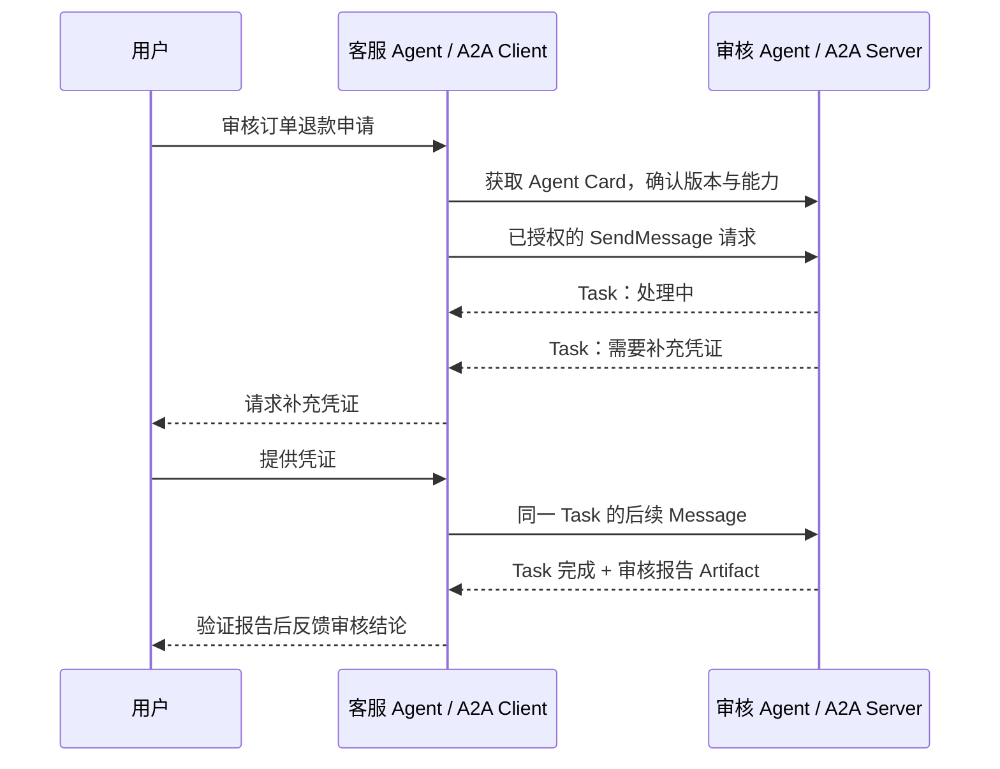

# A2A 智能体协作协议

<span class="dig-tag dig-tag--category">AI 技术</span>

::: tip 核心要点
A2A（Agent2Agent）让**独立、内部实现可以不透明的 Agent 系统**发现能力、交换消息、跟踪任务并交付产物。记住四个对象：Agent Card 声明能力，Message 交换信息，Task 管理任务，Artifact 承载结果。它不要求共享内部 Prompt、思维过程或工具实现。
:::

本文以 [A2A 1.0.0 规范](https://a2a-protocol.org/v1.0.0/specification) 为版本基线，协议版本声明使用 `1.0`。接入时应核对所选绑定和 SDK，不能直接拼接不同版本的示例。

## 为什么不是再写一个工具函数

客服 Agent 可以直接调用 `get_order_status`，因为它知道输入、输出以及后续怎么处理。但如果需要另一个团队运营的退款审核 Agent，事情会不同：审核可能持续数分钟、需要补充凭证、等待人工批准，最后交付审核报告。

A2A 为这种远程协作提供共同语言。调用方说清目标与约束，远程 Agent 自己决定内部步骤；调用方关心进度、是否需要补充信息以及结果是否满足约定。

| 场景 | 更自然的选择 |
|------|----------------|
| 同一进程内调用一个专家 Agent | SDK 的 Agent-as-tool 或 Handoff |
| 连接可复用的订单查询能力 | [MCP](./mcp) 或已有业务 API |
| 与独立部署的审核 Agent 协作 | A2A，前提是双方需要它的任务与互操作契约 |
| 输入输出固定、已有稳定服务接口 | 普通 RPC / HTTP API，不必额外包装 Agent |

## 从发现到交付



这里的审核通过**不意味着退款已经执行**。审核和资金操作是两个业务动作；是否允许执行退款要单独授权，不能从报告中的一句“通过”推导出来。

## Agent Card 与 AgentSkill {#agent-card}

Agent Card 是服务能力说明书，可通过 `/.well-known/agent-card.json`、受信目录或直接配置发现。它不是中央注册中心，也不是可信身份证明；客户端仍需验证来源和认证要求。

下面是用于说明字段关系的无鉴权演示 Card，不代表生产服务配置：

```json
{
  "name": "RefundReviewAgent",
  "description": "Review refund eligibility and return an assessment, without issuing refunds.",
  "version": "1.0.0",
  "supportedInterfaces": [
    {
      "url": "https://review.example.com/a2a",
      "protocolBinding": "HTTP+JSON",
      "protocolVersion": "1.0"
    }
  ],
  "capabilities": { "streaming": true, "pushNotifications": false },
  "defaultInputModes": ["text/plain"],
  "defaultOutputModes": ["application/json"],
  "skills": [
    {
      "id": "refund-review",
      "name": "Refund eligibility review",
      "description": "Assess evidence and policy; request missing information when necessary.",
      "tags": ["orders", "refunds", "review"],
      "examples": ["Review the refund request for order A123."]
    }
  ]
}
```

| 字段 | 需要理解的边界 |
|------|----------------|
| `version` | Agent 自身的发布版本，不是协议版本 |
| `supportedInterfaces` | 接口地址、绑定与协议版本；客户端选择兼容项 |
| `capabilities` | 流式、推送等可选能力，不能假设全部支持 |
| `skills` | `AgentSkill` 能力描述，帮助路由；不是可下载的 `SKILL.md` |
| 输入/输出媒体类型 | 表示能接收什么格式，不保证业务字段或答案正确 |

生产 Card 还要按所选规范声明安全方案和安全要求；不能把访问 token 放到公开 Card。读取 Card 只完成发现，不构成对任务、数据或副作用的授权。

## Message、Task 与 Artifact

| 对象 | 用来做什么 | 不是什么 |
|------|------------|----------|
| **Message** | 发起任务、澄清问题、补充输入 | 可靠的业务事件日志 |
| **Part** | Message / Artifact 中的文本、文件或结构化数据单元 | 隐含的工具执行指令 |
| **Task** | 跟踪一项工作的状态、历史和产物 | 一条必须持续在线的 HTTP 连接 |
| **Artifact** | 交付报告、文件、结构化结果，可分块更新 | “已完成”这类进度描述 |
| **contextId** | 关联相关任务与消息 | 跨系统共享全部记忆或授予权限的凭据 |

简单交互可以直接返回 Message，不必创建 Task。需要长任务管理时，客户端保存 Server 返回的任务 ID；后续输入引用已有 Task，不能自己编造任务 ID 来创建任务。

### 任务状态与恢复 {#task-lifecycle}

以下使用 A2A 1.0 的状态名；不是所有任务都会经过每个状态：

<div role="region" aria-label="A2A 任务状态对照表" tabindex="0" style="overflow-x: auto;">

| 状态 | 含义 | 客户端动作 |
|------|------|------------|
| `TASK_STATE_SUBMITTED` / `TASK_STATE_WORKING` | 已受理 / 处理中 | 按约定查询或接收进度 |
| `TASK_STATE_INPUT_REQUIRED` | 缺少业务输入 | 收集信息，向同一 Task 发送后续消息 |
| `TASK_STATE_AUTH_REQUIRED` | 需要额外认证或授权 | 走受控授权渠道，不把密钥塞进模型上下文 |
| `TASK_STATE_COMPLETED` | 远程任务完成 | 获取并验证 Artifact，不直接等同于业务验收通过 |
| `TASK_STATE_FAILED` / `TASK_STATE_REJECTED` | 执行失败 / 拒绝执行 | 区分暂时性故障与策略拒绝 |
| `TASK_STATE_CANCELED` | 已取消 | 确认已发生副作用；取消不是回滚 |

</div>

完成、失败、拒绝和取消是终态，不能继续向同一 Task 填消息让它“重新开始”。需要后续工作时创建新任务，并按协议关联既有上下文或相关任务。

**断线不等于失败**：流断开时先查询 Task 当前状态，再决定是否重新订阅；不要直接重新提交相同任务。`messageId` 可用于实现去重，但不能假设所有 Server 都自动保证发送幂等，更不能据此承诺“恰好执行一次”。

## 绑定与更新机制

A2A 1.0 定义 JSON-RPC、gRPC、HTTP+JSON 绑定。它们映射同一组核心对象和操作，不代表每个 Server 都实现三种绑定。

| 更新方式 | 适合什么情况 | 需要处理什么 |
|----------|--------------|----------------|
| **轮询 GetTask** | 更新不频繁、网络限制较多 | 查询间隔、退避、终态停止与任务过期 |
| **流式更新** | 交互式展示进度和产物分块 | 声明 streaming 能力；断流后查询与恢复 |
| **Webhook 推送** | 服务间长任务，客户端不保持连接 | 声明 push 能力；回调认证、去重和状态补查 |

请求是等待结果还是立即返回，应按所选版本与调用配置处理，不把所有 SendMessage 都当成固定的异步作业接口。HTTP 绑定使用 `A2A-Version: 1.0` 等服务参数；JSON-RPC 和 HTTP+JSON 的包裹结构、方法名及内容类型不能混写。

Artifact 最后一块到达也不必然表示整个 Task 完成：任务可能有多个产物。消费方要同时看任务状态和产物完整性，并防止重复事件造成重复追加。

## 跨系统的信任边界

委派的是工作，不是无条件转交用户全部权限。A2A Client 和 Server 都必须知道“代表谁、在什么范围内、允许什么操作”。

- **逐请求授权**：查询、订阅、取消 Task 和下载产物都要校验身份与租户，知道任务 ID 不等于有访问权。
- **授权绑定具体动作**：`AUTH_REQUIRED` 只是信号。授权范围、有效期、参数与撤销由应用或扩展定义，不能把一次批准用于后续任意消息。
- **回调防护**：验证 Webhook 来源和预期任务；发送端限制回调 URL、解析后的 IP 与重定向，防止 SSRF。
- **产物也不可信**：检查 Schema、证据来源和文件类型；报告中的新指令不能提升为用户要求。
- **凭据不随对话传播**：按受众和最小权限获取凭据，通过安全渠道传输，日志脱敏。
- **限制递归委派**：超时、总预算和委派深度由各方运行时落实，避免互相转派形成循环。

## 与 Skills、MCP、Harness 怎样组合

退款审核 Agent 可以在内部加载退款审核 Skill，利用 MCP 读取订单与政策，再把审核报告通过 A2A 交还客服 Agent。两端的 Harness 分别控制执行、权限、检查点和验证。

```text
客服 Agent 的 Harness
  -> A2A：委派审核任务、跟踪 Task、接收 Artifact
       -> 审核 Agent 的 Harness
            -> Skills：审核步骤与证据要求
            -> MCP：订单工具与政策资源
            -> 验证并交付报告
```

这些依赖都不是强制的。远程 Agent 完全可以不用 Skills、不用 MCP，仍然实现合规的 A2A 接口。选择协议的依据是边界与契约，不是把所有流行名词串起来。

## 面试追问

**Q：A2A 和多 Agent 是同一件事吗？**

不是。多 Agent 是系统组织方式；A2A 是独立 Agent 系统之间的互操作协议。同一 SDK 中的 Handoff 并不自动使用 A2A。

**Q：远程 Agent 回答“处理成功”，可以结束了吗？**

先检查返回的是 Message 还是 Task；有 Task 时核对终态与 Artifact，再按业务验收条件验证。需要写入的动作还要确认外部系统状态，不能只相信自然语言描述。

**Q：任务超时后能重发吗？**

先区分网络超时与任务失败，使用已有任务 ID 查询；只有理解去重、幂等和副作用状态后才重试。无法确认的敏感操作要人工核实。

## 延伸阅读

- [A2A 官方规范与版本入口](https://a2a-protocol.org/latest/specification/)
- [A2A 与 MCP 的官方对比](https://a2a-protocol.org/latest/topics/a2a-and-mcp/)
- [AI Agent 基本概念](./ai-agents)
- [Agent Skills 编写指南](./ai-agent-skills)
- [Harness Engineering](./harness-engineering)