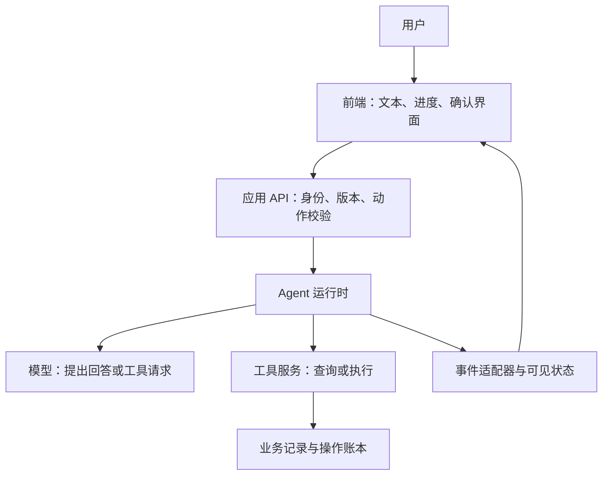

# Agent 交互与生成式 UI

<span class="dig-tag dig-tag--category">AI 技术</span>

::: tip 核心要点
Agent 的界面不是一个更长的聊天框。用户需要知道它正在查询还是执行、哪些信息仍是草稿、什么时候必须确认，以及断线后任务是否还在继续。**事件协议传递过程，界面协议表达交互，业务后端决定权限和真实结果**，三者不能互相代替。
:::

## 为什么只显示文字流不够

一个售后助手收到“帮我看看这笔订单能退多少钱”。它查询订单、读取政策、生成退款建议，再等待用户确认。如果界面只有逐字输出，用户可能把“预计退款 128 元”理解为“已经退款”，也可能在网络断开后重复点击提交。

产品至少要分开显示三种东西：**解释文本、运行进度、可执行操作**。进度应来自运行时事件；金额和订单状态应来自业务系统；操作必须绑定具体对象和版本，而不是从聊天文本中解析“同意”就执行。

## AG-UI、A2UI、MCP Apps 各管什么 {#protocol-boundaries}

| 机制 | 主要职责 | 不替你解决什么 |
|------|----------|----------------|
| **AG-UI** | Agent 与用户界面之间的事件、消息和状态交互 | 业务持久化、幂等执行与权限判定 |
| **A2UI** | 用声明式消息描述组件、数据绑定和用户动作 | 传输可靠性、业务授权与任意代码安全 |
| **MCP Apps** | 在支持该扩展的 MCP 宿主中展示交互界面并与宿主通信 | 所有 MCP 客户端的兼容性，以及工具调用的业务合法性 |

AG-UI 的事件流可以承载 A2UI 消息，但不要求所有应用都使用 A2UI。MCP Apps 适合把已有工具的表单、图表或预览嵌入宿主，也不要求你的整个产品改成 MCP 客户端。[A2A](./a2a) 面向独立 Agent 系统间的协作，不是 A2UI 的缩写。

**选择从产品边界出发**：自有 Web/App 要统一 Agent 事件时评估 AG-UI；希望跨端复用受控组件描述时评估 A2UI；需要在现有 MCP 宿主里提供交互工具时评估 MCP Apps。固定业务表单配普通 API 已经足够时，不必为了“生成式”而增加协议层。



这是一种自有应用的组织方式，不表示三种协议必须同时安装。SSE 负责服务端向浏览器推送时，确认、取消等反向动作仍可走独立 HTTP 请求；需要真正双向流时再选择 WebSocket。

## AG-UI：让界面理解执行过程 {#ag-ui}

[AG-UI 事件文档](https://docs.ag-ui.com/concepts/events)区分运行、文本、工具调用和状态更新。对接时应固定 SDK 版本，检查所需事件是否仍为草案，不把概念页上的所有能力都当作当前客户端已实现。

- 运行开始与终止：`RUN_STARTED`、`RUN_FINISHED`、`RUN_ERROR`。
- 文本片段：`TEXT_MESSAGE_START`、`TEXT_MESSAGE_CONTENT`、`TEXT_MESSAGE_END`，按 `messageId` 聚合。
- 工具参数与结果：`TOOL_CALL_START`、`TOOL_CALL_ARGS`、`TOOL_CALL_END`、`TOOL_CALL_RESULT`，按 `toolCallId` 关联。
- 状态同步：`STATE_SNAPSHOT` 提供完整状态，`STATE_DELTA` 使用 JSON Patch 描述增量；它不是随意合并两个 JSON 对象。

下面是一个运行开始事件：

```json
{
  "type": "RUN_STARTED",
  "threadId": "support_42",
  "runId": "run_9"
}
```

`threadId` 是对话关联，`runId` 是一次运行，不应直接充当退款的业务幂等键。恢复或重试可能产生新的 run，但不能因此重复产生同一业务副作用。

### 两个容易展示错的状态

**工具参数结束不等于工具执行成功。** `TOOL_CALL_END` 可以表示调用参数已经发送完整，不能据此把退款按钮改成“已退款”。先等工具结果，再由后端核对结果中的业务状态。

**运行结束不一定意味着整个业务已完成。** 人工交互扩展可能让运行以等待输入的结果结束，再通过新运行恢复；具体字段与 SDK 支持需要核实。产品自己的任务状态应明确区分待确认、执行中、成功、失败和结果未知，不只维护一个 `loading` 布尔值。

向用户展示的是授权可见的进度、摘要和证据，不应为了“透明”而暴露内部提示词、凭据、其他用户的数据或不透明推理内容。

## A2UI：描述组件，而不是生成任意网页 {#a2ui}

A2UI 将界面结构与数据模型分离。以 [v1.0 规范](https://a2ui.org/specification/v1.0-a2ui/)为例，`createSurface` 建立界面区域，`updateComponents` 更新组件，`updateDataModel` 更新数据，`deleteSurface` 移除区域。较早版本的消息和绑定格式不能混用。

下面的 v1.0 消息创建一个退款建议预览。按钮只请求查看建议，不直接授权退款：

```json
{
  "version": "1.0",
  "createSurface": {
    "surfaceId": "refund_preview_42",
    "catalogId": "https://a2ui.org/specification/v1_0/catalogs/basic/catalog.json",
    "components": [
      {
        "id": "root",
        "component": "Column",
        "children": ["amount_label", "review_button"]
      },
      {
        "id": "amount_label",
        "component": "Text",
        "text": { "@path": "/amountLabel" }
      },
      {
        "id": "review_button",
        "component": "Button",
        "child": "review_label",
        "action": {
          "event": {
            "name": "review_proposal",
            "context": { "proposalId": { "@path": "/proposalId" } }
          }
        }
      },
      { "id": "review_label", "component": "Text", "text": "查看退款建议" }
    ],
    "dataModel": {
      "proposalId": "proposal_42",
      "amountLabel": "建议退款：128.00 元，尚未执行"
    }
  }
}
```

`catalogId` 是双方约定的目录标识，不意味着客户端应访问模型提供的任意 URL 下载组件。应使用已注册的目录和经过验证的 Renderer；客户端校验协议版本、组件类型、属性和引用关系，未知组件给出受控降级，而不是 `eval()` 或直接插入 HTML。

声明式不等于没有风险。图片和链接仍可能指向外部地址，组件可能诱导用户操作，注册函数也可能具有副作用。需要限制 URL、资源大小、组件深度、可调用函数及用户手势要求；关键确认内容由可信业务数据与固定确认组件展示，不能任由模型改写金额或动作含义。

## MCP Apps：工具界面运行在宿主内 {#mcp-apps}

[MCP Apps](https://modelcontextprotocol.io/docs/extensions/apps)把工具和 UI 资源关联起来。典型链路是：工具元数据中的 `_meta.ui.resourceUri` 指向 `ui://` 资源，宿主读取资源，并在 Web 环境中使用沙箱 iframe 渲染，再通过受控消息通道交换工具结果与交互请求。

接入优先使用官方 `@modelcontextprotocol/ext-apps` SDK 和宿主支持的桥接方式，不自行拼装一个无限权限的 `postMessage` 转发器。

- **宿主能力**：先确认客户端支持扩展、资源加载和所需方法；只支持核心 MCP 的客户端应仍能获得有用的文本或结构化结果。
- **资源边界**：CSP 声明需要访问的来源，权限声明请求额外能力，最终是否授予由宿主决定。
- **消息边界**：校验消息来源窗口、关联 ID 和消息结构，并按宿主沙箱的 origin 模型处理；不得把任意跨窗口消息直接转成工具执行。
- **业务边界**：即使调用来自可信宿主，也要在服务端验证当前用户是否能访问对应订单或执行动作。

iframe 隔离保护的是宿主页面，不会自动证明工具返回的信息正确，也不会让嵌入页面免于业务越权风险。

## 人工确认必须绑定具体提案 {#approval-contract}

“用户点过确认”不是一个可无限复用的权限。退款建议应有服务端生成的 `proposalId`、版本、订单、金额、收款对象、有效期和允许动作。身份来自认证会话，金额等关键字段从服务端提案读取，不信任前端回传的替代值。

一次确认流程可以是：

1. Agent 只创建待审核提案，后端保存版本并返回可见字段。
2. 固定确认界面从后端读取当前提案，展示金额、对象和风险；生成式预览只是入口。
3. 用户提交提案 ID、版本和明确选择，服务端重新鉴权、检查有效期和业务状态。
4. 在事务或等价并发控制下，将提案从待确认改为已接受，同时记录操作 ID 并投递执行任务。
5. 执行器按操作幂等契约执行；前端依据已确认的业务结果展示成功。

版本不匹配应要求重新确认。重复点击同一提案可返回同一操作的状态，不能再次执行。关闭窗口、停止输出或终止某次 run 都不自动回滚已发生的操作，结果未知时应展示“正在确认结果”，而不是允许用户立即重试付款。

## 断线恢复：先保证状态一致，再追加文本 {#event-recovery}

SSE 自动重连不代表服务端保留了事件，也不保证客户端不会重复拼接内容。需要为事件保留范围、游标、快照和运行归属定义明确契约：

1. 服务端只向已授权订阅者发送可见事件，并为同一 run 的公开事件流分配连续序号。
2. 重连时按游标重放，重复事件由客户端去重；出现缺口时停止应用增量并获取快照。
3. 快照必须绑定 run 和高水位序号，后续只应用该序号之后的事件，避免“拉快照期间又丢事件”。
4. 若历史已超出保留期，返回明确的重新同步结果，不把连接成功伪装成完整恢复。

### 代码：重复、缺口与旧运行事件

以下是**应用自定义的可见事件信封与 reducer**，不是 AG-UI 或 A2UI 的原生字段。协议适配器负责将事件映射到它；生产解析器、JSON Patch 与 UI Renderer 应使用成熟库。示例只处理文本与终态，不实现审批、授权或业务对账。

状态包括 `runId`、`lastSequence`、`text`、`status` 和 `needsSnapshot`；初始序号为 0。该示例约定终态之后不再产生本运行的可见增量。

```javascript
export function reduceRunEvent(state, event) {
    const statuses = ['running', 'completed', 'failed', 'cancelled'];
    const types = ['text.delta', 'run.completed', 'run.failed', 'run.cancelled'];
    if (![state.runId, event.runId].every(value =>
        typeof value === 'string' && value.trim().length > 0)
            || typeof state.text !== 'string'
            || typeof state.needsSnapshot !== 'boolean') {
        throw new TypeError('Invalid event state');
    }
    if (!Number.isSafeInteger(state.lastSequence) || state.lastSequence < 0
            || !Number.isSafeInteger(event.sequence) || event.sequence < 1
            || !statuses.includes(state.status) || !types.includes(event.type)) {
        throw new RangeError('Invalid sequence or event type');
    }
    if (event.type === 'text.delta' && typeof event.text !== 'string') {
        throw new TypeError('Text delta must be a string');
    }
    if (event.runId !== state.runId || event.sequence <= state.lastSequence
            || state.status !== 'running') {
        return { action: 'ignore', state };
    }
    if (state.needsSnapshot || event.sequence !== state.lastSequence + 1) {
        return { action: 'resync', state: { ...state, needsSnapshot: true } };
    }
    const next = { ...state, lastSequence: event.sequence };
    if (event.type === 'text.delta') {
        next.text += event.text;
    } else {
        next.status = event.type.slice('run.'.length);
    }
    return { action: 'apply', state: next };
}
```

接收序号 1 的文本后重复收到 1，不应重复拼接；直接收到 3，则保持已有文本并请求快照，即使随后收到 2，也先完成重新同步。快照安装必须重新验证运行归属和版本，再清除 `needsSnapshot`，不能由任意增量消息清除。

旧 run 的界面事件可以不再显示，但**旧 run 产生的付款、退款等业务结果不能被后端丢弃**。持久化业务恢复见 [服务端会话恢复](./context-and-memory#session-recovery)。

## 怎样验证交互确实可靠

- **协议与版本**：固定 SDK、Renderer 和组件目录版本，覆盖不支持的事件与组件，不把新字段悄悄当成功忽略。
- **状态同步**：测试重复、缺口、旧 run、快照与增量交错，以及多标签页同时操作。
- **审批**：测试过期提案、金额被篡改、版本变化、重复提交和未授权用户。
- **体验**：用户可以区分建议、等待确认、执行中和已完成；键盘与读屏能识别控件，流式更新不持续抢焦点。
- **运行证据**：同时核对界面状态、事件日志和业务操作账本，而不只截一张“成功”页面。

实现顺序可以从固定界面与受控事件开始，再按真实需求增加动态组件。不要用生成式 UI 替代所有已有表单：稳定业务流程通常更需要可预测性，探索与分析场景才更可能受益于动态组织界面。

## 面试怎么答

**Q：AG-UI、A2UI、MCP Apps 是竞争关系吗？** 不完全是。分别从事件交互、声明式界面和宿主内嵌工具 UI 解决问题，可以组合，也可以只使用一种。

**Q：模型生成的按钮为什么不能直接执行？** 按钮只是操作入口。身份、提案版本、有效期、动作权限和幂等性必须由后端验证，模型不能自己授予权限。

**Q：断线后为什么不直接重新运行 Agent？** 原任务可能仍在执行。应先恢复订阅和状态，确认未决操作，再决定是否需要新 run；新 run 不意味着新业务操作。

## 延伸阅读

- [AG-UI：协议概览](https://docs.ag-ui.com/introduction)
- [AG-UI：事件与状态](https://docs.ag-ui.com/concepts/events)
- [A2UI：v1.0 规范](https://a2ui.org/specification/v1.0-a2ui/)
- [MCP Apps：宿主交互扩展](https://modelcontextprotocol.io/docs/extensions/apps)
- [全栈 AI 实战](./ai-for-fullstack)
- [Harness Engineering](./harness-engineering)