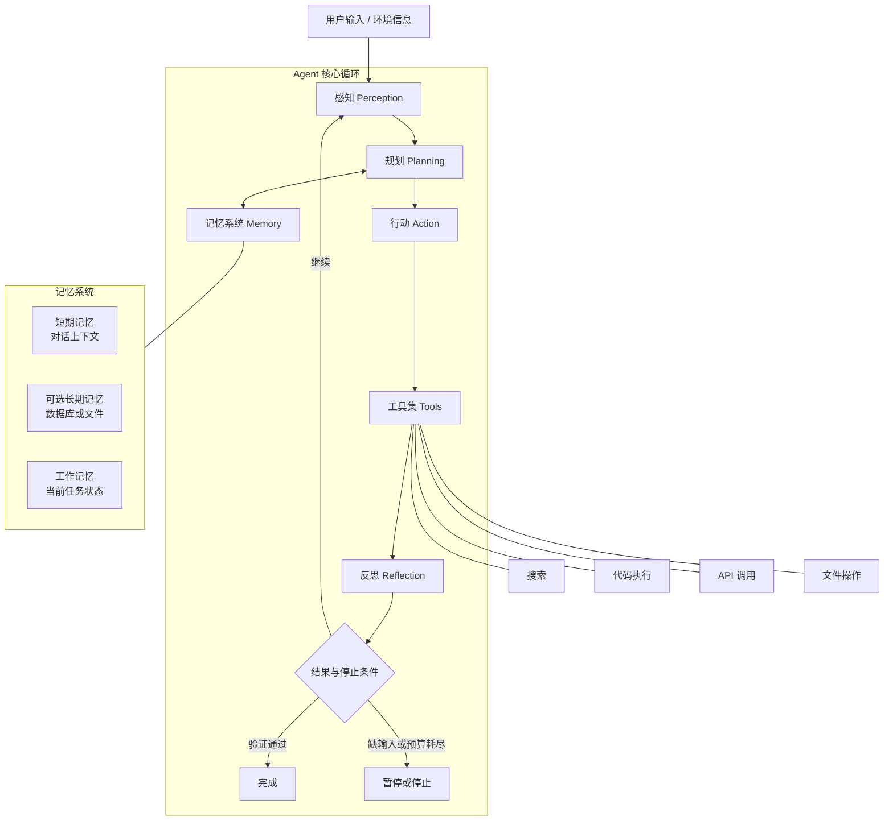

# AI Agent 基本概念 {#ai-agent-智能体}

<span class="dig-tag dig-tag--category">AI 技术</span> <span class="dig-tag dig-tag--hard">⭐⭐⭐ 高级</span> <span class="dig-tag dig-tag--hot">🔥🔥🔥 高频</span>

::: tip 💡 核心要点
AI Agent（智能体）是以大语言模型为决策核心、在环境反馈下**自主选择步骤并调用工具**的系统。最实用的定义是：**LLM 自主使用工具的循环**。它可以规划、执行和根据结果调整，但不天然具备长期记忆、可靠自纠或无限自主性；这些能力取决于外层 Harness 提供的状态、权限、验证和终止机制。步骤固定时优先使用普通工作流，不要为了“Agent 化”而增加不确定性。
:::

## 本页与进阶章节的分工

先用本页理解 Agent 如何决定下一步，再分别学习知识加载、外部连接、跨系统协作与运行时控制。它们是可组合的能力，不是搭建 Agent 必须同时安装的五个组件。

| 主题 | 回答的问题 | 阅读入口 |
|------|------------|----------|
| **AI Agent 基本概念** | 谁决定下一步？何时调用工具、何时结束？ | 本页：循环、状态、工具调用与协作模式 |
| **Agent Skills** | 特定任务该怎么做？ | [Skills 编写指南](./ai-agent-skills)：按需加载过程知识 |
| **MCP** | 应用如何连接外部工具与数据？ | [MCP 模型上下文协议](./mcp) |
| **A2A** | 如何把任务交给另一个独立 Agent？ | [A2A 智能体协作协议](./a2a) |
| **Harness Engineering** | 谁执行动作、限制权限、保存状态并验证结果？ | [Harness Engineering](./harness-engineering) |

## 什么是 AI Agent

### Agent、工作流与聊天助手

判断关键是**执行路径由谁控制**，而不是有没有聊天界面。工作流由代码预先规定步骤和分支，模型可以参与其中；Agent 则让模型在约束内根据反馈选择下一步动作。两者可以嵌套，例如固定的退款流程中，只有“查找订单异常原因”使用 Agent。

一次 Function Calling 不自动构成完整的 Agent 系统，长期记忆、多 Agent 和独立规划器也不是必选项。对于输入输出明确、合规步骤固定的任务，确定性代码通常更容易测试和审计。

### 与简单 LLM 调用的区别

简单的 LLM 调用是**一次性的输入-输出映射**——给定 Prompt，返回回答，流程即结束。而 AI Agent 是一个**持续运行的决策循环**，能够根据中间结果动态调整行为。

| 对比维度 | 简单 LLM 调用 | AI Agent |
|----------|---------------|----------|
| **交互模式** | 单轮输入→输出 | 多轮自主循环 |
| **任务复杂度** | 单步可完成的任务 | 多步骤、需规划的复杂任务 |
| **工具使用** | 无或有限 | 主动选择和调用多种工具 |
| **错误处理** | 由调用方处理 | 可根据工具错误调整；仍需确定性保护 |
| **记忆** | 仅本次调用输入 | 通常有会话状态；长期记忆是可选外部能力 |
| **自主性** | 完全被动响应 | 在授权边界内动态决定下一步 |

### 直观示例

```
简单 LLM 调用：
  用户: "帮我写一封邮件"  →  LLM: [生成邮件文本]  →  结束

AI Agent：
  用户: "帮我调研竞品 X 并写一份分析报告"
    → Agent 思考: 我需要先搜索竞品信息
    → Agent 行动: 调用搜索工具获取竞品数据
    → Agent 思考: 数据不够，我需要查看他们的定价页面
    → Agent 行动: 调用网页抓取工具获取定价信息
    → Agent 思考: 现在信息足够了，我来组织报告结构
    → Agent 行动: 生成分析报告
    → Agent 反思: 报告缺少市场份额数据，我补充一下
    → Agent 行动: 再次搜索并补充数据
    → 最终输出: 完整的竞品分析报告
```

---

## Agent 核心架构

AI Agent 可以用**观察 → 决策 → 行动 → 新观察**来理解。规划、记忆和反思是可组合能力，不一定是独立模块；每次循环还要检查是否完成、需要用户介入或已达到预算：



---

## 核心组件详解

### 规划 Planning

规划模块负责将复杂任务**分解为可执行的子步骤**，并确定执行顺序。

#### ReAct 模式

ReAct（Reasoning + Acting）是最经典的 Agent 规划模式，交替进行**推理**和**行动**：

下面是经典文本形式的教学伪代码，`llm`、工具和 `parse_action` 需要另行实现。实际系统通常使用结构化 Tool Use，不依赖字符串切分判断完成，也不要求模型输出原始思维链。

```python
def react_agent_loop(question: str, tools: dict,
                     llm, max_steps: int = 10) -> str:
    """
    ReAct Agent 核心循环。

    Args:
        question: 用户问题
        tools: 可用工具字典 {"tool_name": tool_function}
        llm: 大语言模型
        max_steps: 最大迭代步数
    Returns:
        最终回答
    """
    history = f"问题: {question}\n"

    for step in range(max_steps):
        # 让 LLM 生成下一步的思考和行动
        response = llm.generate(
            f"""{history}
请按以下格式输出下一步：
Thought: 你的思考过程
Action: 工具名称
Action Input: 工具输入参数
（如果你已经有足够信息回答，请输出：）
Thought: 我已经有足够信息
Final Answer: 最终回答"""
        )

        history += response + "\n"

        # 检查是否已得出最终答案
        if "Final Answer:" in response:
            return response.split("Final Answer:")[-1].strip()

        # 解析并执行工具调用
        action = parse_action(response)
        if action and action["tool"] in tools:
            observation = tools[action["tool"]](action["input"])
            history += f"Observation: {observation}\n"

    return "达到最大步数限制，未能得出结论。"
```

#### Plan-and-Solve 模式

先生成完整的执行计划，然后按计划逐步执行，适合有明确步骤的任务：

```python
plan_and_solve_prompt = """请为以下任务生成一个分步执行计划，
然后按照计划逐步执行。

任务: {task}

请先输出计划：
Plan:
1. [第一步]
2. [第二步]
...

然后逐步执行每一步，展示中间结果。"""
```

**两种模式对比**：

| 特性 | ReAct | Plan-and-Solve |
|------|-------|----------------|
| **规划方式** | 边推理边行动，动态调整 | 先生成完整计划再执行 |
| **灵活性** | 高——可根据中间结果调整方向 | 较低——计划一旦生成不易修改 |
| **适用场景** | 探索性任务、信息不确定 | 步骤明确、流程化任务 |
| **风险** | 可能偏离目标 | 计划可能与实际情况脱节 |

---

### 记忆 Memory

记忆帮助 Agent 保持上下文与复用历史，但并非定义 Agent 的充分或必要条件；普通聊天系统也能使用记忆。下面三类是工程上的常见划分，不是互斥的统一标准。

| 记忆类型 | 实现方式 | 存储内容 | 生命周期 |
|----------|----------|----------|----------|
| **短期记忆（Short-term）** | 对话历史（消息列表） | 当前对话的上下文 | 单次会话 |
| **长期记忆（Long-term）** | 数据库、文件或向量检索 | 经筛选的历史经验、用户偏好、知识 | 跨会话持久化 |
| **工作记忆（Working）** | 结构化状态变量 | 当前任务进度、中间结果 | 单次任务 |

下面用向量存储演示一种实现，摘要函数仅做截断示意。真实系统不应把所有旧消息自动当成长期事实，应控制写入、来源、过期、删除和用户隔离；工具调用与结果消息也要成对保留，不能按条数随意截断。

```python
class AgentMemory:
    """Agent 记忆系统实现。"""

    def __init__(self, vector_store, max_short_term: int = 20):
        self.short_term = []        # 短期记忆：对话历史
        self.working = {}           # 工作记忆：当前任务状态
        self.vector_store = vector_store  # 长期记忆：向量数据库
        self.max_short_term = max_short_term

    def add_message(self, role: str, content: str):
        """添加对话消息到短期记忆。"""
        self.short_term.append({"role": role, "content": content})
        # 超出限制时，将旧消息存入长期记忆
        if len(self.short_term) > self.max_short_term:
            old_messages = self.short_term[:5]
            summary = self._summarize(old_messages)
            self.vector_store.add(text=summary, metadata={"type": "conversation"})
            self.short_term = self.short_term[5:]

    def retrieve_relevant(self, query: str, top_k: int = 3) -> list:
        """从长期记忆中检索与当前查询相关的历史信息。"""
        return self.vector_store.similarity_search(query, top_k=top_k)

    def update_working(self, key: str, value):
        """更新工作记忆中的任务状态。"""
        self.working[key] = value

    def get_context(self, query: str) -> str:
        """组合所有记忆源，构建完整上下文。"""
        # 短期记忆
        recent = self.short_term[-10:]
        # 长期记忆（相关部分）
        long_term = self.retrieve_relevant(query)
        # 工作记忆
        working = self.working

        return self._format_context(recent, long_term, working)

    def _summarize(self, messages: list) -> str:
        """将多条消息压缩为摘要。"""
        content = "\n".join(f"{m['role']}: {m['content']}" for m in messages)
        return f"对话摘要: {content[:500]}"

    def _format_context(self, recent, long_term, working) -> str:
        """格式化组合上下文。"""
        parts = ["=== 近期对话 ==="]
        for msg in recent:
            parts.append(f"{msg['role']}: {msg['content']}")
        if long_term:
            parts.append("\n=== 相关历史经验 ===")
            for item in long_term:
                parts.append(item.text)
        if working:
            parts.append("\n=== 当前任务状态 ===")
            for k, v in working.items():
                parts.append(f"{k}: {v}")
        return "\n".join(parts)
```

---

### 工具 Tools

工具是 Agent **与外部世界交互的接口**，赋予 LLM 超越纯文本生成的能力。

| 工具类型 | 示例 | 能力扩展 |
|----------|------|----------|
| **信息检索** | Web 搜索、知识库查询、数据库查询 | 获取实时信息和私有数据 |
| **代码执行** | Python 沙箱、Shell 命令 | 精确计算、数据处理 |
| **API 调用** | REST API、第三方服务 | 连接外部系统和服务 |
| **文件操作** | 读写文件、解析 PDF/Excel | 处理各种格式文档 |
| **交互操作** | 浏览器自动化、GUI 操作 | 模拟用户操作 |

```python
# 工具定义示例
class Tool:
    """Agent 工具的基类。"""

    def __init__(self, name: str, description: str, func):
        self.name = name
        self.description = description
        self.func = func

    def run(self, input_data: str) -> str:
        """执行工具并返回结果。"""
        try:
            result = self.func(input_data)
            return f"成功: {result}"
        except Exception as e:
            return f"错误: {str(e)}"

# 注册工具
tools = [
    Tool(
        name="web_search",
        description="搜索互联网获取最新信息。输入应为搜索关键词。",
        func=lambda q: search_engine.search(q)
    ),
    Tool(
        name="python_executor",
        description="在沙箱中执行 Python 代码并返回结果。输入应为合法 Python 代码。",
        func=lambda code: sandbox.execute(code)
    ),
    Tool(
        name="file_reader",
        description="读取指定路径的文件内容。输入应为文件路径。",
        func=lambda path: open(path).read()
    ),
]
```

---

### 反思 Reflection

反思可以让 Agent 再检查一次结果，但**同一个模型的自评不是事实验证**，也不能单独保证可靠性。生产系统更应构造可观测的验证闭环：执行测试、校验 Schema、重新读取环境状态、对照权威来源或由独立 verifier 按明确 rubric 检查；失败后把可操作的证据回注，再限制次数地修复。

以代码修复为例，“模型说测试通过”不是证据；测试进程的退出码、失败用例和对应 diff 才是。失败后把这些结果反馈给 Agent，允许有限次数修复；仍未通过就报告未完成，而不是反复询问模型“现在是不是正确了”。

---

## Agent 框架对比

<div role="region" aria-label="Agent 框架对比表" tabindex="0" style="overflow-x: auto;">

| 框架 | 开发者 | 核心特点 | 适用场景 | 学习曲线 |
|------|--------|----------|----------|----------|
| **LangChain Agent** | LangChain | 生态丰富、工具集成广泛、文档齐全 | 通用 Agent 开发、快速原型 | 中等 |
| **LangGraph** | LangChain | 基于图的工作流、支持循环和状态管理 | 复杂 Agent 工作流 | 较高 |
| **AutoGPT** | Significant Gravitas | 全自主执行、目标驱动 | 探索性实验 | 低 |
| **CrewAI** | CrewAI | 多 Agent 角色扮演、任务协作 | 多 Agent 协作场景 | 中等 |
| **AutoGen** | Microsoft | AgentChat 对话抽象 + 事件驱动 Core + Extensions | 多 Agent 原型、分布式或研究型系统 | 较高 |
| **Claude Agent SDK** | Anthropic | 将 Claude Code 的 Agent Loop、内置工具、权限、Hooks、Skills、MCP 与 Subagents 作为 Python/TypeScript 库使用 | 文件/终端型 Agent、自动化 | 中等 |
| **OpenAI Agents SDK** | OpenAI | `Agent` + `Runner`、Agent-as-tool / Handoff、Guardrails、Sessions、HITL 与 Tracing | OpenAI Responses API 生态，也可接其他模型 | 中等 |
| **Dify** | Dify.AI | 可视化编排、低代码平台 | 快速搭建 AI 应用 | 低 |
| **Coze** | 字节跳动 | 可视化 Agent 构建、丰富插件生态 | 国内应用场景 | 低 |

</div>

---

## Function Calling 与工具调用

Function Calling（函数调用）是 Agent 与外部世界交互的核心能力。LLM 在生成过程中**识别需要调用外部工具的时机**，并输出结构化的调用参数。

### 工作流程

```
User Query --> LLM Decision
                  |
           +------+------+
           |             |
      Need Tools    No Tools
           |             |
    Output tool      Generate
    name + args      response
           |
    App executes
    tool call
           |
    Return result
    to LLM
           |
    LLM generates
    final response
```

### 工具定义示例

```python
# OpenAI Function Calling 格式
tools = [
    {
        "type": "function",
        "function": {
            "name": "get_weather",
            "description": "获取指定城市的当前天气信息",
            "parameters": {
                "type": "object",
                "properties": {
                    "city": {"type": "string", "description": "城市名称，如：北京"},
                    "unit": {"type": "string", "enum": ["celsius", "fahrenheit"]}
                },
                "required": ["city"]
            }
        }
    }
]

# Anthropic Claude Tool Use 格式
anthropic_tools = [
    {
        "name": "get_weather",
        "description": "获取指定城市的当前天气信息",
        "input_schema": {
            "type": "object",
            "properties": {
                "city": {"type": "string", "description": "城市名称"},
                "unit": {"type": "string", "enum": ["celsius", "fahrenheit"]}
            },
            "required": ["city"]
        }
    }
]
```

### 工具调用模式

| 模式 | 说明 | 适用场景 |
|------|------|----------|
| **串行调用** | LLM 一次请求一个工具，等待结果后继续 | 步骤有依赖关系的任务 |
| **并行调用** | LLM 一次请求多个工具，同时执行 | 独立的数据获取任务 |
| **链式调用** | 一个工具的输出作为另一个工具的输入 | 多步处理流水线 |

**关键要点**：Function Calling 的本质是让模型输出**结构化的工具调用意图**。客户端工具由你的应用执行，厂商提供的 server/hosted tools 由服务端执行；模型本身只产生调用请求和处理结果。

---

## MCP（Model Context Protocol）

MCP 标准化 AI 应用与外部能力的连接：Host 管理模型与权限，Client 实现通信，Server 提供 Tools、Resources、Prompts。模型仍通过 Function Calling 表达调用意图，应用负责适配、执行和回传结果。

例如多个助手都需要查询订单时，可以复用同一个 MCP Server；若只是本地少量函数，不必为了 Agent 化引入协议层。MCP 不替代业务授权，也不保证工具输出可信。

详见 [MCP 模型上下文协议](./mcp)：架构、完整调用流程、传输、协议版本、扩展与安全检查。

<a id="mcp-migration"></a>

原迁移说明已移至 [MCP 2026-07-28 迁移要点](./mcp#mcp-migration)。

---

## Agent Skills（技能系统）

Agent Skills 用包含 `SKILL.md` 的目录封装过程知识，可以附带脚本、参考资料和模板。宿主先披露名称与描述，匹配任务后再加载正文及所需资源，避免把全部指令一直放在上下文里。

例如“代码审查 Skill”告诉 Agent 如何读取 diff、检查风险和组织报告，但它本身不会创建新的执行主体，也不会授予写文件或推送权限。标准格式、触发设计、测试与版本管理统一在 [Agent Skills 编写指南](./ai-agent-skills) 展开。

::: tip 💡 再记一遍边界
**Skill 加知识，Tool 做动作，Subagent 开新上下文，Agent-as-tool 回结果，Handoff 交会话，A2A 跨系统。**
:::

## Harness Engineering：谁控制执行

模型建议下一步，不代表系统必须照做。Harness 负责组装上下文、加载 Skill、检查工具调用权限、执行动作、保存状态，再把真实结果回传给模型。

例如模型建议“退款并通知用户”时，Harness 应检查是否允许退款、是否需要审批、相同请求是否已执行，以及账务系统是否真的成功；模型自评“已完成”不能代替这些证据。执行循环、上下文预算、持久化恢复与安全验证详见 [Harness Engineering](./harness-engineering)。

---

## 多 Agent 系统

当单个 Agent 难以胜任复杂任务时，可以通过**多个 Agent 协作**来完成。

多 Agent 不是默认升级路径。它适合可并行探索、需要上下文隔离或不同权限/模型的任务；若子任务高度依赖同一上下文，协调、重复检索和汇总损失可能大于收益。先证明单 Agent + 好工具 + 验证闭环不够，再增加 Agent 数量。

### 协作模式

```
Pattern 1: Orchestrator-Worker

  Orchestrator ----> Agent A (Search)
       |-----------> Agent B (Analyze)
       |-----------> Agent C (Write)
       |
    Aggregate --> Final Output


Pattern 2: Debate

  Agent A --> Propose
  Agent B --> Challenge
  Agent A --> Revise
  Judge   --> Final Decision


Pattern 3: Pipeline

  Agent A --> Agent B --> Agent C --> Final Output
  (Research)  (Analyze)   (Write)
```

### A2A 1.0：跨系统的 Agent 协作

A2A 用 Agent Card 描述远程 Agent 的能力，用 Message 交换信息，以 Task 跟踪任务并用 Artifact 交付产物。它面向独立系统的协作；同一个 SDK 内的 Subagent、Agent-as-tool 或 Handoff 不必使用 A2A。

完整示例、任务状态、流式与 Webhook、安全和协议边界见 [A2A 智能体协作协议](./a2a)。下面的示意代码仅描述本地编排，不是 A2A 实现。

### 多 Agent 示例

```python
class MultiAgentSystem:
    """
    多 Agent 协作系统（主从模式）。
    """

    def __init__(self, orchestrator_llm, worker_configs: list):
        self.orchestrator = orchestrator_llm
        self.workers = {}
        for config in worker_configs:
            self.workers[config["name"]] = Agent(
                name=config["name"],
                role=config["role"],
                tools=config["tools"],
                llm=config["llm"]
            )

    def execute(self, task: str) -> str:
        """
        执行多 Agent 协作任务。

        Args:
            task: 任务描述
        Returns:
            最终汇总结果
        """
        # Step 1: Orchestrator 分解任务并分配
        plan = self.orchestrator.generate(
            f"""将以下任务分解为子任务，并分配给合适的 Agent。

可用 Agent:
{self._format_workers()}

任务: {task}

请以 JSON 格式输出分配方案:
[{{"agent": "agent_name", "subtask": "子任务描述"}}]"""
        )

        assignments = parse_json(plan)

        # Step 2: 各 Agent 并行/串行执行子任务
        results = {}
        for assignment in assignments:
            agent_name = assignment["agent"]
            subtask = assignment["subtask"]
            if agent_name in self.workers:
                results[agent_name] = self.workers[agent_name].execute(subtask)

        # Step 3: Orchestrator 汇总结果
        summary = self.orchestrator.generate(
            f"""以下是各 Agent 完成的子任务结果：

{self._format_results(results)}

请汇总为一个完整、连贯的最终输出。

原始任务: {task}"""
        )

        return summary

    def _format_workers(self) -> str:
        return "\n".join(
            f"- {name}: {agent.role}" for name, agent in self.workers.items()
        )

    def _format_results(self, results: dict) -> str:
        return "\n\n".join(
            f"[{name}]:\n{result}" for name, result in results.items()
        )
```

---

## Agentic Workflows vs Simple Chains

理解**Agentic 工作流**与**简单链式调用**的区别是设计 LLM 应用架构的关键。

| 特性 | Simple Chain（简单链） | Agentic Workflow（智能体工作流） |
|------|----------------------|-------------------------------|
| **控制流** | 预定义的固定顺序 | 模型动态决策下一步 |
| **分支** | 无或简单 if-else | 基于中间结果的复杂分支 |
| **循环** | 简单线性链不包含循环；一般工作流可以用代码实现 | 模型可决定继续迭代，运行时限制次数 |
| **错误恢复** | 可由代码配置重试、回退与检查点 | 可结合模型调整策略，仍由运行时保证恢复边界 |
| **适用场景** | 步骤固定的流水线任务 | 需要判断和决策的复杂任务 |

```python
# Simple Chain：固定流程
def simple_chain(document: str) -> dict:
    summary = llm.generate(f"总结以下文档：{document}")
    keywords = llm.generate(f"从以下摘要中提取关键词：{summary}")
    category = llm.generate(f"根据关键词分类：{keywords}")
    return {"summary": summary, "keywords": keywords, "category": category}

# Agentic Workflow：动态决策
def agentic_workflow(task: str) -> str:
    agent = Agent(llm=llm, tools=tools)
    # Agent 自行决定需要几步、用什么工具、是否需要重试
    return agent.execute(task)
```

---

## Claude Agent SDK 与 Anthropic Tool Use

两层 API 不要混淆：Anthropic **Client SDK** 直接调用 Messages API，你自行实现工具循环；**Claude Agent SDK**（Python 包 `claude-agent-sdk`、TypeScript 包 `@anthropic-ai/claude-agent-sdk`）把 Claude Code 的 Agent Loop、内置文件/终端工具、上下文管理、权限、Hooks、Skills、MCP 和 Subagents 作为库使用。

需要完全自定义工具循环或模型输入时可用 Client SDK；需要现成编码 Agent Harness 时可用 Agent SDK。SDK 接入与权限示例集中在 [Harness Engineering](./harness-engineering) 和 [Skills 编写指南](./ai-agent-skills)。

### OpenAI Agents SDK 的当前边界

OpenAI Agents SDK（Python 包 `openai-agents`）的核心是 `Agent` + `Runner`。入门时先区分两种多 Agent 关系，具体运行时实现见 [Harness 中的 SDK 对比](./harness-engineering#主流-sdk-中的-harness-实现)：

| 模式 | 谁继续面对用户 | 上下文如何流动 | 适合场景 |
|------|---------------|---------------|---------|
| **Agent-as-tool** | Manager 保留控制 | 专业 Agent 的结果作为工具结果返回 Manager | 集中编排、统一口径 |
| **Handoff** | 目标 Agent 接管 | 默认携带既有会话历史，可用 input filter 调整 | 分诊后由专家直接服务 |

两种模式都只是编排关系，不会自动形成 A2A 连接或授予新权限。

---

## Agent 的产品形态：Computer Use / Code Agent / Browser Agent

Agent 已从聊天助手扩展到桌面操作、代码工程和浏览器自动化等产品形态。面试中应重点说明它们的**环境接口、验证信号与权限边界**，而不是只背产品名。

### 三种形态对比

<div role="region" aria-label="Agent 产品形态对比表" tabindex="0" style="overflow-x: auto;">

| 维度 | Computer Use | Code Agent | Browser Agent |
|------|-------------|-----------|---------------|
| **代表产品/能力** | Claude Computer Use、OpenAI Responses API `computer` | Claude Code、Cursor、Devin、GitHub Copilot coding agent | Playwright/Browser Use 等浏览器 Harness |
| **操作对象** | 整个桌面（任何 GUI 应用） | 代码仓库 + 终端 + 文件系统 | 网页 DOM / 截图 |
| **核心输入** | 屏幕截图 + 鼠标键盘控制 | 文件读写 + Shell + Git 工具 | DOM 树 / 截图 + 浏览器 API |
| **核心循环** | 看屏幕 → 推理 → 点击/键入 → 再截屏 | 读代码 → 编辑 → 测试 → 重试 | 解析页面 → 选元素 → 操作 → 等待加载 |
| **典型任务** | 跨应用流程自动化、RPA 替代 | 修 bug、实现 feature、写测试、做重构 | 表单填写、数据抓取、电商比价 |
| **关键风险** | 误操作系统、隐私泄露 | 删错文件、推坏代码、消耗云资源 | 触发反爬、错过验证码 |

</div>

三者共同遵循“获取环境证据、选择动作、执行、再验证”的循环。自主程度取决于宿主配置和任务授权，不能仅凭产品名判断。视觉定位、DOM 与截图的取舍、沙箱和多 Agent 编排详见 [Computer Use 与多 Agent 编排](./agent-computer-use)。

---

<a id="prompt-caching"></a>

## Context Engineering、Prompt Caching、Tool Search 与 Compaction

Context Engineering 不只是“写好 System Prompt”，而是每一轮都选择**最小且高信号的 token 集合**：系统指令、工具定义、Skill、记忆、检索数据、消息历史和工具结果都占同一注意力预算。上下文越长不等于效果越好，长任务要组合按需检索、压缩、外部状态和 Subagents。

先记住三点：**缓存减少重复计算，Tool Search 减少常驻定义，Compaction 回收历史空间**。Prompt Cache 不会扩大窗口，Compaction 也不能代替检查点。完整的上下文策略与缓存边界已移至 [Harness Engineering](./harness-engineering#prompt-caching)。

---

## 挑战与应对

### 幻觉（Hallucination）

Agent 在多步推理中可能**累积错误**——一步的幻觉会传播到后续所有步骤。

**应对措施**：
- 在关键步骤加入**事实验证**（如搜索确认）
- 使用 RAG 提供可靠上下文
- 反思机制检查中间结果的一致性

### 无限循环（Infinite Loops）

Agent 可能在两个状态间反复跳转，或不断重复相同行为。

**应对措施**：
- 设置**最大迭代步数**（如 10~20 步）
- 检测连续重复的行为模式并强制终止
- 记录每步状态，检测循环

### 成本控制

Agent 的循环特性可能导致**大量 API 调用**，Token 消耗远超预期。

调用前检查剩余预算并限制本次输出，调用后按真实 `usage` 记账。回合数、总时长、并发工具和外部服务费用也应纳入约束。预算耗尽后停止新调用，返回已有进度与未完成项；不要额外调用模型“强行生成成功结论”。具体机制见 [Harness 的暂停与恢复](./harness-engineering#durable-execution)。

---

### Agent 评估方法

评估 Agent 系统的效果比评估单次 LLM 调用更复杂，需要从多个维度衡量：

| 评估维度 | 指标 | 说明 |
|----------|------|------|
| **任务完成率** | 成功完成目标任务的比例 | 最核心的指标 |
| **工具选择准确率** | 选择正确工具的比例 | 反映规划能力 |
| **步骤效率** | 完成任务的平均步数 vs 最优步数 | 越接近最优越好 |
| **错误恢复率** | 遇到错误后成功恢复的比例 | 反映鲁棒性 |
| **成本效率** | 完成任务消耗的 Token 数 / API 调用次数 | 生产环境关键指标 |

**主流评估基准**：

| 基准 | 考察能力 | 说明 |
|------|----------|------|
| **AgentBench** | 多种环境下的 Agent 能力 | 包含 Web、数据库、代码等 8 个环境 |
| **SWE-Bench** | 自动修复真实 GitHub Issue | 考察代码理解和修改能力，难度高 |
| **WebArena** | 浏览器操作自动化 | 在真实网站上完成任务 |
| **GAIA** | 通用 AI 助手能力 | 需要多种工具和多步推理 |

---

## 常见陷阱

::: warning ⚠️ 常见误区

1. **Agent 过度设计**：简单任务不需要 Agent。如果任务可以通过一次 LLM 调用或固定链式调用完成，引入 Agent 反而增加复杂度、延迟和成本。应根据任务复杂度选择合适的架构层级。

2. **工具描述不清晰**：工具名称、描述、Schema、上下文和调用策略都会影响选择。描述模糊或缺少示例会导致模型选错工具或传入错误参数；描述应说明用途和边界，参数约束还要由执行层校验。

3. **缺少终止条件**：未设置最大步数、Token 上限或超时限制，可能导致 Agent 陷入无限循环或产生巨额费用。生产环境必须配置多层次的终止保护。

4. **记忆管理缺失**：随着对话轮次增加，上下文窗口被历史消息填满，导致关键信息被截断。应实现记忆压缩（摘要）和分级存储机制。

5. **忽视工具执行的安全性**：Agent 可能生成危险的工具调用（如删除文件、执行恶意代码）。能沙箱化的代码和命令应在隔离环境中运行；不能沙箱化的外部 API 也要做最小权限、参数校验、幂等/回滚和风险点审批。

:::

---

<div class="dig-questions">
  <div class="dig-questions__header">
    <span>📝 面试真题</span>
    <span style="font-size: 12px; opacity: 0.8;">4 道高频</span>
  </div>
  <div class="dig-questions__item">
    <span>1. 请描述 AI Agent 的核心架构及其与简单 LLM 调用的区别</span>
    <span class="dig-tag dig-tag--medium" style="margin: 0;">中等</span>
  </div>
  <div class="dig-questions__item">
    <span>2. Agent 系统中的记忆机制有哪些类型？各自的作用和实现方式是什么？</span>
    <span class="dig-tag dig-tag--hard" style="margin: 0;">困难</span>
  </div>
  <div class="dig-questions__item">
    <span>3. 在生产环境中部署 Agent 系统，面临哪些主要挑战？如何应对？</span>
    <span class="dig-tag dig-tag--hard" style="margin: 0;">困难</span>
  </div>
  <div class="dig-questions__item">
    <span>4. 如何评估一个 Agent 系统的性能？有哪些关键指标？</span>
    <span class="dig-tag dig-tag--medium" style="margin: 0;">中等</span>
  </div>
</div>

## 面试真题详解

### Q1：请描述 AI Agent 的核心架构及其与简单 LLM 调用的区别

**要点**：

AI Agent 是以 LLM 为决策核心、在授权范围内根据反馈选择动作的系统，可以从四类职责理解，但不必实现为四个独立模块：

1. **感知（Perception）**：接收用户输入和外部环境信息（包括工具返回的结果），是循环的起点
2. **规划（Planning）**：利用 LLM 的推理能力，将复杂任务分解为子步骤，并决定下一步行动。典型模式包括 ReAct（边推理边行动）和 Plan-and-Solve（先规划后执行）
3. **行动（Action）**：调用外部工具执行具体操作——搜索信息、执行代码、调用 API 等
4. **状态与记忆（Memory）**：维护当前上下文和任务状态；按需要增加数据库、文件或向量存储中的长期记忆

**与简单 LLM 调用的关键区别**在于 Agent 拥有**自主决策循环**——它不是一次性地生成回答，而是持续运行"推理→行动→观察→再推理"的循环，直到任务完成。这赋予了 Agent 处理多步骤、需要外部信息和工具协助的复杂任务的能力。

---

### Q2：Agent 系统中的记忆机制有哪些类型？各自的作用和实现方式是什么？

**要点**：

Agent 的记忆系统分为三个层次：

**短期记忆（Short-term Memory）**：
- 存储当前会话的对话历史
- 实现方式：消息列表（message list），直接放入 LLM 的上下文窗口
- 局限：受上下文窗口大小限制，历史过长时需要截断或压缩

**长期记忆（Long-term Memory）**：
- 存储跨会话的持久化信息，如用户偏好、历史交互经验、领域知识
- 实现方式：向量数据库（如 Chroma、Pinecone），将历史信息 Embedding 后存储，按语义相似度检索
- 典型场景：记住用户上周提到的偏好设置，复用之前类似任务的解决方案

**工作记忆（Working Memory）**：
- 存储当前任务的执行状态、中间结果和待办事项
- 实现方式：结构化变量（如字典、JSON），在任务执行过程中动态更新
- 作用：让 Agent 知道"做到了哪一步"、"哪些子任务已完成"、"中间数据是什么"

**关键设计**：上下文压缩与长期记忆写入分开。压缩时保留目标、约束、近期证据和未完成项；长期记忆仅保存经过筛选、允许持久化的信息，并支持来源追踪、更新和删除。

---

### Q3：在生产环境中部署 Agent 系统，面临哪些主要挑战？如何应对？

**要点**：

| 挑战 | 具体表现 | 应对策略 |
|------|----------|----------|
| **幻觉累积** | 中间推理步骤中的错误逐步放大 | 关键步骤加入事实验证；使用 RAG 提供可靠依据；反思机制交叉检查 |
| **无限循环** | Agent 反复执行相同操作或在状态间跳转 | 设置最大步数和超时时间；检测重复行为模式；强制终止并总结 |
| **成本失控** | 循环调用导致 Token 消耗远超预算 | 设置 Token 预算上限；监控每次执行的成本；选择合适模型（简单步骤用小模型） |
| **安全风险** | Agent 可能生成危险的工具调用 | 沙箱执行；最小权限原则；关键操作人工审批；输入/输出过滤 |
| **可观测性不足** | 多步执行过程难以调试和追踪 | 完整的执行日志和追踪链；可视化每一步的决策和工具调用 |
| **延迟过高** | 多轮 LLM 调用和工具执行导致响应时间长 | 并行执行独立任务；缓存常见子任务结果；流式输出中间状态 |

**核心原则**：在生产环境中，应采用**渐进式自主**策略——从人机协作（Human-in-the-Loop）开始，观察 Agent 的可靠性后再逐步减少人工干预。

---

### Q4：如何评估一个 Agent 系统的性能？有哪些关键指标？

**要点**：

Agent 评估比单次 LLM 调用评估更复杂，需要从**五个维度**综合衡量：

1. **任务完成率**：最核心指标——Agent 是否真正解决了用户的问题。需要明确定义"完成"的标准（如代码通过测试、信息完整准确）
2. **工具选择准确率**：Agent 是否选对了工具、传入了正确参数。错误的工具选择会导致连锁失败
3. **步骤效率**：完成任务用了多少步？与最优路径相比是否有大量冗余步骤
4. **错误恢复率**：当工具调用失败或中间结果不符预期时，Agent 能否自行修正
5. **成本效率**：Token 消耗和 API 调用次数，直接影响生产环境的运营成本

**评估基准**：SWE-Bench（代码修复）是最有影响力的 Agent 基准，因为它使用真实 GitHub Issue 作为任务，贴近实际开发场景。AgentBench 和 GAIA 则提供更广泛的通用能力评估。

**面试加分点**：指出 Agent 评估应区分**过程评估**（每步决策质量）和**结果评估**（最终任务完成），两者都很重要——一个 Agent 可能通过低效路径完成任务，过程评估能发现改进空间。

---

## 延伸阅读

- [LLM Powered Autonomous Agents (Lilian Weng, 2023)](https://lilianweng.github.io/posts/2023-06-23-agent/)
- [ReAct: Synergizing Reasoning and Acting in Language Models](https://arxiv.org/abs/2210.03629)
- [Generative Agents: Interactive Simulacra of Human Behavior](https://arxiv.org/abs/2304.03442)
- [AutoGPT GitHub Repository](https://github.com/Significant-Gravitas/AutoGPT)
- [LangGraph Documentation](https://docs.langchain.com/oss/python/langgraph/overview)
- [MCP 2026-07-28 Specification](https://modelcontextprotocol.io/specification/2026-07-28)
- [MCP Official SDKs](https://modelcontextprotocol.io/docs/sdk)
- [A2A 1.0 Specification](https://a2a-protocol.org/latest/specification/)
- [Agent Skills Specification](https://agentskills.io/specification)
- [Claude Agent SDK](https://code.claude.com/docs/en/agent-sdk/overview)
- [OpenAI Agents SDK](https://openai.github.io/openai-agents-python/)
- [Anthropic Tool Use Documentation](https://platform.claude.com/docs/en/agents-and-tools/tool-use/overview)
- [Effective context engineering for AI agents](https://www.anthropic.com/engineering/effective-context-engineering-for-ai-agents)
