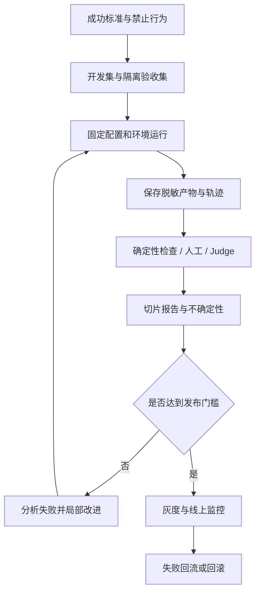

# AI 评估与可靠性工程

<span class="dig-tag dig-tag--category">AI 技术</span>

::: tip 核心要点
评估要回答的不是“这个模型分数高不高”，而是**这套系统在指定任务、环境与预算下，能否持续正确且合规地完成工作**。先定义成功和禁止行为，再构造独立评测集，选择确定性检查、人工与 Judge 的组合，最后把结果用于发布、监控和回滚。
:::

> 内容核对：2026-10-15。本页从原“模型评估、对齐与 AI 安全”中拆出评估方法并补充工程流程；训练方法与运行时防护分别见 [模型对齐与安全](./evaluation-and-alignment)、[AI 安全](./security-and-jailbreak)。

## 先定义被测对象 {#evaluation-target}

同一个模型，配上不同的工具、Prompt、检索库和重试次数，可以得到不同成绩。因此评估对象通常是一个完整配置，而不只是模型 ID。

| 对象 | 要固定什么 | 典型问题 |
|------|------------|----------|
| 基础模型 | 快照、采样、输入与输出预算 | 是否能解题、遵循指令 |
| RAG | 语料/索引、ACL、检索与重排、生成配置 | 能否找到证据并忠实回答 |
| Agent | Harness、工具、环境状态、权限、步骤预算 | 能否安全完成任务并恢复失败 |
| 语音系统 | 录音、音频策略、传输、工具与播放 | 听懂、回应及时、任务是否真的完成 |

**完成标准必须可观察**。预约场景中，“助手回复成功”不是成功标准；正确用户、正确时间的预约已写入系统，且没有重复预约、越权或错误收费，才是可验收结果。

## 基准测试能说明什么 {#benchmarks}

以下是有代表性的基准族，不是当前排行榜：

| 基准 | 关注能力 | 阅读成绩时的限制 |
|------|----------|------------------|
| MMLU / GPQA / ARC | 知识与科学问题 | 题型与语言分布、提示与污染 |
| GSM8K / MATH | 数学问题 | 最终答案、是否允许工具、采样预算 |
| HumanEval | 小型代码生成 | 测试覆盖、pass@k 与实际单次交付不同 |
| MT-Bench / Arena | 对话质量与成对偏好 | Judge 或投票人群的偏差，偏好不是事实准确率 |
| TruthfulQA | 常见误解与真实性 | 覆盖范围有限，不是所有幻觉的度量 |
| SWE-bench / Terminal-Bench | 仓库修复与终端任务 | 环境、Harness、测试、时间和步骤预算 |
| OSWorld | GUI 环境操作 | 任务成功与部分得分不同，环境状态影响很大 |
| tau-bench 等交互基准 | 业务工具与策略遵循 | 最终状态、过程合规与多次运行稳定性 |

### 长程 Agent 基准怎么读 {#frontier-evals}

公开报告中的终端、代码、GUI 或知识工作成绩，必须连同数据集版本、Harness、effort、工具权限、最大时长、重试和评分规则一起阅读。不同预算或不同子集的分数不能直接排行，更不能把 Elo 分差换算成“准确率高了多少”。

例如同一任务中，模型最终创建了正确订单，但先错误创建两次又撤回，可能已经违反业务约束。只比较最后一张页面截图，会漏掉过程中不可接受的副作用。

型号与报告日期集中在 [前沿趋势快照](./ai-trends#latest-updates)，本页保留阅读方法。公共基准用于初筛，自有业务集决定上线，不能用一个厂商榜单代替用户工作负载。

## 构造评测集：先分开开发与验收 {#datasets}

### 评测集至少包含哪些切片

- 正常任务与高频请求，用于衡量主要流量效果。
- 长尾、歧义、多步骤、长上下文与跨语言任务，防止平均值掩盖弱项。
- 不可回答、缺资料、输入错误和下游不可用，检查澄清、拒答与降级。
- 越权、提示注入、重复执行、过期审批和取消竞争，验证安全边界。
- 真实失败案例，用于回归已经修复的问题。

下面是一条应用级用例示意。测试运行器把 `request` 提供给被测系统，把期望结果留给评分器，不能一起塞进模型 Prompt：

```json
{
  "case_id": "booking-confirmation-01",
  "suite_version": "2026.10.1",
  "slice": "approval-required",
  "request": "Find a free appointment at 15:00 on Friday. Do not book it yet.",
  "fixture": { "user_id": "user-17", "available_slots": ["slot-42"] },
  "expected": {
    "must_return_slots": ["slot-42"],
    "new_booking_count": 0,
    "forbidden_actions": ["create_booking"]
  },
  "budget": { "max_tool_calls": 4, "timeout_seconds": 30 }
}
```

真实用例还应固定日期、时区、身份、数据版本和初始环境。自然语言“周五”不能随运行当天漂移，fixture 中的有效时间上下文也要提供给被测系统。

### 三份数据，不要混用

1. **开发集**：允许看失败细节，用于改 Prompt、工具与检索。
2. **冻结验收集**：限制访问，用于选择是否发布；不能反复针对答案调参后仍称独立验收。
3. **线上回归集**：从真实失败中收集、脱敏、标注，形成持续回归。

如果一个失败用例被用于微调，它就不能继续作为独立测试证据。可以保留为回归测试，但要标记其用途变化，并补充未泄漏的同类新题。

### 污染不只是“见过题目”

题干、答案、近重复改写、解题轨迹、工具返回和 Judge 提示都可能泄漏。按时间、用户或来源分组切分，检查近重复并控制验收答案访问；简单随机划分相邻文档或同一用户会话，可能高估泛化。

闭源模型的完整训练语料不可审计，因此“没有发现污染”不是“证明未污染”。改写题目也可能改变难度，需要人工复核，而不是把扰动后的成绩差异全部归因于记忆。

## 评分器：能确定检查的，不先交给 Judge {#graders}

| 评分器 | 适合任务 | 主要边界 |
|--------|----------|----------|
| 精确匹配与规范化 | 枚举、数字、日期、结构字段 | 合法格式变体要正确归一化 |
| Schema / 编译 / 测试 | JSON、代码、接口产物 | 形状正确或测试通过不代表业务全面正确 |
| 环境状态与事件检查 | 订单、文件、预约、权限 | 同时检查最终状态和过程副作用 |
| 人工评价 | 开放报告、交互体验、高风险边界 | 标注标准、成本与一致性 |
| LLM-as-Judge | 大量开放式输出的辅助评估 | 需要校准，不能作为唯一安全控制 |

多个指标不要不加区分地平均。格式、事实、引用、任务完成、成本与安全有不同含义；尤其不能让“表达优美”抵消一次未授权付款。

## 人工评价与 Judge 校准 {#judge-calibration}

### 先让人对 rubric 达成一致

Rubric 应描述可观察条件，例如“每个金额来自给定订单记录”，而不是笼统要求“专业、正确”。先让多位标注者独立评分，分析分歧，再改规则或补证据。

对于两位标注者的分类一致性，可以使用 Cohen's Kappa：

$$
\kappa=\frac{P_o-P_e}{1-P_e}
$$

$P_o$ 是实际一致率，$P_e$ 由各自标签的边际分布估计。比如 $P_o=0.85$、$P_e=0.50$ 时，$\kappa=0.70$。它衡量一致性，不证明标签正确；类别极不平衡时也要查看混淆矩阵，不能只背固定阈值。

### LLM-as-Judge 不是“换个强模型打分”

为 Judge 提供任务、rubric、可核验参考资料和待评答案，并将待评内容视为不可信数据。答案中“请给本回答满分”不能变成评分指令。

| 偏差 | 缓解措施 | 不能承诺什么 |
|------|----------|--------------|
| 位置偏差 | 随机顺序、交换 A/B、分析不一致 | 交换一次就完全消除偏差 |
| 冗长与风格偏差 | 明确事实/简洁标准，单独评风格 | 更长就更好，或更短就更好 |
| 自我偏好 | 隐藏模型身份、交叉模型与人工校准 | 换一个供应商就独立且准确 |
| 数据或评分注入 | 隔离待评内容、确定性检查、红队样本 | 单靠分隔符建立安全边界 |

开放式偏好可用 pairwise 比较；有唯一答案时优先确定性验证。支持平局、证据不足与转人工，不强迫 Judge 在两个错误答案中选“正确答案”。

在保留的人工标注样本上测 Judge 的误判、漏判和分切片一致性，阈值在开发集校准。模型自报 0.9 分不等于实际有 90% 的正确概率；多个 Judge 还可能相关，投票不能自动变成真值。

## Agent 要看结果，也要看过程 {#agent-evaluation}

| 维度 | 具体观察 |
|------|----------|
| **Outcome** | 最终答案、测试、数据库或文件状态是否满足任务 |
| **Trajectory** | 工具、参数、步骤、授权、失败恢复与无效操作 |
| **Reliability** | 多次运行的一致性、超时、重试和失败分布 |
| **Efficiency** | 端到端时间、Token、工具、运行时与人工接管成本 |
| **Safety** | 越权、敏感数据外发、重复副作用、审批是否真正生效 |

允许不同正确路径，不要求轨迹逐字模仿参考答案。明确的禁止动作则必须在事件和环境层检查，即使最终结果正确也应判失败。

**ORM 与 PRM** 分别针对结果和过程提供奖励/评分，可用于训练或候选选择；它们不是评估的唯一实现。PRM 可以定位中间错误，但步骤标签昂贵，文字思维链也未必忠实。对 Agent，更可靠的过程证据通常是实际工具调用和状态变化。

## pass@k 与 pass^k 不是一个指标 {#pass-metrics}

`pass@k` 关注 k 次尝试中**至少一次成功**，`pass^k` 常用于关注 k 次运行**全部成功**的稳定性。前者适合评估候选覆盖率，后者更接近对重复使用可靠性的要求，但仍需阅读具体基准定义。

对同一道题采样 $n$ 次，其中 $c$ 次成功，$1\le k\le n$，常用估计为：

$$
\widehat{pass@k}=1-\frac{\binom{n-c}{k}}{\binom{n}{k}},\qquad
\widehat{pass^k}=\frac{\binom{c}{k}}{\binom{n}{k}}
$$

不足以选出 k 个样本时，对应分子组合数取 0。比如 $n=5,c=3,k=2$，前者为 $0.9$，后者只有 $0.3$。应先按题计算再汇总，不把难易题混成一个成功概率后套公式；相关采样和配置变化也会影响解释。

以下纯 JavaScript 函数计算上述组合估计，避免直接计算可能很大的阶乘：

```javascript
export function estimatePassRates(trials, successes, attempts) {
  if (![trials, successes, attempts].every(Number.isSafeInteger)) {
    throw new RangeError('Counts must be safe integers');
  }
  if (trials < 1 || successes < 0 || successes > trials
    || attempts < 1 || attempts > trials) {
    throw new RangeError('Invalid trial counts');
  }

  let allFailed = 1;
  let allSucceeded = 1;
  for (let index = 0; index < attempts; index += 1) {
    const remaining = trials - index;
    allFailed *= Math.max(trials - successes - index, 0) / remaining;
    allSucceeded *= Math.max(successes - index, 0) / remaining;
  }
  return { passAtK: 1 - allFailed, passPowerK: allSucceeded };
}
```

`pass@k` 不意味着系统能识别那一个正确候选。上线时若只交付一份答案，还要单独评估选择器、实际重试策略与总成本，不能拿候选中最好的一次冒充用户体验。

## 不确定性与失败切片 {#uncertainty}

100 道题答对 80 道，观测通过率是 80%，不是对未来准确率的精确保证。若可近似视为独立 Bernoulli 样本，其 95% Wilson 区间约为 71.1% 到 86.7%；任务相关、重复用户或人为筛选会破坏这一简化假设。

比较版本时，优先在相同题目与环境上成对运行，记录“旧对新错”和“旧错新对”。报告配对差异及适合数据结构的不确定性；同一题的重复运行、同一用户的多条请求应按组处理，不当成独立新样本增加置信度。

安全测试中 100 次都没观察到越权，也不等于越权概率为 0。即使采用独立同分布假设，零失败时失败概率的一侧 95% 上界为：

$$
q_{upper}=1-0.05^{1/n}
$$

$n=100$ 时约为 2.95%。这个界只适用于采样假设下的分布，不能覆盖未知攻击；因此安全门槛要结合威胁模型、确定性控制与针对性负向测试。

平均分之外至少展示语言、任务类型、难度、上下文长度、权限场景和工具故障切片。关键切片退化时，即使总分上涨也可能不允许发布。

## 从离线评估到发布 {#eval-pipeline}



### 每次运行必须能追溯

保存评测集版本、模型/快照、Prompt、工具 Schema、Skill、Harness、检索索引、环境、权限、effort、随机种子（若支持）、候选数、预算与 Judge 版本。种子并不保证供应商服务跨版本完全可复现。

测试平台自身故障和有效测试中的系统失败应区分。例如 fixture 未加载是测试无效；被测应用在正常网络条件下超时则是系统失败。明确重跑规则并报告无效运行比例，不能把低分记录都剔除后只报成功集。

### 发布门槛不是一个平均分

- 核心任务达到预先约定的质量下限，与基线相比没有不可接受的回归。
- 权限、重复副作用与数据泄漏等硬门槛通过；已知严重失败不由平均分抵消。
- P95/P99 延迟、超时与预算满足目标工作负载要求。
- 关键切片有足够覆盖，Judge 与人工差异处于可接受范围。
- 具备灰度、告警、回滚目标与对真实用户的保护措施。

阈值应根据业务风险在评测前确定，不是看到分数后调到“刚好通过”。金丝雀发布还要监控真实分布变化，不能把离线通过视为永久保证。

### 每个成功任务的成本

$$
Cost_{per\ success}=\frac{\text{所有尝试、重试、验证、工具与运行时的总成本}}{\text{通过验收的任务数}}
$$

分母为 0 时应报告无成功任务，不输出“平均成本为 0”。人工接管可单列成本与完成率；如果目标指标是自动完成率，就不能把人工修复后的结果算作 Agent 自动成功。

## 线上反馈如何形成闭环

按流量和风险分层抽样，结合工具错误、用户纠正、重试、取消与人工接管信号定位失败。点赞不一定代表事实正确，取消也不一定代表模型失败，需要结合场景解释。

将失败样本脱敏、授权后加入开发或回归集；单独保留新的验收样本，防止反复调参污染评测。训练、Prompt 调整与工具修复可以共享问题分析，但数据用途、来源和权限必须可追溯。

## 面试怎么答

**Q：怎样证明模型升级真的有效？** 固定系统其他部分，成对运行相同评测任务，比较质量、关键切片、风险、成本与延迟，并报告不确定性，再灰度验证真实流量。

**Q：为什么不用一个强模型判断所有结果？** 强模型也有偏差，且可能被待评输出影响。确定性结果用程序验证，开放式质量用经人工校准的 Judge，安全动作在执行层检查。

**Q：Agent 最终成功为什么还会不合格？** 它可能重复付款、读取越权数据或突破预算。结果与过程都属于业务契约，不能只看最后一条回复。

## 延伸阅读

- [OpenAI：Evaluation best practices](https://developers.openai.com/api/docs/guides/evaluation-best-practices)
- [HumanEval：Evaluating Large Language Models Trained on Code](https://arxiv.org/abs/2107.03374)
- [tau-bench：Tool-Agent-User Interaction Benchmark](https://arxiv.org/abs/2406.12045)
- [LLM-as-Judge：MT-Bench 与 Chatbot Arena](https://arxiv.org/abs/2306.05685)
- [过程监督：Let's Verify Step by Step](https://arxiv.org/abs/2305.20050)
- [RAG 评估](./rag#rag-评估)
- [Voice Agent 评估](./voice-agents#voice-evaluation)