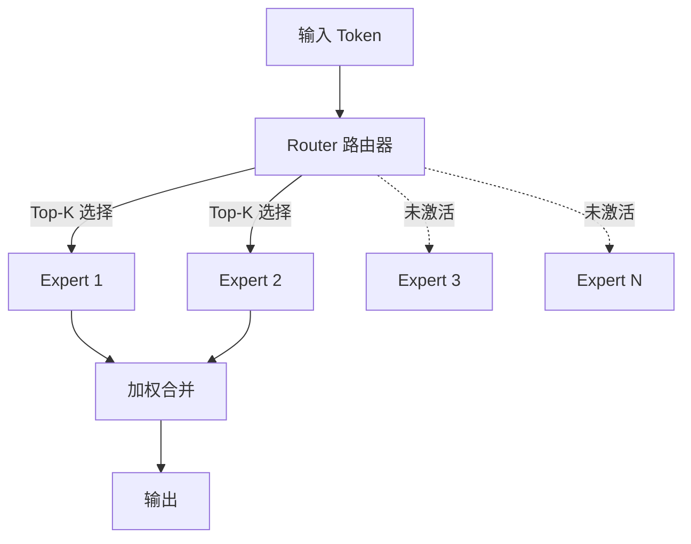

# AI 概述与发展历程

AI 技术 ⭐ 入门 🔥 低频

::: tip 💡 核心要点
人工智能（Artificial Intelligence, AI）是让机器执行通常需要人类智能任务的技术总称。当前生成式 AI 的重要基础是**大语言模型（LLM）与多模态基础模型**；Transformer 是主流骨干，状态空间、混合注意力和扩散语言建模也在发展。理解模型、训练方法与应用系统分别解决什么问题，比背诵最新型号更重要。
:::

## 什么是人工智能

人工智能是计算机科学的一个分支，旨在构建能够执行通常需要人类智能任务的系统。讨论能力范围时，常见以下概念，但它们不是有统一验收标准的产品等级：

| 层次 | 定义 | 现状 |
|------|------|------|
| **专用 AI（Narrow AI）** | 面向有限任务范围的系统 | 如特定分类、推荐或检测系统 |
| **通用人工智能（AGI）** | 在广泛任务中迁移知识并完成复杂工作 | 定义、能力门槛和验证方法存在分歧，不能以单项高分宣告实现 |
| **超级智能（ASI）** | 在广泛重要能力上显著超越人类的假设性系统 | 属于研究与治理讨论，不能等同于某项能力超过人类 |

“强 AI”在一些语境还涉及是否真正理解或具有心智，不宜直接当成 AGI 的严格同义词。前沿模型能覆盖许多任务，但可靠性、长程自主性和未知环境泛化仍需验证；不存在所有人共同接受的“已实现 AGI”判定。工程选型应使用具体任务指标，而不是这些标签。

---

## 发展历程

AI 的发展经历了多次范式转变，每一次都伴随着核心方法论的根本性变化：

### 关键里程碑

| 年份 | 事件 | 意义 |
|------|------|------|
| 1950 | 图灵提出模仿游戏 | 提供以可观察行为讨论机器智能的经典思路 |
| 1997 | 深蓝击败国际象棋冠军 | 展示大规模搜索、局面评估与专用硬件的组合能力 |
| 2012 | AlexNet 赢得 ImageNet | 推动深度神经网络与 GPU 训练在视觉领域普及 |
| 2017 | Transformer 论文发表 | 以注意力为核心、摆脱循环计算，成为此后主流 LLM 的架构基础 |
| 2018 | BERT / GPT 发布 | 预训练+微调范式确立 |
| 2020 | GPT-3（175B 参数） | 展示大规模语言模型的少样本上下文学习能力 |
| 2022 | ChatGPT 发布 | LLM 进入大众视野，RLHF 对齐技术成熟 |
| 2023 | GPT-4 / Claude 2 | 多模态能力、长上下文、推理能力大幅提升 |
| 2024 | 模型全面进化 | Claude 3/3.5、GPT-4o、Gemini 1.5、LLaMA 3、o1 推理模型；开源模型缩小与闭源差距 |
| 2025 | 推理模型与 Agent 爆发 | Claude 4、GPT-4.1、o3/o4-mini、Gemini 2.5、DeepSeek R1、LLaMA 4；AI Agent 进入生产 |
| 2026 | 推理、多模态与 Agent 融合 | 前沿模型把可调推理、长上下文、视觉/计算机使用和大规模工具调用逐步整合；评估重心从单轮问答扩展到长程任务的成功率、可靠性与成本 |

---

## AI 模型分类

### 按学习方式分类

| 类型 | 定义 | 典型应用 |
|------|------|----------|
| **监督学习** | 从标注数据中学习输入→输出映射 | 分类、回归、目标检测 |
| **无监督学习** | 从无标注数据中发现结构和模式 | 聚类、降维、异常检测 |
| **自监督学习** | 从数据本身构造监督信号 | 自回归预训练（下一 Token 预测）、BERT（掩码预测） |
| **强化学习** | 通过与环境交互和奖励信号学习策略 | 游戏 AI、RLHF 对齐、机器人控制 |

LLM 的**预训练**常以自监督方式学习语言、代码或多模态数据；后训练可使用人工或合成示范做 SFT、偏好数据做 DPO/RLHF、测试与环境结果做可验证奖励训练。不能用“自监督、无需人工标注”概括整个生命周期。

推理时加入示例、检索资料或增加思考预算，通常不更新模型权重。训练、上下文学习和运行时记忆是不同机制，详见 [LLM 基础](./llm-fundamentals#预训练与微调)。

### 按模型功能分类

| 类型 | 特点 | 代表模型 |
|------|------|----------|
| **判别式任务中的模型** | 根据输入判断类别、分数或边界 | 分类器、检测器、加分类头的 BERT |
| **生成式模型（Generative）** | 学习 $P(X)$ 或 $P(X\|Y)$，生成新数据 | GPT 系列、Claude、Stable Diffusion |

自回归 LLM 通过前文生成后续 Token，也可用生成结果完成分类。BERT 是编码器与预训练方案，本身不能简单等同于“判别式分类器”；生成式模型也可学习条件分布。因此分类依据是建模目标和使用方式，而不只是公式里有没有条件变量。

### 按架构分类

先用经典 Transformer 理解三种布局；这里列的是公开模型，不推断未公开的商用架构：

| 架构 | 特点 | 代表 | 适用任务 |
|------|------|------|----------|
| **Encoder-Only** | 双向注意力，适合理解 | BERT | 文本分类、NER、语义相似度 |
| **Decoder-Only** | 因果注意力，自回归生成 | GPT-2、Llama 3 | 文本生成、对话、推理 |
| **Encoder-Decoder** | 编码器理解+解码器生成 | T5、BART | 翻译、摘要 |

**因果 Transformer 是重要主线，但不是全部语言模型的定义。** 例如 Qwen3-Next 混合线性注意力与标准注意力；DeepSeek-V4.1-Flash 的因果 Encoder-Decoder 不同于 T5 的双向编码器布局；LLaDA 则使用 Transformer 实现扩散语言建模。

| 分类维度 | 常见选择 | 需要分清 |
|----------|----------|----------|
| **序列骨干** | Transformer、SSM、线性注意力与混合结构 | 如何表示和访问历史信息 |
| **参数激活** | Dense、稀疏 MoE | 每 Token 使用多少参数，不等于总权重大小 |
| **生成方式** | 自回归、扩散/去掩码 | 如何形成输出序列，不由骨干名称单独决定 |
| **训练与能力定位** | Base、Instruct、Reasoning | 不是互斥架构，推理模型也可遵循指令 |
| **模态** | 文本、图像、语音、视频、动作 | 分别核对输入、输出及是否依赖外部工具 |

基础模型（Foundation Model）强调经广泛数据训练、可适配多种任务；LLM 强调语言建模，两者有交集。聊天产品、模型 API 与 Agent 系统则属于不同封装层次。现代结构详见 [LLM 基础](./llm-fundamentals#modern-decoder-block)，替代路线见 [混合架构与扩散语言模型](./llm-fundamentals#hybrid-and-diffusion)。

---

## Scaling Laws 规模定律

Scaling Laws 是在特定数据分布、模型与训练配方下，对损失如何随规模变化做经验拟合。Kaplan 等人（2020）研究了参数、数据与计算的幂律趋势；Chinchilla（2022）进一步研究固定训练预算下如何分配参数和数据，其参数化损失拟合可写为：

$$
L(N,D) \approx E + \frac{A}{N^\alpha} + \frac{B}{D^\beta}
$$

其中 $N$ 为模型参数量，$D$ 为训练 Token 数，$E,A,B,\alpha,\beta$ 是拟合参数。计算预算 $C$ 是约束，而不是被遗漏的第三个自变量；对常见稠密 Transformer 训练，忽略部分开销时常用 $C \approx 6ND$ 粗估，不能直接套到任意 MoE、长上下文或多模态训练。

核心发现：
- **固定计算预算时要平衡参数与数据**；仅扩大参数却不提供相应训练数据，可能不是最有效的分配
- 某些下游指标会表现出**涌现（Emergence）**，但“突然出现”可能同时受离散评分、提示方式和评测分辨率影响，不能把它理解为统一的物理阈值
- **Chinchilla 研究**（2022）在其模型、数据和计算设定下得到约每参数 20 个训练 Token 的经验点；更稳健的结论是：固定训练计算下，参数量与训练 Token 应近似同步扩展，而不是把 1:20 当作跨架构不变常数

这解释了为什么业界同时扩大模型、数据和训练计算。需要注意：前沿闭源模型通常不披露参数量或是否采用 MoE，不能根据产品名或性能反推出“数千亿参数”。此外，训练计算最优不等于生命周期成本最优：服务量很大时，较小但训练更久的模型可能以更低推理成本胜出。

### 预训练、后训练与测试时计算

今天讨论“增加计算换能力”，还应区分预算花在哪里，而不是把所有收益归到参数变大：

| 阶段 | 增加什么 | 如何判断收益 |
|------|----------|--------------|
| **预训练** | 模型、数据与训练计算 | 同分布损失、下游能力、训练与服务总成本 |
| **后训练** | 高质量示范、偏好/奖励数据、任务环境与 rollout | 指令遵循、推理、工具使用和安全表现，防止奖励投机 |
| **测试时计算** | 思考步骤、候选数、搜索、验证与工具调用 | 固定预算下的任务成功率、延迟与成本，不以思维链长度评分 |

三者的经验关系不能混成一条普适公式。专题分别见 [模型训练](./model-training)、[合成数据与蒸馏](./synthetic-data-and-distillation)、[推理模型与测试时计算](./reasoning-models)。

---

## 2024-2026 主流模型格局

### 当前托管模型目录

以下列举通用型号，不是排名或完整产品目录。三家均未在所引目录中给出完整骨干与参数规模，不用传闻补齐。Stable 表示版本状态，不保证所有账号、地区和功能均可使用。

| 官方目录 | 当前代表型号 | 能力与选型边界 |
|----------|--------------|----------------|
| [OpenAI](https://developers.openai.com/api/docs/models) | GPT-6 Astra、GPT-6.1 Sol、GPT-6 Luna | 文本/图像输入、文本输出；按复杂任务、成本与吞吐选择，工具和专用语音/图像模型另行核对 |
| [Anthropic](https://platform.claude.com/docs/en/about-claude/models/overview) | Claude Fable 5.1、Opus 5.5、Sonnet 5.5、Haiku 5.5 | 文本/图像输入、文本输出；推理设置、服务平台和生命周期按具体 ID 判断 |
| [Google](https://ai.google.dev/gemini-api/docs/models) | Gemini 4 Argon、Gemini 3.8 Flash | Argon 已标 Stable，支持文本、图像、视频、音频和 PDF 输入，输出文本；不等于支持 Live API 或音频/图像生成 |

<small>注：目录快照为 2026-10-15；型号与可用范围以官方文档为准，版本变化见 [最新进展快照](./ai-trends#latest-updates)。</small>

### 开放权重与公开架构例子

下表按教学价值选取，**不声称每个型号都是所属家族的最新版本**。开放权重、许可证、官方 API 上线与本地硬件可部署性需分别判断。

| 模型与来源 | 公开结构或规模 | 适合说明的概念 |
|------------|----------------|----------------|
| [Qwen3-Next-80B-A3B](https://huggingface.co/Qwen/Qwen3-Next-80B-A3B-Instruct) | 80B 总参数、约 3B 激活，Apache 2.0 | Gated DeltaNet 与 Gated Attention 混合，配合高稀疏 MoE 与 MTP |
| [DeepSeek-V4.1-Flash](https://huggingface.co/deepseek-ai/DeepSeek-V4.1-Flash) | 模型卡列 552B 骨干参数；prefill/decode 分别约 8B/16B 激活，MIT | 多模态、因果 Encoder-Decoder、跨层缓存复用；骨干参数不应直接写成全部权重总数 |
| [Llama 4 Scout / Maverick](https://ai.meta.com/blog/llama-4-multimodal-intelligence/) | 109B/400B 总参数，均约 17B 激活，自定义许可证 | 原生多模态 MoE 与早期融合；开放权重不等于 OSI 定义的开源 |
| [DeepSeek V3](https://arxiv.org/abs/2412.19437) / [R1](https://arxiv.org/abs/2501.12948) | V3 为 671B 总参数、每 Token 37B 激活 | 历史技术基线：MLA、MoE、多 Token 预测与推理后训练 |
| [gpt-oss-120b / 20b](https://openai.com/index/introducing-gpt-oss/) | 117B/21B 总参数，约 5.1B/3.6B 激活，Apache 2.0 | 可自托管的文本推理 MoE，与托管 GPT 产品线分开看 |

> **阅读型号表的边界**：产品能力、API 能力和单个底层模型不是同义词。例如搜索、图像生成、语音或 Computer Use 可能由工具或专用模型协作完成。闭源厂商未披露的参数量、MoE、注意力形式应写“未公开”，不要用传闻补齐。

### MoE（Mixture of Experts）架构

稀疏 MoE 是大模型的重要路线。它通常把 FFN 替换为多个专家，对每个 Token 只选择其中若干个，训练和推理阶段都可使用这种稀疏激活；注意力、路由器和共享专家等参数不一定被跳过：

- **优势**：在每 Token 只激活少数专家时，可用较少计算访问更大的参数容量
- **代价**：所有专家权重通常仍要存储或分片，Router 还会带来负载不均与跨设备 All-to-All 通信；所以“激活参数少”不等于显存占用和延迟等同于同规模稠密小模型
- **代表**：DeepSeek V3、Qwen3-Next、Llama 4 Scout/Maverick；引用规模时注明总参数、骨干参数和激活参数的口径。未公开内部结构的托管型号不作为确定的 MoE 示例

---

## 多模态 AI

多模态 AI 能处理多种类型的数据，但输入支持和输出支持并不对称：能看图不一定能画图，能接收音频也不一定能实时生成语音。

| 模态 | 能力 | 代表模型 |
|------|------|----------|
| **文本 + 图像理解** | 看图问答、图表分析、文档理解 | GPT-6、Claude 5.5、Gemini 4 Argon / 3.8 Flash、DeepSeek-V4.1-Flash 等具体型号 |
| **图像生成** | 根据描述生成或编辑图像 | GPT Image、Gemini Nano Banana、Qwen-Image-2.1 等专用模型；不等于所有聊天模型直接生成图像 |
| **语音** | 语音识别、理解、合成与实时对话 | 专用 Realtime/Transcribe、Gemini Live/TTS；分别核对模态与会话接口 |
| **视频** | 视频理解或视频生成（两者需区分） | Gemini 理解、Veo/Gemini Omni 生成；Sora 2 API 已关闭，不再作为新接入示例 |
| **跨模态检索** | 用文本查图片、音频查视频片段 | Gemini Embedding 2、EmbeddingGemma 2；输出向量而不是事实回答 |

历史模型可用于理解演进，不能据此假设其 API 永久可用。接口关闭状态见 [OpenAI 官方生命周期清单](https://developers.openai.com/api/docs/deprecations)，Google 的当前能力见 [Gemini API 文档](https://ai.google.dev/gemini-api/docs)。

多模态能力使 AI 从“只能读文字”扩展到“能看、能听、能生成媒体”。**原生多模态**通常指多种模态在同一训练目标或共享骨干中联合训练，而不是简单调用 OCR、ASR、图像生成等外部工具；厂商未公开训练架构时，应只描述已验证的输入/输出能力。

理解见 [视觉语言模型](./vision-language-models)，媒体生成见 [生成式多模态](./generative-multimodal)，实时会话见 [Voice Agent](./voice-agents)。[世界模型与具身智能](./world-models-and-embodied-ai) 进一步区分环境预测、动作策略和真实控制；生成一段合理视频并不证明系统掌握了物理规律。

---

## AI 技术全景图

后续内容按问题组织，完整目录见 [AI 技术](./index)：

| 方向 | 核心问题 | 对应章节 |
|------|----------|----------|
| **模型基础** | 模型如何表示、生成与推理？ | [LLM 基础](./llm-fundamentals)、[推理与测试时计算](./reasoning-models)、[视觉语言模型](./vision-language-models) |
| **信息与上下文** | 本次任务需要哪些知识？如何管理历史？ | [Prompt](./prompt-engineering)、[上下文与记忆](./context-and-memory)、[Embedding](./embedding-and-vector-db)、[RAG](./rag) |
| **Agent** | 如何根据反馈行动，并受控地连接外部系统？ | [AI Agent 基本概念](./ai-agents)、[Agent Skills](./ai-agent-skills)、[MCP](./mcp)、[A2A](./a2a)、[Harness](./harness-engineering)、[Computer Use](./agent-computer-use) |
| **训练与生产** | 如何提升、评估和运行系统？ | [训练](./model-training)、[合成数据与蒸馏](./synthetic-data-and-distillation)、[评估](./ai-evaluation)、[对齐与安全](./evaluation-and-alignment)、[安全防护](./security-and-jailbreak)、[推理优化](./inference-optimization)、[应用架构](./ai-architecture) |
| **多模态与环境** | 如何生成媒体、实时对话和与物理环境交互？ | [生成式多模态](./generative-multimodal)、[Voice Agent](./voice-agents)、[世界模型与具身智能](./world-models-and-embodied-ai) |

建议先读本文和 LLM 基础，再做一个带 [评估](./ai-evaluation) 的小型 Prompt/RAG 应用；需要动态行动时进入 Agent 分支，需要改变模型行为时进入训练分支。模型记忆、长上下文与检索并非互相替代，多模态与具身方向可以按项目需求选读。最后用 [AI 系统设计](./ai-system-design) 与 [面试准备](./ai-interview-prep) 串联各层取舍。

---

::: warning ⚠️ 常见误区

1. **混淆 AI、机器学习、深度学习的关系**：AI 是最广义的概念，机器学习是 AI 的子集，深度学习是机器学习的子集，LLM 是深度学习的一个具体方向。它们是包含关系，不是并列关系。

2. **认为参数量越大模型越好**：Scaling Laws 是有适用条件的经验拟合，不保证所有下游能力随规模单调提升。实际效果还取决于数据、后训练、架构、上下文和运行时预算，小模型也可能在特定任务上更合适。

3. **混淆开源、开放权重与闭源**：API 模型由厂商托管，能力与运维门槛通常较低，但有成本、版本变更和数据治理问题；Llama、Qwen、DeepSeek 等许多模型是**开放权重**，许可证未必符合 OSI 开源定义。它们可私有部署，但需承担硬件、安全、评估和升级成本。

:::

---

  

    📝 面试真题
    3 道基础
  

  

    1. 简述 AI、机器学习、深度学习、大语言模型之间的关系
    简单
  

  

    2. Scaling Laws 的核心发现是什么？对 LLM 发展有什么指导意义？
    中等
  

  

    3. 对比 Encoder-Only、Decoder-Only、Encoder-Decoder 三种架构的区别和适用场景
    中等
  

## 面试真题详解

### Q1：简述 AI、机器学习、深度学习、大语言模型之间的关系

**要点**：

它们是**层层包含**的关系：

> **AI ⊃ ML ⊃ DL ⊃ LLM**：人工智能包含机器学习，机器学习包含深度学习，当前大语言模型属于以大规模神经网络建模语言的方向。Transformer 是其主流骨干，不是定义条件。

- **AI**：让机器模拟人类智能的总称，包括规则系统、搜索算法等非 ML 方法
- **ML**：通过数据自动学习规律的方法，是 AI 的主流实现路径
- **DL**：使用多层神经网络的 ML 方法，能自动学习特征表示
- **LLM**：通过大规模训练建模语言的神经网络，没有统一的参数量门槛；稀疏模型还要区分总参数与激活参数

---

### Q2：Scaling Laws 的核心发现是什么？对 LLM 发展有什么指导意义？

**要点**：

Scaling Laws（规模定律）的核心发现：
- 在特定实验条件下，交叉熵损失随参数或数据规模呈可拟合的幂律趋势
- 固定计算预算时要平衡参数量与训练 Token，而不是把参数、数据和计算当作三个互不相关的旋钮
- 小规模实验可以帮助预测同配方下的损失趋势，但不保证下游能力、可靠性和安全性同样可预测

**指导意义**：
1. 为规划训练计算提供经验依据——在同分布、同指标和可扩展训练配方下，可用小实验预测损失趋势，但并不保证所有下游能力等比例提升
2. **Chinchilla 研究**提示固定计算预算下应同时扩大参数和数据；约 1:20 是特定实验得到的经验值，不是不可变定律
3. 帮助研究规模与下游能力的关系；某些指标看似突然跃迁，但应排除评分离散化、提示和数据污染等因素
4. 指导了训练资源的分配决策——在固定计算预算下，如何分配参数量和训练数据量
5. 后训练与测试时计算提供另外的投入方向，需要用独立评估比较收益，不能直接套用预训练拟合公式

---

### Q3：对比 Encoder-Only、Decoder-Only、Encoder-Decoder 三种架构

**要点**：

| 维度 | Encoder-Only | Decoder-Only | Encoder-Decoder |
|------|-------------|-------------|-----------------|
| **注意力方式** | 双向注意力 | 因果注意力（当前位置及前文） | 经典形式为编码器双向、解码器因果并交叉关注编码结果 |
| **常见预训练任务** | 掩码语言模型（MLM） | 下一 Token 预测（NTP） | 去噪/序列到序列目标 |
| **公开代表模型** | BERT、RoBERTa | GPT-2、Llama 3 | T5、BART |
| **擅长任务** | 理解类（分类、NER） | 生成类（对话、写作） | 序列到序列（翻译、摘要） |

**为什么 Decoder-Only 在文本生成中很常见？**
1. 自回归生成天然适合对话和文本创作
2. 架构简单，易于扩展到大规模参数
3. 在足够大的规模下，Decoder-Only 模型也能很好地完成理解类任务
4. 大规模训练与服务生态成熟，KV Cache 等优化已有广泛支持

补充边界：这些经典例子不定义全部 LLM。因果 Encoder-Decoder、混合骨干和扩散语言模型需要按实际掩码、状态结构与生成目标分析；MoE 则是另一个参数激活维度。

---

## 延伸阅读

- [Attention Is All You Need (Vaswani et al., 2017)](https://arxiv.org/abs/1706.03762)
- [Scaling Laws for Neural Language Models (Kaplan et al., 2020)](https://arxiv.org/abs/2001.08361)
- [Training Compute-Optimal Large Language Models (Chinchilla, 2022)](https://arxiv.org/abs/2203.15556)
- [A Survey of Large Language Models (Zhao et al., 2023)](https://arxiv.org/abs/2303.18223)
- [OpenAI Model Release Notes](https://help.openai.com/en/articles/9624314-model-release-notes)
- [OpenAI API Models](https://developers.openai.com/api/docs/models)
- [Anthropic Claude Models Overview](https://platform.claude.com/docs/en/about-claude/models/overview)
- [Google Gemini API Models](https://ai.google.dev/gemini-api/docs/models)
- [The Llama 4 Herd: Native Multimodality and MoE](https://ai.meta.com/blog/llama-4-multimodal-intelligence/)
- [Qwen3-Next Model Card](https://huggingface.co/Qwen/Qwen3-Next-80B-A3B-Instruct)
- [DeepSeek-V4.1-Flash Model Card](https://huggingface.co/deepseek-ai/DeepSeek-V4.1-Flash)
- [Large Language Diffusion Models](https://arxiv.org/abs/2502.09992)
