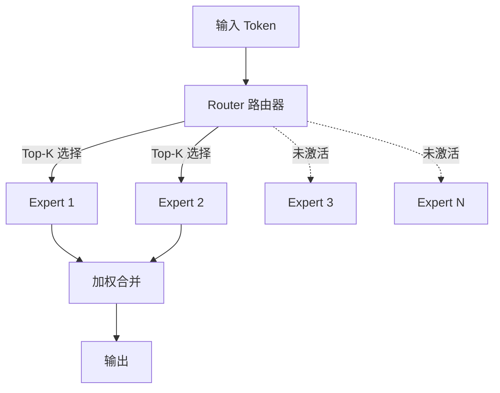

# AI 概述与发展历程

<span class="dig-tag dig-tag--category">AI 技术</span> <span class="dig-tag dig-tag--easy">⭐ 入门</span> <span class="dig-tag dig-tag--hot">🔥 低频</span>

::: tip 💡 核心要点
人工智能（Artificial Intelligence, AI）是让机器执行通常需要人类智能任务的技术总称。当前生成式 AI 的重要基础是**大语言模型（LLM）与多模态基础模型**；它们多数以 Transformer 为骨干，通过大规模预训练和训练后训练获得语言、视觉、工具使用等能力。理解 AI 的发展脉络和核心概念分类，是深入学习 LLM、RAG、Agent 等技术的基础。
:::

## 什么是人工智能

人工智能是计算机科学的一个分支，旨在构建能够执行通常需要人类智能的任务的系统。根据能力范围，AI 可分为三个层次：

| 层次 | 定义 | 现状 |
|------|------|------|
| **弱 AI（Narrow AI）** | 针对有限任务范围的智能系统 | 当前可部署系统，包括前沿语言/多模态模型与自动驾驶系统 |
| **强 AI（AGI）** | 具备人类级别通用智能 | 尚未实现，是行业主要研究方向 |
| **超级 AI（ASI）** | 全面超越人类智能 | 纯理论阶段 |

当前所有商用 AI 系统——无论是 ChatGPT、Claude 还是自动驾驶——都属于弱 AI 范畴。

---

## 发展历程

AI 的发展经历了多次范式转变，每一次都伴随着核心方法论的根本性变化：


### 关键里程碑

| 年份 | 事件 | 意义 |
|------|------|------|
| 1950 | 图灵测试提出 | 首次定义"机器智能"的评判标准 |
| 1997 | 深蓝击败国际象棋冠军 | 规则系统的巅峰 |
| 2012 | AlexNet 赢得 ImageNet | 深度学习革命的起点 |
| 2017 | Transformer 论文发表 | 以注意力为核心、摆脱循环计算，成为此后主流 LLM 的架构基础 |
| 2018 | BERT / GPT 发布 | 预训练+微调范式确立 |
| 2020 | GPT-3（175B 参数） | 展示 In-Context Learning 涌现能力 |
| 2022 | ChatGPT 发布 | LLM 进入大众视野，RLHF 对齐技术成熟 |
| 2023 | GPT-4 / Claude 2 | 多模态能力、长上下文、推理能力大幅提升 |
| 2024 | 模型全面进化 | Claude 3/3.5、GPT-4o、Gemini 1.5、LLaMA 3、o1 推理模型；开源模型缩小与闭源差距 |
| 2025 | 推理模型与 Agent 爆发 | Claude 4、GPT-4.1、o3/o4-mini、Gemini 2.5、DeepSeek R1、LLaMA 4；AI Agent 进入生产 |
| 2026 | 推理、多模态与 Agent 融合 | 前沿模型把可调推理、长上下文、视觉/计算机使用和大规模工具调用逐步整合；评估重心从单轮问答扩展到长程任务的成功率、可靠性与成本 |

**本章核验：2026-10-10。** 近期已确认 GPT-6 与交互式输出、Claude 5.5、Gemini 3.8 Flash、分阶段开放的 Gemini 4 Argon、端侧多模态 EmbeddingGemma 2，以及开放权重 DeepSeek-V4.1-Flash。日期、来源、访问范围和生命周期集中在 [最新进展快照](./ai-trends#latest-updates)，不把受限测试写成全面可用。

---

## AI 模型分类

### 按学习方式分类

| 类型 | 定义 | 典型应用 |
|------|------|----------|
| **监督学习** | 从标注数据中学习输入→输出映射 | 分类、回归、目标检测 |
| **无监督学习** | 从无标注数据中发现结构和模式 | 聚类、降维、异常检测 |
| **自监督学习** | 从数据本身构造监督信号 | LLM 预训练（下一个词预测）、BERT（掩码预测） |
| **强化学习** | 通过与环境交互和奖励信号学习策略 | 游戏 AI、RLHF 对齐、机器人控制 |

LLM 的训练本质上是**自监督学习**——通过预测下一个 Token 来学习语言的统计规律，不需要人工标注。

### 按模型功能分类

| 类型 | 特点 | 代表模型 |
|------|------|----------|
| **判别式模型（Discriminative）** | 学习 $P(Y\|X)$，预测类别或标签 | BERT、分类器、检测模型 |
| **生成式模型（Generative）** | 学习 $P(X)$ 或 $P(X\|Y)$，生成新数据 | GPT 系列、Claude、Stable Diffusion |

当前 LLM 属于生成式模型——给定前文，生成后续文本。

### 按架构分类

| 架构 | 特点 | 代表 | 适用任务 |
|------|------|------|----------|
| **Encoder-Only** | 双向注意力，适合理解 | BERT | 文本分类、NER、语义相似度 |
| **Decoder-Only** | 因果注意力，自回归生成 | GPT、Claude、LLaMA | 文本生成、对话、推理 |
| **Encoder-Decoder** | 编码器理解+解码器生成 | T5、BART | 翻译、摘要 |

**当前生成式文本 LLM 仍以 Decoder-Only 为主。** 但多模态模型可能再加视觉编码器、跨模态连接器或早期融合模块，部分新架构还会混合状态空间层、稀疏注意力等组件，因此“Decoder-Only”不等于内部只有原始 Transformer 解码器。

---

## Scaling Laws 规模定律

2020 年 OpenAI 发表的 Scaling Laws 研究揭示了一个关键规律：模型性能（用交叉熵损失衡量）主要取决于三个因素，且可预测地随规模增长而提升：

$$
L(N, D, C) \approx \left(\frac{N_c}{N}\right)^{\alpha_N} + \left(\frac{D_c}{D}\right)^{\alpha_D} + L_\infty
$$

其中 $N$ 为参数量，$D$ 为数据量，$C$ 为计算量，$L_\infty$ 为不可约损失。

核心发现：
- **参数量、数据量、计算量**三者同步增长时，模型性能持续提升
- 某些下游指标会表现出**涌现（Emergence）**，但“突然出现”可能同时受离散评分、提示方式和评测分辨率影响，不能把它理解为统一的物理阈值
- **Chinchilla 研究**（2022）在其模型、数据和计算设定下得到约每参数 20 个训练 Token 的经验点；更稳健的结论是：固定训练计算下，参数量与训练 Token 应近似同步扩展，而不是把 1:20 当作跨架构不变常数

这解释了为什么业界同时扩大模型、数据和训练计算。需要注意：前沿闭源模型通常不披露参数量或是否采用 MoE，不能根据产品名或性能反推出“数千亿参数”。此外，训练计算最优不等于生命周期成本最优：服务量很大时，较小但训练更久的模型可能以更低推理成本胜出。

---

## 2024-2026 主流模型格局

| 模型 | 开发者 | 架构 | 参数规模 | 开源 | 特点 |
|------|--------|------|----------|------|------|
| **GPT-5.x** | OpenAI | 未公开 | 未公开 | 否 | 2026 主线已整合可调推理、编码、工具与计算机使用；具体上下文和模态按产品/API 版本核对 |
| **Claude Fable 5 / Opus 5 / Sonnet 5** | Anthropic | 未公开 | 未公开 | 否 | 面向长程 Agent、编码和知识工作；当前型号支持文本/图像输入、文本输出，不能据此推断底层是纯 Decoder-Only |
| **Gemini 3.x** | Google | 未公开 | 未公开 | 否 | 多模态理解与 Agent 能力；稳定版、预览版和专用音视频生成模型需要区分 |
| **Llama 4 Scout / Maverick** | Meta | 原生多模态 MoE（早期融合） | 109B/400B 总参数，均约 17B 激活 | 开放权重 | 首代 Llama MoE；开放权重不等于 OSI 定义的开源软件，使用受许可证约束 |
| **Qwen 系列** | 阿里云 | 依具体型号 | 依具体型号 | 多数开放权重 | 覆盖语言、代码、视觉等型号；部署前核对各模型许可证 |
| **DeepSeek V3 / R1** | DeepSeek | MoE | V3 为 671B 总参数、每 Token 37B 激活 | 开放权重 | V3 使用 MLA、无辅助损失负载均衡与多 Token 预测；R1 展示可验证任务上的强化学习推理训练 |
| **gpt-oss-120b / 20b** | OpenAI | MoE | 117B/21B 总参数，约 5.1B/3.6B 激活 | 开放权重 | 文本推理模型，适合自托管；与 GPT-5 产品线不是同一型号 |

> **阅读型号表的边界**：产品能力、API 能力和单个底层模型不是同义词。例如搜索、图像生成、语音或 Computer Use 可能由工具或专用模型协作完成。闭源厂商未披露的参数量、MoE、注意力形式应写“未公开”，不要用传闻补齐。

### MoE（Mixture of Experts）架构

MoE 是近年来大模型的重要趋势。与稠密模型（Dense Model）不同，MoE 在每次推理时只激活部分参数：



- **优势**：在每 Token 只激活少数专家时，可用较少计算访问更大的参数容量
- **代价**：所有专家权重通常仍要存储或分片，Router 还会带来负载不均与跨设备 All-to-All 通信；所以“激活参数少”不等于显存占用和延迟等同于同规模稠密小模型
- **代表**：DeepSeek V3（671B 总参/37B 激活）、Mixtral、Llama 4 Scout/Maverick。GPT-4/4o 是否采用何种 MoE 未获官方公开，不宜作为确定示例

---

## 多模态 AI

多模态 AI 能够同时处理和生成多种类型的数据：

| 模态 | 能力 | 代表模型 |
|------|------|----------|
| **文本 + 图像理解** | 看图问答、图表分析、文档理解 | GPT-6、Claude 5.5、Gemini 3.8、DeepSeek-V4.1-Flash 等具体型号 |
| **图像生成** | 根据描述生成或编辑图像 | GPT Image、Gemini Nano Banana、Qwen-Image-2.1 等专用模型；不等于所有聊天模型直接生成图像 |
| **语音** | 语音识别、理解、合成与实时对话 | 专用 Realtime/Transcribe、Gemini Live/TTS；分别核对模态与会话接口 |
| **视频** | 视频理解或视频生成（两者需区分） | Gemini 理解、Veo/Gemini Omni 生成；Sora 2 API 已关闭，不再作为新接入示例 |
| **跨模态检索** | 用文本查图片、音频查视频片段 | Gemini Embedding 2、EmbeddingGemma 2；输出向量而不是事实回答 |

历史模型可用于理解演进，不能据此假设其 API 永久可用。接口关闭状态见 [OpenAI 官方生命周期清单](https://developers.openai.com/api/docs/deprecations)，Google 的当前能力见 [Gemini API 文档](https://ai.google.dev/gemini-api/docs)。

多模态能力使 AI 从“只能读文字”扩展到“能看、能听、能生成媒体”。**原生多模态**通常指多种模态在同一训练目标或共享骨干中联合训练，而不是简单调用 OCR、ASR、图像生成等外部工具；厂商未公开训练架构时，应只描述已验证的输入/输出能力。

---

## AI 技术全景图

本章节的后续文章按以下结构组织，由基础到进阶：

```
AI Technology
|
+-- Fundamentals
|   +-- AI Overview
|   +-- LLM Principles
|
+-- LLM Applications
|   +-- Prompt Engineering
|   +-- Embedding & Vector DB
|   +-- RAG
|
+-- AI Agent
|   +-- Agent Architecture
|   +-- MCP
|
+-- AI Engineering
    +-- Fine-tuning
    +-- Architecture Design
```

建议的学习路径：
1. **入门**：本文 → [LLM 大语言模型原理](./llm-fundamentals)
2. **应用**：[Prompt Engineering](./prompt-engineering) → [Embedding 与向量数据库](./embedding-and-vector-db) → [RAG](./rag)
3. **进阶**：[AI Agent 智能体](./ai-agents) → [模型微调与训练](./model-training) → [AI 应用架构设计](./ai-architecture)

---

::: warning ⚠️ 常见误区

1. **混淆 AI、机器学习、深度学习的关系**：AI 是最广义的概念，机器学习是 AI 的子集，深度学习是机器学习的子集，LLM 是深度学习的一个具体方向。它们是包含关系，不是并列关系。

2. **认为参数量越大模型越好**：Scaling Laws 只说明性能随规模提升，但实际效果还取决于训练数据质量、对齐方法、架构设计等。小模型配合好的数据和微调，可能在特定任务上超过大模型。

3. **混淆开源、开放权重与闭源**：API 模型由厂商托管，能力与运维门槛通常较低，但有成本、版本变更和数据治理问题；Llama、Qwen、DeepSeek 等许多模型是**开放权重**，许可证未必符合 OSI 开源定义。它们可私有部署，但需承担硬件、安全、评估和升级成本。

:::

---

<div class="dig-questions">
  <div class="dig-questions__header">
    <span>📝 面试真题</span>
    <span style="font-size: 12px; opacity: 0.8;">3 道基础</span>
  </div>
  <div class="dig-questions__item">
    <span>1. 简述 AI、机器学习、深度学习、大语言模型之间的关系</span>
    <span class="dig-tag dig-tag--easy" style="margin: 0;">简单</span>
  </div>
  <div class="dig-questions__item">
    <span>2. Scaling Laws 的核心发现是什么？对 LLM 发展有什么指导意义？</span>
    <span class="dig-tag dig-tag--medium" style="margin: 0;">中等</span>
  </div>
  <div class="dig-questions__item">
    <span>3. 对比 Encoder-Only、Decoder-Only、Encoder-Decoder 三种架构的区别和适用场景</span>
    <span class="dig-tag dig-tag--medium" style="margin: 0;">中等</span>
  </div>
</div>

## 面试真题详解

### Q1：简述 AI、机器学习、深度学习、大语言模型之间的关系

**要点**：

它们是**层层包含**的关系：

> **AI ⊃ ML ⊃ DL ⊃ LLM**：人工智能（AI）包含机器学习（ML），机器学习包含深度学习（DL），大语言模型（LLM）是深度学习中基于 Transformer 的一个分支。

- **AI**：让机器模拟人类智能的总称，包括规则系统、搜索算法等非 ML 方法
- **ML**：通过数据自动学习规律的方法，是 AI 的主流实现路径
- **DL**：使用多层神经网络的 ML 方法，能自动学习特征表示
- **LLM**：基于 Transformer 架构、参数量达数十亿以上的语言模型，是 DL 在 NLP 方向的最新进展

---

### Q2：Scaling Laws 的核心发现是什么？对 LLM 发展有什么指导意义？

**要点**：

Scaling Laws（规模定律）的核心发现：
- 模型性能（交叉熵损失）与**参数量 N、数据量 D、计算量 C** 呈幂律关系
- 三者需要**同步增长**才能高效提升性能
- 性能提升是**可预测**的——可以用小规模实验预测大规模训练的结果

**指导意义**：
1. 为规划训练计算提供经验依据——在同分布、同指标和可扩展训练配方下，可用小实验预测损失趋势，但并不保证所有下游能力等比例提升
2. **Chinchilla 研究**提示固定计算预算下应同时扩大参数和数据；约 1:20 是特定实验得到的经验值，不是不可变定律
3. 帮助研究规模与下游能力的关系；某些指标看似突然跃迁，但应排除评分离散化、提示和数据污染等因素
4. 指导了训练资源的分配决策——在固定计算预算下，如何分配参数量和训练数据量

---

### Q3：对比 Encoder-Only、Decoder-Only、Encoder-Decoder 三种架构

**要点**：

| 维度 | Encoder-Only | Decoder-Only | Encoder-Decoder |
|------|-------------|-------------|-----------------|
| **注意力方式** | 双向注意力 | 因果注意力（只看前文） | 编码器双向 + 解码器因果 |
| **预训练任务** | 掩码语言模型（MLM） | 下一个词预测（NTP） | 去噪自编码 |
| **代表模型** | BERT、RoBERTa | GPT、Claude、LLaMA | T5、BART |
| **擅长任务** | 理解类（分类、NER） | 生成类（对话、写作） | 序列到序列（翻译、摘要） |

**为什么当前主流 LLM 都是 Decoder-Only？**
1. 自回归生成天然适合对话和文本创作
2. 架构简单，易于扩展到大规模参数
3. 在足够大的规模下，Decoder-Only 模型也能很好地完成理解类任务
4. Scaling Laws 在 Decoder-Only 架构上得到了最充分的验证

---

## 延伸阅读

- [Attention Is All You Need (Vaswani et al., 2017)](https://arxiv.org/abs/1706.03762)
- [Scaling Laws for Neural Language Models (Kaplan et al., 2020)](https://arxiv.org/abs/2001.08361)
- [Training Compute-Optimal Large Language Models (Chinchilla, 2022)](https://arxiv.org/abs/2203.15556)
- [A Survey of Large Language Models (Zhao et al., 2023)](https://arxiv.org/abs/2303.18223)
- [OpenAI Model Release Notes](https://help.openai.com/en/articles/9624314-model-release-notes)
- [Anthropic Claude Models Overview](https://platform.claude.com/docs/en/about-claude/models/overview)
- [Google Gemini API Models](https://ai.google.dev/gemini-api/docs/models)
- [The Llama 4 Herd: Native Multimodality and MoE](https://ai.meta.com/blog/llama-4-multimodal-intelligence/)
