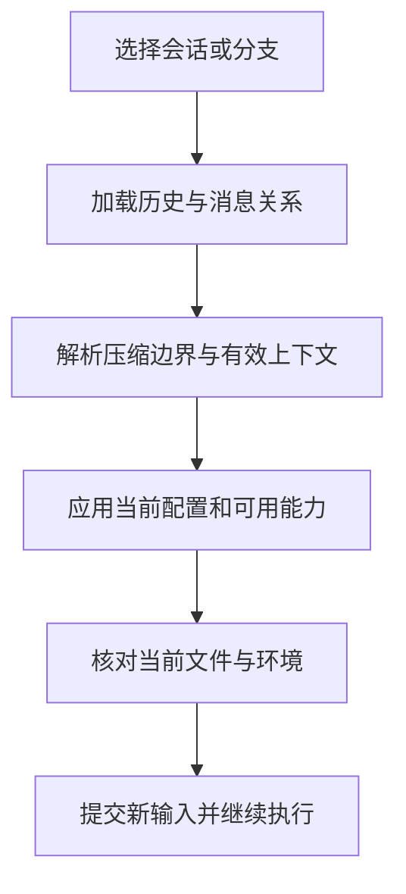

# 上下文与会话

<span class="dig-tag dig-tag--category">Claude Code</span> <span class="dig-tag dig-tag--hard">深入</span>

::: tip 核心要点
上下文管理决定模型**本轮看见什么**，会话管理决定系统**保存什么、如何继续**，检查点决定部分文件状态**如何恢复**。它们相互关联，却不是同一份数据。理解 Claude Code 的长任务能力，要把 Prompt 组装、工具结果处理、缓存、压缩、历史记录与恢复串起来，而不是归结为“上下文窗口足够大”。
:::

## 1. 三种状态视图

### 当前请求视图

模型请求包含适用的 System Prompt、工具定义、消息与附件。长历史可能已被替换、清理或总结，原始命令输出也可能只保留预览与文件引用。

这个视图由本轮任务需要和模型输入限制共同决定。模型没有看到某段历史，不能直接推断它已经从磁盘删除；反过来，磁盘里还存在文件，也不意味着模型已经读过它。

### 持久化会话视图

Transcript 记录消息和相关运行信息，支持继续会话、查找历史、分支与诊断。它需要保存身份和关系信息，而不只是将屏幕上的字符连起来。

一条 progress、一次文件读取、一段 assistant 文本和一个压缩边界，具有不同语义。恢复时要读取相应记录并重建有效历史，不能把每一行都当成一条新的用户指令。

### 环境与文件视图

实际文件、Git 分支、数据库、运行中的进程与远端系统都在对话之外。对话恢复可以保留“上次执行了什么”，但不能保证这些对象仍停留在上次状态。

这也是长任务必须再次验证环境的原因：昨天的成功测试记录可以帮助定位，但今天的文件版本才是当前修改的基线。

## 2. Prompt 与指令怎样组装

### 稳定指导与动态信息分离

产品级工具指导和行为约定通常变化较少，工作目录、任务状态、当前文件和新工具结果则经常变化。把两类信息合理分层，可以减少重复构造和不必要的缓存失效。

CLI 2.1.84 的实现中存在系统提示的动态边界标记以及 `cacheSafeParams` 一类上下文快照传递。它们说明某些辅助调用需要复用一致的 Prompt、工具和消息前缀，而不是每个调用都独立拼一段随意文本。

但**动态组装不等于每一轮都从零生成整个 System Prompt**。当前官方接口还支持在会话首次请求时记录系统提示并在后续复用，压缩或特定配置会改变重建时机。阅读旧版本流程与配置当前版本时，应分别看对应行为。

### CLAUDE.md 不等于 System Prompt

根据官方说明，CLAUDE.md 内容通过系统提示之后的用户侧上下文进入对话，并不是直接替换模型的系统角色。运行时可以把它作为带来源标识的项目知识，但普通文件文本不因此成为不可绕过的权限规则。

指令发现还涉及目录层级、导入、路径规则和配置来源。项目根指令可以在启动时加载，某些子目录指令在访问相关文件时按需加载，避免一开始把所有模块规范都塞入会话。

### 导入与按需加载不同

把一大段内容拆成多个文件，再全部用导入引入，只改善文件组织，不一定减少 Token。真正的按需加载需要先提供足够的索引或描述，再在任务相关时读取正文。

Skill 描述、工具搜索提示和记忆索引都体现这种思想。但索引过长本身也会占用预算，不能把所有知识都伪装成“轻量描述”常驻上下文。

### 动态附件承担什么

文件改变、工具结果、计划信息、任务通知和恢复相关数据都可能通过附件或元消息进入后续上下文。它们的来源、生命周期和注入位置应该可追踪。

将外部文本包装成系统提醒的外观，不会使其获得真实系统权限。来自网页、文件、MCP 或子 Agent 的内容仍需按其来源处理，防止低信任数据冒充用户授权。

## 3. 缓存与预算

### Prompt Cache 缓存的是输入计算

Prompt Cache 复用相同输入前缀的处理结果，不是在复用上次的最终答案。模型仍需要根据本轮新增信息继续生成。

稳定的系统提示、工具列表和历史前缀通常更利于缓存复用；在前缀中不断插入当前时间、随机 ID 或重排工具列表，会增加失效机会。即使自然语言含义相同，序列化内容或顺序改变也可能无法复用。

不能把某个固定命中率写成架构保证。实际命中取决于模型、缓存条件、请求内容、时效和调用模式，必须通过用量数据测量。

### 缓存与压缩可能存在取舍

清理旧结果可以减少输入长度，但改变已缓存的历史前缀；保留过多内容有利于前缀稳定，却增加上下文负担。实现需要在空间、延迟、费用和信息保真之间做权衡。

某些辅助调用会尝试复用父调用的上下文快照。它们依赖的是兼容的系统提示、工具与消息组合，而不是“子 Agent 都写同一句开场白”就自动共享全部缓存。

### 预算必须留下执行空间

一次请求需要同时容纳指导、工具定义、有效历史、新输入，以及模型输出。工具结果随后还会增加下一轮输入，所以不能等到恰好达到模型上限才考虑清理。

还要分清四个计量：上下文窗口、单次输出上限、任务累计用量和运行轮数。缩小历史不会退还之前已经发生的 API 费用；增加任务金额预算也不会扩展模型的上下文窗口。

## 4. 压缩如何保留任务语义

### 第一层：控制单个结果体积

大文件、长测试日志和搜索结果可能一次就占满输入。工具结果层可以限制返回范围、保存完整输出到文件并附带预览，让模型按需继续读取。

这一层应保留足够的诊断价值：错误摘要、关键路径、截断提示与后续读取入口。只保留“输出过长”而丢掉全部失败细节，会让下一轮无法推进。

### 第二层：轻量清理旧结果

CLI 2.1.84 中的部分 microcompact 路径会选择较旧工具结果，将大段内容替换为清理标记，同时保留结果的结构与关联 ID。它不一定调用模型生成摘要。

为什么保留结构？因为工具调用与结果存在协议关系。若把旧结果连同 ID 全部删除，却留下对应 tool_use，后续请求可能出现未配对的调用；若把结果误接到另一工具 ID，又会污染推理。

下面是自行构造的关系示意，只展示内容块，不是完整 API 请求：

```json
{
  "call": {
    "type": "tool_use",
    "id": "call_example_read",
    "name": "Read",
    "input": { "file_path": "/workspace/pagination.ts" }
  },
  "result": {
    "type": "tool_result",
    "tool_use_id": "call_example_read",
    "content": "Earlier file content was cleared; read the file again if needed."
  }
}
```

### 第三层：总结历史并重建输入

自动压缩会判断输入是否逼近适用阈值，必要时请求摘要，再构建较小的后续上下文。摘要不是简单保留最后几条消息：还需要携带任务目标、已确认约束、关键发现、当前改动与待完成工作。

在所选实现中，压缩路径会检查返回中是否有有效摘要文本，空摘要和 API 错误不会被当成成功压缩。自动压缩还跟踪连续失败，避免永远执行同一个失败操作。

压缩成功后会形成 `compact_boundary` 等边界信息，供后续历史处理理解“从哪里开始使用新的上下文视图”。边界和摘要共同构成恢复依据，不应把它们当作普通日志丢掉。

### 主动压缩与响应式压缩

主动压缩发生在请求准备阶段，依据估计与阈值预防超限；响应式压缩发生在适用失败之后，尝试修复已经被拒绝的输入。后者需要记录是否已经尝试，以免遇到无法压缩的大对象时反复循环。

两者都不保证无限长任务可以无损延续。摘要会丢细节，文件和环境还会变化，因此关键约束应保存为可重新读取的任务资料，重要结论需要再次验证。

## 5. 记忆不是聊天记录备份

### 三类资料各有用途

**项目指令**表达稳定约定；**任务状态**描述当前工作进度与未决问题；**跨会话记忆**保留以后仍有价值的知识。把所有对话都当作长期记忆，会增加噪声、过期信息和隐私风险。

Claude Code 的自动记忆通常组织为一个简短索引与多个主题文件，运行时加载索引的受限部分，模型按需读取主题。默认位置位于相应项目的 `~/.claude/projects/<project>/memory/` 下，可受配置影响。

### 索引和正文分别控制成本

当前官方说明中，启动读取 MEMORY.md 的前 200 行或前 25KB，以先达到者为准；主题文件不是全部自动进入每次请求。这是一个明确的加载预算，而不是模型拥有无限跨会话记忆。

索引应说明“存在什么知识、何时读取”，主题正文则保留必要背景。索引尾部被截断时，相关知识即使仍在磁盘，也可能没有被发现。

### 记忆需要纠错和过期处理

“某次测试命令在某个临时环境失败”未必是长期规则；“项目必须兼容某个旧协议”才可能影响以后工作。写入前需要判断适用范围、证据和时效。

不要保存密钥、完整敏感日志或未经确认的个人信息。记忆文件也应能被查看、修正和删除；遇到冲突时，优先核对当前任务指令与真实代码，而不是盲信较早总结。

## 6. 持久化、恢复与分支

### 消息必须带身份和关系

持久化历史不仅需要消息内容，还需要消息 ID、会话归属、父消息关系和分支信息。CLI 2.1.84 的会话分支路径可见 `sessionId`、`parentUuid`、`isSidechain` 与 `forkedFrom` 等字段处理。

在该分支路径中，新历史会得到新的会话 ID，重新建立父消息链，并记录来自原会话的哪条消息。这说明 Fork 不是把一个 JSON 文件换个文件名就完成，更不是复制模型服务端的完整推理状态。

### Resume 与 Fork

Resume 继续目标会话，让新消息接在对应历史之后；Fork 从一个历史位置建立新的会话分支。两者都需要选择有效消息链与压缩边界，而不是简单按时间排序全部记录。

**对话 Fork 与 Git worktree 是两个操作**。前者分离对话，后者分离文件 checkout。两个会话即使 ID 不同，若仍修改同一目录，文件冲突并不会自动消失。

### 恢复是重新建立执行环境



运行中的进程、网络连接、工具实例和过期审批不能仅凭历史文本恢复。子任务是否仍存在、服务是否可用、工具是否更新，都需要现实检查。

### 文件检查点另有边界

检查点服务于支持的文件编辑恢复，不等于事务日志。Shell 引起的文件修改、外部进程变更、数据库写入和部署通常不在同样的恢复范围内；子 Agent 编辑是否纳入主会话检查点也与运行方式有关。

恢复对话而保留文件，可能让模型的记忆落后于当前代码；恢复文件而保留对话，则可能让“已经完成”的叙述领先于文件状态。无论选哪一种，都要再次读取相关文件和运行验证。

## 7. 长任务的验证方法

### 一个好的压缩摘要应保留什么

以分页任务为例，至少需要保留：原始失败条件、不变的接口约束、已修改文件、真实测试结果、尚未验证的场景，以及下一步应检查什么。

下面是任务状态摘要的教学示例，不是固定的内部摘要模板：

```text
目标：修复恰好一页时遗漏末条记录的问题。
约束：响应字段不变；不升级依赖；不修改无关模块。
已确认：边界计算有 off-by-one；最小失败用例已复现。
当前状态：实现与回归测试已修改，局部测试通过。
待完成：验证多页与空集合场景，检查 diff 范围。
注意：“局部测试通过”只针对摘要前的文件版本。
```

### 不只测试“还能继续聊天”

1. 在接近上下文限制时继续任务，检查约束、工具关联和待办是否保留。
2. 注入空摘要或压缩错误，确认不会覆盖有效历史或无限重试。
3. 压缩后修改真实文件，检查 Agent 是否重新获取当前版本。
4. 从历史分支继续，确认消息归属正确、没有污染原会话。
5. 在工具执行前后分别中断，检查恢复后是否重复产生副作用。
6. 删除或修正一条记忆，检查后续行为是否仍被旧结论影响。

衡量长任务可靠性，应该看约束保持、错误恢复和副作用一致性，而不只是窗口大小或摘要压缩率。

关联阅读：[运行机制](./runtime)、[通用上下文工程](../context-and-memory)、[官方记忆说明](https://code.claude.com/docs/en/memory)、[会话](https://code.claude.com/docs/en/sessions)、[检查点](https://code.claude.com/docs/en/checkpointing)。