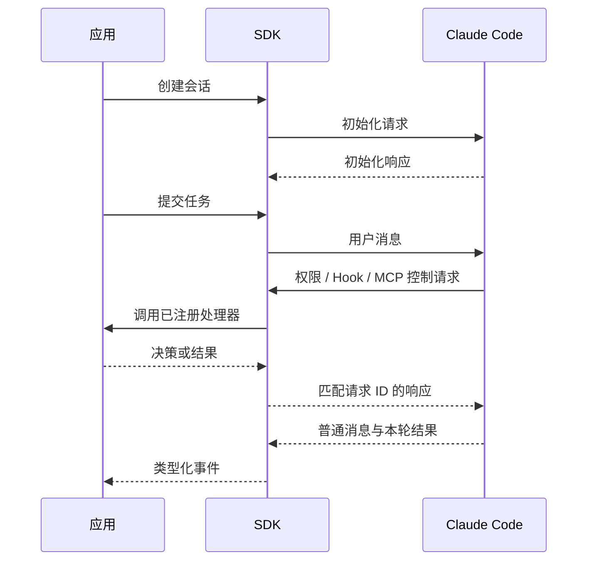

# 协作与扩展

<span class="dig-tag dig-tag--category">Claude Code</span> <span class="dig-tag dig-tag--hard">深入</span>

::: tip 核心要点
Claude Code 的扩展能力围绕已有运行时组合：**子 Agent 分担任务，Skills 提供方法，MCP 提供外部能力，插件组织分发，SDK 和交互接口连接宿主**。它们不是五个互相替代的框架。协作的难点也不只是创建更多 Agent，而是输入是否完整、权限如何继承、状态如何关联、结果何时可用，以及谁负责最终验证。
:::

## 1. 子 Agent 如何参与任务

### 委派本身也是一次工具调用

主 Agent 根据任务决定是否委派，再通过相应工具提供任务说明、子 Agent 类型和受支持的运行选项。运行时解析 Agent 定义，准备工具与上下文，然后执行子任务。

子任务也可以经历多轮模型与工具交互。主 Agent 不必接收其每次读取的完整内容，而是消费结果和必要证据，从而降低主会话上下文负担。

```text
主任务发现一个可独立处理的问题
  → 构造委派说明与限制
  → 解析子 Agent 定义、模型和工具
  → 创建子任务身份与执行上下文
  → 子任务执行自己的模型 / 工具循环
  → 返回完成、失败、中断或部分结果
  → 主 Agent 汇总并验证
```

### 三种上下文关系

**普通子 Agent**从自己的定义和委派消息开始，不应假设它知道主会话刚才读到的所有文件。当前官方行为还区分内置 Explore/Plan 与其他 Agent 的启动上下文，某些项目资料不会一律加载。

**继承会话的 fork**基于父会话的历史和相关上下文开始，适合已有背景很重的侧任务。它减少重复解释，但也可能继承父会话中的错误假设。

**Skill 的 `context: fork`**表示把 Skill 内容交给独立子 Agent 执行，不等于复制当前对话历史。不能仅凭 fork 这个名字就假设它拥有所有前文。

### 权限与上下文是不同边界

独立上下文不等于独立机器，也不保证更窄权限。子 Agent 的有效工具池与权限受到父会话、Agent 定义、前后台模式和组织策略共同影响。

同样，“没有 Edit 工具”不必然意味着无法修改文件：如果仍能执行任意 Shell 命令，写入能力可能仍存在。真正的限制应落实到工具、审批和环境，而不只是角色提示词。

## 2. 前后台任务与结果汇总

### 前台等待与后台通知

前台子任务通常需要先完成，主流程才继续使用它的结果；后台任务可以与主任务并行，完成结果通过后续通知进入会话。默认选择随产品版本、运行模式和任务类型变化，应观察实际任务状态。

无论哪种方式，都要区分**已创建、正在执行、已完成、失败与被取消**。启动一个任务不意味着得到一个有效结果；没有新日志也不意味着任务已经完成。

### 身份关联不能靠文字标题

一次系统可能同时存在会话 ID、Agent ID、任务 ID、工具调用 ID 和控制请求 ID。名称是面向人的标签，而 ID 才用于准确关联对象。把“测试任务”这样的标题当主键，很容易在重试或同名任务中串线。

主任务汇总时应保留：结果来自谁、处理了哪些文件、实际执行了什么检查、输出是否完整、还有什么限制。不要把后台进度文本提前包装成最终报告。

### 可并行与应该并行不同

分页任务可以把“检查接口契约”和“检查测试边界”作为独立阅读任务；如果两个任务同时修改同一个测试文件，则需要文件所有权或独立 worktree，再由主任务合并。

多 Agent 还会增加模型用量、重复探索和结果整合成本。任务很小、上下文高度共享或需要频繁确认时，主会话直接处理通常更合适。

### 团队协作不是普通委派的同义词

共享任务列表、成员之间消息传递和团队生命周期，需要比“调用一个子 Agent 并等待结果”更多的协议。配置了多个角色，不代表它们已经有共同任务状态，更不能推导出自动使用 A2A。

对有依赖的任务，应明确谁负责输入、谁拥有修改权、何时解锁后继任务，以及失败后是否需要取消其他工作。Agent 报告中的“已获批准”也不能代替真实用户审批。

## 3. MCP 怎样进入工具系统

### 从服务发现到工具适配

MCP 连接建立后，宿主获取 Server 提供的能力，把工具描述和输入 Schema 适配进本地工具系统。模型仍然产生工具调用，运行时负责权限判断与实际转发。

```text
读取有效 MCP 配置
  → 连接、认证与能力协商
  → 获取工具列表和说明
  → 包装为运行时工具对象
  → 模型选择并提交参数
  → 宿主检查权限并转发请求
  → Server 返回结果
  → 适配、限长、关联调用 ID，再进入主循环
```

MCP 解决连接与契约，不负责替代模型的任务规划，也不自动证明 Server 的输出可信。

### 为什么要延迟加载工具

大量工具的完整 Schema 会占据上下文。延迟加载先让模型知道可发现的能力，需要时再获取具体定义。

CLI 2.1.84 的实现中，工具延迟判断涉及 MCP 属性、工具自身的 `shouldDefer` 和功能条件，ToolSearch 结果还可以返回 `tool_reference`。这说明工具池、当前已加载定义和本轮可调用工具不是完全相同的集合。

应检查完整链路：发现到名称之后，Schema 是否真正进入模型可见工具集，连接是否就绪，最终调用是否仍受权限控制。工具搜索成功不等于外部服务已经能执行请求。

### 外部 Server 与 SDK 进程内 Server

外部 MCP Server 可以通过本地子进程或受支持的网络传输提供服务。SDK 进程内 Server 则将工具函数放在宿主应用中，减少独立 Server 的部署和进程管理。

不过，“进程内”描述的是工具函数与 SDK 宿主的关系。默认 Python SDK 仍可能启动 Claude Code CLI 子进程，因此 CLI 与宿主之间仍有 IPC，不能据此宣称整条工具调用没有跨进程通信。

### 外部能力需要额外故障处理

连接失败、认证过期、工具列表变化、调用超时和返回过大应有不同诊断信息。具有写副作用的请求在超时后不能盲目重试：需要确定远端是否已经提交，或使用业务幂等机制。

## 4. Skills 与插件怎样加载

### Skill 的三个阶段

**发现阶段**读取名称、描述与配置，使模型或用户能够选择它。**调用阶段**加载正文、参数和必要资源。**执行阶段**仍由运行时使用工具完成任务，而不是 Markdown 自己执行全部步骤。

有些 Skill 支持动态命令上下文，需要先执行受支持的命令再把输出注入正文。这是实际执行面，不是无害的文本宏；应检查脚本来源、权限和超时。

### 指令生效与临时批准不同

Skill 的自然语言正文不会自行越过宿主安全策略；但 Claude Code 会解释其中的配置字段。例如，`allowed-tools` 可以为调用所在轮次提供自动批准规则，不能把它当成仅用于展示的文档。

这个字段也不代表唯一可用工具集合。正文内容、临时批准规则、组织策略和工具可见性的生命周期不同，不能因正文还留在历史中，就认定其批准规则也一直有效。

### 用一个具体任务组织 Skill

下面是一个教学用 Skill 内容，适用于已经知道待检查范围的分页回归审查；这里只展示定义，不在当前项目安装：

````markdown
---
name: pagination-review
description: Review pagination boundary handling and regression coverage.
disable-model-invocation: true
---

Review $ARGUMENTS without changing files.

1. Read the pagination implementation and its tests.
2. Check empty input, an exact page, and a partial final page.
3. Identify missing assertions and report evidence by file and symbol.
4. Distinguish confirmed defects from cases that still need execution.
````

它描述任务方法，不是安全沙箱。若要求严格只读，还要限定实际工具和执行权限。把同样内容交给独立子 Agent 时，也必须保证委派说明包含它所需的背景。

### 插件是一组能力的组织单元

插件可以携带 Skills、Agent 定义、Hooks 和 MCP 配置等。加载过程需要解决路径、名称空间、启停状态和运行时注册，不是只把一个目录放进模型上下文。

禁用插件不等于抹除会话里已经出现的内容，更新插件也不等于所有已创建连接和缓存会自动采用新定义。排错应分别检查安装状态、配置生效状态与本次会话实际使用的能力。

## 5. SDK 如何连接执行引擎

### Python SDK 的实际调用路径

以 Python SDK 0.2.168 的默认传输为例，`query()` 将任务交给内部客户端；`SubprocessCLITransport` 构造 CLI 参数并启动子进程；内部 `Query` 处理初始化、消息分发和控制回调；parser 再把普通消息转换成公开类型。

交互式 `ClaudeSDKClient` 在这个基础上提供连续输入、逐轮接收和中断等能力。读取这里的循环时，要记住它负责驱动与通信，模型和工具之间的主循环仍在 Claude Code 运行时中。

### 双向控制协议

消息管道同时承载普通输出和控制消息。控制请求通过 `request_id` 配对；工具调用通过自己的 ID 配对；两者不能混用。



`hook_callback` 通过 callback ID 找到宿主函数，`mcp_message` 把 JSON-RPC 交给相应 Server，`can_use_tool` 处理需要应用确认的权限请求。初始化时传递的是可序列化描述和回调标识，而不是把 Python 函数直接塞进 JSON。

### 管道数据必须正确分帧

stdin/stdout 的 `stream-json` 通常按换行分隔消息，但操作系统读取的是任意大小的数据块。一条消息可能跨越多次读取，一个块也可能含多条消息。

传输层需要重组完整行、处理 EOF 与坏 JSON、限制缓冲并协调并发写入。不能对半截块先做 strip，也不能在其他任务仍写入时直接关闭 stdin。

### 一个最小宿主示例

下面使用公开 API 观察一轮结果，不手动执行收到的内置工具调用。运行需要 Python 3.10+、`claude-agent-sdk==0.2.168`、可用 CLI 与认证，且会产生模型用量；只在受控测试目录运行。

```python
import asyncio
from pathlib import Path

from claude_agent_sdk import ClaudeAgentOptions, ClaudeSDKClient, ResultMessage


async def main():
    options = ClaudeAgentOptions(
        cwd=str(Path.cwd()),
        tools=["Read", "Glob", "Grep"],
        allowed_tools=["Read", "Glob", "Grep"],
        disallowed_tools=["mcp__*"],
        permission_mode="dontAsk",
        setting_sources=[],
        strict_mcp_config=True,
        max_turns=4,
        max_budget_usd=1,
    )
    async with ClaudeSDKClient(options=options) as client:
        await client.query("Read README.md and summarize its purpose.")
        async for message in client.receive_response():
            if isinstance(message, ResultMessage):
                if message.is_error:
                    raise RuntimeError(message.errors or message.result)
                if message.terminal_reason not in (None, "completed"):
                    raise RuntimeError(message.terminal_reason)
                print(message.result)


asyncio.run(main())
```

`receive_response()` 到一条 ResultMessage 后返回，但客户端仍然存在。复杂后台任务不应照搬这个单轮消费方式：需要继续处理后续状态与通知，并定义整体结束条件。

## 6. 交互层怎样消费事件

### TUI 是运行状态的投影

终端界面需要同时显示输入、消息、工具状态与审批。它消费执行引擎事件，再更新对应的界面状态，不能把“终端是否还在刷新”当作任务唯一的存活判据。

内部撤销、合并和进度事件也不一定都对 SDK 暴露。不同交互层可以有不同显示方式，但应对同一个动作的批准状态和完成状态保持一致。

### 中断与新输入不能串轮

SDK 的 interrupt 请求不会自动清空已经缓冲的旧消息。中断后立即提交新任务，再只读取一次“下一条结果”，可能读到的是旧任务的结束消息。

宿主应先消费相应终止结果，维护请求与会话关系，再开始或区分下一项工作。取消控制消息得到响应，也不能说明远端写操作已经回滚。

### 远程控制与远端执行

Remote Control 可以让用户从另一界面控制本地执行，文件和工具仍可能留在原机器。云端任务则运行在相应远端环境。两者的网络路径、凭据、文件同步与故障恢复不同。

判断一个集成时，先回答：**界面在哪里、模型请求从哪里发出、工具在哪里执行、状态保存在哪里**。不要只因使用浏览器，就认为代码一定在云端运行。

### 正确关闭仍是协议的一部分

有后台工作需要继续发送权限、Hook 或 MCP 请求时，过早关闭 stdin 会切断控制通道；但等待所有后台进程自然退出又可能永远等不到开发服务器结束。

宿主和运行时需要区分一轮结果、可终止子任务、长期后台服务以及整体会话状态。资源清理应有界，并考虑取消路径，不能只在成功分支中执行。

## 7. 组合能力的验收

对分页任务，一个合理组合可以是：主 Agent 负责修改；只读子 Agent 检查边界测试；Skill 提供统一审查方法；MCP 读取相关需求；Hook 执行必要检查；SDK 负责把任务和结果接入现有系统。

但不要为了覆盖所有功能而把它们全部装上。每增加一项，都应能说明它解决的具体问题，以及失败后谁接手。

| 验收点 | 需要验证 |
|--------|----------|
| 委派完整性 | 子任务拿到独立完成工作所需的背景与约束 |
| 权限一致性 | 子任务、外部工具和回调没有绕开主任务边界 |
| 状态关联 | 重试、同名任务与后台通知不会串到其他请求 |
| 结果可靠性 | 部分输出、失败与真正完成被明确区分 |
| 修改一致性 | 并发任务不互相覆盖，合并后重新验证 |
| 配置生效 | Skill、插件与 MCP 的实际加载状态符合预期 |
| 资源退出 | 取消、断线和异常后没有无限等待或失去控制的任务 |

这一组能力最终服务于同一个目标：让编程任务在真实环境里可执行、可纠偏、可验证。复杂度应该来自任务需要，而不是来自 Agent 数量。

关联阅读：[工具与权限](./tools)、[上下文与会话](./context)、[官方子 Agent](https://code.claude.com/docs/en/sub-agents)、[Skills](https://code.claude.com/docs/en/skills)、[MCP](https://code.claude.com/docs/en/mcp)、[插件](https://code.claude.com/docs/en/plugins/overview)、[Python SDK](https://code.claude.com/docs/en/agent-sdk/python)。