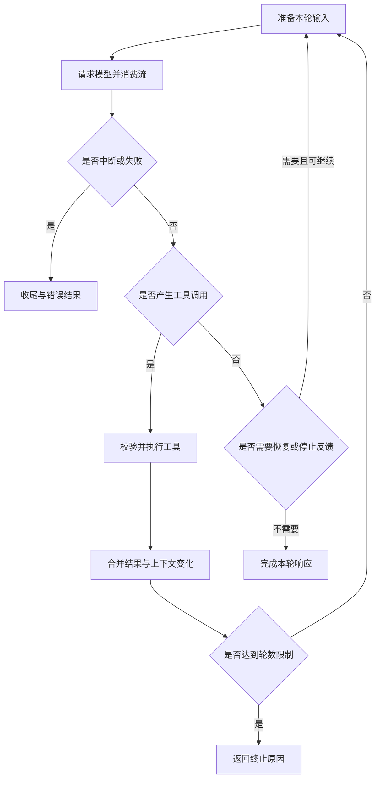

# 运行机制

<span class="dig-tag dig-tag--category">Claude Code</span> <span class="dig-tag dig-tag--hard">深入</span>

::: tip 核心要点
Claude Code 的执行核心可以理解为一个**持续产出事件的异步状态机**：输入先被处理成任务消息，运行时准备本轮上下文，模型返回文本或工具调用，工具结果再进入下一轮。真正复杂的部分是状态如何跨轮保存，以及压缩、重试、中断、停止检查如何改变控制流。终端只是事件消费者之一，不是执行引擎本身。
:::

## 1. 从入口到执行引擎

### 同一个任务，不同输入外壳

交互终端需要处理键盘输入、对话显示、审批和中断；非交互模式需要处理标准输入、结构化结果和进程退出；SDK 还要处理双向控制消息。它们不应各自复制一套完整的工具执行循环，而是通过适配层使用共同的运行能力。

可以按职责把运行路径分成六层：

```text
终端 / IDE / 非交互输入 / SDK
  → 参数、配置、身份与会话初始化
  → 输入处理：命令、文件引用、附件、用户消息
  → 主循环：准备上下文、请求模型、决定继续路径
  → 工具执行：校验、权限、动作、结果
  → 事件适配：展示、持久化、控制协议与最终结果
```

这是一张职责图，不代表每一层都对应一个独立进程。尤其在默认 SDK 接入中，应用与 CLI 可以通过子进程通信，但 CLI 内部工具不因此都变成独立服务。

### 启动阶段解决哪些问题

启动不只是读取一条 prompt。运行时还需确定工作目录、配置来源、模型接入、权限模式、可用工具、扩展与目标会话。恢复已有会话与创建新会话也有不同初始化路径。

有些操作属于管理命令，不需要进入模型循环；有些输入会先在本地处理，再变成模型可见消息。判断一段启动代码的作用，首先看它是否真的调用了主循环，而不是看到“command”就认为一定消耗模型 Token。

## 2. 输入如何成为本轮上下文

### 用户输入不是原样透传

用户可以发送普通文本、文件引用、图片或命令。运行时需要解析输入类型、收集适用上下文、处理相应事件，并保留来源信息。

例如“检查这个文件”与引用具体文件路径不是同样的信息量。引用处理可能增加文件内容；一条 Skill 命令可能展开为指令和参数；运行时还可能补充当前模式、工具结果或环境变化。

所以观察模型请求时，应区分**用户最初输入、处理后的消息、最终 API payload**。三者不同不一定是 bug，但每一项增加的内容都应有明确来源和信任边界。

### 不同数据不应揉成一个字符串

- **System Prompt**：产品级行为、工具使用方式等约束。
- **项目上下文**：适用的项目指令、环境信息与文件内容。
- **会话消息**：用户输入、模型输出以及工具调用和结果。
- **执行上下文**：权限状态、取消控制器、工具集合、缓存和应用状态访问器。

最后一项尤其重要：执行上下文中的对象不一定送给模型。取消句柄、工具实现函数或应用状态访问器属于宿主运行时，不能把它们等同于 Prompt。

## 3. 主循环保存哪些状态

### 从真实状态对象切入

以 CLI **2.1.84** 的实现为例，主循环主体可定位到异步生成器 `po_`。其中跨轮状态包含 `messages`、`toolUseContext`、`turnCount`，还保存压缩、续写与停止检查相关字段。压缩符号名只用于定位这个版本，不是稳定公共 API。

关键字段可以分为四组：

1. **对话与环境**：`messages` 保存进入后续轮次的历史，`toolUseContext` 提供本次执行所需的工具、权限、取消与应用状态。
2. **压缩状态**：`autoCompactTracking` 记录压缩后的跟踪信息；`hasAttemptedReactiveCompact` 避免同一恢复路径无限尝试。
3. **恢复与停止**：`maxOutputTokensRecoveryCount` 记录输出截断续写次数，`stopHookActive` 区分正在处理停止反馈的状态。
4. **跨轮辅助结果**：`pendingToolUseSummary` 可以携带上一轮尚未消费的摘要任务，`turnCount` 用来约束工具轮续转。

这表明主循环并非简单递归调用一个 API。它需要知道本轮为何开始、哪些恢复动作已经试过，以及哪些异步结果将在后续消费。

### 长期状态与单轮临时变量

一轮内部还需要暂存模型返回的 assistant 片段、工具调用集合、工具结果及新的执行上下文。这些临时集合不能直接与完整会话状态混为一谈。

例如，流式请求失败后改走另一条请求路径，需要撤销或清理已经产出的孤立片段；如果只维护一个不断追加的字符串，便很难知道哪些内容可以保留，哪些调用尚未闭合。

### 字段存在不代表它驱动控制流

该版本在状态重建时写入 `transition.reason`，用于标记这次转移的原因。理解分支时仍要追踪真实的 `continue`、`return` 和等待点，不能只因看到一个叫 transition 的字段，就把它解释成由通用状态机框架读取的调度命令。

## 4. 一轮模型调用如何展开

### 请求前的准备

主循环先规范化历史和内容替换状态，再经过轻量上下文处理与自动压缩判断，然后准备实际模型请求。这里处理的是本轮输入视图，并不意味着历史持久化文件已被同样截断。

接着选择适用模型与参数，组装工具定义、消息和系统上下文。模型适配层还承担认证、provider 协议差异、流式传输与错误转换；这些工作不应塞进具体文件工具的实现。

### 流式输出不是纯文本

模型流可以包含消息开始、内容块开始、文本增量、工具参数增量和结束信息。运行时逐渐把它们转换成可消费的内容块与内部事件。

工具参数还在增量生成时不能当成完整 JSON 执行。能做流式工具执行，也必须在相应工具调用形成、参数可校验后才交给执行器，而不是边收到字符串边运行 Shell。



### 请求完成与 Agent 完成不同

一次模型请求结束，可能只是要求调用工具。工具执行完成后，运行时再把结果交给模型，模型才有机会解释测试失败并选择下一步。

一条用户任务因此可以包含多次模型请求、多个工具调用与数次权限交互。`max_turns` 约束的也不能简单理解成用户发言条数或精确的工具调用总数。

## 5. 四类续转分支

### 正常工具轮

模型输出工具调用后，执行器产出消息以及可能更新的执行上下文。主循环将本轮 assistant 消息和下游工具结果并入历史，再构造下一轮状态。

在上述实现中，正常工具续转会增加 `turnCount`，重置输出恢复计数与响应式压缩尝试标志，并携带必要的压缩跟踪和延后摘要。这样新的任务进展不会被上一轮失败恢复计数错误地约束。

**例子**：Read 返回分页实现，下一轮模型提出 Edit；Edit 返回修改结果，下一轮提出测试命令。读、改、测不是三个固定阶段函数，而是多次工具反馈驱动的决策结果。

### 输入过长后的恢复

当输入过长等适用错误出现时，可以尝试响应式压缩。压缩成功后使用新的消息集合重试，并设置“已经尝试”的标志；如果仍无法恢复，就返回相应错误，不能不停压缩同一批输入。

这与请求前的主动压缩不同：前者是在估算阶段预防超限，后者是在明确失败之后尝试修复输入。两者的触发条件、预算与失败语义应分开。

### 输出截断后的续写

`max_output_tokens` 一类输出限制不意味着任务已完成。运行时可以保留已有输出、增加继续任务的元消息，并在有限次数内发起后续请求。

此路径增加的是输出恢复计数，不等同于正常完成一个工具轮。输入超限与输出截断分别需要“减少输入”和“继续产出”，不能用同一种盲目重试处理。

### Stop Hook 反馈后的继续

模型没有再提出工具调用时，运行时可能进入停止检查。若检查反馈要求补充处理，可以把反馈加入下一轮，并标记正在执行停止后的继续流程。

如果一个检查永远要求继续，它会制造无限任务。Hook 本身需要有明确通过条件、递归保护与执行预算；模型愿意说“已完成”，不应绕过必要检查，检查也不应无条件延长工作。

## 6. 事件、错误与中断

### 异步生成器为什么合适

异步生成器允许引擎在等待网络或工具时持续 `yield` 进度与消息，而不必先得到完整最终结果。上层可以分别负责显示、记录或转成 SDK 消息，执行器不必知道终端应该怎么画。

内部事件也不都属于公共协议。以 `tombstone` 为例，所选版本在流式回退时使用它撤销不应保留的 assistant 片段，而 headless 适配路径会过滤该事件。不能假设内部所有 `yield` 都原样出现在 `stream-json` 中。

### 在不同阶段中断

**模型流中断**需要停止接收生成，并处理已经出现但尚未完整完成的工具调用。**工具执行中断**则需要取消相应执行任务、收集能够得到的结果并返回明确的中断原因。

该版本分别存在 `aborted_streaming` 与 `aborted_tools` 返回路径。这不是多余的命名：同样按一次停止键，系统可能需要处理完全不同的资源与副作用。

取消是控制信号，不是时间倒流。一个 HTTP 写请求可能已被服务端提交，一个文件可能已保存。调用者必须区分“请求取消已发出”和“副作用确定没有发生”。

### 错误不能只看一层

- 网络请求失败：可能适用退避与重试，但已产生的输出需要保持一致。
- 输入过大：改变上下文后才有重试价值。
- 工具参数无效：应返回可理解的工具错误，让模型修正调用。
- 权限拒绝：不是网络抖动，不应自动绕开规则重试。
- 业务验证失败：通常应继续定位代码，不是重新启动整个会话。

所选实现甚至存在 API 错误消息之后由内部循环返回 `completed` 的路径。因此，**内部循环返回、API stop reason、SDK result 和业务成功是四种不同语义**。调用方需要检查错误消息与结果标志，不能只匹配一个名叫 completed 的字符串。

## 7. 用一条轨迹检查理解

以分页任务为例，一条可能的轨迹是：

```text
用户要求修复分页边界
  → 搜索接口与测试
  → 读取实现，模型提出边界假设
  → 运行最小用例，确认失败
  → 编辑实现和回归测试
  → 测试返回一个新的失败
  → 模型根据失败再次读取并修正
  → 验证通过，停止检查不再要求继续
  → 输出改动、验证结果与未覆盖范围
```

阅读实现时，沿着这条轨迹检查五个不变量：

1. 工具调用和结果能通过 ID 关联，不能只按出现顺序猜配对。
2. 本轮消息只在正确阶段并入后续状态，不混入已作废片段。
3. 压缩重试、续写和正常工具轮使用不同的计数与重置策略。
4. 失败或取消后仍能关闭资源、输出终止信息，而不是留下永远等待的消费者。
5. 最终回答中的验证结论能够对应实际工具证据。

测试引擎不必每次都调用真实模型。可以使用固定的事件序列模拟工具调用、截断、拒绝和中断，检查状态与输出；再用少量真实任务验证协议和环境集成。这样能区分运行时 bug 与模型选择的不确定性。

进一步理解通用执行层见 [Harness Engineering](../harness-engineering)。产品工作方式与外部接口分别参见[官方工作原理](https://code.claude.com/docs/en/how-claude-code-works)和[Agent Loop](https://code.claude.com/docs/en/agent-sdk/agent-loop)。