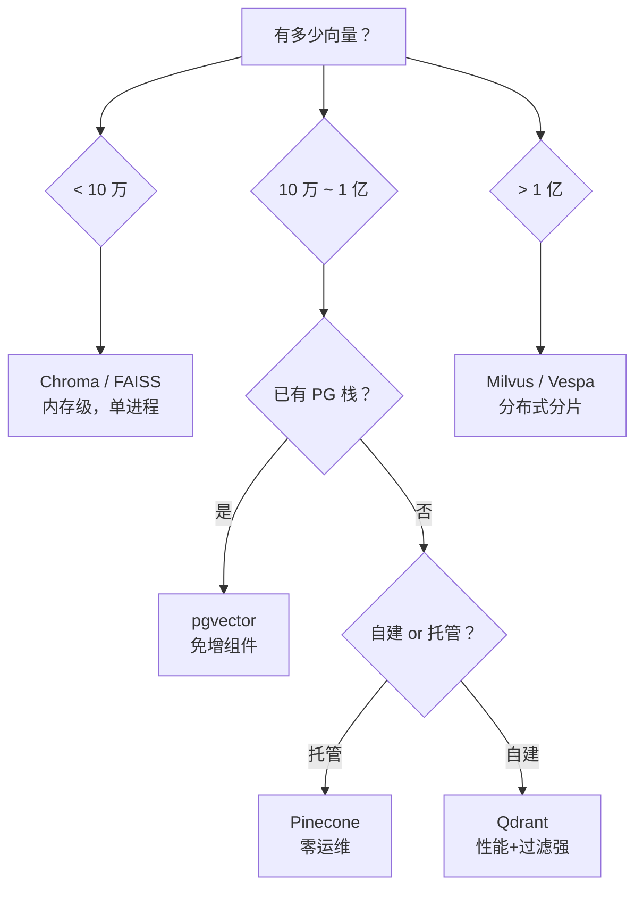
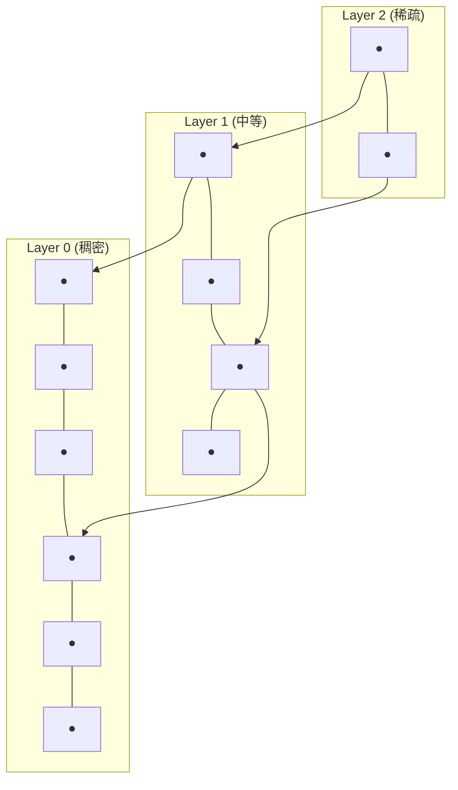

# Embedding 与向量数据库

<span class="dig-tag dig-tag--category">AI 技术</span> <span class="dig-tag dig-tag--medium">⭐⭐ 中级</span> <span class="dig-tag dig-tag--hot">🔥🔥 中频</span>

::: tip 💡 核心要点
Embedding（嵌入）是将文本、图像等数据映射到向量空间的技术；检索表示既包括捕获语义的**稠密向量（Dense）**，也包括保留词项权重的**稀疏向量（Sparse）**，二者可组成混合检索。向量数据库负责高效存储、近似最近邻搜索和元数据过滤。模型、索引、过滤语义与评测集必须配套选择，不能只看维度或排行榜。
:::

## 什么是 Embedding

### 从离散到连续

传统文本表示（如 One-Hot 编码）将每个词映射为一个高维稀疏向量，无法捕获词与词之间的语义关系。Embedding 则将文本映射到低维稠密向量空间，使得：

- **语义相近的文本**在向量空间中**距离更近**
- **语义无关的文本**在向量空间中**距离更远**

```
传统表示 (One-Hot):
  "猫" = [1, 0, 0, 0, 0, ...]     维度 = 词表大小（数万）
  "狗" = [0, 1, 0, 0, 0, ...]     无法反映"猫"和"狗"的语义相近

Embedding 表示:
  "猫" = [0.21, -0.35, 0.68, ...]  维度 = 768~3072
  "狗" = [0.23, -0.31, 0.65, ...]  向量相近 → 语义相近
  "汽车" = [-0.45, 0.82, -0.12, ...]  向量远离 → 语义不同
```

### 发展历程

| 阶段 | 方法 | 特点 |
|------|------|------|
| **2013** | Word2Vec（CBOW / Skip-gram） | 首次将词映射到稠密向量，发现向量算术（king - man + woman ≈ queen） |
| **2014** | GloVe | 基于全局词共现统计训练词向量 |
| **2018** | ELMo / BERT | 上下文相关的动态 Embedding，同一个词在不同语境中有不同向量 |
| **2022** | 专用 Embedding 模型 | 针对检索优化的 Embedding（对比学习训练），如 E5、BGE |
| **2024-2025** | 多模态与任务自适应 Embedding | Matryoshka 表示学习（灵活维度）、任务特定 LoRA 适配器（Jina v3）、多模态 Embedding（Cohere embed-v4 支持图文混合）、开源模型在 MTEB 榜单上全面追平甚至超越闭源 API（NV-Embed-v2、BGE-en-icl） |

在 Word2Vec 时代，每个词有一个**固定**的向量。现代 Embedding 模型基于 Transformer 编码器，生成的是**上下文相关**的句子/段落级 Embedding。2024 年以来，Embedding 领域的关键趋势包括：支持**灵活维度截断**（Matryoshka Representation Learning，OpenAI text-embedding-3 系列率先采用）、**任务自适应**（通过 LoRA 适配器针对检索/分类/聚类等不同任务优化）、以及**多模态嵌入**（将文本和图像映射到同一向量空间）。

### Dense、Sparse 与 Hybrid

| 表示 | 检索信号 | 优势 | 局限 |
|------|---------|------|------|
| **Dense** | 句子/段落级连续向量 | 擅长同义表达和语义匹配 | 可能漏掉编号、专有名词和精确短语 |
| **Sparse** | 高维稀疏词项权重（BM25 或学习式 sparse） | 精确匹配强、较易解释 | 对改写和跨语言语义较弱 |
| **Hybrid** | 并行召回后用 RRF/加权融合 | 同时覆盖语义与词法信号 | 多一套索引和调参成本 |

Hybrid 不是把不同分值直接相加：稠密相似度和 BM25 分数通常不在同一尺度，优先用 RRF 等基于排名的融合，或在标注集上做分数归一化与权重学习。

---

## Embedding 模型原理

### 编码器架构

现代 Embedding 模型通常基于 **BERT 类编码器**架构，通过双向注意力机制理解完整上下文：

```
Text --> Tokenizer --> Transformer Encoder --> Pooling --> Embedding Vector
                                                          [0.12, -0.34, ...]
```

### 训练方法：对比学习

现代 Embedding 模型主要通过**对比学习（Contrastive Learning）**训练：

$$
\mathcal{L} = -\log \frac{\exp(\text{sim}(q, d^+) / \tau)}{\exp(\text{sim}(q, d^+) / \tau) + \sum_{i=1}^{N} \exp(\text{sim}(q, d_i^-) / \tau)}
$$

其中 $q$ 是查询，$d^+$ 是正样本（相关文档），$d_i^-$ 是负样本（不相关文档），$\tau$ 是温度参数。

**核心思想**：拉近查询与相关文档的距离，推远查询与不相关文档的距离。

### 负样本挖掘策略

对比学习的效果高度依赖负样本的质量：

| 策略 | 说明 | 效果 |
|------|------|------|
| **随机负样本** | 从语料库随机采样 | 简单但效果有限 |
| **批内负样本** | 同一批次中其他样本的正样本作为负样本 | 高效，广泛使用 |
| **困难负样本** | 用 BM25 或初步模型检索出的"似是而非"的文档 | 显著提升模型区分能力 |

### Matryoshka 表示学习

Matryoshka Representation Learning（MRL）在训练时让向量的多个前缀维度都可用于任务，因此支持从完整向量截取前 $d$ 维，在效果、内存和延迟间权衡。它不是任意 Embedding 都具备的性质：**只有模型明确支持时才能安全截断**；使用 API 的 `dimensions` 参数时由服务端处理，手工截断则通常需要重新归一化。维度选择必须在本领域数据上评估 Recall@K / nDCG 与成本，不能假设固定损失比例。

### Late Interaction（延迟交互）

普通 Dense Bi-Encoder 把整段 Query 和 Document 各压成一个向量；ColBERT 一类 Late Interaction 模型保留 Token 级向量，并用 MaxSim 聚合：

$$
S(q,d)=\sum_{i \in q}\max_{j \in d} q_i \cdot d_j
$$

它通常能保留更细粒度的匹配信号，适合法律、医学、长文档等高召回场景，但每篇文档要存多个向量，需要专用压缩/索引和更高存储开销。它不是通用向量库里“再加一个向量字段”就能等价实现的方案。

---

## 相似度度量

将文本转为 Embedding 后，需要定义"距离"来衡量两个向量的相似程度。

### 余弦相似度（Cosine Similarity）

$$
\text{cos\_sim}(\mathbf{a}, \mathbf{b}) = \frac{\mathbf{a} \cdot \mathbf{b}}{\|\mathbf{a}\| \cdot \|\mathbf{b}\|}
$$

- 范围：$[-1, 1]$，值越大越相似
- **忽略向量的长度**，只关注方向
- 最常用的相似度度量

### 欧氏距离（Euclidean Distance）

$$
d(\mathbf{a}, \mathbf{b}) = \sqrt{\sum_{i=1}^{n} (a_i - b_i)^2}
$$

- 范围：$[0, +\infty)$，值越小越相似
- 受向量长度影响
- 适合已归一化的向量

### 点积（Dot Product / Inner Product）

$$
\mathbf{a} \cdot \mathbf{b} = \sum_{i=1}^{n} a_i \cdot b_i
$$

- 范围：$(-\infty, +\infty)$，值越大越相似
- 同时考虑方向和长度
- 当向量已归一化时，等价于余弦相似度

### 如何选择

| 场景 | 推荐度量 | 原因 |
|------|----------|------|
| 通用语义搜索 | 余弦相似度 | 对向量长度不敏感，跨文档稳定 |
| 已归一化的向量 | 点积 | 计算更快，结果等价余弦 |
| 需要考虑"重要性"差异 | 点积 | 向量模长可编码重要性信息 |

---

## 主流 Embedding 模型

| 模型 | 开发者 | 维度 | 最大长度 | 特点 |
|------|--------|------|----------|------|
| **text-embedding-3-large** | OpenAI | 3072 | 8191 Token | 英文综合性能优异，支持 Matryoshka 维度截断 |
| **text-embedding-3-small** | OpenAI | 1536 | 8191 Token | 性价比高，支持 Matryoshka 维度截断 |
| **Cohere embed-v4.0** | Cohere | 256 / 512 / 1024 / 1536 | 128K Token | 多模态（文本+图像），支持压缩和搜索类型 |
| **Voyage-4-large / Voyage-4** | Voyage AI | 以当前 API 规格为准 | 以当前 API 规格为准 | 新一代通用检索模型；法律、代码等领域仍需业务集评测 |
| **Voyage-4-lite** | Voyage AI | 以当前 API 规格为准 | 以当前 API 规格为准 | 轻量低延迟版本，适合高吞吐候选方案 |
| **NV-Embed-v2** | NVIDIA | 4096 | 32K Token | MTEB 榜单领先的开源模型 |
| **BGE-en-icl** | BAAI（智源） | 4096 | 32K Token | 支持 In-Context Learning 示例提升检索效果 |
| **BGE-M3** | BAAI（智源） | 1024 | 8192 Token | 开源多语言模型，同时支持稠密、稀疏和 ColBERT 多粒度检索 |
| **GTE-Qwen2-1.5B / 7B** | 阿里云 | 1536 / 3584 | 32K Token | 长文本与中文检索；具体许可证和显存按型号核对 |
| **Jina Embeddings v3** | Jina AI | 1024 | 8192 Token | 内置任务特定 LoRA 适配器，多语言支持 |

<small>注：以上为 2026-08 的候选示例，并非排名；规格与可用性以各模型文档为准。</small>

### 选择要点

- **中文场景**：优先 BGE-M3 或 GTE-Qwen2，中文语义捕获更精准
- **多语言场景**：可评估 BGE-M3 或 Jina Embeddings v3
- **英文检索**：可评估 Voyage-4 系列、BGE-en-icl、NV-Embed-v2；公开榜单只能用于初筛
- **多模态（图文混合）**：Cohere embed-v4 支持文本与图像统一嵌入
- **成本敏感**：比较 API 单价、向量维度、吞吐和召回率；text-embedding-3-small 支持缩短维度，但是否最优取决于业务数据
- **长文本**：Cohere embed-v4.0、Voyage 与 GTE-Qwen2 等型号的输入上限不同；长输入也不等于长文档检索效果一定更好，应在真实文档长度上评测
- **私有部署**：BGE、GTE、NV-Embed 均为开源模型，可本地部署

### 2026-10 增量：多模态与端侧检索 {#multimodal-retrieval}

上表保留原有文本检索候选快照。新增选择应按数据模态、部署方式与实际召回质量评估，不是同一个排行榜中的无条件替换：

| 候选 | 核实能力与来源 | 选型边界 |
|------|----------------|----------|
| Gemini Embedding 2 | [官方文档](https://ai.google.dev/gemini-api/docs/embeddings)与[定价](https://ai.google.dev/gemini-api/docs/pricing)列出文本、图像、音频、视频、PDF 的统一向量空间 | 托管 API 要评估数据地域、输入限制和模态计费，文本价不能套给视频 |
| EmbeddingGemma 2 | [2026-10-06 发布](https://blog.google/innovation-and-ai/technology/developers-tools/embeddinggemma-2/)：740M 参数，Apache 2.0，模块化编码器和组合模态 | 已发布权重可做本地检索；后续托管支持不等于现已可用，设备内存与延迟需实测 |

EmbeddingGemma 2 支持 8K Token 混合输入与 MRL，输出维度包括 768、512、256、128。文本路径可仅加载约 270M 参数的模块，视觉与音频模块按需增加；量化、激活和运行时仍影响总内存，不存在通用的固定 RAM 承诺。

统一空间支持“文字找图片”“音频查视频片段”，但 Embedding 只召回候选，不生成事实答案。多模态 RAG 的最低检查包括：

1. 保存文档 ID、页码、时间区间、原始资源、版本与 ACL，使证据可定位、可授权。
2. 模型、Tokenizer、预处理或维度变化时重建兼容索引；相同维度不等于同一空间，先影子评测再切流。
3. 除 Recall@K / nDCG 外，测试页码或时间定位、相似图表误召回、中文与代码查询、权限泄漏和回答证据一致性。
4. MRL 仅用于受支持模型，按指定维度和度量归一化并测召回损失；不是随意裁剪所有向量。

**面试追问**：“能替代 OCR 吗？”语义召回和精确字段提取不同。金额、编号与表格计算仍可能需要 OCR/结构化解析和业务校验，应按任务组合。

---

## 向量数据库

### 为什么需要向量数据库

传统数据库（MySQL、PostgreSQL）擅长精确匹配查询（`WHERE id = 123`），但无法高效处理"找到与这个向量最相似的 K 个向量"的查询。

向量数据库解决的核心问题：
- **高维向量的高效相似度搜索**——在数百万到数十亿向量中，毫秒级返回 Top-K 结果
- **索引优化**——使用 ANN（近似最近邻）算法，用微小精度损失换取数量级的速度提升
- **混合查询**——结合向量相似度搜索和元数据过滤（如 `category = 'AI' AND similarity > 0.8`）

元数据过滤不是附加功能细节，而会改变召回率和容量规划。**Pre-filter** 先缩小候选集，权限语义清晰但过滤条件过窄时 ANN 图可能召回不足；**Post-filter** 先 ANN 再过滤，容易出现“要 10 条只剩 2 条”，通常需要 over-fetch 或迭代扩大候选。不同数据库对过滤与 ANN 的执行计划差异很大，应使用真实过滤选择性做压测。

### 主流向量数据库

| 数据库 | 类型 | 特点 | 适用场景 |
|--------|------|------|----------|
| **Chroma** | 嵌入式 | 轻量、Python 原生、零配置 | 原型开发、小规模应用 |
| **Pinecone** | 云托管 | 全托管、自动扩缩容、无需运维 | 生产环境、无运维团队 |
| **Milvus** | 分布式 | 高性能、支持十亿级向量、开源 | 大规模生产、私有化部署 |
| **pgvector** | PostgreSQL 扩展 | 复用现有 PG 基础设施、支持 SQL 混合查询 | 已有 PG 技术栈的团队 |
| **Qdrant** | 独立部署 | Rust 实现、性能优异、过滤灵活 | 高性能需求的生产环境 |
| **Vespa** | 分布式搜索平台 | 稀疏/稠密/多向量检索与排序表达能力强 | 复杂混合搜索和大规模生产 |
| **FAISS** | 库（非数据库） | Meta 开发、纯向量检索、不含持久化 | 研究实验、自建存储层 |

### 向量数据库选型实战

"为什么选 X 而不选 Y" 是 2025-2026 年 AI 系统设计面试的高频追问。回答的关键不是背特性，而是按**规模 → 数据形态 → 团队栈 → 成本** 四步推导。

#### 决策树



#### 五维深度对比

| 维度 | pgvector | Qdrant | Milvus | Pinecone | Chroma |
|------|---------|--------|--------|----------|--------|
| **扩展形态** | 单机/读副本/分区 | 单机或分布式 | 原生分布式 | 托管扩缩容 | 本地/单节点为主 |
| **写入吞吐** | 中 | 高 | 极高 | 高 | 低 |
| **混合过滤** | SQL 原生，最强 | 灵活 payload 过滤 | 强 | 中等（仅 metadata）| 弱 |
| **多向量字段** | 一行多列 | 命名向量/多向量 | 多字段/collection | 以当前产品能力为准 | 能力有限 |
| **运维成本** | 低（同 PG）| 中 | 高 | 极低 | 极低 |
| **稀疏/混合检索** | 需配合 PostgreSQL 全文检索 | 原生支持 | 原生支持 | 以当前托管规格为准 | 能力有限 |

“规模上限”没有稳定的产品级数字，会随硬件、分片、副本、过滤选择性、更新率和 SLA 变化。选型时应固定数据集与目标 Recall@K，对 P50/P99 延迟、写入吞吐、重建时间、备份恢复和总成本做基准测试。

#### 容量与成本估算（口诀）

::: tip 💡 一段口诀算清显存/磁盘

向量数据库的存储估算公式（HNSW 索引 + float32 向量）：

```
原始向量存储 ≈ N × D × 每维字节数
总容量 = 原始向量 + ANN 索引 + 元数据/倒排索引 + WAL/副本/备份
        ↑        ↑       ↑
        向量数  维度

      示例 1: 1000 万 × 1536 × 4 ≈ 61.4 GB（仅原始 float32 向量）
      示例 2: 1 亿 × 1024 × 4   ≈ 409.6 GB（仅原始 float32 向量）
      示例 3: 10 亿 × 768 × 4   ≈ 3.07 TB（仅原始 float32 向量）
```

      HNSW 图开销不是固定 30%，还取决于 $M$、实现、ID 和 allocator；生产容量还要乘副本数并预留构建峰值空间。

**压缩三连**（亿级以上必备）：
- **量化（PQ/SQ8）**：float32 → int8 或码本，理论向量载荷可降约 4× 或更多，召回损失需实测
- **Matryoshka 截断**：仅适用于明确支持 MRL/维度缩短的模型，3072 维截到 768 维时原始向量载荷减 4×
- **二者叠加**：理论可压缩到原始的 1/16

:::

#### 选型常见反模式

| 反模式 | 为什么坑 | 正确做法 |
|--------|---------|---------|
| **"反正都能用，就上 FAISS"** | FAISS 不是数据库——无持久化、无并发、无元数据 | 生产用 Qdrant/Milvus，FAISS 留给实验 |
| **"先上 Pinecone 再说"** | 大规模后单价远高于自建（10× 起）| 流量稳定后评估自建 TCO |
| **"上 Milvus 显得专业"** | Milvus 运维门槛高，分布式部署 = etcd + MinIO + Pulsar | 千万级以下用 pgvector / Qdrant |
| **"直接用 Redis 做向量库"** | 是否合适取决于规模、过滤、持久化与既有运维栈，不能只凭产品类别判断 | 用同一数据集和 SLA 对候选方案压测 |

---

## ANN 索引算法

精确最近邻搜索（暴力遍历所有向量）的时间复杂度为 $O(n \cdot d)$，在大规模数据集上不可接受。ANN 算法通过构建索引结构，将搜索从**线性扫描**加速到**对数级或亚线性级**。

### HNSW（Hierarchical Navigable Small World）

HNSW 是目前最流行的 ANN 索引算法，构建多层图结构：



查询过程：从最高层入口节点开始，在当前层贪心搜索最近邻，逐层下降，最终在底层返回 Top-K 结果。

- **查询成本**：经验上常呈亚线性增长，但没有对任意数据分布都成立的严格 $O(\log n)$ 保证
- **优点**：通常能在较高召回下获得低延迟、不需要训练聚类中心
- **缺点**：内存占用大（需存储图结构），构建索引较慢
- **适用场景**：内存充足、低延迟和高召回优先；可承载规模取决于硬件、分片、过滤和 SLA

### IVF（Inverted File Index）

IVF 先将向量空间**聚类**成 $k$ 个区域，查询时只搜索最相关的 $n_{probe}$ 个区域：

> IVF 将向量空间划分为多个聚类（Voronoi cells），查询时只搜索最近的几个聚类，将搜索范围从全量缩小到 $\frac{nprobe}{nlist}$。

- **候选扫描量（粗略）**：若有 $n_{list}$ 个近似均匀聚类，约扫描 $n_{probe}\cdot n/n_{list}$ 个候选；真实时间还乘向量维度并包含粗量化、过滤与实现开销
- **优点**：内存效率高、适合大规模数据
- **缺点**：需要训练聚类中心、精度受 $n_{probe}$ 影响
- **适用场景**：可训练聚类中心、需要用 `nprobe` 在速度与召回之间调节；不是按“超过 1 亿”机械选择

### PQ（Product Quantization）

PQ 将高维向量**切分为多个子段**，每个子段独立量化压缩：

> PQ 将高维向量切分为多个子空间，每个子空间独立量化为码本索引，大幅压缩存储空间（如 128 维 float32 → 16 字节）。

- **优点**：显著减少向量载荷；压缩倍数取决于子向量数量、每个码的 bit 数和原始数据类型
- **缺点**：精度损失相对较大
- **适用场景**：内存受限且可接受召回损失，不限于十亿级数据
- 通常与 IVF 结合使用（IVF-PQ）

### 索引选择对比

| 算法 | 查询速度 | 内存占用 | 精度 | 构建速度 | 推荐规模 |
|------|----------|----------|------|----------|----------|
| **暴力搜索** | 线性扫描 | 仅向量 | 精确 | 无需构建 | 小数据或精确基线 |
| **HNSW** | 通常低延迟 | 高 | 可调 | 较慢 | 内存充足、高召回优先 |
| **IVF** | 随 `nprobe` 可调 | 中 | 可调 | 需训练 | 大规模、可离线训练 |
| **PQ** | 距离近似 | 最低 | 有损 | 需训练 | 内存受限 |
| **IVF-PQ** | 候选与码距均可调 | 低 | 有损、可调 | 需训练 | 大规模且内存敏感 |

---

## 实践：构建语义搜索

以下示例演示使用 OpenAI Embedding 和 FAISS 构建一个简单的语义搜索系统：

```python
import numpy as np
import faiss
from openai import OpenAI

client = OpenAI()

def get_embeddings(texts: list[str], model: str = "text-embedding-3-small") -> np.ndarray:
    """批量获取文本的 Embedding 向量"""
    response = client.embeddings.create(input=texts, model=model)
    return np.array([item.embedding for item in response.data], dtype="float32")

# 1. 准备文档
documents = [
    "Transformer 是一种基于自注意力机制的深度学习架构",
    "RAG 通过检索外部知识来增强语言模型的生成能力",
    "向量数据库使用 ANN 算法实现高效的相似度搜索",
    "LoRA 是一种参数高效的模型微调方法",
    "Docker 是一个开源的容器化平台",
    "Redis 是一个高性能的内存键值数据库",
]

# 2. 生成 Embedding 并构建索引
doc_embeddings = get_embeddings(documents)
dimension = doc_embeddings.shape[1]

index = faiss.IndexFlatIP(dimension)              # 内积索引（向量已归一化时等价余弦）
faiss.normalize_L2(doc_embeddings)                # L2 归一化
index.add(doc_embeddings)

# 3. 查询
query = "如何优化大模型的训练效率"
query_embedding = get_embeddings([query])
faiss.normalize_L2(query_embedding)

scores, indices = index.search(query_embedding, k=3)

print("查询:", query)
for i, (score, idx) in enumerate(zip(scores[0], indices[0])):
    print(f"  Top-{i+1} (相似度: {score:.4f}): {documents[idx]}")
```

---

## 生产环境最佳实践

### 索引调优

| 参数 | 影响 | 建议 |
|------|------|------|
| **HNSW: M**（每节点连接数） | M 越大精度越高，但构建越慢、内存越多 | 通常 16~64 |
| **HNSW: ef_construction** | 构建时搜索范围，越大索引质量越高 | 100~500 |
| **HNSW: ef_search** | 查询时搜索范围，越大精度越高 | 50~200 |
| **IVF: nlist**（聚类数） | 聚类越多查询越快但精度可能下降 | $\sqrt{n}$ 到 $4\sqrt{n}$ |
| **IVF: nprobe** | 搜索聚类数，越多精度越高但越慢 | nlist 的 1%~10% |

### 元数据过滤

生产中通常需要结合结构化过滤和向量搜索：

```python
# Qdrant 示例：结合元数据过滤
from qdrant_client import QdrantClient
from qdrant_client.models import Filter, FieldCondition, MatchValue

results = client.search(
    collection_name="articles",
    query_vector=query_embedding,
    query_filter=Filter(
        must=[
            FieldCondition(key="category", match=MatchValue(value="AI")),
            FieldCondition(key="language", match=MatchValue(value="zh")),
        ]
    ),
    limit=10,
)
```

### 关键决策

| 决策点 | 选项 | 建议 |
|--------|------|------|
| **Embedding 模型** | 开源 vs API 调用 | 小规模用 API（如 OpenAI），大规模或隐私敏感用开源（BGE） |
| **向量数据库** | 嵌入式 vs 独立部署 vs 云托管 | 原型用 Chroma，生产用 Milvus/Qdrant/Pinecone |
| **索引类型** | HNSW vs IVF vs PQ | 数据量小选 HNSW，数据量大选 IVF-PQ |
| **维度选择** | 高维 vs 低维 | 效果:高维 > 低维，速度:低维 > 高维。平衡点在 768~1536。支持 Matryoshka 的模型可灵活截断维度 |

选择时还应确认：租户/ACL 过滤能否在检索前执行、删除是否真正从索引和备份中清除、Embedding 模型升级如何双写/重建，以及向量和原文的加密、保留期与审计要求。

---

::: warning ⚠️ 常见误区

1. **认为向量数据库可以替代传统数据库**：向量数据库专注于相似度搜索，不擅长精确匹配、事务处理、复杂 SQL 查询。两者是互补关系。

2. **忽视 Embedding 模型的选择**：不同 Embedding 模型对不同语言和领域的效果差异很大。中文场景使用英文模型可能导致检索质量大幅下降。

3. **混淆精确搜索和近似搜索**：ANN 算法返回的是**近似**最近邻，可能遗漏真正的最近邻。recall 参数的调优直接影响搜索质量。

4. **盲目追求高维 Embedding**：更高维度不一定带来更好效果，但一定会增加存储和计算成本。实际应用中 768~1536 维通常足够。支持 Matryoshka 表示学习的模型（如 text-embedding-3 系列）允许灵活截断维度，可根据场景在效果和成本间取舍。

:::

---

<div class="dig-questions">
  <div class="dig-questions__header">
    <span>📝 面试真题</span>
    <span style="font-size: 12px; opacity: 0.8;">3 道高频</span>
  </div>
  <div class="dig-questions__item">
    <span>1. 解释 HNSW 索引算法的工作原理及其优缺点</span>
    <span class="dig-tag dig-tag--medium" style="margin: 0;">中等</span>
  </div>
  <div class="dig-questions__item">
    <span>2. 对比余弦相似度和点积，什么场景下结果一致？</span>
    <span class="dig-tag dig-tag--easy" style="margin: 0;">简单</span>
  </div>
  <div class="dig-questions__item">
    <span>3. 如何为千万级文档的语义搜索系统选择向量数据库和索引方案？</span>
    <span class="dig-tag dig-tag--hard" style="margin: 0;">困难</span>
  </div>
</div>

## 面试真题详解

### Q1：解释 HNSW 索引算法的工作原理及其优缺点

**要点**：

HNSW（Hierarchical Navigable Small World）是一种基于**多层图结构**的近似最近邻搜索算法：

**构建过程**：
1. 为每个向量随机分配一个层级（概率指数递减，高层节点少）
2. 在每层中，将新向量与最近的 M 个节点建立双向连接
3. 形成一个从稀疏（高层）到稠密（底层）的多层导航图

**查询过程**：
1. 从最高层的入口节点出发
2. 在当前层进行贪心搜索，找到局部最近邻
3. 下降到下一层，以上一层的结果为起点继续搜索
4. 在底层（Layer 0）找到最终的 Top-K 结果

**优点**：查询速度快、常能取得较高召回率、无需训练聚类中心、支持动态插入。
**缺点**：内存占用大（需存储图连接关系）、构建索引慢。

---

### Q2：对比余弦相似度和点积，什么场景下结果一致？

**要点**：

- **余弦相似度**只衡量向量的**方向**，忽略模长
- **点积**同时考虑向量的**方向和模长**

当向量已经过 **L2 归一化**（即 $\|\mathbf{a}\| = \|\mathbf{b}\| = 1$）时，两者结果完全一致：

$$
\text{cos\_sim}(\mathbf{a}, \mathbf{b}) = \frac{\mathbf{a} \cdot \mathbf{b}}{1 \times 1} = \mathbf{a} \cdot \mathbf{b}
$$

是否归一化取决于模型/API，不能假设“大多数”都如此。以 OpenAI v3 为例，官方说明输出（包括通过 `dimensions` 缩短后的输出）已 L2 归一化，因此点积、余弦相似度的分数相同，欧氏距离的排序也相同；其他模型应查文档或自行归一化。

---

### Q3：如何为千万级文档的语义搜索系统选择向量数据库和索引方案？

**要点**：

**规模分析**：千万级（~10M）文档，假设 1536 维 Embedding。

**向量数据库选择**：
- 有 PostgreSQL 基础设施 → **pgvector**（简单，但性能到千万级可能瓶颈）
- 需要高性能 → **Qdrant** 或 **Milvus**
- 不想自运维 → **Pinecone**

**索引方案**：
- 千万级可优先基准测试 HNSW；是否合适取决于内存、过滤、更新率和目标延迟
- 可从 **HNSW** 的 M=32、ef_construction=200、ef_search=100 附近开始压测，而非把它们当作通用最优值
- 内存估算：10M × 1536 × 4 bytes ≈ 60GB（原始向量）+ ~30GB（HNSW 图结构）≈ 90GB
- 如果内存受限，可评估 **IVF-PQ**：例如 128 个 8-bit 子码时，仅 10M 条 PQ code 约 1.28GB；再加 ID、倒排表、聚类中心、元数据、运行时结构与副本。总量是否接近 10GB 必须按实现实测

**其他考虑**：
- 元数据过滤需求 → 选择支持 pre-filtering 的数据库（Qdrant、Milvus）
- 实时更新需求 → HNSW 支持动态插入，IVF 需要定期重建聚类
- 多副本高可用 → Milvus 或 Pinecone

---

## 延伸阅读

- [Efficient and robust approximate nearest neighbor search using Hierarchical Navigable Small World graphs](https://arxiv.org/abs/1603.09320)
- [Sentence-BERT: Sentence Embeddings using Siamese BERT-Networks](https://arxiv.org/abs/1908.10084)
- [Text Embeddings by Weakly-Supervised Contrastive Pre-training (E5)](https://arxiv.org/abs/2212.03533)
- [C-Pack: Packaged Resources To Advance General Chinese Embedding (BGE)](https://arxiv.org/abs/2309.07597)
- [Matryoshka Representation Learning](https://arxiv.org/abs/2205.13147)
- [ColBERT: Efficient and Effective Passage Search via Contextualized Late Interaction over BERT](https://arxiv.org/abs/2004.12832)
- [OpenAI Embeddings Guide](https://developers.openai.com/api/docs/guides/embeddings)
