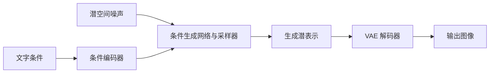

# 生成式多模态

<span class="dig-tag dig-tag--category">AI 技术</span>

::: tip 核心要点
多模态理解回答“输入里有什么”，多模态生成回答“如何产生符合条件的图像、音频或视频”。理解生成系统要分开看表示空间、网络结构、训练目标、采样算法与条件控制。扩散、Flow Matching、DiT 和 VAE 分属不同层次，不能当成互相替代的四种模型。
:::

本页重点讲图像与视频生成；视觉理解见 [VLM](./vision-language-models)，实时语音见 [Voice Agent](./voice-agents)。模型和平台的当前能力以其模型卡与接口文档为准。

## 理解与生成并不是同一条链路

给模型一张产品图让它描述材质，是理解；要求把背景改成白色，是条件生成或编辑；根据一句描述生成短视频，还需要处理运动与时间一致性。

一个聊天产品可以同时支持这些任务，但背后可能是多个模型和工具。能看图的 LLM 不一定直接输出图像，能生成逼真图片的模型也不一定擅长准确读取表格。

| 任务 | 输入与输出 | 关键验收点 |
|------|------------|------------|
| 图像生成 | 文本或参考图到新图像 | 语义、构图、细节与可用性 |
| 图像编辑 | 原图、修改要求与可选 Mask | 改对目标区域，保留其他内容 |
| 视频生成 | 文本、起始帧或参考片段到视频 | 运动、身份、时序和镜头一致性 |
| 视频理解 | 视频到描述、答案或定位 | 是否看对事件及时间关系 |

生成路线不只有扩散：离散视觉 token 的自回归生成、混合架构等也存在。闭源模型未披露实现时，只描述可验证的输入输出，不从产品效果反推网络结构。

## 生成模型的五个层次 {#generation-layers}

| 层次 | 要问的问题 | 常见概念 |
|------|------------|----------|
| **表示** | 在像素、潜变量还是离散 token 上建模 | VAE、视觉 Tokenizer、时空压缩 |
| **网络结构** | 用什么网络预测所需量 | U-Net、DiT、MMDiT |
| **训练目标** | 让网络学什么 | 噪声预测、速度预测、Flow Matching |
| **采样** | 如何从初始状态得到成品 | Scheduler、ODE/SDE 求解、步数 |
| **条件控制** | 如何遵循文字、结构或参考图 | Cross-Attention、CFG、ControlNet、IP-Adapter |

例如，一个系统可以同时使用 VAE 压缩、Transformer 主干、Rectified Flow 训练和多步采样。说“用了 Transformer，所以不是扩散模型”混淆了网络与生成目标。

## 扩散模型如何生成图像 {#diffusion}

以噪声预测路线为例，训练时从真实数据 $x_0$ 构造不同噪声程度的 $x_t$：

$$
x_t=\alpha_t x_0+\sigma_t\epsilon,\qquad \epsilon\sim\mathcal N(0,I)
$$

模型根据带噪输入、时间步与条件 $c$ 预测噪声，一种常见简化训练目标是：

$$
\mathcal L_{noise}=\mathbb E\left[\|\epsilon-\epsilon_\theta(x_t,t,c)\|_2^2\right]
$$

这不是全部扩散训练配方。有的实现预测原始数据或不同参数化的速度，时间步权重和噪声调度也可能不同；采样器必须与训练设定匹配。

生成时通常从噪声出发，按训练好的模型与采样器逐步更新，最终得到图像表示。**模型不需要先拥有这张目标图片再把它加噪**；前向加噪是训练构造，推理是在学习到的分布中生成新样本。

### 步数不等于质量旋钮的全部

增加采样步数可能改善某些细节，也可能收益趋于饱和甚至改变风格。经过少步蒸馏的模型应使用相应配置，不能把普通模型的 50 步设置直接套过去。

Scheduler 决定时间点和更新规则；更换 Scheduler 不是保证变好的“滤镜”。比较时固定模型、分辨率、条件和种子，并同时看质量与实际计算开销。

## 潜空间与 VAE {#latent-space}

直接在高分辨率像素上反复计算很昂贵。Latent Diffusion 先用编码器把图像压缩到潜空间，再在潜表示上生成，最后用解码器还原图像。



训练时还会使用 VAE 编码器处理真实图片。这里的潜表示主要服务于重建和生成，不等于检索用的语义 Embedding，也不能随便替换成向量数据库中的向量。

压缩减少计算，但可能损失细小文字、线条和局部纹理。图像质量问题可能出在压缩器、生成网络或解码器，不能全部归因于 Prompt。

## DiT 与 Flow Matching {#dit-flow-matching}

### DiT 是网络结构

Diffusion Transformer 将图像或潜变量划分成 token，再使用 Transformer 处理，并注入时间与条件信息。MMDiT 一类结构进一步组织文字与视觉表示的交互。

Transformer 主干有利于规模化，但 token 数、注意力形式和硬件实现共同决定计算。不是用了 DiT 就必然比任何 U-Net 更快或更好。

### Flow Matching 是训练向量场的方法

为了建立直觉，令 $z_0$ 是噪声，$z_1$ 是数据潜表示，在一条线性条件路径上插值：

$$
z_t=(1-t)z_0+t z_1,\qquad t\in[0,1]
$$

对应目标速度为 $z_1-z_0$，可以训练模型预测这个速度场：

$$
\mathcal L_{flow}=\mathbb E\left[\|v_\theta(z_t,t,c)-(z_1-z_0)\|_2^2\right]
$$

生成时从噪声初值开始，沿学习到的向量场积分。不同论文对时间方向、路径和参数化的约定可能相反，必须按具体模型理解，不能机械复制公式中的正负号。

Rectified Flow 与这种线性路径构造密切相关，但条件路径是直线，不意味着最终学习到的每条生成轨迹都完全笔直，更不意味着任意模型一次前向就能得到高质量图像。少步生成通常还依赖训练、蒸馏和求解器设计。

## 条件控制与图像编辑 {#conditioning}

### CFG 如何增强条件影响

在一种常见噪声预测约定下，Classifier-Free Guidance 组合无条件与有条件预测：

$$
\hat\epsilon=\epsilon_{uncond}+s(\epsilon_{cond}-\epsilon_{uncond})
$$

此约定中 $s=1$ 对应条件预测，增大 $s$ 会加强两者差异。过强 guidance 可能导致过饱和、伪影或多样性下降；不同框架的尺度定义和实现可能不同，不能把某个数值当作通用建议。

负向 Prompt 也不是对禁止内容的确定性保证。有些模型使用内置或蒸馏后的 guidance，未必在推理时执行两次同样的网络计算。

### 参考图与结构控制

| 手段 | 想控制什么 | 边界 |
|------|------------|------|
| **参考图 / IP-Adapter** | 主体外观、风格或视觉条件 | 权重需匹配底层模型，不能保证身份完全不变 |
| **ControlNet 等结构条件** | 边缘、深度、姿态或布局 | 条件提取误差会进入生成结果 |
| **Inpainting** | 根据 Mask 编辑区域 | Mask 外也可能变化，应检查保留区域 |
| **Outpainting** | 扩展画面范围 | 新区域需要与原图光照、透视和内容协调 |
| **LoRA 适配** | 特定风格、主体或领域行为 | 训练许可、过拟合、模型版本兼容性 |

以“只改产品图背景”为例，验收既要检查新背景，也要检查产品颜色、标识、数量、文字和轮廓是否被改动。生成看起来更漂亮，不代表满足编辑任务。

## 视频比多张图片多了什么 {#video-generation}

视频需要在时间上保持主体、动作和场景关系。逐帧独立生成容易闪烁、变形、身份漂移，还可能出现物体突然消失或运动不连续。

常见系统使用时空潜表示、时间条件、时空注意力或分段生成等设计。具体是否生成整段、采用自回归片段或多阶段采样，取决于模型，不存在唯一的视频生成结构。

### 分辨率和帧数怎样影响成本

在固定压缩与 patch 规则下，视觉 token 数可粗略看作与潜空间的时间、高度和宽度乘积成正比。空间宽高各翻倍，token 数可能约增加四倍；帧数翻倍又可能再翻倍。

如果使用对所有这些 token 的朴素全注意力，其成对计算还会进一步增长；实际系统常用因子化、窗口或稀疏等机制，因此不能简单把 token 比例当作最终延迟倍数。显存还包含激活、文本条件、解码与临时工作区。

### 长视频与镜头衔接

分段生成可以降低单次资源需求，但需要处理边界运动、人物身份、物体状态、光照和声音同步。重叠帧、参考帧、条件状态与后处理有帮助，不保证任意长度都一致。

画面符合视觉常识，也不证明模型精确模拟了物理。动作条件世界模型与一般视频生成的区别，在于是否能对动作变化给出可靠的环境后果，而不是只看画面是否逼真。

动作预测、闭环执行与仿真迁移的完整区别见 [世界模型与具身智能](./world-models-and-embodied-ai)。

## 一次可复现的生成任务 {#generation-workflow}

生成服务宜保存请求、资产与模型配置，而不是只保存最终图片。下面是应用内部记录示意，不是某个厂商可直接调用的 API 请求：

```json
{
  "job_id": "image-job-42",
  "operation": "background_edit",
  "source_asset_id": "asset-17",
  "mask_asset_id": "mask-17",
  "model_revision": "approved-image-model-revision",
  "prompt_revision": "background-edit-v2",
  "settings": {
    "width": 1024,
    "height": 1024,
    "seed": 42,
    "steps": 28,
    "scheduler": "checkpoint-default"
  },
  "status": "queued"
}
```

模型必须实际支持所选参数。相同种子也不保证跨硬件、库版本、采样器和模型快照得到逐像素相同结果，实验记录不能只留下一个 seed。

完整链路通常包括输入资产授权、格式与尺寸检查、创建幂等任务、队列调度、受限 Worker、产物验证和受控交付。用户取消要区分停止排队、停止推理与删除已生成资产；重试不能重复计费或公开发布多份结果。

开放模型可以使用 [Hugging Face Diffusers](https://huggingface.co/docs/diffusers/index)等成熟框架，遵循具体模型的 pipeline、VAE、scheduler 和权重兼容关系。托管服务则按其任务状态、内容处理和保留策略接入，不自行假定后端结构。

## 质量评估不能只看美观 {#generation-evaluation}

| 维度 | 应测什么 |
|------|----------|
| 语义遵循 | 对象、数量、属性、空间关系是否符合要求 |
| 局部准确性 | 文字、图表、标识、边缘与细节是否正确 |
| 编辑保真 | 未要求修改的区域和主体是否保持 |
| 时间一致性 | 视频中的身份、运动、物体持续性与镜头衔接 |
| 多样性 | 不同种子是否只产生少数近重复模式 |
| 工程质量 | 成功率、延迟、显存、单位合格产物成本与失败恢复 |

FID、CLIP 类相似度或视频分布指标各自反映特定特征空间与数据分布，不能单独证明一张业务图片合格。需要参考集时明确样本量与分布；业务任务还应结合字段检查、局部对比、人工评价和独立 Judge。

比较模型时固定任务集、尺寸、时长、采样预算及编辑条件。多生成十张再挑最好的一张，与只生成一张不是同一个成本与质量设定，应报告候选数与挑选规则。

## 许可证与内容来源

检查模型权重、生成输入、参考图和输出用途的许可，尤其是第三方人物、品牌、艺术作品或客户数据。公开下载的权重不自动意味着任何商用训练与输出用途都允许。

记录必要的来源与变更，按场景使用生成内容标识和 C2PA 等来源机制。来源记录帮助验证资产流转，不等于证明画面中的事件真实，也不能把没有标识的媒体直接认定为真实。

## 面试怎么答

**Q：DiT 与扩散有什么关系？** DiT 是生成网络结构，扩散是生成建模路线；潜空间、训练目标、采样器与条件控制还需分别说明。

**Q：Flow Matching 为什么不能简单理解成一步生成？** 训练路径和学习到的生成向量场不同，推理还要数值积分；少步能力取决于模型训练和采样方案。

**Q：图像编辑怎么验收？** 同时检查修改目标和保留约束。只改背景时，产品本身的颜色、标识和结构改变都可能使结果不合格。

**Q：视频生成为什么更难？** 除单帧语义与细节，还要保持时间、运动和身份一致，资源消耗与长程误差都会增加。

## 延伸阅读

- [Denoising Diffusion Probabilistic Models](https://arxiv.org/abs/2006.11239)
- [Latent Diffusion Models](https://arxiv.org/abs/2112.10752)
- [Scalable Diffusion Models with Transformers](https://arxiv.org/abs/2212.09748)
- [Flow Matching for Generative Modeling](https://arxiv.org/abs/2210.02747)
- [Scaling Rectified Flow Transformers](https://arxiv.org/abs/2403.03206)
- [Diffusers 的 Stable Diffusion 3 Pipeline](https://huggingface.co/docs/diffusers/api/pipelines/stable_diffusion/stable_diffusion_3)
- [AI 评估与可靠性工程](./ai-evaluation)