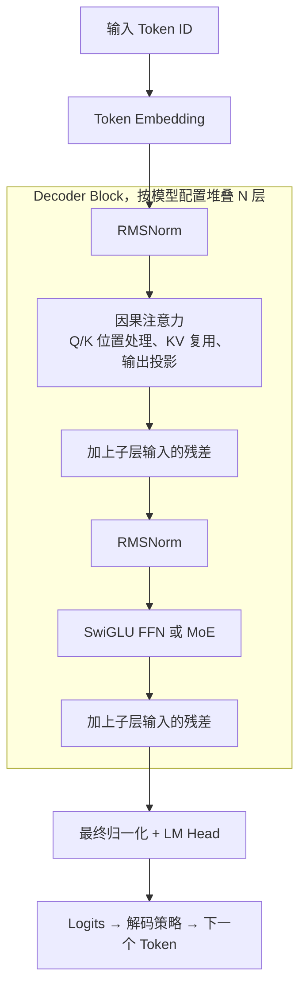

# 大语言模型基础 LLM Fundamentals

<span class="dig-tag dig-tag--category">AI 技术</span> <span class="dig-tag dig-tag--medium">⭐⭐ 中级</span> <span class="dig-tag dig-tag--hot">🔥🔥🔥 高频</span>

::: tip 💡 核心要点
大语言模型（Large Language Model, LLM）通过大规模数据训练来建模语言。Transformer 是主流骨干，但不是 LLM 的定义条件；自回归生成也不是唯一的语言建模方式。本章以常见的因果 Transformer 为主线，解释注意力、现代 Decoder Block、训练阶段、分词与解码，再说明混合架构和扩散语言模型的区别。
:::

## 什么是大语言模型

大语言模型（LLM）是通过大规模语料进行预训练、能够建模和生成语言的神经网络。“Large”没有统一参数门槛：参数量、训练 Token、训练计算和能力都在变化，数亿参数的领域模型与稀疏激活的 MoE 也使“数十亿以上”不适合作为定义。其核心能力包括：

- **文本生成**：根据上下文生成文本；主流自回归模型逐步预测下一个 Token，Token 不一定是完整单词
- **语义理解**：对输入文本进行深层语义表征
- **上下文学习（In-Context Learning）**：利用 Prompt 中的指令或示例适应任务，通常不更新模型权重，效果仍需评估

GPT-2、Llama 3 等公开架构采用**仅解码器（Decoder-Only）** Transformer。闭源模型的产品能力不能反推内部结构；未披露的注意力形式、参数量和专家配置应保留为未知。

阅读模型资料时，要分开看**骨干结构**（注意力、状态空间或混合）、**参数激活方式**（Dense/MoE）、**生成方式**（自回归/扩散）和**训练与能力定位**（Base/Instruct/Reasoning）。这些维度并不互斥，不能排成一列当作同一种分类。

当前模型与访问状态见 [AI 概述](./ai-overview) 和 [最新进展快照](./ai-trends#latest-updates)。

---

## Transformer 架构

Transformer 由 Vaswani 等人于 2017 年在论文《Attention Is All You Need》中提出，是当前主流 LLM 的基础架构。工程上常见的是其变体：RoPE、RMSNorm、SwiGLU、GQA/MQA、MoE、稀疏注意力等都不是原始论文的固定组成。

### 自注意力机制 Self-Attention

自注意力让每个位置根据内容聚合**允许访问的位置**的信息。编码器可使用双向注意力；自回归解码器必须使用因果掩码，位置 $i$ 只能访问 $j \le i$ 的位置。训练时虽然整段文本同时可见，掩码仍须阻止未来答案泄漏。

给定输入序列的表示矩阵 $X$，通过三个线性变换得到查询（Query）、键（Key）、值（Value）矩阵：

$$
Q = XW_Q, \quad K = XW_K, \quad V = XW_V
$$

注意力得分的计算公式为：

$$
  \operatorname{Attention}(Q, K, V) = \text{softmax}\left(\frac{QK^T}{\sqrt{d_k}} + M\right)V
$$

其中 $d_k$ 是每个 Key 头的维度；缩放用于避免点积随维度增大而使 softmax 过度饱和。因果掩码 $M_{ij}$ 在 $j \le i$ 时为 $0$，在 $j > i$ 时为 $-\infty$，因此未来位置的注意力权重为零。批处理还需屏蔽填充位置。

训练时位置 $i$ 的输出预测 $x_{i+1}$，目标要错开一位。生成时则把新 Token 追加到前缀；KV Cache 复用历史 K/V，并不改变因果约束。

### 多头注意力 Multi-Head Attention

多头注意力从同一输入 $X$ 为各头计算独立的 Q/K/V 投影，并行计算注意力后拼接：

$$
  \operatorname{MultiHead}(X) = \text{Concat}(\text{head}_1, \ldots, \text{head}_h)W_O
$$

$$
  \operatorname{head}_i = \text{Attention}(XW_Q^i, XW_K^i, XW_V^i)
$$

多头机制允许模型从不同表示子空间聚合信息，但不能假定某个头始终专门负责语法或事实。

### MHA、MQA、GQA 与 MLA {#attention-variants}

这些设计主要调整 K/V 的表示和复用方式，不等于改变因果掩码，也不直接消除全注意力随序列长度增长的计算成本。

| 设计 | Q 与 K/V 的关系 | 工程取舍 |
|------|----------------|----------|
| **MHA** | 每个 Query 头有对应的 K/V 头 | 表达灵活，历史 KV 占用较大 |
| **MQA** | 所有 Query 头共享一组 K/V | 显著减少 KV 存储与读取，效果需要训练验证 |
| **GQA** | Query 头分组，每组共享 K/V；KV 头数介于 1 与 Query 头数之间 | 在 MHA 与 MQA 之间折中，Llama 3 等公开模型采用 |
| **MLA** | 用低维潜变量压缩 K/V，并配合解耦的位置表示与投影实现注意力 | DeepSeek V2/V3 的代表设计；不是简单减少 KV 头数，收益依赖具体实现 |

对各层配置相同、K/V 头维度相同的普通 MHA/MQA/GQA，单序列 KV Cache 的近似大小为：

$$
  B_{\mathrm{KV}} = 2 \times L \times T \times H_{KV} \times d_{head} \times b
$$

$L$ 为层数，$T$ 为缓存 Token 数，$H_{KV}$ 为 KV 头数，$b$ 为每元素字节数。32 层、8 个 KV 头、128 维、BF16（2 字节）时，每 Token 约 128 KiB，8192 Token 约 1 GiB；尚未计入权重、临时张量、分页浪费与并发。MLA、量化 KV、局部或跨层共享缓存不能直接套用这条公式。部署细节见 [LLM 推理优化](./inference-optimization)。

### 位置编码 Positional Encoding

Transformer 本身不包含序列顺序信息（不像 RNN 天然具有时序性），因此需要显式注入位置信息。原始 Transformer 使用正弦/余弦位置编码：

$$
PE_{(pos, 2i)} = \sin\left(\frac{pos}{10000^{2i/d}}\right), \quad PE_{(pos, 2i+1)} = \cos\left(\frac{pos}{10000^{2i/d}}\right)
$$

许多公开 LLM 采用**旋转位置编码（RoPE, Rotary Position Embedding）**，将位置编码到 Q/K 的旋转中；长度扩展仍需具体训练配方和评估支持。

#### RoPE 旋转位置编码

RoPE（Rotary Position Embedding）的核心思想是通过**旋转矩阵**将位置信息编码到向量中。对于位置 $m$ 处的向量 $x$，RoPE 将其每两个维度视为一个二维平面上的向量，按照与位置成正比的角度进行旋转：

$$
f(x, m) =
\begin{pmatrix}
\cos(m\theta) & -\sin(m\theta) \\
\sin(m\theta) & \cos(m\theta)
\end{pmatrix}
\begin{pmatrix} x_1 \\ x_2 \end{pmatrix}
$$

上式展示一对维度；完整向量的不同维度对使用各自的旋转频率。通常将旋转施加到 Q/K，使位置对点积的影响通过相对位移体现。

**关键优势**：
- **相对位置感知**：旋转引入的位置信息依赖两个 Token 的相对距离；注意力得分仍取决于 Q/K 的内容
- **便于做长度扩展**：可结合位置插值、NTK-aware Scaling、YaRN 等方法扩展，但原始 RoPE 本身不保证训练长度外仍保持质量
- **不同注意力中的使用需分别设计**：部分方案可结合旋转位置表示，但不能假定任意线性注意力都能直接替换为同一 RoPE 实现

#### ALiBi（Attention with Linear Biases）

ALiBi 采用完全不同的思路——不修改 Embedding，而是在注意力得分上直接**减去一个与距离成正比的偏置**：

$$
  S_{ij}^{(h)} = \frac{q_i^{(h)} \cdot k_j^{(h)}}{\sqrt{d_k}} - a_h(i-j) + M_{ij}
$$

这里采用因果场景，允许的位置满足 $j \le i$，$a_h$ 是每个头的固定正斜率；随后沿 Key 位置做 softmax。距离越远，线性惩罚越大，未来位置仍由 $M$ 屏蔽。

#### 位置编码方案对比

| 方案 | 原理 | 可训练参数 | 长度外推 | 代表模型 |
|------|------|-----------|----------|----------|
| **Sinusoidal** | 正弦/余弦函数 | 无 | 差 | 原始 Transformer |
| **RoPE** | 旋转 Q/K 子空间 | 无 | 需缩放/继续训练验证 | LLaMA, Qwen, GPT-NeoX |
| **ALiBi** | 线性注意力偏置 | 无 | 通常优于绝对学习位置，但并非无损 | BLOOM, MPT |
| **Learned** | 可学习向量 | 有 | 差 | GPT-2, BERT |

### 前馈网络 Feed-Forward Network

每个 Transformer 层中，注意力子层之后是一个逐位置的前馈网络（FFN）：

$$
\text{FFN}(x) = \text{ReLU}(xW_1 + b_1)W_2 + b_2
$$

许多现代模型使用 **SwiGLU**：它不只是把 ReLU 改名，而是引入两条投影分支和逐元素门控。省略偏置时：

$$
  \operatorname{SwiGLU}(x) = \left[\text{SiLU}(xW_{gate}) \odot (xW_{up})\right]W_{down}
$$

其中 $\text{SiLU}(z)=z\sigma(z)$，$\odot$ 表示逐元素乘法。比较 FFN 成本时还要看中间维度，不能只比较激活函数名称。

### Pre-Norm、RMSNorm 与残差连接 {#modern-decoder-block}

一个常见的现代 Decoder Block 可写为：

$$
U = X + \text{CausalAttention}(\text{RMSNorm}(X)), \qquad
Y = U + \text{SwiGLU}(\text{RMSNorm}(U))
$$

这里的两个 RMSNorm 有各自的参数，注意力内部完成 Q/K/V 投影、位置处理与输出投影。**Pre-Norm** 指在子层计算前归一化，残差支路保留原输入；它有助于深层网络训练，但不是所有模型的唯一布局。

$$
  {\operatorname{RMSNorm}(x)}_i = \frac{x_i}{\sqrt{\frac{1}{d}\sum_{j=1}^{d}x_j^2+\epsilon}}g_i
$$

与 LayerNorm 不同，RMSNorm 不减去均值，用均方根缩放后乘可学习增益 $g_i$。归一化不负责保存长期记忆，也不替代位置编码。

**Dense 与 MoE**通常是在 FFN 这一位置做选择：Dense 对每个 Token 使用同一组 FFN 权重；稀疏 MoE 由 Router 选择若干专家并合并输出，可能另有共享专家。总参数决定存储负担，激活参数影响每 Token 计算；通信、负载和访存仍决定实际速度。详见 [AI 概述中的 MoE](./ai-overview#moe-mixture-of-experts-架构)。

### 整体结构示意



这是常见结构的教学示意，不是对所有商用模型内部实现的推断。

---

## 混合架构与扩散语言模型 {#hybrid-and-diffusion}

### 状态空间与线性注意力

标准注意力显式访问历史 K/V，长上下文会增加缓存和读取成本。另一条路线是把历史压缩进递推状态，但“状态大小不随长度增长”不意味着可以无损记住全部历史。

| 路线 | 核心机制 | 边界 |
|------|----------|------|
| **选择性状态空间模型（SSM）** | Mamba 用输入相关的状态更新选择保留或遗忘信息 | 不依赖标准 Self-Attention；固定状态存在信息压缩取舍 |
| **线性注意力** | 通过特征映射、递推累积或门控更新等方式避免完整注意力矩阵 | 不是 FlashAttention；线性复杂度需说明固定维度和具体实现假设 |
| **混合结构** | 交替使用状态更新层与标准注意力层 | 兼顾效率与历史信息访问，但仍要为注意力层维护相应缓存 |

[Qwen3-Next](https://huggingface.co/Qwen/Qwen3-Next-80B-A3B-Instruct) 是已公开例子：Gated DeltaNet 线性注意力与 Gated Attention 混合，同时采用稀疏 MoE。线性注意力与 SSM 有相关的递推视角，但不能把所有门控线性注意力都称作 Mamba。

架构标签也需要看具体定义：[DeepSeek-V4.1-Flash](https://huggingface.co/deepseek-ai/DeepSeek-V4.1-Flash) 的 Causal Encoder-Decoder 让解码器复用由编码器最终状态投影的全局 KV，文本仍自回归生成。这里的因果编码器不同于 T5 的双向编码器，不能只看到 “Encoder-Decoder” 就推断注意力掩码或任务形式。

### 扩散语言模型 Diffusion Language Models

[LLaDA](https://arxiv.org/abs/2502.09992) 说明语言建模不必限定为从左到右的下一 Token 预测。其训练对文本施加不同程度的掩码，学习预测被遮蔽 Token；生成通过多步反向去掩码逐渐形成文本，也可采用分块策略。

它仍可使用 Transformer 骨干并接受 SFT，所以**扩散是生成与训练目标维度，不是 Transformer 的反义词**。并行更新多个位置可能带来机会，但需要多轮模型计算；实际速度、缓存复用、流式输出、约束生成和工具调用成熟度必须按实现评估。

| 容易混淆的概念 | 实际改变 |
|----------------|----------|
| **多 Token 预测（MTP）** | 增加预测后续多个位置的训练目标或预测头，不自动把模型变成扩散模型 |
| **推测解码（Speculative Decoding）** | 草稿提出若干 Token，由目标模型验证；满足正确接受/拒绝校正时可保持目标采样分布 |
| **扩散生成** | 通过噪声或掩码的反向过程生成，而非仅沿固定前缀追加一个 Token |

---

## 预训练与微调

### 预训练 Pre-training

主流自回归语言模型从大规模清洗、去重后的文本与代码中构造自监督目标，常用**下一 Token 预测（Next Token Prediction）**：

$$
\mathcal{L}_{\text{pretrain}} = -\sum_{t=1}^{T} \log P(x_t \mid x_1, x_2, \ldots, x_{t-1}; \theta)
$$

这让模型学习数据中的语言、知识与推理模式，但不能保证记住的内容真实或及时。语料中也可能包含人工编写或合成的示例；“自监督”指训练目标来自数据本身，不等于数据治理没有人工参与。掩码/扩散目标、多模态联合训练则有不同目标设计。

### 后训练 Post-training

预训练之后，模型通常还需要学习如何按指令、格式、工具协议和任务反馈工作。常见方法可组合或迭代，不是每个模型都必须依次经过相同的流水线。

| 方法 | 训练信号与作用 | 不能据此保证什么 |
|------|----------------|------------------|
| **SFT** | 学习指令与示范回答；对话训练通常只对目标回答等指定位置计算损失 | 示范可能错误，格式一致不等于事实正确 |
| **偏好优化** | RLHF 常用人类偏好训练奖励模型再做 RL；DPO 等方法直接利用偏好对优化策略 | 偏好不等于真实性，也不等于安全证明 |
| **可验证奖励（RLVR）** | 用测试、数学结果或环境反馈提供奖励 | 奖励覆盖不全时可能产生投机行为；GRPO 是优化方法，不是奖励来源 |
| **蒸馏** | 学习教师的输出、分布或其他监督信号 | 教师能力与错误都可能迁移，效果需独立测试 |

**Base** 通常指预训练基座，**Instruct** 强调指令遵循，**Reasoning** 强调推理能力及可能的可调计算预算。这些是训练或能力定位，不是三种互斥骨干架构；推理模型也需要遵循指令。

训练会更新权重；普通 In-Context Learning、RAG、上下文压缩与 Prompt Cache 通常不会更新权重。它们也不等于跨会话记忆，后者还需要外部存储、检索与治理。

完整训练流程见 [模型微调与训练](./model-training)，知识迁移见 [合成数据与知识蒸馏](./synthetic-data-and-distillation)，运行时信息管理见 [上下文工程与 Agent 记忆](./context-and-memory)。

---

## 分词 Tokenization

文本模型通常先通过 Tokenizer 把字符串转换为离散 Token ID，再查 Embedding。Token 可以对应子词、字节、字符、空白或特殊标记，不保证等于一个词；多模态输入还可能转换为视觉或音频表示。

| 算法 | 特点 | 代表模型 |
|------|------|----------|
| **BPE（Byte-Pair Encoding）** | 在训练时反复合并高频相邻符号对；可从字节或字符起步 | GPT-2、Llama 3 的具体实现采用字节级 BPE |
| **WordPiece** | 使用子词词表，常见编码实现按最长匹配切分 | BERT |
| **Unigram** | 基于子词概率模型选择切分，训练时逐步裁剪候选词表 | T5 的 SentencePiece Unigram 模型 |

**SentencePiece 是分词工具库，不是与 BPE 并列的单一算法**：它支持 BPE 与 Unigram；Llama 1/2 的 SentencePiece BPE 与 Llama 3 的分词器并不相同。tiktoken、SentencePiece 等工具名、算法名和具体模型词表要分开看。

**关键概念**：
- **Vocabulary Size**（词表大小）：随型号变化，不能把某个固定区间当成 LLM 定义或性能标准
- **Token ≠ 单词或汉字**：同一字符串在不同 Tokenizer 上切分不同，字节回退时一个字符也可能占多个 Token
- **Chat Template 与特殊 Token**：用户/助手角色、工具结果和结束标记的编码会影响效果与计数；自托管时必须匹配目标模型的模板

### BPE 算法详解

BPE（Byte-Pair Encoding）是最主流的分词算法，其训练过程如下：

1. **初始化**：将训练语料拆分为单个字节（或字符）作为初始词表
2. **统计**：计算所有相邻 Token 对的出现频率
3. **合并**：将频率最高的 Token 对合并为新 Token，加入词表
4. **重复**：回到第 2 步，直到词表达到目标大小

**示例**（字符级教学示意，空格只作词边界，不参与统计；词表大小目标为 6）：

```
初始词表: [a, b, c, d]
语料: "abab cdab abcd"

第 1 轮: "ab" 出现 4 次 → 合并 → 词表: [a, b, c, d, ab]
第 2 轮: "ab" 已合并，"cd" 出现 2 次 → 合并 → 词表: [a, b, c, d, ab, cd]
```

### Token 效率与多语言影响

不同语言在同一模型中的 Token 化效率差异很大，这直接影响 API 成本和上下文利用率：

| 影响 | 为什么 |
|------|--------|
| **成本与配额** | API 按具体模型的 Tokenizer 计数；同一文本在不同型号上可能不同 |
| **有效上下文** | 分词更碎会占用更多位置，压缩可容纳的信息量 |
| **多语言与代码能力** | 词表覆盖、字节回退和训练数据共同影响效率，不能仅凭“汉字数 × 固定倍数”估算 |

准确计数应调用目标模型的 Token 计数 API 或同版本 Tokenizer；不要把 GPT-4、Claude 某个历史版本的示例当作家族恒定规则。

**面试要点**：理解 Tokenization 对 LLM 的影响——它决定了模型的有效上下文长度、推理成本和多语言性能差异。

---

## 上下文窗口与长文本处理

标准 Transformer 的全注意力计算量为 $O(n^2)$，注意力分数的朴素显存也为 $O(n^2)$，严重限制了上下文窗口长度。FlashAttention 能把中间显存降到线性并减少 IO，但**不会把精确全注意力的算术复杂度变成线性**。长上下文还受 KV Cache、位置外推数据和模型能否真正利用远处信息影响。

### 滑动窗口注意力 Sliding Window Attention

对因果解码器，窗口大小 $w$ 包含当前位置及最多 $w-1$ 个历史位置，即位置 $i$ 只访问 $\max(1, i-w+1) \le j \le i$。固定头数和维度时，注意力计算量为 $O(n \cdot w)$；它不会因为使用局部窗口而获得查看未来 Token 的权限。

例如 $w=3$ 时，第 5 个位置可关注第 3、4、5 个位置。因果全注意力则可关注第 1 到第 5 个位置。双向编码器可另设前后窗口，不应与这里的因果窗口混用。

代表模型是原始 Mistral 7B（窗口大小 4096）。多层堆叠可扩大间接感受野，但不等于可以无损保留任意长历史；局部层与全局层交替也是一种设计选择。

### 稀疏注意力 Sparse Attention

结合**局部窗口**和**全局 Token**，兼顾局部信息和长距离依赖：

- **Longformer**：滑动窗口 + 部分 Token 全局关注（如 [CLS]）
- **BigBird**：滑动窗口 + 全局 Token + 随机连接

### 长度外推技术

当使用 RoPE 的模型需要处理超过原训练长度的序列时，常见方法会调整位置或频率；仅修改配置并不保证模型获得相应能力：

| 技术 | 原理 | 效果 |
|------|------|------|
| **NTK-aware Scaling** | 调整 RoPE 基数，改变不同维度的旋转频率 | 有无需继续训练的用法，但扩展倍数与质量不作统一保证 |
| **YaRN** | 分频段插值并调整注意力缩放 | 通常结合模型指定配置和长度扩展训练，需要评估短文本回退 |
| **Dynamic NTK** | 根据序列长度动态调整缩放因子 | 需核对实现如何保持已缓存 K 与新 Q/K 的位置计算一致 |

---

### 标称窗口不等于有效上下文

- **能放入**：API 接受 1M Token，只说明输入上限与资源策略允许
- **能找到**：Needle-in-a-Haystack 测试主要衡量检索，不等于能综合整本代码库
- **能推理**：随着位置、干扰项和“针”的数量变化，准确率可能明显下降（Context Rot）
- **能经济地服务**：长 Prefill 的计算、KV Cache 和计费仍可能不可接受

**记忆法**：长上下文看四层——**装得下、找得到、想得对、付得起**。工程上应按目标长度做多针检索、跨段综合和真实任务回归，而不是只看厂商窗口数字。

---

## Reasoning 与测试时计算

本节先区分概念；串行/并行计算、验证器、推理预算与 API 状态管理详见 [推理模型与测试时计算](./reasoning-models)。

许多当前推理模型仍以自回归方式生成文本，通过后训练和测试时计算，在最终回答前进行分解、验证、回溯或工具调用。“Reasoning”描述能力与计算策略，本身不规定必须使用哪种骨干或生成目标。

| 手段 | 改变什么 | 边界 |
|------|----------|------|
| **Chain-of-Thought Prompting** | 提示普通模型写出中间步骤 | 步骤流畅不代表正确；公开文字也未必等同于模型内部计算 |
| **Best-of-N / Self-Consistency** | 采样多个候选再投票或重排 | 提高计算成本，只适合答案可比较的任务 |
| **可验证奖励 RL** | 用数学答案、代码测试等反馈训练策略 | 奖励只覆盖可验证部分，可能出现 Reward Hacking |
| **工具交错推理** | 推理中调用搜索、代码、文件或环境 | 结果取决于工具、权限、Harness 和错误恢复，不是裸模型能力 |

更多思考通常对难题有益，对简单问题则可能增加延迟、成本，甚至“过度思考”。因此应把 reasoning effort 当作质量—延迟—成本旋钮，并用任务成功率而不是“推理文字有多长”来评估。

---

## 解码策略：Temperature, Top-K, Top-P

以下针对自回归生成：模型输出词表上的 logits，解码器再贪心选择或按概率采样下一个 Token。Temperature、Top-K、Top-P 控制选择方式，不直接度量答案正确性。

这些是算法概念，不代表每个托管 API 都开放全部参数。部分推理模型限制采样参数，应先遵循具体型号的文档；reasoning effort 也不是 Temperature 的替代名称。

### Temperature（温度）

Temperature 参数 $\tau$ 用于调节 softmax 输出的概率分布：

$$
P(x_i) = \frac{\exp(z_i / \tau)}{\sum_j \exp(z_j / \tau)}
$$

- $\tau \to 0$：分布趋向确定性，选择概率最高的 Token（贪心解码）
- $\tau = 1$：保持原始分布
- $\tau > 1$：分布更平坦，增加随机性和多样性

### Top-K 采样

只从概率最高的前 $K$ 个 Token 中采样，其余 Token 概率设为 0。

### Top-P 采样（Nucleus Sampling）

选择概率累积和刚好超过 $P$ 的最小 Token 集合，从中采样。相比 Top-K，Top-P 能自适应调整候选集大小。

### Python 实现示例

下面实现有限 logits 上的教学版采样器，依赖 NumPy；约定 `temperature=0` 直接贪心选择，不代表所有厂商 API 的零温度行为。

```python
import numpy as np

def sample_with_temperature(logits: np.ndarray, temperature: float = 1.0,
                            top_k: int = 0, top_p: float = 1.0) -> int:
    """
    从 logits 中按指定策略采样下一个 Token。

    Args:
        logits: 模型输出的原始分数 (vocab_size,)
        temperature: 温度参数，越低越确定
        top_k: 仅保留概率最高的 K 个 Token，0 表示不启用
        top_p: 核采样阈值，1.0 表示不启用
    Returns:
        采样得到的 Token ID
    """
    logits = np.asarray(logits, dtype=np.float64)
    if logits.ndim != 1 or logits.size == 0 or not np.all(np.isfinite(logits)):
      raise ValueError("logits must be a nonempty, finite 1-D array")
    if not np.isfinite(temperature) or temperature < 0:
      raise ValueError("temperature must be finite and nonnegative")
    if isinstance(top_k, bool) or not isinstance(top_k, (int, np.integer)) or top_k < 0:
      raise ValueError("top_k must be a nonnegative integer")
    if not np.isfinite(top_p) or not 0 < top_p <= 1:
      raise ValueError("top_p must be in (0, 1]")
    if temperature == 0:
      return int(np.argmax(logits))

    # 1. 应用温度缩放
    logits = (logits - np.max(logits)) / temperature

    # 2. Top-K 过滤
    if top_k > 0:
        top_k_indices = np.argsort(logits)[-top_k:]
        mask = np.full_like(logits, -np.inf)
        mask[top_k_indices] = logits[top_k_indices]
        logits = mask

    # 3. 计算 softmax 概率
    exp_logits = np.exp(logits - np.max(logits))
    probs = exp_logits / exp_logits.sum()

    # 4. Top-P (Nucleus) 过滤
    if top_p < 1.0:
        sorted_indices = np.argsort(probs)[::-1]
        sorted_probs = probs[sorted_indices]
        cumulative_probs = np.cumsum(sorted_probs)

        # 找到累积概率超过 top_p 的截断点
        cutoff_index = np.searchsorted(cumulative_probs, top_p) + 1
        keep_indices = sorted_indices[:cutoff_index]

        filtered_probs = np.zeros_like(probs)
        filtered_probs[keep_indices] = probs[keep_indices]
        probs = filtered_probs / filtered_probs.sum()

    # 5. 按概率采样
    return int(np.random.choice(len(probs), p=probs))
```

---

## RLHF 人类反馈强化学习

RLHF（Reinforcement Learning from Human Feedback）是后训练的一条重要路线，不是全部后训练的同义词。人类偏好、AI 反馈与可验证奖励提供不同信号，SFT、DPO、RL 与蒸馏也可组合。详细流程见 [模型微调与训练](./model-training)，对齐目标与局限见 [模型对齐与 AI 安全](./evaluation-and-alignment)。

---

## 主流模型家族

当前托管型号、开放权重模型与历史架构例子分开整理在 [AI 概述与发展历程](./ai-overview)。选型依据是目标任务、质量、延迟、成本、模态、许可证和部署边界，而不是品牌或参数量排名。

---

## 推理优化

KV Cache、量化（Quantization）、推测解码（Speculative Decoding）等推理优化技术的详细介绍，请参阅 [LLM 推理优化](./inference-optimization)。

---

## 幻觉 Hallucination

幻觉是指 LLM **生成看似合理但事实上错误或无依据的内容**，是面试中的高频考点。

### 幻觉的类型

| 类型 | 描述 | 示例 |
|------|------|------|
| **事实性幻觉** | 生成与客观事实不符的内容 | 编造不存在的论文引用 |
| **忠实性幻觉** | 生成与提供的上下文矛盾的内容 | 总结文档时添加原文没有的信息 |

未遵循格式或语言约束通常归为**指令遵循失败**，可以与幻觉同时发生，但不能把所有错误都归入事实幻觉。

### 产生原因

1. **训练数据噪声**：预训练语料中包含错误、过时或矛盾的信息
2. **曝光偏差（Exposure Bias）**：训练时使用真实数据，推理时使用自身生成的 Token，误差逐步累积
3. **不确定性未校准**：训练目标和回答激励未必鼓励恰当地拒答；语言流畅度、自信语气与正确率可能脱节
4. **频率捷径**：模型可能偏向生成训练数据中高频出现的模式，而非基于上下文推理

### 缓解策略

| 策略 | 原理 | 适用场景 |
|------|------|----------|
| **RAG** | 检索可信且及时的材料，检查引用是否支持结论 | 需要最新/领域知识时；检索错误仍会传播 |
| **Self-Consistency** | 多次采样取可比较答案的一致结果 | 推理任务；多个答案可能共享同一错误 |
| **Chain-of-Verification (CoVe)** | 拆出待核查事实，再用资料、工具或独立检查验证 | 自问自答本身不足以证明事实正确 |
| **置信度校准与拒答** | 在独立标注集上检查预测置信度与实际正确率的对应关系，选择拒答阈值 | 同时报告准确率与覆盖率；需监控分布变化 |
| **Grounding** | 验证引用真实存在，并且原文确实支持对应结论 | 文档摘要/分析；有引用不等于有证据 |

让模型说“我有 90% 把握”不构成校准；Token 概率也不直接等于整个答案正确的概率。降低 Temperature 只能改变采样，贪心输出同样可能稳定地重复错误。评估方法见 [AI 评估与可靠性工程](./ai-evaluation)。

---

## 常见陷阱

::: warning ⚠️ 常见误区

1. **把常见结构当成定义**：BERT、GPT-2、T5 可用于理解经典 Transformer 布局，但不能覆盖混合注意力、因果 Encoder-Decoder 和扩散语言模型；闭源架构不能靠产品能力推断。

2. **认为 Temperature=0 必然是确定性输出**：很多 API 把 0 实现为近似贪心，但服务端模型版本、并行归约、MoE 路由、工具调用和同分 Tie-breaking 都可能变化；“低随机性”不等于跨时间可复现。

3. **混淆微调与 Prompt Engineering**：微调修改模型参数，Prompt Engineering 不修改参数而是通过精心设计输入引导模型输出。二者适用场景不同，不可互相替代。

4. **忽视 Tokenization 对性能的影响**：不同语言的 Token 化效率不同，中文在英文为主的模型中通常消耗更多 Token，影响成本和上下文长度利用率。

5. **把上下文窗口当成可用记忆**：支持 1M Token 不代表能稳定检索、跨段推理或以可接受成本服务 1M Token；需要按目标长度做多针、综合和真实任务评估。

6. **把可见 CoT 当成能力或忠实解释**：推理文字可能正确、错误或经过摘要，长度也不等于质量。应优先检查最终答案、可验证中间状态、工具轨迹与多次运行可靠性。

:::

---

<div class="dig-questions">
  <div class="dig-questions__header">
    <span>📝 面试真题</span>
    <span style="font-size: 12px; opacity: 0.8;">4 道高频</span>
  </div>
  <div class="dig-questions__item">
    <span>1. 请解释 Transformer 的自注意力机制及其计算过程</span>
    <span class="dig-tag dig-tag--medium" style="margin: 0;">中等</span>
  </div>
  <div class="dig-questions__item">
    <span>2. Temperature、Top-K、Top-P 三种采样策略有何区别？如何选择？</span>
    <span class="dig-tag dig-tag--easy" style="margin: 0;">简单</span>
  </div>
  <div class="dig-questions__item">
    <span>3. RoPE 和 ALiBi 在处理位置信息上有什么区别？各自的优缺点？</span>
    <span class="dig-tag dig-tag--medium" style="margin: 0;">中等</span>
  </div>
  <div class="dig-questions__item">
    <span>4. LLM 幻觉的主要原因有哪些？如何缓解？</span>
    <span class="dig-tag dig-tag--medium" style="margin: 0;">中等</span>
  </div>
</div>

## 面试真题详解

### Q1：请解释 Transformer 的自注意力机制及其计算过程

**要点**：

自注意力按内容聚合允许访问的位置。双向编码器和因果解码器使用不同掩码，自回归训练也不能访问未来答案。

**计算过程**：

1. 将输入向量 $x$ 通过三个权重矩阵 $W_Q$、$W_K$、$W_V$ 分别映射为 Query、Key、Value 向量
2. 计算 Query 和所有 Key 的点积作为注意力得分：$\text{score} = QK^T$
3. 除以 $\sqrt{d_k}$，避免点积过大使 softmax 饱和
4. 加入因果/填充掩码，再沿 Key 位置用 softmax 归一化
5. 用注意力权重对 Value 进行加权求和，得到输出

**多头注意力**在此基础上，将 Q、K、V 分成 $h$ 个头，分别计算后拼接，使模型能从不同子空间捕获不同类型的关系。

**为什么要缩放？** 当 $d_k$ 较大时，$QK^T$ 的值可能非常大，导致 softmax 的梯度趋近于零，缩放因子确保梯度稳定。

---

### Q2：Temperature、Top-K、Top-P 三种采样策略有何区别？如何选择？

**要点**：

| 策略 | 作用 | 效果 |
|------|------|------|
| **Temperature** | 缩放 logits 分布的平坦程度 | 低温确定性高、高温多样性大 |
| **Top-K** | 仅从概率前 K 个 Token 中采样 | 截断尾部低概率 Token |
| **Top-P** | 从累积概率达到阈值 P 的最小集合中采样 | 自适应候选集大小 |

**选择建议**：

- **固定格式与抽取**：先考虑结构化输出和业务校验；在型号允许时评估低温设置
- **代码与数学**：先遵循模型卡的推荐配置，再在真实任务上比较；低温不保证正确，某些推理模型推荐非零温度
- **创意与候选搜索**：适当增加多样性，同时配合评分、去重和预算限制

Top-K 和 Top-P 通常与 Temperature 组合使用。Top-P 相比 Top-K 更灵活，因为它会根据分布形状自动调整候选 Token 数量——在模型非常确定时只保留少量候选，在不确定时保留更多候选。

---

### Q3：RoPE 和 ALiBi 在处理位置信息上有什么区别？各自的优缺点？

**要点**：

**RoPE（Rotary Position Embedding）**：
- 通过旋转矩阵将位置信息编码到 Q/K 向量中
- 注意力得分自然反映相对距离
- 优点：理论优雅、广泛验证、可结合调整基数或插值做长度扩展（NTK-aware Scaling、YaRN）
- 缺点：原始 RoPE 不能保证超出训练长度后无损，仍需长上下文数据和任务评估

**ALiBi（Attention with Linear Biases）**：
- 不修改 Embedding，直接在注意力分数上减去与距离成正比的线性偏置
- 优点：实现简单、无需训练参数，在论文设定中有较好的长度外推
- 缺点：线性衰减假设可能丢失某些长距离模式

**选择建议**：RoPE 已成为主流方案（LLaMA、Qwen 等均采用），生态工具支持更广；ALiBi 在实现简洁、希望训练短测长的场景仍有价值，但两者超出训练长度都应评估，不能称为“零成本无损外推”。

---

### Q4：LLM 幻觉的主要原因有哪些？如何缓解？

**要点**：

**主要原因**：
1. **训练数据噪声**：语料中包含的错误和矛盾信息被模型学习
2. **曝光偏差**：训练时使用真实 Token，推理时使用自身生成的 Token，误差逐步放大
3. **不确定性未校准**：表达出的自信不一定对应实际正确率
4. **目标与证据不一致**：高概率文本不一定有事实依据，贪心解码也会产生幻觉

**缓解策略**：
- **RAG 与 Grounding**：获取可信资料，逐条检查证据与结论，不只检查有没有引用
- **Self-Consistency**：用于答案可比较的任务，注意候选间的相关错误
- **验证与拒答**：用工具、测试或人工复核关键事实，无充分证据时拒答或转人工
- **校准与评估**：用独立数据验证置信度及拒答阈值，同时看错误率与回答覆盖率

**面试加分点**：不承诺通过 RAG、低温或自检消除幻觉；根据场景风险建立证据核查、拒答、人工接管和持续评估。

---

## 延伸阅读

- [Attention Is All You Need (Vaswani et al., 2017)](https://arxiv.org/abs/1706.03762)
- [Language Models are Few-Shot Learners (GPT-3 Paper)](https://arxiv.org/abs/2005.14165)
- [LoRA: Low-Rank Adaptation of Large Language Models](https://arxiv.org/abs/2106.09685)
- [Training language models to follow instructions with human feedback (InstructGPT)](https://arxiv.org/abs/2203.02155)
- [LLaMA: Open and Efficient Foundation Language Models](https://arxiv.org/abs/2302.13971)
- [RoFormer: Enhanced Transformer with Rotary Position Embedding](https://arxiv.org/abs/2104.09864)
- [Train Short, Test Long: Attention with Linear Biases (ALiBi)](https://arxiv.org/abs/2108.12409)
- [Root Mean Square Layer Normalization](https://arxiv.org/abs/1910.07467)
- [GLU Variants Improve Transformer](https://arxiv.org/abs/2002.05202)
- [GQA: Training Generalized Multi-Query Transformer Models](https://arxiv.org/abs/2305.13245)
- [DeepSeek-V3 Technical Report](https://arxiv.org/abs/2412.19437)
- [The Llama 3 Herd of Models](https://arxiv.org/abs/2407.21783)
- [SentencePiece](https://github.com/google/sentencepiece)
- [Mamba: Linear-Time Sequence Modeling with Selective State Spaces](https://arxiv.org/abs/2312.00752)
- [Large Language Diffusion Models (LLaDA)](https://arxiv.org/abs/2502.09992)
