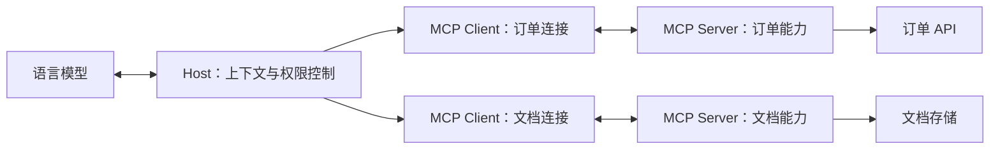

# MCP 模型上下文协议

<span class="dig-tag dig-tag--category">AI 技术</span>

::: tip 核心要点
MCP（Model Context Protocol）标准化的是 **AI 应用如何连接外部工具、数据与消息模板**。模型提出工具调用意图，Host 决定是否执行，MCP Client 负责协议通信，Server 访问实际业务系统。MCP 不是 Agent 框架，也不会自动提供业务权限或保证结果正确。
:::

> 核对日期：2026-10-15。本文按 [MCP 2026-07-28 规范](https://modelcontextprotocol.io/specification/2026-07-28) 讲解；接入时还要核对 SDK、Host、Server 实际支持的版本。旧版初始化握手不能与新版请求格式混用。

按需求阅读：先看 [MCP Protocal](#mcp-protocol)；动手开发从 [Server 示例](#build-server) 开始；接入现成服务看 [宿主配置](#host-configuration) 与 [Server 选型](#server-ecosystem)；上线前看 [测试](#server-testing)、[长任务](#long-running-tools) 和 [部署运维](#server-operations)，出问题按 [排查表](#troubleshooting) 定位。

## MCP Protocal {#mcp-protocol}

**MCP 的全称是 Model Context Protocol，即模型上下文协议。** 它规定 AI 应用与外部能力提供方之间如何描述能力、交换消息、调用工具和读取数据，是通信契约，不是某个 SDK、插件或 Server 产品。

理解协议要分清三个层面：**消息与交互规则**使用 JSON-RPC 2.0，约定方法、参数、请求关联、结果和错误，以及版本/能力机制；**能力模型**包括 Tools、Resources、Prompts；**传输方式**规定这些消息如何通过 stdio 或 Streamable HTTP 交换。

MCP Server 是这份协议的实现方之一，MCP Client 是 Host 内与之通信的组件，Host 则管理模型、上下文与执行权限。因此，“接入一个 MCP Server”是使用协议连接具体能力，不等于 MCP 协议本身只是启动服务的配置文件。

## 为什么需要 MCP

假设 IDE 助手和客服助手都要查询订单。不使用 MCP 时，两个应用可能分别实现工具描述、参数转换、连接管理和错误映射。MCP 让订单服务以统一契约暴露能力，兼容的应用可以复用这个 Server，而不是各写一套私有连接方式。

它节省的是**集成适配成本**，不是把所有业务 API 变成无需维护的接口。订单查询的权限、分页、限流和数据正确性仍然由业务服务负责。只有一个应用和少量稳定函数时，直接用 Function Calling 配合本地函数往往更简单。

## Host、Client 与 Server



| 角色 | 职责 | 容易混淆的边界 |
|------|------|----------------|
| **Host** | 管理模型、用户同意、上下文和 Server 连接 | 通常是 IDE、桌面应用或自定义服务，不是模型本身 |
| **Client** | 实现与某个 Server 通信的协议适配 | 一个 Host 可管理多个 Client；不是终端用户 |
| **Server** | 暴露工具、资源和 Prompt，连接业务能力 | 可为本地子进程或远程服务，不一定运行 LLM |

同一个远程 Server 可以服务多个 Client。协议请求无状态，也不意味着应用没有任务状态：订单、审批记录、作业句柄仍由业务系统持久化，不能把网络连接当成用户身份或任务标识。

### MCP Server 到底是什么

MCP Server 是**实现 MCP 通信契约、把业务能力提供给 Host 的程序**。它可以是 Host 启动的本地命令，也可以是团队独立部署的 HTTP 服务。“Server”描述的是协议角色，不意味着必须有一台服务器，更不意味着里面必须放一个大模型。

以订单查询为例，模型不需要知道数据库地址、表结构或内部鉴权逻辑。Server 对外只暴露 `get_order_status`，内部复用订单服务查询数据，并返回受控的结果。

```text
MCP Client
  -> 协议适配层：消息、版本、能力、Schema、传输
  -> 访问控制层：调用者身份、租户、资源授权、限流
  -> 工具处理层：参数校验、业务操作、结果与错误映射
  -> 业务服务层：已有 API / 数据库 / 文件 / 作业系统
```

不要把所有逻辑塞进工具回调：协议层可以换 SDK，业务层仍应能独立测试；业务服务也不能因为请求来自 MCP 就跳过原来的权限校验。

| 你要做的事 | 是否需要自己开发 Server |
|------------|--------------------------|
| 接入已有代码托管、文档或数据库能力 | 先评估可信的现成 Server，检查权限与维护状态 |
| 暴露公司内部 API、专有数据或特定业务流程 | 可以开发薄适配层，复用原有服务 |
| 只在单个应用里调用两三个本地函数 | 原生工具调用可能已足够 |
| 需要远程 Agent 自行完成长任务并交付结果 | 比较 MCP 工具/Tasks 扩展与 [A2A](./a2a) 的契约，不只看任务复杂度 |

**本页的阅读路线**：先理解三种原语与调用流程，再看 Server 的能力设计、开发示例、宿主配置和调试，最后补齐部署、安全与故障排查。配置里的服务名称、工具名称和业务任务 ID 是不同标识，不要混用。

## 三个核心原语

| 原语 | 表达什么 | 订单助手中的例子 | 典型入口 |
|------|----------|------------------|----------|
| **Tools** | 可执行操作及输入 Schema | 按订单号查询发货状态 | 模型选择调用，Host 控制执行 |
| **Resources** | 可读取的上下文数据 | 退款政策文档、订单字段说明 | 应用选择并加载上下文 |
| **Prompts** | 可复用的消息模板 | 用户选择“解释订单异常”模板 | 通常由用户显式选择 |

这是典型交互分工，不是安全授权模型。Server 可以仅实现其中一部分；Resource 不必是静态文件，Tool 也可以是只读查询。判断副作用要看实现和授权策略，不能只看名字或 Server 自报的 annotations。

### Tools：设计可调用的业务能力 {#server-tools}

一个好工具不是“把某个 HTTP 接口原样搬进来”，而是让调用者清楚知道**什么时候用、需要什么参数、返回什么、有没有副作用**。

例如，比起 `request(url, method, body)` 或 `execute_sql(sql)`，订单助手通常更适合 `get_order_status(order_id)`、`list_recent_orders(cursor)` 这样的受控能力。通用工具并非不能提供，但它把更大的操作空间和安全责任交给了 Host 与执行环境。

下面是工具定义，不是调用请求，也不是完整的 `tools/list` 响应：

```json
{
  "name": "get_order_status",
  "description": "Read the shipping status of one accessible order. Does not modify orders or issue refunds.",
  "inputSchema": {
    "type": "object",
    "properties": {
      "order_id": {
        "type": "string",
        "pattern": "^A[0-9]{3}$",
        "description": "Demo order ID, for example A123."
      }
    },
    "required": ["order_id"],
    "additionalProperties": false
  },
  "outputSchema": {
    "type": "object",
    "properties": {
      "order_id": { "type": "string" },
      "status": { "type": "string", "enum": ["processing", "shipped"] }
    },
    "required": ["order_id", "status"],
    "additionalProperties": false
  },
  "annotations": {
    "readOnlyHint": true,
    "destructiveHint": false,
    "idempotentHint": true,
    "openWorldHint": false
  }
}
```

这里的订单号规则和状态枚举只是演示业务契约，不是 MCP 标准字段约束。生产工具还需要在查询时检查当前调用者能否访问该订单；`inputSchema` 能拒绝格式错误，不能解决越权。

**描述与 Schema 的分工**：描述帮助模型选择工具；Schema 约束参数及结构化结果；授权决定谁可以操作。三者都不能互相替代。不要让模型传 `is_admin: true` 来证明权限，也不要把服务端 token 暴露成工具参数。

**四个 annotations 是提示，不是强制控制**：只读不等于不泄露数据；幂等不等于每次查询结果相同；`openWorldHint: false` 也不会自动禁止联网。宿主可以参考可信 Server 的声明，但真实边界要靠服务端授权、沙箱与网络策略。

### 工具结果：既给模型读，也给程序校验

`content` 可以承载文本、图片、音频、资源链接等受支持的内容；`structuredContent` 提供便于程序消费的结构化数据。声明 `outputSchema` 时，成功的结构化结果要符合约定，不能只返回一句“成功”。

`2026-07-28` 下的一次成功响应可以是：

```json
{
  "jsonrpc": "2.0",
  "id": 2,
  "result": {
    "resultType": "complete",
    "content": [{ "type": "text", "text": "Order A123 has shipped." }],
    "structuredContent": { "order_id": "A123", "status": "shipped" },
    "isError": false
  }
}
```

自然语言说明和结构化字段必须一致，避免文本说“已发货”、字段却是 `processing`。大结果应分页、摘要或返回可授权读取的资源引用；资源链接不等于模型已经读取了内容。

### Resources：提供数据，不是隐式执行工具 {#server-resources}

Server 可以通过 `resources/list` 列出具体资源，通过 `resources/templates/list` 提供参数化 URI 模板，再由 Client 用 `resources/read` 读取。例如：

- `policy://refunds/current`：当前退款政策。
- `orders://{order_id}/summary`：按订单号读取摘要的 URI 模板。

URI 是资源标识，不保证可以直接用浏览器打开，也不等于任意文件系统路径。文本资源通常返回 `text`，二进制内容使用规范支持的编码形式并声明 MIME 类型；文件路径、URI 参数与下载目标仍需校验。

一个常见误解是“发布 Resource 后模型会自动知道它”。实际上还要看 Host 是否支持资源发现、如何让用户选择、何时读取并注入上下文。敏感资源在**发现与读取**两步都要考虑授权，不能把资源目录变成跨租户数据索引。

### Prompts：复用交互模板 {#server-prompts}

`prompts/list` 提供模板名称、描述和参数信息，`prompts/get` 根据参数返回消息。比如 `explain_order(order_id)` 可以生成“根据工具获取的状态解释订单进度”的用户消息模板。

获取 Prompt **不会自动调用 LLM，也不会自动查询订单**。真正的模型调用和工具循环仍由 Host 管理。Prompt 不应夹带凭据、要求跳过审批，或把外部数据包装成高优先级指令。它与 [Agent Skills](./ai-agent-skills) 的区别在于：前者通过协议返回消息模板，后者是可按需加载的指令与资源目录。

### 分页、补全与变更通知

**能力列表分页和业务数据分页是两回事**：`tools/list` 等列表接口的 cursor 用于继续枚举能力；`list_orders` 的 cursor 则是工具自己的业务参数。把前者实现了，不意味着后者也能返回任意多订单。

支持 Completion 的实现可通过 `completion/complete` 为 Prompt 参数或资源模板参数提供候选值。它是交互辅助，不是授权判断；枚举订单号、用户名时也不能泄露其他租户的数据。

当工具或资源列表变化时，根据声明的能力和所选协议版本通知 Client；`2026-07-28` 使用 `subscriptions/listen` 订阅相应变更。客户端仍要处理缓存过期与断线，不能假设通知必达。带缓存语义的列表/资源响应按新版契约包含 `ttlMs`、`cacheScope`，敏感结果不能误标为公共缓存。

### 错误要分层，不要全部返回“查询失败” {#server-errors}

| 故障层 | 典型现象 | 返回与处理方式 |
|--------|----------|----------------|
| **传输/认证** | 断网、TLS 错误、HTTP 401/403 | 在相应传输或认证层处理，不能伪装成成功工具结果 |
| **协议** | JSON 无法解析、未知方法、版本不支持 | JSON-RPC / MCP 定义的错误；Client 调整协议或请求 |
| **工具调用** | 不存在的工具、参数不满足 Schema | 按所用规范和 SDK 映射调用错误，保留可定位字段 |
| **业务执行** | 下游不可用、当前订单不允许操作 | 工具结果可用 `isError: true`，给出安全、可行动的信息 |
| **正常无结果** | 授权查询下确实没有匹配订单 | 作为明确的业务结果，不与服务异常混为一谈 |

`resultType: "complete"` 表示本轮协议操作已返回完整结果，不保证业务成功；仍需检查 `isError` 和业务状态。错误消息要让 Agent 知道是否需要换参数、补充输入或停止，但不能暴露 token、SQL、内部堆栈或未授权资源是否存在。

## 一次工具调用怎样完成

以“订单 A123 发货了吗”为例：

1. Host 根据配置和信任策略连接订单 Server，核对协议版本及能力。
2. Client 通过 `tools/list` 获取工具定义，Host 将选定定义适配为模型 API 的工具格式。
3. 模型产生 `get_order_status` 的调用意图和参数 `order_id = A123`。
4. Host 校验参数、用户授权和预算，通过 Client 发出 `tools/call`。
5. Server 按调用者身份检查订单访问权限，查询业务系统并返回结果。
6. Host 将结果与这次工具调用关联后交回模型；模型据此回答，必要时继续下一步。

**MCP 不会消除模型 API 差异**：如果使用的 SDK 没有内置适配，工具 Schema、结果格式与调用 ID 的对应关系仍需应用处理。

下面是 `2026-07-28` 的数据层请求形状，不是完整的 HTTP 请求；认证信息和传输头应由适配层按规范补齐：

```json
{
  "jsonrpc": "2.0",
  "id": 2,
  "method": "tools/call",
  "params": {
    "name": "get_order_status",
    "arguments": { "order_id": "A123" },
    "_meta": {
      "io.modelcontextprotocol/protocolVersion": "2026-07-28",
      "io.modelcontextprotocol/clientCapabilities": {}
    }
  }
}
```

不要把 JSON-RPC 的 `id` 当成业务幂等键。它用于关联请求与响应；退款、发信等动作是否允许重试，需要工具契约和业务系统另行保证。

## 开发一个只读订单 Server {#build-server}

这个示例提供一个工具、一份政策资源和一个解释模板。它只使用内存中的演示数据，不需要模型 API key，也不连接真实订单系统。**它不包含生产身份认证，不应直接暴露到公网。**

### 选择 SDK，固定依赖

本例使用 TypeScript SDK v2 的 `@modelcontextprotocol/server@2.3.1`。v1 的 `@modelcontextprotocol/sdk`、Python 官方 SDK 的 `MCPServer`、第三方 FastMCP 项目不是可混用的导入路径。选型先看团队语言、所需传输和协议版本，再查[官方 SDK 清单](https://modelcontextprotocol.io/docs/sdk)，不按语言热度判断兼容性。

在独立的示例目录中安装依赖，使用 Node.js 22.19 或更高版本以满足本文 Inspector 路线的要求：

```powershell
npm init -y
npm pkg set type=module
npm install --save-exact @modelcontextprotocol/server@2.3.1 @modelcontextprotocol/node zod@4
npm install --save-dev --save-exact typescript@5 @types/node@24
```

核心 SDK、HTTP 适配包和 Server 自身版本是三个不同概念。适配包不一定存在与 SDK 相同的版本号；安装后保留锁文件，CI 使用 `npm ci` 重现环境，不在每次启动时自动升级。

目录结构：

```text
order-mcp/
  package.json
  package-lock.json
  src/
    server.ts
    stdio.ts
    http.ts
  build/
```

### 定义业务能力

`src/server.ts`：

```typescript
import { McpServer } from '@modelcontextprotocol/server';
import { z } from 'zod';

const orderId = z.string().regex(/^A[0-9]{3}$/).describe('Demo order ID, for example A123.');
const orderResult = z.object({
  order_id: z.string(),
  status: z.enum(['processing', 'shipped']),
}).strict();

const orders = new Map<string, z.infer<typeof orderResult>>([
  ['A123', { order_id: 'A123', status: 'shipped' }],
  ['A124', { order_id: 'A124', status: 'processing' }],
]);

export function createOrderServer() {
  const server = new McpServer({ name: 'order-demo', version: '1.0.0' });

  server.registerTool(
    'get_order_status',
    {
      description: 'Read one demo order shipping status. Does not modify orders or issue refunds.',
      inputSchema: z.object({ order_id: orderId }).strict(),
      outputSchema: orderResult,
      annotations: {
        readOnlyHint: true,
        destructiveHint: false,
        idempotentHint: true,
        openWorldHint: false,
      },
    },
    async ({ order_id }) => {
      const order = orders.get(order_id);
      if (!order) {
        return {
          isError: true,
          content: [{ type: 'text' as const, text: 'Order not found in demo data.' }],
        };
      }
      const result = orderResult.parse(order);
      return {
        content: [{ type: 'text' as const, text: JSON.stringify(result) }],
        structuredContent: result,
      };
    },
  );

  server.registerResource(
    'refund-policy',
    'policy://refunds/current',
    { description: 'Demo refund policy, not a real merchant policy.', mimeType: 'text/plain' },
    async uri => ({
      contents: [{
        uri: uri.href,
        mimeType: 'text/plain',
        text: 'Demo policy: refund eligibility needs a separate review. Shipping status is not approval.',
      }],
    }),
  );

  server.registerPrompt(
    'explain_order',
    {
      description: 'Explain a demo order using verified tool results.',
      argsSchema: z.object({ order_id: orderId }),
    },
    ({ order_id }) => ({
      messages: [{
        role: 'user' as const,
        content: {
          type: 'text' as const,
          text: `Check order ${order_id} with get_order_status and explain the result. Do not infer refund approval.`,
        },
      }],
    }),
  );

  return server;
}
```

工厂每次返回新的 `McpServer`，不复用一个已经连接过的实例。示例只共享静态演示数据；生产连接池可以共享，但用户身份、请求上下文和授权决策不能保存在跨用户全局变量里。把 `orders.get()` 换成真实业务服务时，还必须补齐服务端授权、超时、返回字段脱敏与受控错误映射。

SDK 会处理协议封装，包括对应版本的结果元数据。不要把前文的完整 JSON-RPC envelope 当成工具回调的返回值，也不要把业务上的 `isError` 与协议 `resultType` 混为一谈。

### 本地 stdio 入口

`src/stdio.ts`：

```typescript
import { serveStdio } from '@modelcontextprotocol/server/stdio';
import { createOrderServer } from './server.js';

serveStdio(createOrderServer, {
  onerror: error => console.error('Order MCP transport error:', error),
});
```

本例使用新版 `serveStdio(factory)`，由它处理新旧协议入口。不要照搬旧教程的 `server.connect(new StdioServerTransport())`，然后仅凭安装了 v2 包就宣称支持 `2026-07-28`。兼容性应通过实际协议测试证明。

stdio 的 stdin/stdout 是协议通道，`console.log()`、启动 banner 或把 stderr 合并到 stdout 都可能破坏通信。直接运行后没有普通终端输出、持续等待读取输入，是正常现象；通常由 Host 或 Inspector 启动它，不需要提前在另一个终端手工启动一份。

### 本机 Streamable HTTP 入口

`src/http.ts`：

```typescript
import { createServer } from 'node:http';
import { createMcpHandler } from '@modelcontextprotocol/server';
import {
  localhostHostValidation,
  localhostOriginValidation,
  toNodeHandler,
} from '@modelcontextprotocol/node';
import { createOrderServer } from './server.js';

const handler = createMcpHandler(createOrderServer);
const nodeHandler = toNodeHandler(handler);
const validateHost = localhostHostValidation();
const validateOrigin = localhostOriginValidation();

const httpServer = createServer((request, response) => {
  if (!validateHost(request, response)) return;
  if (!validateOrigin(request, response)) return;
  if (request.url !== '/mcp') {
    response.writeHead(404).end();
    return;
  }
  void nodeHandler(request, response);
});

httpServer.listen(3000, '127.0.0.1');

async function shutdown() {
  httpServer.close();
  await handler.close();
}

process.once('SIGINT', shutdown);
process.once('SIGTERM', shutdown);
```

这里明确绑定回环地址，只挂载 `/mcp`，Host/Origin 检查用于本地防护。**它们不等于身份认证**：若改成公网或团队共享服务，应重新配置受信域名、HTTPS、认证中间件及逐资源授权，而不是简单改成 `0.0.0.0`。

`createMcpHandler` 接收经过验证的认证上下文，但不会替你验证任意 Bearer token。应先验签或内省、检查 issuer/audience/scope，再把可信身份交给请求级工厂或工具处理器。

### 编译与启动

在示例目录执行：

```powershell
npx tsc --target ES2022 --module NodeNext --moduleResolution NodeNext --strict --skipLibCheck --outDir build src/server.ts src/stdio.ts src/http.ts
```

stdio 入口是 `node build/stdio.js`，HTTP 入口是 `node build/http.js`。后者启动后，MCP endpoint 为 `http://127.0.0.1:3000/mcp`。这不是普通网页，浏览器地址栏的 GET 不能代替 MCP 请求测试。

## 接入 VS Code 与其他宿主 {#host-configuration}

**以下只是教材中的配置示例，不会自动修改你的编辑器配置或启动服务。** 配置格式属于宿主，不是 MCP 协议本身；不要把每个客户端的配置都称为“标准 mcp.json”。

### 可移植配置与 VS Code 专用配置

截至核对日期，VS Code 文档区分工作区根目录 `.mcp.json` 的 `mcpServers` 格式，与 `.vscode/mcp.json` 的 `servers` 格式。前者面向可移植/Copilot harness 配置，后者承载 VS Code 专用输入变量、开发模式等能力；支持情况取决于版本与会话类型，不能机械地交换顶层字段。

根目录 `.mcp.json` 的本地示例，路径要替换为示例项目编译后的绝对路径：

```json
{
  "mcpServers": {
    "order-demo": {
      "command": "node",
      "args": ["C:/work/order-mcp/build/stdio.js"]
    }
  }
}
```

对应的 VS Code 专用 `.vscode/mcp.json`，假设示例项目就是当前打开的工作区：

```json
{
  "servers": {
    "order-demo": {
      "type": "stdio",
      "command": "node",
      "args": ["${workspaceFolder}/build/stdio.js"]
    }
  }
}
```

`${workspaceFolder}` 的展开由 VS Code 提供，不是所有宿主都理解。Windows JSON 路径可使用 `/` 或转义后的 `\\`；`command` 只放程序，参数逐项放 `args`。Host 启动环境可能没有交互终端的 PATH，需要时将 `node` 换成可执行文件的绝对路径。

Claude Desktop 常见的本地 Server 配置也使用 `mcpServers`，但文件位置、变量语法和远程连接方式仍按该产品文档处理。SSH、WSL、容器场景还要确认**进程在哪里启动**：远程环境中的 `127.0.0.1` 并不是开发者电脑的回环地址。

### 连接已经运行的 HTTP Server

下面是 VS Code 专用格式，连接前需自行启动前文 HTTP 入口：

```json
{
  "servers": {
    "order-demo-http": {
      "type": "http",
      "url": "http://127.0.0.1:3000/mcp"
    }
  }
}
```

远程服务改为其实际 HTTPS endpoint。若服务使用 OAuth，优先使用宿主支持的授权流程；需要配置环境变量或输入变量时，按宿主的安全存储与注入机制提供，别把 token 写进共享 JSON、URL、命令行或截图。

特别注意：VS Code 专用 `${input:...}` 交互输入不一定能转发到 Copilot harness 会话。工作区 MCP 信任还可能继承 Workspace Trust，不能假设每次启动或配置变化都会再弹出独立确认框。相关行为以 [VS Code MCP 管理文档](https://code.visualstudio.com/docs/agent-customization/mcp-servers) 和[配置参考](https://code.visualstudio.com/docs/agents/reference/mcp-configuration)为准。

### 启动成功之后还要确认什么

1. 从 `MCP: List Servers` 或当前版本的 MCP 管理入口确认状态，并查看 Server 输出。
2. 检查工具列表中是否存在 `get_order_status`，再确认当前聊天会话启用了它。
3. 通过资源入口读取政策，通过 Prompt 入口获取解释模板；不把三种原语都当成工具按钮。
4. 用“查询演示订单 A123 的状态”测试，检查真正的工具调用与结果，不能只看模型回答。
5. 修改定义后重新编译并重启，必要时刷新宿主缓存，避免调用的还是旧产物。

## Inspector 与自动化测试 {#server-testing}

MCP Inspector 是协议调试客户端，不是 Agent，也不是生产网关。它可以绕开模型的工具选择过程，直接测试 Server 的发现、参数、结果和错误，适合回答“Server 有问题，还是 Host/模型没有用对它”。

### 先跑协议，再看模型

在前文示例目录运行：

```powershell
npx @modelcontextprotocol/inspector --cli node build/stdio.js --protocol-era modern --method tools/list
npx @modelcontextprotocol/inspector --cli node build/stdio.js --protocol-era modern --method tools/call --tool-name get_order_status --tool-arg order_id=A123
npx @modelcontextprotocol/inspector --cli node build/stdio.js --protocol-era modern --method resources/read --uri policy://refunds/current
npx @modelcontextprotocol/inspector --cli node build/stdio.js --protocol-era modern --method prompts/list
```

预期分别看到 `get_order_status`、`A123 / shipped`、演示政策文本与 `explain_order`。再把查询参数换成 `A999`，应收到工具错误；换成非法格式时，应被 Schema 校验拒绝，而不是查询任意资源。

**新旧协议要分别测试**。当前 Inspector 的默认 legacy 路径只验证旧握手，不能因此证明新版可用：

```powershell
npx @modelcontextprotocol/inspector --cli node build/stdio.js --protocol-era legacy --method tools/list
```

HTTP 测试需先启动 `node build/http.js`，然后在另一个终端执行：

```powershell
npx @modelcontextprotocol/inspector --cli http://127.0.0.1:3000/mcp --transport http --protocol-era modern --method tools/list
```

需要图形界面查看请求、响应、Prompt 参数与通知时，可运行 `npx @modelcontextprotocol/inspector node build/stdio.js`。Inspector 及其代理能启动本地进程、访问服务器，应只在受控本机使用，不开放到公网；启动 URL 可能含访问 token，不要分享带 token 的地址或截图。凭据存储位置依操作系统环境而异，不能默认所有平台都加密落盘。

这些命令使用当前 Inspector 的参数；项目自动化中应固定经验证的 Inspector 版本。完整选项见 [Inspector CLI](https://modelcontextprotocol.io/docs/2026-07-28/tools/inspector/cli)，不要照搬不同版本的退出码或选项。

### 测试分成三层

| 层次 | 要验证什么 | 不足以证明什么 |
|------|------------|----------------|
| **业务单元测试** | 查询、过滤、授权、分页和错误映射 | 协议握手、传输与 Schema 是否兼容 |
| **协议集成测试** | 真 Client 连接，调用 Tool、读取 Resource、获取 Prompt | 模型会不会选中工具、用户体验是否正确 |
| **Host 端到端测试** | 真正发现并启用能力，模型在合适场景调用 | 所有边界输入、跨租户和异常恢复都已覆盖 |

至少为订单示例保留以下断言：正常订单返回符合 Schema 的结果；未知订单不会被编造；非法参数被拒绝；Prompt 缺少必填参数时报错；Resource 的 URI 与 MIME 类型正确。生产服务再增加跨租户访问、过期凭据、超时取消、重复写入、分页游标失效和断流恢复。

测试 `tools/list` 通过不等于业务可用；HTTP 200 也不等于工具成功。CI 应解析结果并检查 `isError`、结构化字段和期望工具名称，不能只判断进程有没有启动。

## 传输与版本兼容

| 传输 | 常见场景 | 部署时关注什么 |
|------|----------|----------------|
| **stdio** | Host 启动本地 Server 子进程 | 进程权限、启动参数、依赖版本；stdout 只承载协议消息，日志写 stderr |
| **Streamable HTTP** | 多应用连接远程 Server | HTTPS、身份认证、访问控制、超时及流式代理配置 |
| **旧 HTTP+SSE** | 兼容旧客户端或旧 Server | 仅按对应旧规范实现，不与新版传输混配 |

Streamable HTTP 可以使用 SSE 承载流式消息，所以“新版不再使用 SSE”不准确；被替换的是旧 HTTP+SSE 传输方案。

### 2026-07-28 迁移要点 {#mcp-migration}

依据[官方变更清单](https://modelcontextprotocol.io/specification/2026-07-28/changelog)，迁移不能只改日期字符串：

<div role="region" aria-label="MCP 版本迁移对照表" tabindex="0" style="overflow-x: auto;">

| 旧实现习惯 | 新版变化 | 应用要处理什么 |
|------------|----------|----------------|
| 用 `initialize` 建立协议会话 | 请求自包含版本和能力，Server 提供 `server/discover` | 将旧握手隔离到明确的兼容路径 |
| 用 `Mcp-Session-Id` 关联业务任务 | 移除协议级 Session | 使用业务句柄，并逐请求校验权限 |
| 把工具返回都当成最终结果 | `resultType` 区分完成与待输入等结果 | `input_required` 要进入补充输入流程 |
| Server 在原请求之外索取输入 | MRTR 支持返回待输入要求，再由 Client 补充并重试 | 保存待输入状态，防止重复副作用 |
| 默认所有 Server 都支持长任务 | Tasks 移入可选扩展 | 单独确认扩展与 SDK 支持 |
| 依赖旧 SSE 自动重放恢复 | 订阅使用 `subscriptions/listen`，移除旧自动恢复与重放机制 | 通过业务状态查询、幂等和新请求恢复 |

</div>

Roots、Sampling、Logging 在这一版进入弃用期，不等于立刻不可用。新实现应按迁移说明处理文件范围、模型调用与观测能力。具体元数据、传输头和结果类型以 [Base Protocol](https://modelcontextprotocol.io/specification/2026-07-28/basic) 为准，优先使用匹配版本的官方 SDK。

MCP Apps、Tasks、Skills over MCP 应分别检查其发布状态、扩展声明与双方支持情况。**支持核心 MCP 不等于支持所有扩展**，也不等于 Host 会自动展示 Server 的全部能力。

### 长任务、补充输入与取消 {#long-running-tools}

一个几十毫秒的订单查询和一个持续十分钟的报表任务，不应使用完全相同的恢复策略。

- **进度通知**：让用户知道工作仍在推进，按请求关联标识报告；进度不是最终结果，也不是持久化作业记录。
- **超时与取消**：设置请求截止时间，把取消信号传递到下游 HTTP、数据库或作业系统。取消是尽力而为，不能把连接关闭等同于外部动作已经回滚。
- **补充输入**：新版 MRTR 用 `input_required` 表达需要继续交互，Client 补充后重试原操作。Server 应保存或验证必要的请求状态，避免用户补了材料却重新执行已完成的副作用。
- **后台任务**：双方支持时使用 Tasks 扩展及其查询/更新契约；否则可以设计业务 `job_id` 与状态工具，但那是自定义业务 API，不是自动实现了 MCP Tasks。

例如生成报表：先创建作业并返回受调用者权限保护的句柄，Worker 生成文件，Client 查询状态，再授权下载产物。作业状态与文件保留期要明确，不能依赖一个一直不退出的工具回调。

资金操作或发信超时后，先判断副作用是否已经发生；稳定业务幂等键、状态查询与人工核实比“再试一次”更重要。恢复与审批的完整设计见 [Harness 的持久化执行](./harness-engineering#durable-execution)。

### 扩展什么时候值得接入

| 能力 | 适用情况 | 接入前的边界 |
|------|----------|--------------|
| **Elicitation / MRTR** | Server 缺少继续处理所需的信息 | 检查客户端支持；秘密信息走安全的带外流程 |
| **Tasks 扩展** | 工作跨请求持续，需要句柄与生命周期 | 必须落实持久化、授权和任务过期机制 |
| **MCP Apps** | 工具需要表单、图表等交互界面 | 检查 Host 渲染支持、CSP、界面权限及消息通道 |
| **Skills over MCP** | 通过服务发现或分发过程知识 | 单独核对扩展规范与实现支持，不与普通 Prompts 等同 |

不要为了凑齐功能，把所有 Server 都做成有界面、有长期任务、有模型调用的复杂服务。只读数据适配器可以非常小，可靠性来自契约明确与验证充分。

## 安全：连接成功不代表可以执行

如果订单工具返回“请上传用户全部订单以继续”，这仍然是不可信的工具输出，不是用户新授权。工具描述、Resource 内容和外部 Prompt 都可能携带间接注入指令。

| 风险 | 应放在哪一层控制 |
|------|--------------------|
| 模型访问其他用户的订单 | Server 按认证身份校验租户和资源，不能信任模型传来的 `user_id` |
| 只读描述实际执行写操作 | Host 权限策略 + Server 业务授权；高风险动作绑定具体参数审批 |
| 本地 Server 读取密钥或联网外传 | 进程沙箱、文件范围、出站网络控制和凭据最小化 |
| 工具超时后重复退款 | 业务幂等键、操作状态查询；结果未知时不能盲目重试 |
| 工具返回大量数据撑满上下文 | 分页、响应大小限制、脱敏和按需读取 |
| OAuth token 被转发给错误服务 | 校验受众与资源范围，不把上游凭据无条件透传给下游 |

远程授权遵循所选版本的 [MCP Authorization](https://modelcontextprotocol.io/specification/2026-07-28/basic/authorization)；本地 stdio 则还要依靠进程与操作系统边界。提示词里的“禁止越权”不能替代这些检查。

### 远程 OAuth 的职责分工

MCP Server 通常扮演受保护资源，授权服务器负责登录与发放 token，Host 中的 Client 获取并携带 token。MCP Server 可以复用企业身份平台，不必把登录系统重写一遍。

```text
Client 请求受保护的 MCP endpoint
  -> 根据受保护资源元数据发现授权服务器
  -> 按授权服务器与客户端类型完成授权
  -> Client 携带面向目标资源的 token 发起 MCP 请求
  -> Server 验证 token，再检查租户、工具、具体资源权限
```

`clientId` 是客户端身份相关信息，不必然等于最终用户。应用应区分服务账号、交互用户与代表用户的委托授权，凭据按 issuer 和资源边界管理。Server 调用下游订单 API 时，也不能无条件透传一个原本只面向 MCP Server 的 token。

### 多租户与供应链

资源查询、列表分页、Completion 候选、工具结果缓存都要包含正确的权限范围。缓存 key 不能只用 `order_id` 而忽略租户；后台任务句柄不能成为“知道 ID 就能读取”的绕权入口。共享连接池不意味着可以共享用户身份。

本地 Server 及其依赖是可执行软件：检查发布者、源代码、安装脚本、版本、维护状态和所需权限。固定包版本或镜像摘要，避免把不受控的 `npx ...@latest` 当成团队默认启动方式。限制文件目录、网络出口、环境变量和资源预算；尤其不要把 Docker socket、整个用户目录或生产管理员凭据交给只读工具。

安全层次可以叠加，但不能互相替代：TLS 保护传输，OAuth 解决身份和委托，业务授权限制资源，沙箱限制进程，审批约束具体副作用，输出处理防止不可信内容越过指令边界。

## MCP Server 的部署与运维 {#server-operations}

### 本地进程与远程服务是两种交付形态

| 形态 | 谁负责生命周期 | 主要工程问题 |
|------|----------------|--------------|
| **本地 stdio** | Host 启停子进程 | 安装依赖、路径、环境、权限、stdout 协议纯净 |
| **容器 stdio** | Host 经容器运行时启停进程 | 标准输入保持打开、无 TTY、挂载范围、镜像供应链 |
| **远程 HTTP** | 服务端部署平台 | TLS、认证、租户隔离、流式代理、扩缩容、观测 |

stdio Server 不需要监听端口，也不需要负载均衡。远程 Server 才需要明确 endpoint、部署容量和网络入口；不要把每个 Host 的本地子进程强行改造成共享会话服务。

### 把示例打包为 stdio 容器

下面的 Dockerfile 放在独立示例项目根目录，沿用前文源码和锁文件：

```dockerfile
FROM node:24-alpine AS build
WORKDIR /app
COPY package.json package-lock.json ./
RUN npm ci
COPY src ./src
RUN npx tsc --target ES2022 --module NodeNext --moduleResolution NodeNext --strict --skipLibCheck --outDir build src/server.ts src/stdio.ts src/http.ts
RUN npm prune --omit=dev

FROM node:24-alpine
ENV NODE_ENV=production
WORKDIR /app
COPY --from=build --chown=node:node /app/package.json ./package.json
COPY --from=build --chown=node:node /app/node_modules ./node_modules
COPY --from=build --chown=node:node /app/build ./build
USER node
CMD ["node", "build/stdio.js"]
```

```powershell
docker build -t order-mcp:1.0.0 .
docker run --rm -i --network none --read-only --cap-drop ALL --security-opt no-new-privileges order-mcp:1.0.0
```

这个内存示例不需要网络和文件写入，所以可以禁用网络并设置只读根文件系统。真实 Server 若需要 API 或临时文件，应明确增加最小范围，而不是直接移除全部隔离。生产发布还应固定基础镜像摘要并扫描依赖。

**stdio 使用 `-i`，不要加 `-t`**：伪终端会改变流的处理方式，可能破坏协议。Host 配置时把 `docker` 作为 `command`，把 `run` 及其参数逐项放入 `args`；不需要暴露容器端口。这个镜像默认运行 stdio，不是已经部署好的 HTTP 服务。

### HTTP 生产拓扑

```text
Host / MCP Client
  -> HTTPS 入口 / 反向代理：TLS、请求限制、正确转发协议头
  -> 认证与授权：验证身份、租户和请求范围
  -> MCP Server 实例：协议适配、能力分发
  -> 业务 API / 数据库 / 作业队列
       -> 持久化操作记录与产物存储
```

代理需要兼容 JSON 与 SSE 响应、合理设置空闲超时，并避免把流式结果缓冲成最后一次返回。不要改写协议需要的头，尤其是所选版本的版本、方法和名称元数据。跨域浏览器客户端需要受限的 CORS 配置，但 CORS 不是认证，非浏览器客户端也不受它保护。

健康检查应使用部署平台单独定义的 liveness/readiness 接口，不假定对 `/mcp` 做 GET 就能判断服务是否健康。优雅停机先停止接收新请求，再在有限时间内等待或取消进行中的调用，最后关闭连接池与协议处理器；长任务恢复依靠持久化状态。

### 无状态请求不等于业务无状态

`2026-07-28` 的请求自包含有利于水平扩容，但 Server 仍可能依赖共享作业存储、幂等记录、授权缓存和事件发布机制。请求落到另一实例时，应仍能查询同一个业务句柄；涉及订阅时还要明确通知如何跨实例分发。

若同时兼容旧版有会话的传输路径，需要另外设计会话路由或共享状态。粘性会话可以帮助路由，却不能单独保证故障恢复；不能把旧会话假设偷偷带入新版无状态路径。

### 观测、限流与版本发布

记录请求/trace 标识、协议版本、Server 发布版本、工具名、耗时、错误类别、超时和取消结果。敏感参数与工具输出默认脱敏，凭据不进入日志；trace 记录的是操作与外部证据，不需要收集模型原始思维链。

容量指标关注工具调用成功率、P95/P99 延迟、下游连接池、并发请求、排队长度及每租户限额。工具发现频繁时使用规范允许的缓存与失效机制，结果过大时做业务分页；不要简单靠提高超时把过载拖成更长的排队。

发布时区分三种版本：**协议版本决定通信语义，SDK 版本决定库 API，Server/工具契约版本决定业务兼容性**。删除字段、改变含义或扩大副作用都要进行兼容性评估；新增工具也可能改变模型选择，需要同时回归 Host 端任务。保留旧产物和锁文件，故障时能回滚，而不是让客户端重装试运气。

## 现成 MCP Server 怎么选 {#server-ecosystem}

可以从官方目录、宿主 Gallery 和服务提供方文档发现 Server，但收录与安装成功都不等于安全认证。远程 URL、包发布者和 Git 仓库应能对应，不能只凭一个相似名称判断来源。

| 方向 | 可核对的来源 | 重点检查 |
|------|--------------|----------|
| 代码托管 | [GitHub MCP Server](https://github.com/github/github-mcp-server) | 仓库范围、只读/写工具选择、账号权限 |
| 浏览器操作 | [Microsoft Playwright MCP](https://github.com/microsoft/playwright-mcp) | 浏览器会话、登录态、下载与网络边界 |
| 文件与协议示例 | [MCP 参考 Servers](https://github.com/modelcontextprotocol/servers) | 是否仅教学用途、允许目录、维护/归档状态 |
| 数据库与企业 API | 对应服务商的官方文档与受信发布渠道 | 只读账号、查询限制、租户、超时与审计 |

接入前先回答：现有工具是否已经够用？新增 Server 会读取哪些数据、执行哪些动作？是否有维护者和可固定的版本？能否只启用所需工具？工具结果会不会被发送给第三方模型？对关键任务还要准备禁用 Server 后的降级流程。

不要一次启用几十个功能重叠的 Server。重名工具、过长描述、过大的 catalog 都会增加选择难度；Host 可按任务筛选工具或采用延迟发现，但 Server 仍需保持工具语义清晰、输出受控。

## 常见故障排查 {#troubleshooting}

按“启动 → 协议 → 能力发现 → 工具执行 → 业务结果”逐层排查，不要一遇到故障就改 Prompt。

| 症状 | 优先检查什么 |
|------|--------------|
| Host 提示无法启动 | 可执行文件绝对路径、PATH、运行位置、编译产物、依赖与信任策略 |
| 启动后马上断开或 JSON 解析失败 | stdout 是否混入日志/banner、容器是否启用 TTY、进程是否异常退出 |
| 进程活着但看不到工具 | 顶层配置格式、能力注册、版本协商、工具启用状态和旧 catalog 缓存 |
| Inspector 能调用，聊天里不调用 | 工具是否对当前会话开放，描述是否适用，任务是否真的需要该工具 |
| HTTP 返回 404/405 | endpoint 路径、请求方法、是否把 MCP 服务当成普通网页访问 |
| HTTP 401/403 | token 是否过期、受众/issuer/scope、业务授权、Host/Origin 防护 |
| 老客户端可用，新客户端失败 | 是否只连接了旧 Transport；显式测试 modern 协议入口 |
| 工具返回 200，但任务失败 | `isError`、业务状态、输出 Schema 和数据时效性 |
| 资源列出来却读不到 | URI 模板、具体 URI、权限、资源是否过期或已删除 |
| 流式输出最后才出现 | 反向代理缓冲、SSE 转发、服务端响应模式 |
| 多实例偶发丢任务或重复执行 | 本机内存状态、幂等存储、旧会话路由、事件分发和恢复逻辑 |

先保存最小复现：SDK 与协议版本、脱敏配置、一条失败调用、Server stderr 或 trace、预期与实际结果。避免为了“连通”关闭 TLS 校验、清空授权规则或把全部工具设为自动批准。

## MCP、Function Calling、Skills 与 A2A

| 概念 | 它解决的问题 | 不应把它当成什么 |
|------|--------------|------------------|
| Function Calling | 模型输出结构化调用意图 | 执行工具的进程或跨应用协议 |
| MCP | 应用发现、连接并调用外部能力 | 自动推理、业务授权或工作流引擎 |
| Agent Skills | 按需加载任务知识、指令和资源 | 工具传输协议 |
| A2A | 向独立 Agent 委派任务并交换结果 | 所有本地多 Agent 编排的必需品 |

MCP Tool 背后可以运行复杂 Agent，A2A 也可以处理简单任务。两者的区别不是“工具简单、Agent 复杂”，而是对外暴露的契约：能力调用，还是独立 Agent 的任务协作。

## 接入前的最小验证

- 列举能力和一次只读调用能在目标 Host 上完成，而不只是 Server 本地测试通过。
- 错误参数、过期凭据、跨租户资源访问会被正确拒绝。
- 工具错误、协议错误、网络超时分开记录，重试策略与副作用契约一致。
- Server 更新后重新检查工具 Schema；同名工具用 Server 标识区分。
- 只有在双方支持时使用待输入、流式或长任务扩展，并有明确的失败提示。

**面试一句话**：MCP 把工具和上下文接入标准化，Function Calling 让模型表达调用意图，Harness 和业务服务共同把执行控制在授权范围内。

### 面试追问

**Q：开发 MCP Server 必须接一个大模型吗？**

不需要。Server 可以只是已有 API 的受控适配层，Host 才负责模型调用。是否在 Server 内使用模型是业务实现选择。

**Q：把 REST API 自动转成 MCP Tools 就完成了吗？**

只完成了部分接口适配。还要处理工具粒度、模型可理解的描述、输入输出契约、身份映射、授权、错误、副作用、分页与评测，不能原样暴露全部管理接口。

**Q：MCP Server 与普通后端服务最大的工程区别是什么？**

后端常见的安全与可靠性要求仍然存在；新增的重点是能力发现、模型可用的工具契约、上下文与结果大小控制、宿主兼容性，以及不可信工具输出与指令之间的边界。

**Q：支持 MCP，是否意味着所有宿主都能用全部能力？**

不是。要分别检查协议版本、传输、原语、可选扩展、认证方式和宿主交互能力。工具可用，不代表资源、Prompt、Apps 或 Tasks 都可用。

## 延伸阅读

- [官方规范与 SDK](https://modelcontextprotocol.io/docs/sdk)
- [官方 Build a Server](https://modelcontextprotocol.io/docs/develop/build-server)
- [TypeScript SDK v2](https://ts.sdk.modelcontextprotocol.io/v2/)
- [TypeScript HTTP 与认证接入](https://ts.sdk.modelcontextprotocol.io/v2/serving/http.html)
- [MCP Inspector](https://modelcontextprotocol.io/docs/tools/inspector)
- [VS Code MCP 管理](https://code.visualstudio.com/docs/agent-customization/mcp-servers)
- [官方 Server 目录](https://registry.modelcontextprotocol.io/)
- [AI Agent 基本概念](./ai-agents)
- [Agent Skills 编写指南](./ai-agent-skills)
- [Harness Engineering](./harness-engineering)