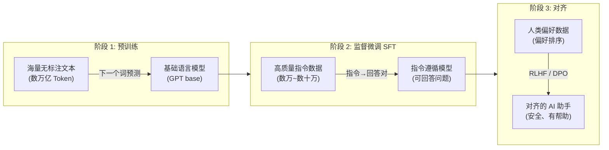
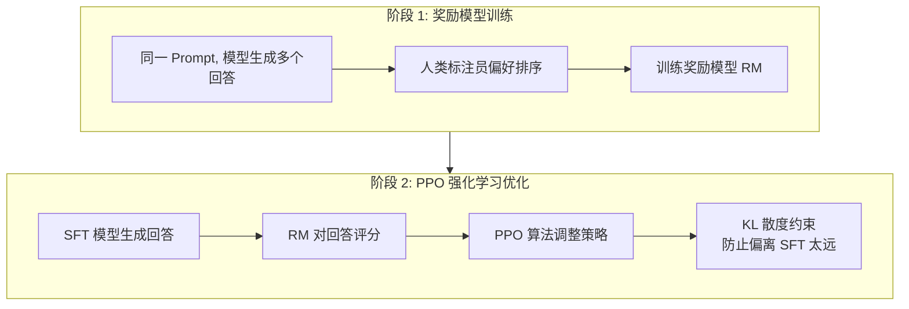

# 模型微调与训练

<span class="dig-tag dig-tag--category">AI 技术</span> <span class="dig-tag dig-tag--hard">⭐⭐⭐ 高级</span> <span class="dig-tag dig-tag--hot">🔥🔥 中频</span>

::: tip 💡 核心要点
模型训练是指通过数据与反馈优化大语言模型参数的过程，常概括为**预训练（Pre-training）**、**监督微调（SFT）**和**训练后训练（Post-training）**。训练后训练不只做“价值观对齐”，还包括指令遵循、偏好优化、可验证奖励强化学习、工具使用与安全训练。对于多数应用团队，核心关注的是 **LoRA/QLoRA 等 PEFT**、数据质量和可回归的领域评估。
:::

## 训练范式全景

大语言模型的训练是一个多阶段的流程，每个阶段有不同的目标和数据需求：



| 阶段 | 数据规模 | 计算成本 | 目标 |
|------|----------|----------|------|
| **预训练** | 大规模文本/代码/多模态数据 | 极高，随模型和预算变化 | 学习通用表示、语言模式与知识 |
| **SFT** | 数万~数十万条 | 中等（数小时~数天） | 学习遵循指令、对话格式 |
| **对齐** | 数万条偏好数据 | 中等 | 输出与人类期望一致 |

---

## 微调方法概览

### 全量微调 Full Fine-tuning

更新模型的**所有参数**，是最直接的微调方式：

- **优点**：可更新全部参数，适配容量上限高，但并不保证在小数据上一定优于 PEFT
- **缺点**：仅 FP16 权重就约为 140GB；训练还要容纳梯度、优化器状态和激活，通常远高于 140GB，具体取决于精度、优化器、分片与重计算
- **适用**：有充足计算资源且任务差异大的场景

### 参数高效微调 PEFT

冻结原始模型的大部分参数，只训练少量新增参数：

| 方法 | 原理 | 可训练参数量 | 效果 |
|------|------|-------------|------|
| **LoRA** | 在权重矩阵旁添加低秩分解增量 | 0.1%~1% | 接近全量微调 |
| **QLoRA** | 4-bit 冻结基础模型 + 高精度 LoRA 训练 | 0.1%~1% | 可显著降显存，质量取决于任务、量化与超参数 |
| **Prefix Tuning** | 在每层注意力前添加可训练的前缀向量 | < 0.1% | 适合特定格式任务 |
| **Adapter** | 在 Transformer 层中插入小型瓶颈网络 | ~1% | 早期方法，已逐步被 LoRA 替代 |
| **IA3** | 学习激活值的缩放因子 | < 0.01% | 极少参数，效果有限 |

---

## LoRA 深入解析

LoRA（Low-Rank Adaptation）是当前最主流的 PEFT 方法，其核心思想：**冻结原始权重 $W$，在旁边添加一个低秩分解的增量矩阵**。

### 数学原理

对于原始权重矩阵 $W \in \mathbb{R}^{d \times d}$，LoRA 将增量分解为两个低秩矩阵的乘积：

$$
W' = W + \Delta W = W + BA
$$

其中 $B \in \mathbb{R}^{d \times r}$，$A \in \mathbb{R}^{r \times d}$，$r \ll d$。

**参数量对比**：
- 全量微调：$d^2$ 参数（如 $d = 4096$，则 $\approx 16.7M$）
- LoRA：$2 \times d \times r$ 参数（$r = 16$ 时，$\approx 131K$，**压缩 128 倍**）

### 为什么低秩有效

LoRA 论文观察到适配更新具有较低的“内在秩”，因此可用低秩矩阵表达许多任务所需的主要变化。这是经验假设而非对所有层、任务和秩都成立的定理；领域跨度很大或需要重塑大量能力时，过小的 rank 仍会欠拟合。

### 实现细节

```python
import torch
import torch.nn as nn

class LoRALinear(nn.Module):
    """带 LoRA 的线性层"""
    def __init__(self, original_linear: nn.Linear, rank: int = 16, alpha: float = 32):
        super().__init__()
        self.original = original_linear
        self.original.weight.requires_grad = False  # 冻结原始权重

        d_in, d_out = original_linear.in_features, original_linear.out_features

        # LoRA 低秩矩阵
        self.lora_A = nn.Linear(d_in, rank, bias=False)   # 降维
        self.lora_B = nn.Linear(rank, d_out, bias=False)   # 升维

        # 初始化：A 用正态分布，B 用零初始化 → 初始 ΔW = 0
        nn.init.normal_(self.lora_A.weight, std=0.02)
        nn.init.zeros_(self.lora_B.weight)

        self.scaling = alpha / rank  # 缩放因子

    def forward(self, x):
        original_output = self.original(x)
        lora_output = self.lora_B(self.lora_A(x)) * self.scaling
        return original_output + lora_output
```

### 关键超参数

| 参数 | 说明 | 推荐值 |
|------|------|--------|
| **rank (r)** | 低秩矩阵的秩，控制参数量和表达能力 | 常从 8~64 搜索，任务差异大时需评估 |
| **alpha (α)** | 缩放因子，控制 LoRA 增量的影响强度 | 与 rank、学习率联合调参，不存在固定 2 倍规则 |
| **target_modules** | 应用 LoRA 的层（Q/K/V/O/FFN） | 依模型命名和任务选择；全线性层常是更强基线 |
| **dropout** | LoRA 路径的 Dropout | 数据少时可尝试，不能当作固定范围 |

### 推理时合并

LoRA 的一大优势是推理时可以将增量合并回原始权重，**不增加任何推理开销**：

$$
W_{\text{merged}} = W + \frac{\alpha}{r} \cdot BA
$$

合并后的模型与全量微调的模型在计算流程上完全相同。

### QLoRA

QLoRA 是 LoRA 的进一步优化，将基础模型量化为 **4-bit**，只用 LoRA 部分保持高精度：

$$
W'_{\text{QLoRA}} = \text{Dequant}_4(W_{\text{4bit}}) + BA
$$

- QLoRA 能显著降低**基础权重**占用，但总显存还包括量化元数据、LoRA 参数、梯度、优化器、激活和临时工作区；70B 是否能在单张 24GB 卡上训练取决于序列长度、batch、checkpointing、offload 与实现，不能由“权重约 35GB”直接推出
- 在 QLoRA 论文任务上可匹配 16-bit 微调的强基线，但“几乎无损”必须用目标任务评估确认

---

## 监督微调 SFT

### 指令微调

指令微调（Instruction Tuning）使用**指令-回答对**训练模型学习遵循用户指令：

```json
{
  "instruction": "请将以下英文翻译为中文",
  "input": "The weather is beautiful today.",
  "output": "今天天气很好。"
}
```

### 数据集格式

| 格式 | 结构 | 代表数据集 |
|------|------|------------|
| **Alpaca** | instruction + input + output | Stanford Alpaca（52K 条） |
| **ShareGPT** | 多轮对话 (human/gpt 交替) | ShareGPT、WildChat |
| **OpenAI Chat** | messages 数组 (system/user/assistant) | 自定义对话数据 |

### 数据质量 > 数据数量

LIMA 展示了在强预训练模型和特定对齐设定下，约 1000 条精心筛选示例也能获得较好的响应风格。这说明质量很重要，但不证明所有领域的 1000 条数据都优于大数据集；知识覆盖、长尾边界和安全行为仍需要足够多样的数据。关键在于：

- **多样性**：覆盖目标任务的各种场景
- **一致性**：输出风格和格式统一
- **准确性**：答案正确、逻辑清晰
- **长度适当**：避免过短（信息不足）或过长（注水）

数据不足时，不能只扩大模型生成量。合成样本的来源、审核、去重、评测隔离，以及回答/概率分布/on-policy 蒸馏的区别，详见 [合成数据与知识蒸馏](./synthetic-data-and-distillation)。

---

## 人类偏好对齐

预训练+SFT 之后的模型已能遵循指令，但输出可能不安全、不诚实或不够有帮助。对齐（Alignment）阶段使模型输出与人类偏好一致。

### RLHF（Reinforcement Learning from Human Feedback）

RLHF 是最经典的对齐方法，由三个子阶段组成：



**RLHF 的优化目标**：

$$
\max_{\pi_\theta} \mathbb{E}_{x \sim D, y \sim \pi_\theta(y|x)} \left[ R_\phi(x, y) - \beta \cdot D_{\text{KL}}(\pi_\theta(y|x) \| \pi_{\text{ref}}(y|x)) \right]
$$

其中 $R_\phi$ 是奖励模型，$\pi_\theta$ 是策略模型，$\pi_{\text{ref}}$ 是 SFT 模型（参考模型），$\beta$ 控制 KL 惩罚力度。

### DPO（Direct Preference Optimization）

DPO 跳过**显式奖励模型和在线 PPO rollout**，在 KL 正则化的 Bradley-Terry 偏好模型假设下，把奖励—策略关系改写为分类损失，直接从偏好数据优化策略：

$$
\mathcal{L}_{\text{DPO}} = -\mathbb{E}_{(x, y_w, y_l)} \left[ \log \sigma \left( \beta \log \frac{\pi_\theta(y_w|x)}{\pi_{\text{ref}}(y_w|x)} - \beta \log \frac{\pi_\theta(y_l|x)}{\pi_{\text{ref}}(y_l|x)} \right) \right]
$$

其中 $y_w$ 是偏好的回答（win），$y_l$ 是被拒绝的回答（lose）。

### RLHF vs DPO

| 维度 | RLHF | DPO |
|------|------|-----|
| **流程复杂度** | 需训练奖励模型 + PPO 优化 | 只需一步优化 |
| **训练稳定性** | PPO 调参困难，易不稳定 | 标准监督学习，训练稳定 |
| **效果** | 可在线探索并使用任意可计算奖励，但易 Reward Hacking | 离线、简单；效果受偏好覆盖与参考策略分布影响 |
| **数据需求** | 偏好排序数据 | 偏好对（win/lose） |
| **主流度** | PPO/GRPO 等在线 RL 在推理与可验证任务中仍重要 | DPO 及变体是常用离线偏好优化路线之一 |

### 其他对齐方法

| 方法 | 特点 | 发布时间 |
|------|------|----------|
| **ORPO** | 合并 SFT 和对齐为一步，无需参考模型 | 2024 |
| **KTO** | 只需"好/坏"二分标签而非成对偏好 | 2024 |
| **SimPO** | 简化 DPO，使用序列平均对数概率作为隐式奖励 | 2024 |
| **GRPO** | DeepSeekMath（2024）提出的 PPO 变体；对同一 Prompt 采样一组输出，用组内相对奖励估计优势，省去独立 Critic/Value 模型 | 2024 |
| **RLVR** | 使用可验证结果（数学答案、代码测试等）作为奖励；奖励更客观但覆盖范围窄，仍需防测试漏洞与 Reward Hacking | 2024-2025 |
| **Online / Iterative DPO** | 用当前策略持续生成并标注新偏好对，缓解固定离线数据的分布偏移；收益取决于采样与反馈质量 | 2024-2025 |
| **Self-Play / SPIN** | 模型与自身博弈生成偏好数据，减少对人类标注的依赖 | 2024 |

---

## 训练实践

### LoRA 微调示例

使用 Hugging Face PEFT 和 TRL 库进行 LoRA 微调：

```python
from datasets import load_dataset
from transformers import AutoModelForCausalLM, AutoTokenizer
from peft import LoraConfig, get_peft_model
from trl import SFTConfig, SFTTrainer

# 1. 加载模型和分词器
model_name = "Qwen/Qwen2.5-7B"  # 或使用 Llama-3/4, DeepSeek-R1 等开源模型
model = AutoModelForCausalLM.from_pretrained(model_name, torch_dtype="auto")
tokenizer = AutoTokenizer.from_pretrained(model_name)

# 2. 配置 LoRA
lora_config = LoraConfig(
    r=16,                          # 秩
    lora_alpha=32,                 # 缩放因子
    target_modules=["q_proj", "v_proj", "k_proj", "o_proj"],
    lora_dropout=0.05,
    bias="none",
    task_type="CAUSAL_LM",
)

model = get_peft_model(model, lora_config)
model.print_trainable_parameters()
# trainable params: 13,107,200 || all params: 7,628,000,000 || trainable%: 0.17%

# 3. 准备数据
dataset = load_dataset("json", data_files="train_data.jsonl")

# 4. 训练（当前 TRL API）
training_args = SFTConfig(
    output_dir="./output",
    num_train_epochs=3,
    per_device_train_batch_size=4,
    gradient_accumulation_steps=4,
    learning_rate=2e-4,
    warmup_ratio=0.1,
    bf16=True,
    max_length=2048,
    logging_steps=10,
    save_strategy="epoch",
)

trainer = SFTTrainer(
    model=model,
    args=training_args,
    train_dataset=dataset["train"],
  processing_class=tokenizer,
)

trainer.train()

# 5. 合并并保存
merged_model = model.merge_and_unload()
merged_model.save_pretrained("./merged_model")
```

### 训练基础设施

| 模型规模 | 全量微调显存 | QLoRA 显存 | 推荐硬件 |
|----------|------------|-----------|----------|
| **7B** | 权重+梯度+Adam 状态约 112GB 起（未计激活） | 常见短上下文约 6~12GB 起 | 1× 24GB 可做多数 QLoRA 实验 |
| **13B** | 约 208GB 起（未计激活） | 常见短上下文约 10~20GB 起 | 24GB 卡需控制长度或 offload |
| **70B** | 约 1.1TB 起（未计激活） | 仅 4-bit 权重约 35GB，训练总量更高 | 通常需 48/80GB 级 GPU、多卡或 CPU offload |

> 这里的全量估算按每参数约 16 bytes 粗算（FP16/BF16 权重与梯度、FP32 master weight、Adam 一二阶状态），不同优化器和 FSDP/ZeRO 会改变单卡占用；QLoRA 数字对序列长度与激活重计算尤其敏感。

### 分布式训练

大规模模型通常需要多卡甚至多机训练：

| 框架 | 策略 | 特点 |
|------|------|------|
| **FSDP** | 完全分片数据并行 | PyTorch 原生，将模型参数/梯度/优化器状态分片到多卡 |
| **DeepSpeed** | ZeRO（Zero Redundancy Optimizer） | 微软开发，ZeRO-3 可训练万亿参数模型 |
| **Megatron-LM** | 张量并行 + 流水线并行 | NVIDIA 开发，适合超大规模预训练 |

---

## 评估体系

### 通用基准测试

| 基准 | 评估能力 | 说明 |
|------|----------|------|
| **MMLU** | 通用知识 | 57 个学科的多选题（高中~专业级） |
| **HumanEval** | 代码生成 | 164 个 Python 编程题 |
| **MT-Bench** | 对话能力 | 多轮对话质量（GPT-4 评分） |
| **MATH** | 数学推理 | 竞赛级数学问题 |
| **C-Eval** | 中文知识 | 中文多学科知识评估 |

### 自定义评估

生产环境中，通用基准不足以衡量微调效果，需要构建**领域特定评估集**：

1. 准备 100~500 条代表性测试样例
2. 定义评估维度（准确性、格式遵循、安全性等）
3. 使用固定版本的强模型做自动评分，并以人工抽检校准；Judge 型号、Prompt 和顺序都要版本化
4. 对比微调前后的效果差异

---

::: warning ⚠️ 常见误区

1. **认为微调不能注入任何新知识，或可以替代知识库**：微调可以让模型记住部分新事实和领域模式，但更新、溯源和精确召回不可靠，也可能遗忘旧能力。频繁变化且需引用的知识优先 RAG；稳定技能、术语和行为模式更适合微调，必要时两者结合。

2. **数据量越多效果越好**：低质量数据可能导致模型退化。LIMA 研究表明 1000 条高质量数据即可显著提升效果。关键是数据质量和多样性。

3. **LoRA rank 越大越好**：过大的 rank 增加计算和过拟合风险，过小又可能欠拟合。16~32 是常见起点而非结论，应按领域跨度、目标层和验证集调参。

4. **忽视评估的重要性**：微调后必须在独立测试集上评估，避免过拟合训练数据。通用基准和领域评估都需要。

:::

---

<div class="dig-questions">
  <div class="dig-questions__header">
    <span>📝 面试真题</span>
    <span style="font-size: 12px; opacity: 0.8;">3 道高频</span>
  </div>
  <div class="dig-questions__item">
    <span>1. 解释 LoRA 的原理及其数学基础，为什么低秩分解有效？</span>
    <span class="dig-tag dig-tag--medium" style="margin: 0;">中等</span>
  </div>
  <div class="dig-questions__item">
    <span>2. 对比 RLHF 和 DPO 两种对齐方法的优缺点</span>
    <span class="dig-tag dig-tag--hard" style="margin: 0;">困难</span>
  </div>
  <div class="dig-questions__item">
    <span>3. 如何为企业场景准备高质量的微调数据集？</span>
    <span class="dig-tag dig-tag--medium" style="margin: 0;">中等</span>
  </div>
</div>

## 面试真题详解

### Q1：解释 LoRA 的原理及其数学基础，为什么低秩分解有效？

**要点**：

LoRA 的核心思想是冻结预训练模型的权重 $W$，在旁边添加一个**低秩分解的增量矩阵** $\Delta W = BA$：

$$
W' = W + BA, \quad B \in \mathbb{R}^{d \times r}, A \in \mathbb{R}^{r \times d}, r \ll d
$$

**为什么低秩有效**：
1. LoRA 论文观察到微调更新常具有较低的**内在秩**——许多有效变化集中在少数主要方向，但这不是所有任务都成立的保证
2. 预训练模型已经学到了丰富的语言表示，微调只需要在这些表示上做**小幅调整**
3. 类比：微调不是"重新学习"，而是"微调旋钮"——需要调节的自由度（秩）远小于模型的总参数维度

**实践要点**：
- 初始化：$A$ 正态初始化，$B$ 零初始化 → 训练开始时 $\Delta W = 0$，不破坏原始模型
- 推理无额外开销：$W_{\text{merged}} = W + BA$ 合并后计算量不变
- 目标层需实测；只调 Q/V 是经典设置，把 LoRA 扩展到全部注意力和 FFN 线性层常是更强但更耗显存的基线

---

### Q2：对比 RLHF 和 DPO 两种对齐方法的优缺点

**要点**：

**RLHF**：两步走——先训练奖励模型（RM），再用 PPO 强化学习优化。
- 优点：理论上限高，奖励模型可复用
- 缺点：流程复杂（需同时维护 4 个模型：策略/参考/奖励/价值），PPO 训练不稳定

**DPO**：一步到位——将奖励函数隐式嵌入策略优化中，直接从偏好对（win/lose）训练。
- 优点：实现简单（标准监督学习），训练稳定，无需单独的奖励模型
- 缺点：无法复用奖励模型，对偏好数据质量更敏感

**关键数学联系**：DPO 证明了在 KL 约束下，最优策略可以用参考模型和数据直接表示，无需显式奖励模型。

DPO 及其变体因简洁、稳定而成为常用离线偏好优化路线；PPO/GRPO 等在线 RL 并未被取代。DeepSeekMath 在 2024 年提出 GRPO，DeepSeek-R1 在 2025 年进一步展示了强化学习在数学、代码等**可验证任务**上激发推理行为的效果。边界是验证器覆盖有限，错误奖励会被策略放大。

---

### Q3：如何为企业场景准备高质量的微调数据集？

**要点**：

**数据收集**：
1. 从真实业务场景中收集"问题-期望回答"对
2. 让领域专家编写高质量的标准答案
3. 利用固定版本的强模型辅助生成初稿，保留来源并由领域专家审核修正

**数据质量控制**：
- **准确性**：答案必须正确，由专家审核
- **多样性**：覆盖业务场景的各种变体和边界情况
- **一致性**：输出格式、风格、详略程度统一
- **去重和去噪**：移除重复、模糊、矛盾的样例

**数据规模策略**：
- 先用数百到数千条代表样本跑通训练—评估闭环，再从失败簇补数据
- 是否扩到数万条取决于任务多样性、长尾覆盖、基座能力和标签噪声，没有通用阈值
- 关键原则：比较学习曲线和每类失败率；“1000 条精标一定胜过 10000 条粗标”只能作为质量优先的提醒，不能当作定律

**数据格式**：使用 ShareGPT 多轮对话格式或 OpenAI Chat 格式，包含 system prompt 定义角色和约束。

---

## 延伸阅读

- [LoRA: Low-Rank Adaptation of Large Language Models](https://arxiv.org/abs/2106.09685)
- [QLoRA: Efficient Finetuning of Quantized Language Models](https://arxiv.org/abs/2305.14314)
- [Training language models to follow instructions with human feedback (InstructGPT)](https://arxiv.org/abs/2203.02155)
- [Direct Preference Optimization (DPO)](https://arxiv.org/abs/2305.18290)
- [LIMA: Less Is More for Alignment](https://arxiv.org/abs/2305.11206)
- [DeepSeekMath: Group Relative Policy Optimization (GRPO)](https://arxiv.org/abs/2402.03300)
- [DeepSeek-R1: Reinforcement Learning for Reasoning](https://arxiv.org/abs/2501.12948)
- [Let's Verify Step by Step: Process versus Outcome Supervision](https://arxiv.org/abs/2305.20050)
