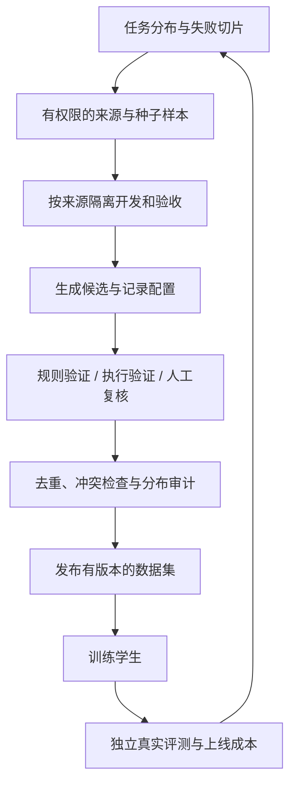

# 合成数据与知识蒸馏

<span class="dig-tag dig-tag--category">AI 技术</span>

::: tip 核心要点
合成数据解决“如何构造训练或测试样本”，知识蒸馏解决“如何把教师的行为或分布迁移给学生”。两者可以结合，但生成的数据不天然正确，学生也不会自动继承教师的全部能力。真正的工程闭环是明确任务分布、追踪数据来源、验证样本、隔离评测，并衡量学生上线后的质量与总成本。
:::

> 内容核对：2026-10-15。本文以公开论文和训练框架文档解释方法，不把某个模型、数据比例或蒸馏配方当作通用最优解。

## 从一个业务问题开始

假设客服系统已经能用较强模型给工单分类，但每天有大量重复请求，延迟与费用成为问题。团队希望让一个较小模型承担常见分类，只把难例交给强模型。

可以先收集有使用权限的工单，为缺少覆盖的类别构造样本，让教师给出候选标签，再用业务规则与人工复核。随后训练学生，并在未用于生成或调参的真实工单上比较结果。

这里有三个不同判断：生成的工单是否符合真实分布、教师标签是否正确、学生是否真正学会任务。教师比学生大，并不能替你回答这三个问题。

## 合成数据与蒸馏的区别

| 方法 | 主要改变什么 | 典型用途 |
|------|--------------|----------|
| **合成数据** | 数据的构造方式 | 扩充长尾问题、生成指令、构造测试环境 |
| **数据增强** | 对已有样本做保持或可控改变语义的变换 | 改写、噪声、格式和语言变化 |
| **伪标签** | 用模型给未标注样本提供候选标签 | 降低逐条人工标注成本 |
| **知识蒸馏** | 学生学习教师的输出、分布或特征 | 任务专用模型、压缩与低延迟部署 |
| **量化** | 权重或激活的数值表示 | 降低存储和访存成本 |

合成数据不一定来自大模型，也可以由规则、程序或仿真器生成。蒸馏也不要求一定更换为更少参数的模型，只是压缩和降低部署成本是常见目的。蒸馏与量化可组合，组合后仍需重新评估。

## 哪些数据值得生成 {#synthetic-data}

先看真实失败切片，再决定补什么；不要先定“生成一百万条”，再寻找它们的用途。

| 数据类型 | 例子 | 主要验证点 |
|----------|------|------------|
| 指令与回答 | 根据授权文档生成问答 | 答案能否回指原文，不编造新事实 |
| 改写与多语言 | 同一投诉的不同表达 | 标签是否保持，是否丢失否定和条件 |
| 偏好对 | 同一问题的两个答案及优劣 | 偏好依据是否明确，不能按长度排序 |
| 工具轨迹 | 查订单、澄清、生成报告 | 工具结果是否来自真实或明确模拟的执行 |
| 长尾与边界 | 缺字段、歧义、权限不足 | 是否符合业务中可能出现的情况 |
| 仿真与测试数据 | 合成音频、渲染图像、环境轨迹 | 仿真与真实输入之间的差距 |

尤其不要让模型自己编造工具返回，再把整段轨迹标成“实际执行成功”。文本合理不代表动作可执行，模拟环境的成功也不能替代真实业务验收。

## 一条可审计的数据生产线 {#data-pipeline}



### 来源和用途先确定

保留来源 ID、版本、许可、可用于何种训练、敏感级别和保留期限。使用教师 API 前，要核对服务条款是否允许相应数据生成与蒸馏用途，不能把“能调用 API”视为无限制训练授权。

隐私保护不是把姓名删掉就完成了。工单上下文、地址、少见事件和组合字段也可能识别个人，合成输出还可能复现源数据。模型生成不等于匿名化，更不自动提供差分隐私保证。

### 候选生成与验收分开

先定义覆盖矩阵，如类别、语言、输入长度、歧义程度和异常类型，再生成候选。记录教师快照、Prompt、采样设置和源文档版本，便于复现和撤回。

审核采用与任务匹配的证据：分类使用业务标注，代码运行测试，结构化提取校验字段，问答核对原文。另一个模型可以辅助审核，但不能让同一个错误假设在生成和评分中互相认可。

### 拒绝采样会改变分布

对同一输入生成多个候选，再保留满足条件的样本，是常见的拒绝采样思路。过滤可以提高平均质量，也可能只留下容易题、固定风格或符合评分器偏好的答案。

因此要统计各切片的生成数、接受率、拒绝原因和多样性，而不是只报告“过滤后全部通过”。保留真实难例和不可回答样本，避免学生只学会在容易任务上表现流畅。

### 一条样本应带哪些元数据

下面是数据治理记录示意，不是训练框架直接接受的统一格式。实际训练时应转换为目标 Trainer 的输入，并把审核信息保留在独立元数据中。

```json
{
  "sample_id": "ticket-example-42",
  "source_ids": ["policy-v3-section-8"],
  "split": "train",
  "task": "ticket_classification",
  "input": "The parcel has not arrived after the promised delivery date.",
  "target": "delivery_delay",
  "generation": {
    "teacher_revision": "teacher-snapshot-1",
    "prompt_revision": "ticket-generator-v2"
  },
  "validation": {
    "schema_passed": true,
    "review_status": "accepted",
    "review_record_id": "review-17"
  }
}
```

`review_status` 必须由审核流程写入并能追溯，不能因为模型输出了 `accepted` 就放行。高质量元数据同样需要权限控制；教师输出与参考答案不得泄漏到独立评测的模型输入中。

## 三类知识蒸馏 {#distillation-methods}

### 回答或序列蒸馏

教师生成完整回答或轨迹，过滤后作为学生 SFT 的目标。只取得教师文本时，这是最直接的路线。学生使用自己的 Tokenizer 训练，因此教师和学生不必共享词表。

优点是实现简单，缺点是每个输入只保留了有限候选，无法完整表达教师对其他可能答案的判断。学生也可能学到冗长格式、错误解释或不必要的工具步骤。

### 概率分布蒸馏

教师提供每个位置的 token 概率或 logits，学生学习其软分布。在共享或已对齐的词表与上下文条件下，一种经典目标是：

$$
\mathcal L=\lambda\mathcal L_{label}
+(1-\lambda)T^2D_{KL}(p_T^{teacher}\Vert p_T^{student})
$$

其中 $T>0$ 为软化分布的温度，$\lambda\in[0,1]$ 控制标签监督与蒸馏的混合。这是常见形式，不是所有 LLM 蒸馏算法都必须包含标签项或 $T^2$。

温度升高通常使分布更平滑，但最优温度与损失依任务而定。API 只返回少量 top-logprobs，不等于提供完整词表分布；Tokenizer 或词表不同，也不能直接逐 token 对齐计算 KL。

### 特征蒸馏

学生学习教师的中间隐藏表示、注意力或其他特征。它需要能够访问教师内部，并处理层数、维度和架构差异，常用于可控训练环境。

闭源 API 通常不提供这些内部特征。不能把教师生成的一段“解释”当成隐藏激活，也不能把可见推理摘要当成原始内部推理过程。

## On-policy 与离线蒸馏 {#on-policy-distillation}

离线蒸馏通常在固定的人类或教师序列上训练。学生上线后却会接续自己的输出，可能进入训练数据里少见的前缀，造成训练与生成分布不匹配。

On-policy 蒸馏让**学生先生成序列，再由教师在这些学生实际访问的上下文上提供反馈**。这样更容易覆盖学生自己的错误状态，但需要持续采样和教师计算，成本与训练复杂度更高。

```text
离线路线：输入 -> 教师回答 -> 固定数据集 -> 学生训练
On-policy：输入 -> 当前学生生成 -> 教师对该轨迹反馈 -> 学生更新 -> 再采样
```

“在线”在这里不意味着必须直接拿真实用户流量训练。可以在隔离环境和授权数据上生成 rollout；重要的是序列来自哪一版策略，以及反馈如何用于更新。

GKD 研究了学生生成分布与不同散度目标的组合。它与 RLVR 的区别是反馈来源和优化目标不同：教师分布反馈不等于环境给出的可验证结果奖励，二者也可以组合。实现可参考 [TRL 的 GKD 文档](https://huggingface.co/docs/trl/main/en/gkd_trainer)，注意其版本及实验性 API 状态。

## 防止训练与评测泄漏 {#source-isolation}

同一文档的改写、翻译和派生问答应按来源分组，不要先生成再逐条随机划分。否则模型可能在训练中看过验收题的等价答案，得到虚高分数。

以下纯 JavaScript 示例检查已记录来源 ID 的重叠，适合放入数据发布检查；它不负责发现未记录的语义近重复。

```javascript
export function assertNoSourceOverlap(training, evaluation) {
  const collect = records => {
    if (!Array.isArray(records) || records.length === 0) {
      throw new Error('Each split must contain records');
    }
    const sources = new Set();
    for (const record of records) {
      const identifiers = record?.source_ids;
      if (!Array.isArray(identifiers) || identifiers.length === 0) {
        throw new Error('Missing source lineage');
      }
      for (const identifier of identifiers) {
        if (typeof identifier !== 'string' || identifier.trim() === '') {
          throw new Error('Invalid source identifier');
        }
        sources.add(identifier.trim());
      }
    }
    return sources;
  };
  const trainingSources = collect(training);
  const evaluationSources = collect(evaluation);
  for (const identifier of trainingSources) {
    if (evaluationSources.has(identifier)) {
      throw new Error('Source overlap: ' + identifier);
    }
  }
}
```

来源 ID 要由可信流水线产生并规范化，同一来源的别名不能各自伪装成新来源。对多文档派生样本记录全部祖先来源，还要做近重复检测、人工抽检和数据用途审计。检查通过只能证明“已记录来源没有交叉”，不能证明绝无污染。

## 实战中如何比较学生模型

至少比较原始学生、只用真实标注训练的学生、混合合成数据的学生与教师基线。使用固定且隔离的真实测试集，避免只在合成数据生成器偏爱的题目上比较。

| 维度 | 需要检查什么 |
|------|--------------|
| 任务质量 | 各类别准确率、长尾、拒答与歧义处理 |
| 行为迁移 | 格式、工具选择、参数正确性，是否复制无效步骤 |
| 保留能力 | 目标任务之外是否出现遗忘或安全退化 |
| 运行成本 | 延迟、吞吐、显存、输出长度与重试费用 |
| 数据质量 | 接受率、来源覆盖、近重复、教师错误与人工修正 |

学生在特定任务上超过教师并非不可能，但不能推广成“蒸馏总能超越教师”。上线时可按经过校准的策略升级难例到教师；置信度、拒答和路由也要单独评估。

## 合成数据为什么可能让模型退化

反复用模型输出替换真实分布，可能减少长尾、多样性或放大已有错误。所谓模型坍塌相关研究描述的是特定数据递归与训练条件下的风险，不代表使用任何合成数据都会失败。

降低风险的办法是保留有代表性的真实数据、追踪来源与迭代代数、独立验证内容、监控尾部覆盖，并对数据混合比例做消融实验。不存在适用于所有任务的“真实数据必须占多少”固定比例。

### 什么时候不值得蒸馏

请求量太小、任务分布频繁变化、教师用途受限、缺少可靠评测或学生容量不足时，直接 API、Prompt 优化、RAG 或缓存可能更合适。

粗略的盈亏平衡条件为：

$$
N(C_{teacher}-C_{student})>C_{generation}+C_{training}+C_{evaluation}+C_{maintenance}
$$

左侧单任务成本应包含重试、路由和运行费用，而且质量须先达到门槛。把人工审核、数据更新和学生运维漏掉，会高估蒸馏收益。

## 面试怎么答

**Q：合成数据和蒸馏是同一件事吗？** 不是。合成数据描述样本来源，蒸馏描述学生向教师学习的方式；教师回答可以作为合成 SFT 数据，但还存在概率和特征蒸馏。

**Q：教师只提供文本，能不能做 logits 蒸馏？** 不能直接做完整分布蒸馏。可以做回答级蒸馏；有限 logprobs、词表差异和输出权限都需要额外处理。

**Q：怎样证明合成数据有效？** 固定独立真实评测集，对比无合成、不同数据混合及教师基线，按任务切片看质量、成本和遗忘，不只看训练 loss。

## 延伸阅读

- [Distilling the Knowledge in a Neural Network](https://arxiv.org/abs/1503.02531)
- [On-Policy Distillation of Language Models](https://arxiv.org/abs/2306.13649)
- [Self-Instruct](https://arxiv.org/abs/2212.10560)
- [TRL GKD Trainer](https://huggingface.co/docs/trl/main/en/gkd_trainer)
- [模型微调与训练](./model-training)
- [AI 评估与可靠性工程](./ai-evaluation)