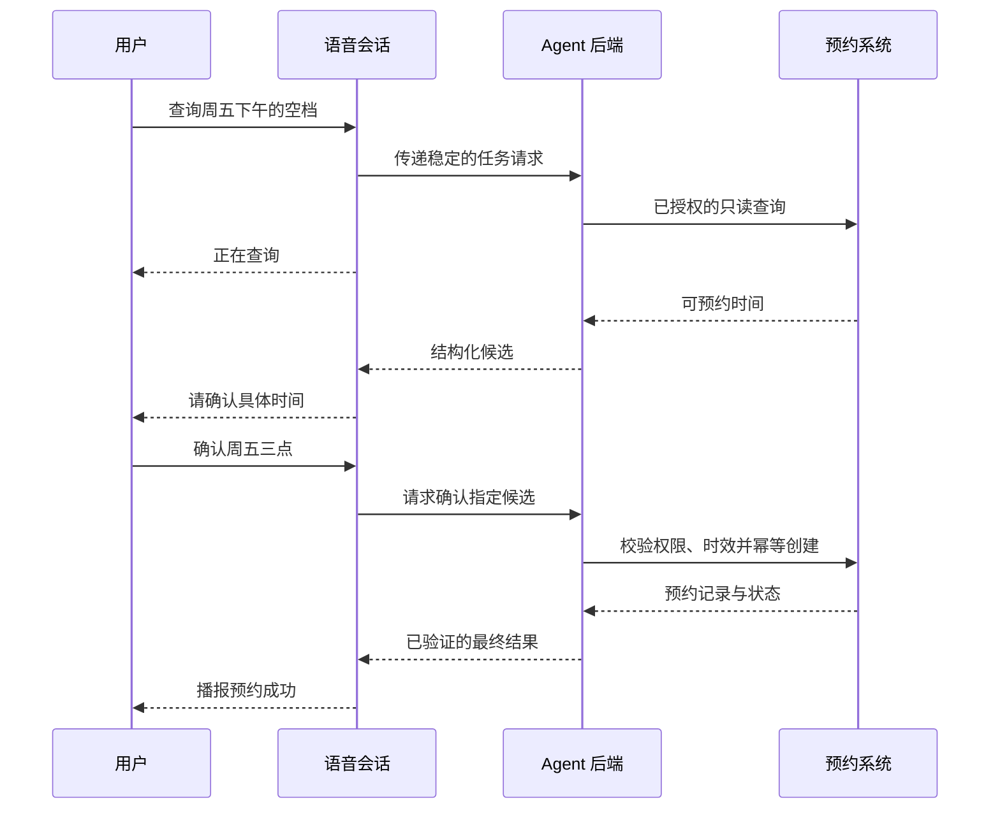

# 实时语音与 Voice Agent

<span class="dig-tag dig-tag--category">AI 技术</span>

::: tip 核心要点
Voice Agent 不只是把聊天框换成麦克风。它要同时处理**音频传输、轮次判断、打断、工具执行与业务状态**。用户听到“已经完成”时，后端操作必须真的完成；用户打断说话时，也不能误以为已执行的操作被撤销。
:::

实时语音接口、模型和会话事件变化较快，本文示意流程使用应用级事件，具体协议以供应商接口文档为准。

## 三种语音架构 {#voice-architectures}

| 架构 | 核心链路 | 适合什么 |
|------|----------|----------|
| **级联语音** | ASR/STT → 文本 Agent → TTS | 需要检查转写、复用现有文本流程、独立替换组件 |
| **实时 Speech-to-Speech** | 单个语音会话理解音频、推理、调用工具并生成语音 | 重视语调、节奏与低延迟交互 |
| **语音前端 + 独立后端** | 语音模型处理交互，委派文本 Agent/工作流执行任务 | 交谈不中断，同时复用复杂业务后端 |

这里的“单个会话”不意味着内部一定只有一个神经网络。产品级能力与模型内部架构不同，未披露时不应推断。

[OpenAI Voice Agents](https://developers.openai.com/api/docs/guides/voice-agents) 区分 GPT-Live 全双工前端、Realtime API 和级联方案；[Gemini Live](https://ai.google.dev/gemini-api/docs/live) 也提供实时音视频交互。选型应比较实际模态、会话限制、部署地域和任务效果，不按产品名称推断全部能力。

### 级联不是落后方案

ASR（Automatic Speech Recognition）将音频转成文字，TTS（Text-to-Speech）将文字转成语音。级联方案容易保留转写、做业务审核和复用现有 RAG/Agent，但转写可能丢失情绪、停顿等信息，也可能把专有名词、数字识别错。

各阶段可以流式重叠，不一定等整段音频完成才开始处理；不过用户输入尚未稳定时就启动高风险操作，会放大误识别的后果。追求低延迟不能取消业务确认。

### Speech-to-Speech 也需要外部控制

原生音频交互可能更好地保留节奏和语气，但不能因此省略工具授权、状态存储和业务验证。音频模型返回“已预约”只是一次输出，预约系统中的实际记录才是事实来源。

## 一个语音预约任务怎样完成



“正在查询”只是反馈，不是有用答案，也不应冒充任务完成。候选时间在用户确认前可能已被别人占用，因此后端需要再次检查，而不是直接执行模型缓存中的旧结果。

## WebRTC、WebSocket 与音频链路 {#audio-transport}

| 连接方式 | 常见用途 | 需要关注什么 |
|----------|----------|----------------|
| **WebRTC** | 浏览器或移动端实时媒体 | 麦克风权限、ICE/STUN/TURN、音轨、抖动与连接恢复 |
| **WebSocket** | 服务端实时流、需要自主管理音频帧的客户端 | 编码、分帧、播放缓冲、背压、取消与事件关联 |
| **HTTP 文件接口** | 批量转写、离线语音生成 | 上传大小、异步状态、重试和结果保留 |

WebRTC 不会自动解决任务状态，WebSocket 也不是“天生高延迟”。实际延迟由网络、音频缓冲、轮次判断、模型和工具共同决定。SSE 可以用于展示后台任务进度，但不是上传实时麦克风音频的双向通道。

编码格式、采样率、声道和帧长度要按模型接口处理。PCM、Opus 等格式不能仅改一个 MIME 标签就互相转换；采样率错误可能造成语速、时长或内容识别异常。

### 凭据与连接边界

浏览器不应持有长期模型 API key。由后端验证应用用户，按供应商能力发放短期、受限会话凭据或协商会话；业务工具仍由后端执行并再次鉴权。临时凭据也要防止跨用户复用和日志泄露。

HTTPS、安全上下文与麦克风授权是浏览器接入的前提。还需处理用户拒绝权限、设备切换、耳机断开、页面后台、音频播放策略以及断线重连，而不是只验证开发者电脑能出声。

## 轮次判断与全双工 {#turn-taking}

**VAD（Voice Activity Detection）**判断是否存在语音活动，不判断这句话是否说完，更不能判断说话者是否获准执行某项操作。用户思考时的停顿、背景电视声和短促语气词都会影响轮次切分。

- **声学 VAD**：根据声音特征判断开始/结束，速度快，但沉默不一定代表语义完成。
- **语义轮次判断**：结合内容判断是否轮到助手，更符合交互，但可能增加等待并有模型误判。
- **显式控制**：按住说话、按钮结束或固定轮次，牺牲部分自然度换可控性。

半双工通常在听与说之间切换；全双工允许同时听和说，但仍需要决定什么时候让出话轮。它不意味着用户和助手永远重叠发声，也不意味着后台操作无需等待确认。

对姓名、金额、日期和地址，应单独验证关键实体。ASR 的整体词错误率很低，也可能恰好把“十五点”识别成“五点”。声纹或说话人分离只能辅助体验，不应默认当作可靠身份认证。

## 打断：至少有三件事需要处理 {#interruptions}

用户在助手播报时说“等一下，改到四点”，系统要同时考虑：

1. **停止播放**：清理本地尚未播放的旧音频，尽快让出话轮。
2. **停止生成或委派**：按供应商和运行时契约取消旧响应，并标记哪些结果已过时。
3. **协调业务状态**：核实预约是否已创建；已执行的动作不能靠停止音频回滚。

发送了取消请求不等于取消成功。对旧预约已经成功、但结果晚到的情况，应保存业务结果并按新要求走明确的更改流程；不能因为语音轮次过期就丢弃外部副作用记录。

### 不要让旧音频重新响起

应用应关联 session、用户输入轮次、模型 response 和业务 operation。下面是一个仅用于**播放层过滤**的纯 JavaScript 示例，不是供应商事件名，也不负责业务取消：

```javascript
export function canPlayAudio(event, state) {
  if (state.closed || state.interrupted) return false;
  if (!state.responseId) return false;
  return event.sessionId === state.sessionId
    && event.responseId === state.responseId;
}
```

当用户打断时，播放层设置 `interrupted` 并清空旧缓冲；新响应产生后更新 `responseId`。即使网络后来送到旧音频，也不会重新播放。真实系统还需处理包顺序、重复事件与音频调度，优先使用成熟实时 SDK，而不是只靠这个过滤函数。

**业务结果不适用同样的丢弃策略**。旧音频可以不播，旧付款或预约的真实结果必须入账、对账并向用户解释。

### 模型认为说过，不等于用户听到了

模型可能已生成十秒音频，用户只听了三秒就打断。如果仍把整段当成已交流内容，后续对话会错误地假设用户已听到确认信息。应使用目标 API/SDK 的播放位置、截断或会话更新机制，使历史与实际交互对齐；不要把“收到音频”当成“完成播放”。

## 工具执行与语音反馈分开 {#voice-tools}

语音前端应把稳定的意图与必要上下文交给后端，由后端应用 [MCP](./mcp)、普通工具或 [A2A](./a2a) 协作。是否使用这些协议与是否支持语音没有强制关系。

| 场景 | 可以提前做什么 | 必须等待什么 |
|------|----------------|--------------|
| 查询订单或空档 | 在有授权、输入足够明确时发起只读查询 | 稳定结果才能作事实陈述 |
| 预填预约表单 | 生成可修改草稿 | 确认关键字段及当前权限 |
| 付款、发信、正式预约 | 准备受控操作提案 | 具体动作授权、幂等及执行结果 |

口头的“嗯”“好”是否构成批准，取决于明确的产品交互契约与风险级别，不能一律视为确认。高风险操作可能需要额外身份验证或屏幕确认，不能仅凭音频中的一句话授权。

后端长任务继续运行时，语音会话可回应澄清或查询进度，但需保证新要求与旧操作的关系明确。执行状态与恢复机制应由 [Harness](./harness-engineering#durable-execution) 管理，不绑定到单条音频连接。

## 延迟应该怎样测 {#voice-latency}

级联链路可以近似拆成：轮次结束判断 + 转写稳定 + 模型/工具 + 首段语音生成 + 传输/播放缓冲。实际阶段可能重叠，不能直接把每个阶段的 P95 相加当成端到端 P95。

| 指标 | 测什么 |
|------|--------|
| 首个可听反馈延迟 | 用户结束输入后多久听到任何反馈 |
| 首个有用答案延迟 | 多久听到真实结果，而不是“正在处理” |
| 打断响应延迟 | 用户开始打断到旧音频停止的时间 |
| 任务完成时间 | 业务系统何时完成并验证操作 |
| 不必要静默与重叠 | 是否长时间无反馈，或助手持续抢话 |

先测客户端实际播放时间，再拆分服务端模型、工具与网络时间。优化播放缓冲可能降低等待，但过小的缓冲又会导致断续；更低 effort 可能加快模型输出，却影响实体识别或任务判断，需要同一批录音回归。

## 评估语音，也评估任务 {#voice-evaluation}

评测集隔离、过程与结果评分、发布门槛见 [AI 评估与可靠性工程](./ai-evaluation)，语音还需要下面的专项检查。

按照“固定合成音频 → 真实录音回放 → 多轮实时交互”逐步增加复杂度，并辅以人工听评：

- **识别**：口音、噪声、中英混合、专有名词、数字；关键字段错误单独统计。
- **表达**：可懂度、发音、语速和自然度，不能只看转写文字。
- **交互**：停顿、打断、改口、用户连续说话、工具返回时插话。
- **业务**：工具参数、权限、重复执行、最终数据库状态与口头确认是否一致。
- **会话**：断线、丢音、超时、权限拒绝、重连后的上下文与播放位置。

例如用户说“取消刚才的预约”，成功标准不是助手回答“已取消”，而是正确识别要取消哪一笔、确认授权、最终记录正确且没有多删其他预约。

不要把只有清晰合成音频的得分当作真实电话效果，也不要让同一个模型同时扮演用户、被测 Agent 和唯一评分者。固定录音、工具环境与评测配置，才能比较不同架构。

## 隐私与安全

录音、转写、声音特征与工具结果可能包含个人信息，需明确用户告知、采集范围、访问控制、保留期限与删除流程。用于质量评估的录音也不应默认长期保存。

音频中的网页朗读、背景声音或远端说话者可以携带不可信指令。语音输入并不会绕过原有信任边界；最小权限、输出核实、敏感动作确认和审计同样适用。临时会话凭据、录音下载链接和后台操作 ID 不应出现在公开日志中。

## 面试怎么答

**Q：什么时候选级联，什么时候选实时语音？** 需要逐阶段审核与复用现有文本流程时，级联通常容易控制；重视节奏、语调和实时互动时评估 Speech-to-Speech 或全双工前端。用同一业务任务衡量质量与延迟，不只比音质。

**Q：打断为什么不只是 AbortController？** 它涉及播放缓冲、服务端生成、上下文已听位置和后台副作用。停止一个网络请求不能自动取消预约或退款。

**Q：首音很快是否说明体验好？** 不一定。要分别看有用答案延迟、打断速度、静默、任务正确性以及用户是否真的听到了结果。

## 延伸阅读

- [OpenAI：Voice Agents 架构与评估](https://developers.openai.com/api/docs/guides/voice-agents)
- [OpenAI：Realtime API](https://developers.openai.com/api/docs/guides/realtime)
- [Gemini Live API](https://ai.google.dev/gemini-api/docs/live)
- [全栈 AI：流式交互与服务集成](./ai-for-fullstack)
- [上下文工程与 Agent 记忆](./context-and-memory)
- [Harness Engineering](./harness-engineering)