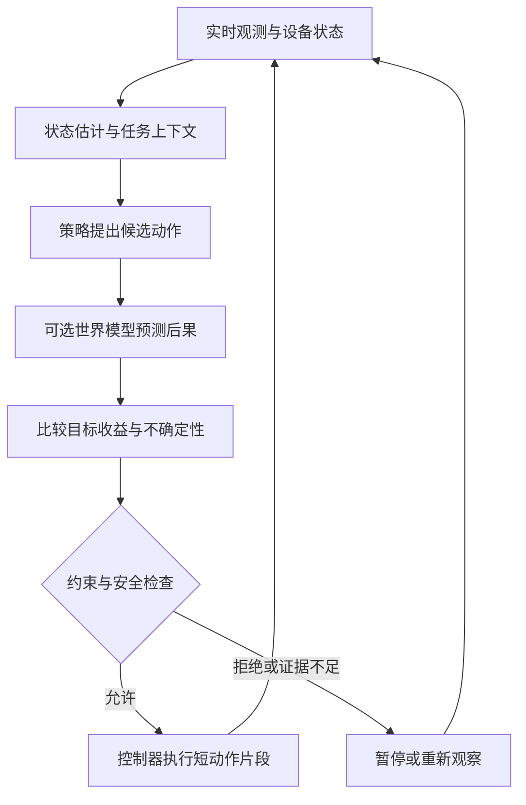

# 世界模型与具身智能

<span class="dig-tag dig-tag--category">AI 技术</span>

::: tip 核心要点
世界模型学习环境如何演化，面向控制时尤其关注动作会带来什么后果；策略选择动作，控制器把动作落实到设备。具身智能把感知、决策、行动与环境反馈连接起来。VLA 是视觉、语言与动作结合的一条路线，不等于世界模型，也不意味着可以把语言模型输出直接发送给电机。
:::

> 内容核对：2026-10-15。本文介绍公开研究中的概念与工程边界，不提供真实设备控制程序，也不把研究演示当作生产安全或通用智能的证明。

## 从看懂画面到影响环境

让模型指出桌上的杯子，是视觉理解；让系统把杯子放到托盘，需要知道物体位置、设备状态、动作可达性以及抓取是否成功。杯子被遮挡或滑动后，系统还要重新观察并调整。

“先生成完整步骤，再一次执行到底”通常不足以应对环境变化。具身任务不仅要计划，还要在时间、空间和物理约束下闭环执行。

| 组件 | 回答的问题 | 示例 |
|------|------------|------|
| **感知模型** | 现在观察到了什么 | 杯子的位置、姿态与可见性 |
| **世界模型** | 如果采取某个动作，环境可能怎样变化 | 接触后杯子会移动、倾斜还是保持原位 |
| **策略 Policy** | 为了目标下一步做什么 | 选择接近、抓取、放置或重新观察 |
| **控制器 Controller** | 如何在设备约束内落实动作 | 跟踪目标轨迹、满足速度和力的限制 |
| **安全监督** | 此刻是否允许继续执行 | 状态过期、碰撞风险或人员接近时停止 |

这些职责可以部分融合在一个模型里，但工程上的责任仍需明确。使用端到端模型不意味着不需要校准、控制器或独立安全机制。

## 世界模型是什么 {#world-model}

这里主要讨论从数据学习环境表示和动态规律的模型。它可以预测可见图像，也可以只在潜状态中预测，不一定生成可供人观看的视频。

面向动作的观测预测可抽象为：

$$
p_\theta(o_{t+1}\mid h_t,a_t)
$$

$o_{t+1}$ 是下一次观测，$a_t$ 是动作，$h_t$ 是由已有观测与动作形成的历史或内部状态。奖励和终止状态也可以成为模型预测的一部分。不是所有世界模型都以动作作为输入，但用于控制时必须考虑动作后果。

策略则回答另一个问题：

$$
a_t\sim\pi_\phi(\cdot\mid h_t,g)
$$

$g$ 是任务目标。世界模型可以预测“推一下会怎样”，策略决定“要不要推”。预测模型本身不一定知道用户目标，也不自动拥有执行权限。

### 部分可观测与隐藏状态

单张图看不到杯子背面、摩擦系数或夹爪内部状态。系统需要融合历史、设备本体状态与新的传感信息，维护对环境的估计，而不是把画面当成全部真实状态。

语言 Agent 的文本记忆与物理环境状态估计也不是同一个东西。任务笔记可记录目标与约束，实时姿态与安全距离则需要新鲜的传感器证据；旧摘要不能替代它们。

## 与视频生成、仿真和数字孪生的区别

| 概念 | 重点 | 不能自动得到什么 |
|------|------|------------------|
| **普通视频生成** | 产生符合条件的视觉序列 | 对每个外部动作的可靠响应 |
| **动作条件世界模型** | 学习环境随动作的演化 | 精确物理、无限时长、真实设备可迁移性 |
| **物理仿真器** | 按建模的力学与接触规则计算 | 所有真实材质、传感器和设备误差 |
| **数字孪生** | 与特定真实对象对应并保持数据关联 | 单靠生成画面完成校准和同步 |
| **静态三维场景表示** | 几何与外观重建、视角变化 | 自动预测接触、运动和控制后果 |

神经世界模型与物理仿真可以组合。数字孪生也可以使用学习模型，但必须有真实对象对应、参数校准和更新机制，不能把任意可漫游的生成场景都称为数字孪生。

### 视觉真实不等于动态正确

一段视频中的物体移动很自然，但如果改变动作方向后仍生成同一段运动，它就不能可靠支撑动作规划。应测试相同初始状态、不同动作对应的后果，以及遮挡后物体是否保持一致。

[Genie 3 的公开报告](https://deepmind.google/blog/genie-3-a-new-frontier-for-world-models/)展示了可交互环境，同时列出动作空间、交互时长、地理准确性和多主体互动等限制。这些是研究证据，不应推导为可替代所有物理仿真或保证真实机器人控制。

## 世界模型怎样参与决策 {#model-based-control}



一种常见思路是：生成候选动作序列，在模型内预测结果，选择满足约束且更有利的序列，只执行其中一小段，然后重新观察。这是模型预测控制的一类组织方式，不要求所有系统采用同一个优化算法。

预测越远，模型误差越可能累积。策略还可能找到模拟器或世界模型的漏洞，在模型里“得高分”，到真实环境却失败。扩大搜索预算不能替代模型校准和真实验证。

不确定性估计可帮助缩短规划时域、选择重新观察或转人工，但本身也需要校准。多个预测一致不代表一定正确；风险评分不能替代硬安全约束。

## VLA 从视觉和语言到动作 {#vla}

VLA 是 Vision-Language-Action 的缩写。它通常把图像、语言目标以及可选的设备状态作为条件，预测动作或动作序列，而不是只生成一段自然语言建议。

```text
图像 / 设备状态 + 语言目标
  -> 编码与多模态融合
  -> 动作预测头或生成模型
  -> 动作解码与坐标/单位映射
  -> 可行性检查与控制器
  -> 环境反馈
```

[OpenVLA](https://openvla.github.io/)是公开路线之一：在视觉语言骨干上学习 token 化动作，再解码为连续动作。其他实现可使用连续回归、扩散或 Flow Matching 动作头，不能把“VLA”限定为一种输出格式。

### 动作表示是接口契约

关节目标、末端位姿增量、速度指令和夹爪状态不能互换。必须明确坐标系、单位、旋转表示、动作频率、归一化方式以及动作相对哪个时刻的状态。

同样的数值在不同设备上可能含义完全不同。模型训练时用的相机视角、机器人形态和动作尺度改变后，需要适配与验证，而不是直接替换机器人名称。

### 动作分块与 Diffusion Policy

Action Chunking 一次预测未来多个动作，减少每一步都请求模型的开销，也有助于保持局部连续性。系统通常只执行其中一部分，然后基于新观测重新预测，这种滚动执行避免长时间完全开环。

[Diffusion Policy](https://diffusion-policy.cs.columbia.edu/)在动作空间中迭代去噪以生成动作序列。它用扩散表达可能有多种合理解的动作分布，不是在“先生成一段机器人视频，再照着视频运动”。

Diffusion Policy 也不必包含语言输入，因而不自动等于 VLA。分块越长通常减少模型调用，但会增加两次反馈之间的开环时间，不能只按吞吐量选长度。

## 数据与训练方式 {#embodied-training}

### 模仿学习

Behavior Cloning 从演示中的观测、目标与动作学习策略。数据可由遥操作、示教、已有控制系统或仿真产生，需要同步相机、本体状态、动作和时间戳。

只模仿成功轨迹可能缺少错误恢复：学生偏离演示后，会进入未见过的状态。可以收集安全的纠正与恢复数据，增加环境变化，并通过闭环测试验证，不是简单增加更多相似的成功视频。

### 强化学习与模型内训练

强化学习利用奖励改善策略，世界模型可以提供部分想象轨迹以减少真实交互成本。但奖励可能被利用，模型内成功也可能来自预测错误。

仿真、离线数据与真实交互应各自报告。涉及真实设备时必须有合适的安全监督和实验规程，不能让模型为探索奖励而绕过设备限制。

### 一条轨迹需要保存什么

下面是离线数据清单示意，只引用记录，不是可执行的设备指令：

```json
{
  "episode_id": "tray-task-42",
  "split": "evaluation",
  "robot_configuration": "bench-robot-config-v2",
  "task": "Place the cup on the tray.",
  "observation_record_id": "observations-42",
  "action_record_id": "actions-42",
  "calibration_revision": "calibration-7",
  "action_spec": {
    "representation": "end_effector_delta",
    "coordinate_frame": "robot_base",
    "position_unit": "meter",
    "rotation_unit": "radian"
  },
  "outcome_record_id": "verified-outcome-42"
}
```

真实数据还要记录动作轴序、时间对齐、终止原因、干预与异常，训练和执行端共同验证接口。成功标签应关联可核验的环境记录，不让模型仅凭语言自评标成成功。

按场景、物体、设备和采集来源分组划分训练与评测。把同一段轨迹的相邻帧随机分到两边，会严重高估泛化。数据治理方法可参照 [合成数据与知识蒸馏](./synthetic-data-and-distillation)。

## Sim-to-Real 的主要差距 {#sim-to-real}

| 差距 | 例子 | 应对方向 |
|------|------|----------|
| 视觉 | 光照、材质、相机噪声、背景 | 校准、多样化采样、受控随机化 |
| 动力学 | 摩擦、质量、接触和柔性物体 | 参数辨识、动力学随机化与真实验证 |
| 设备 | 自由度、夹爪、关节范围和延迟 | 动作适配、设备专属约束与回归 |
| 时序 | 观测过期、网络抖动、推理太慢 | 时间戳、期限、缓冲与故障停止策略 |
| 任务分布 | 未见物体、指令或布局 | 分组评测、长尾与恢复场景 |

Domain Randomization 通过改变仿真参数扩大覆盖，不是随机得越多越好。分布过宽或不合理可能增加学习难度；真实环境超出随机化范围时依然会失败。

模型压缩、量化或更换推理后端也可能改变动作延迟和策略质量，应在闭环中回归，不能只看离线 token 吞吐。

## 分层控制与安全边界 {#control-safety}

高层语言计划、动作策略和低层控制通常具有不同的运行频率与责任。高层可以决定下一阶段目标，低层控制器依据最新状态跟踪目标并实施约束；具体频率取决于设备和任务，不存在统一数值。

关键保护包括状态新鲜度检查、动作范围限制、碰撞与工作空间约束、设备故障监测、独立急停和必要的人工监督。它们不能只写在模型 Prompt 中，也不能完全依赖网络连接中的 Agent 自评。

模型超时或连接断开时，应按设备规程进入安全状态，而不是无限重复最后一个动作。重新连接后要读取真实状态并重新规划，不直接重放中断前的动作队列。

机器人执行过的物理动作通常无法像数据库事务一样回滚。需要区分可恢复任务、需要人工检查的状态和不可接受风险；完成目标不能抵消一次危险执行。

## 怎样评估世界模型与策略 {#embodied-evaluation}

| 对象 | 重点指标 |
|------|----------|
| 世界模型 | 单步与多步预测、动作可控性、遮挡一致性、状态/奖励预测和不确定性 |
| 策略 | 任务成功率、长尾泛化、恢复能力、动作平滑性与干预次数 |
| 系统 | 端到端延迟、过期状态、约束违反、故障停止与真实设备结果 |
| 数据迁移 | 未见物体、布局、设备、视角和真实环境下的退化 |

单帧重建误差或视频相似度低，不保证模型适合规划。反过来，潜状态预测模型不生成漂亮画面，也可能对控制有用。必须选择与用途一致的指标。

比较时固定初始条件、目标、控制接口、时间预算和干预规则，报告多次运行及失败切片。剪辑过的成功视频、单次仿真成功和真实设备多轮可靠性是三种不同证据。

## 与软件 Agent 的联系

Computer Use 也需要“观察、动作、反馈”闭环，但它常操作离散界面，机器人还受到连续状态、实时性和物理约束。不能把 GUI 点击坐标直接类比为可靠的机械臂控制。

两者共同需要可靠工具契约、状态、验证和权限；这些思想可参考 [Harness Engineering](./harness-engineering)。MCP、A2A 可以参与高层系统集成，但不是机器人实时总线，也不替代设备控制与安全标准。

## 面试怎么答

**Q：世界模型和 VLA 的区别？** 世界模型预测环境演化，VLA 通常根据视觉与语言预测动作。两者可以组合，也可以分别工作，不能当作同义词。

**Q：生成视频是否意味着理解物理？** 视觉合理只能提供部分证据，仍需测试动作干预、状态一致性、多步误差与实际控制效果。

**Q：为什么需要闭环？** 观测不完整、动作有误差、环境会变化，执行后必须重新观察。一次生成全部步骤不能保证后续状态仍符合计划。

**Q：仿真里成功为什么还不能上线？** 仿真与真实环境在视觉、动力学、设备和时序上有差距，还需要设备级约束、分阶段实测与独立安全监督。

## 延伸阅读

- [World Models](https://arxiv.org/abs/1803.10122)
- [DreamerV3](https://danijar.com/project/dreamerv3/)
- [Genie 3 的能力与限制](https://deepmind.google/blog/genie-3-a-new-frontier-for-world-models/)
- [OpenVLA](https://openvla.github.io/)
- [Diffusion Policy](https://diffusion-policy.cs.columbia.edu/)
- [MuJoCo 仿真器](https://mujoco.readthedocs.io/en/stable/overview.html)
- [生成式多模态](./generative-multimodal)
- [AI 评估与可靠性工程](./ai-evaluation)