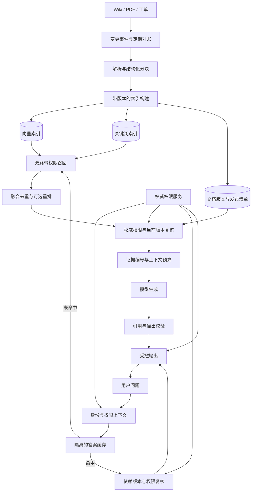

# 企业知识库与可信 RAG 设计

> **面试方向：** AI 应用后端、企业搜索、知识平台  
> **核心矛盾：** 回答质量与延迟、检索效率与权限隔离、异步索引与数据时效  
> **说明：** 本文为原创面试练习，规模与指标是教学假设；资料核验日期为 2026-10-17。

::: tip 核心要点
可信 RAG 的设计单位不是“问题与相似文档”，而是**某个身份在某个时刻能访问的某个版本的证据**。召回、缓存、上下文、引用和会话历史都必须服从这个边界。
:::

## 题目背景

> 为一家 10 万员工的企业设计知识库助手。接入 Wiki、PDF 和工单，支持多轮问答、引用原文和权限隔离。文档会更新、删除和撤权，系统需要在模型服务不稳定时仍提供可用的检索体验。

已有 [向量数据库与 RAG](../interview-cases/vector-db-rag) 介绍了分块、向量索引和混合检索。本题侧重生产系统中更容易遗漏的**权限一致性、数据发布、证据契约和质量验证**，不重复推导 ANN 算法。

## 需求澄清

| 维度 | 本题约定 | 需要主动确认 |
|------|------|------|
| 功能 | 问答、引用跳转、反馈、多轮追问 | 是否需要跨文档综合和图片理解 |
| 非目标 | 不自动修改业务数据，不训练基础模型 | 是否后续接入工具执行 |
| 身份 | 企业 SSO，部门/项目组权限 | 是否有外部合作方和多租户 |
| 数据 | 100 万份文档，平均 6 个 Chunk | 扫描 PDF、表格、重复附件占比 |
| 更新 | 普通内容更新目标 5 分钟内可检索 | 原始数据源能否推送变更 |
| 撤权 | 权威权限系统确认撤权后，新授权决策必须拒绝 | 在途请求按什么时间点判定 |
| 体验 | 普通问答 P95 端到端 TTFT < 2.5 秒 | 高敏感问答是否允许先缓冲后输出 |
| 完成 | 输出不超过 600 Token，P95 完成 < 20 秒 | 长报告是否转为异步任务 |
| 降级 | 模型故障时返回有权限的搜索结果 | 不能退回无权限过滤的通用搜索 |

**撤权不等于瞬间抹去已经显示的内容。** 本题要求生成前查询权威权限；返回缓存、引用和高敏感完整答案前再次校验。普通流式回答按段校验并监听撤权通知，中途撤权则停止后续输出。若业务要求严格的输出与撤权原子顺序，应由统一输出服务与权限版本建立有序屏障，并承担相应延迟，不能只靠缓存 TTL 宣称“立即生效”。

---

## 关键指标估算

### 查询与模型负载

```text
DAU = 20,000；每人每天 10 个问题；活跃时段 10 小时
每日问题数 = 200,000
平均 QPS = 200,000 / 36,000 ≈ 5.56
峰值 QPS = 5.56 × 4 ≈ 22.22

基线每个问题生成一次，输入 4,000 Token、输出 600 Token
峰值输入吞吐 ≈ 88,889 Token/s
峰值输出吞吐 ≈ 13,333 Token/s
若平均回答耗时 12 秒，在途问答约 22.22 × 12 ≈ 267
```

该估算不含查询改写模型和重试。先按无答案缓存容量准备；上线观察命中率后再调整，不把猜测的“80% 缓存命中”当作基础容量。

### 索引与写入

| 项目 | 推导 | 结果 |
|------|------|------|
| Chunk 数 | 100 万文档 × 6 | 600 万 |
| 原始向量 | 600 万 × 1,024 维 × 4 bytes | 24.576 GB，约 22.89 GiB |
| 三份原始向量 | 24.576 GB × 3 | 73.728 GB |
| 每日变更 | 假设每天 1% 文档变化 | 1 万文档，约 6 万 Chunk |
| 集中重建 | 在 1 小时内处理 6 万 Chunk | 约 16.67 Chunk/s |
| 每日嵌入量 | 每个变更 Chunk 平均 500 Token | 约 3,000 万 Token |

图索引、文本、倒排索引、元数据、WAL 和重建临时空间另算。压缩率必须用自己的数据测量；单是原始向量大小不能推出整个数据库的内存需求。

5 分钟新鲜度要求还包括连接器发现、排队、解析和发布延迟。突发上传 10 万文档时，要按积压量和最老事件年龄扩容，不能只监控平均写入 QPS。

---

## 高层架构



在线链路和文档处理链路独立扩容。检索阶段的 ACL 过滤减少无效候选，生成前的权威校验阻止陈旧索引泄漏；二者解决的问题不同，不能相互替代。

## 数据模型与 API

| 实体 | 关键字段 | 约束 |
|------|------|------|
| Document | tenant_id、doc_id、source_revision、active_version、deleted_at | 文档唯一标识不随内容更新变化 |
| Chunk | tenant_id、doc_id、doc_version、chunk_id、content_hash、source_span | 向量与文本指向同一版本和原文范围 |
| AccessPolicy | doc_id、policy_version、允许的主体/组 | 权威权限在业务侧，索引存可过滤快照 |
| IndexManifest | embedding_version、chunker_version、generation、status | 模型升级与分块策略可追溯 |
| Answer | answer_id、user_id、evidence_refs、model_version、prompt_version | 答案依赖的文档与权限版本可定位 |
| Feedback | answer_id、标签、可选说明 | 正负反馈不是自动成立的训练标签 |

```http
POST /v1/knowledge/answers
Content-Type: application/json

{
  "conversation_id": "conv_204",
  "question": "差旅报销需要哪些凭证？",
  "response_mode": "stream"
}
```

`tenant_id`、用户 ID 和组成员信息由服务端验证后的身份派生，不信任请求体传入的权限列表。创建答案前验证会话归属；`GET /v1/knowledge/answers/{answer_id}` 和引用下载接口也必须鉴权。

### 证据与流式事件契约

```json
{
  "answer_id": "ans_801",
  "status": "completed",
  "evidence": [
    {
      "citation_id": "source_1",
      "doc_id": "travel_policy",
      "doc_version": 8,
      "chunk_id": "receipts_02",
      "source_span": "section:3.2"
    }
  ],
  "model_version": "approved-model-snapshot",
  "prompt_version": "knowledge-v3"
}
```

服务端为已授权证据生成 `citation_id`，模型只能引用这些编号，不能自行创造文档 URL。流式事件区分 `answer.delta`、`citation`、`completed` 和 `failed`；前端只有收到 `completed` 才将答案标记为完整。传输中断时，不将半截回答写成成功缓存。

---

## 核心设计决策

### 决策 1：建立简单、可比较的检索基线

1. 保留标题、表头、代码范围和文档版本，先按结构分块，不盲目固定为某个 Token 数。
2. 使用带相同权限约束的 BM25 与向量检索，分别取一批候选。
3. 以 RRF 等秩融合方法合并，按文档版本和内容哈希去重。
4. 只在验证有收益时加入 Cross-Encoder 重排；在上下文预算内选取互补证据。
5. 候选不足时最多进行一次受预算控制的查询扩展，仍不足就澄清或拒答。

初始可试验“两路各 40 个候选，重排前 20 个，最终放入 6 个 Chunk”，这些是待调参数。对精确工单号、日期和产品型号，应验证关键词检索是否比增加向量 Top-K 更有效。

**不要直接比较不同检索器的原始分数。** BM25 分数与余弦相似度不在同一尺度，未经校准的加权相加缺乏解释性。向量相似度也不是“答案正确的概率”。

### 决策 2：索引发布不能让新旧内容混用

```text
收到 doc_42 的 revision 18
    -> 幂等记录变更事件
    -> 解析并生成 version 18 的 Chunk
    -> 写入向量和关键词索引，等待查询可见
    -> 校验两路 Chunk 数、内容哈希和权限元数据
    -> 比较当前 source_revision，原子推进 active_version
    -> 通知缓存失效，延后清理旧版本
```

事件以 `(tenant_id, doc_id, source_revision)` 去重；迟到的 revision 17 不得覆盖 revision 18。工作节点失败可以重复处理，但只能让校验完成的版本变为 active。

查询结果依据每文档的 `active_version` 复核，不将新向量和旧文本拼成一份证据。若某一路发布尚未完成，可以读取旧的完整版本或降低召回能力，并明确新鲜度状态。更严格的一致性可以使用索引代际与别名切换，但不应为每份文档更新都全量重建。

Embedding 模型升级时建立新代索引，双写变更、回填历史、影子评估，然后切换。即使维度相同，也不能假设两个模型的向量空间兼容。

### 决策 3：撤权与删除走安全优先的路径

| 事件 | 立即生效的边界 | 后台处理 |
|------|------|------|
| 用户退出项目组 | 权威授权不再允许该用户访问 | 刷新身份缓存，撤销相关答案缓存 |
| 文档变为私密 | 最新权限版本阻止新上下文装配和输出 | 更新两路索引 ACL |
| 文档删除 | Tombstone 阻止文档成为新证据 | 清理 Chunk、向量、文本与派生缓存 |
| 数据主体删除请求 | 按约定范围停止访问与处理 | 按策略清理日志、备份和派生数据 |

权限服务不可用时，对受保护内容采用 fail closed。不能因为向量索引“几分钟前校验过”就继续回答。

生成前还要处理**历史会话中的旧证据**：后续追问不能自动携带已撤权的原文或摘要。对历史引用重新授权，只重建仍可访问的上下文；已经发送给用户的信息无法通过撤权收回，应在产品与合规要求中说明。

### 决策 4：答案缓存是权限敏感的数据产品

| 缓存类型 | 示例 Key 要素 | 风险与失效条件 |
|------|------|------|
| 查询 Embedding | 模型版本、规范化问题哈希 | 问题本身可能敏感，需隔离和保留期限 |
| 检索结果 | 租户、授权范围版本、查询、索引代际 | 组成员变化、文档更新和删除 |
| 答案缓存 | 用户或已证明等价的权限范围、问题、对话摘要哈希、Prompt/模型版本 | 命中后仍复核证据版本和当前权限 |
| Provider 前缀缓存 | 供应商定义的上下文前缀 | 仅减少模型计算，不自动复用答案 |

MVP 可以只缓存**无个性化内容的公开政策问答**。订单、薪酬和私人文档默认不进入共享语义答案缓存。

语义近似只能用于找候选缓存项，还必须校验实体、时间、版本和权限。例如“今年报销上限”与“去年报销上限”语义接近，但不能共享答案。缓存权限指纹相同也不是放弃命中后复核的理由。

### 决策 5：有引用不等于有事实依据

| 校验层 | 可以检查 | 仍然不能证明 |
|------|------|------|
| 引用格式 | ID 存在，文档版本匹配，用户可访问 | 引用确实支持该结论 |
| 规则校验 | 金额、日期等字段与证据一致 | 任意自然语言推理正确 |
| 语义校验 | 证据是否支持关键断言 | 完全无误，需要人工校准 |
| 人工抽检 | 复杂结论、冲突证据、业务适用性 | 所有线上流量都正确 |

文档中的“忽略之前规则”等文字只是待检索的数据，不能改变系统授权。不给只读问答进程配置任意外发或写工具；限制上下文来源、校验引用并通过对抗评估发现注入问题。输入关键词过滤或一句 System Prompt 都不能单独保证安全。

高敏感答案可先完整生成、检查关键断言和权限，再返回；普通答案按段校验后流式输出。**“先输出全部 Token，再审核”无法撤回已经泄漏的信息。**

---

## 延迟、成本与降级

下面是普通查询的**规划预算**，不是分别测量的 P95 相加得到的保证：

| 阶段 | 预算 | 超预算处理 |
|------|------|------|
| 鉴权、缓存与查询嵌入 | 250 ms | 超时拒绝受保护访问，不跳过鉴权 |
| 并行检索与可选重排 | 500 ms | 跳过重排或使用仍可用的检索路 |
| 证据复核与上下文组装 | 150 ms | 剔除无法验证的证据 |
| 准入、排队与模型首 Token | 1,400 ms | 搜索结果降级或快速失败 |
| 网络与余量 | 200 ms | 通过端到端压测检验 |

600 Token 若以每秒 40 Token 输出，生成部分约 15 秒，完成延迟与 TTFT 必须分别看。优化顺序通常是消除不必要模型调用、缩小上下文、并行检索、验证缓存，之后才考虑更复杂的 Agentic RAG。

| 故障 | 用户得到什么 | 必須记录什么 |
|------|------|------|
| 模型限流 | 已授权的文档列表及检索结果 | 降级原因、供应商错误和配额 |
| 向量库不可用 | 带权限的关键词搜索 | 使用的检索模式、质量变化 |
| 文档源不可用 | 仍在允许新鲜度范围内的有效版本 | source_revision、索引滞后 |
| 没有相关证据 | 澄清问题或明确无法回答 | 无答案类型，避免记录为正确解决 |
| 权限复核失败 | 不返回受保护证据 | 授权失败事件和追踪 ID |

---

## 评估与上线

### 测试集设计

| 样本切片 | 示例 | 判定依据 |
|------|------|------|
| 有答案 | 报销需要哪些凭证 | 专家标注的有效证据与关键事实 |
| 无答案 | 询问未发布的政策 | 合理拒答，不编造细则 |
| 精确匹配 | 指定合同编号与版本 | 召回正确实体和版本 |
| 权限隔离 | 不同部门询问同一问题 | 各自可见集合不同，无越权原文 |
| 版本竞争 | 查询期间更新或撤权 | 满足约定的权限/版本时间语义 |
| 注入与冲突 | 文档含伪指令或政策互相矛盾 | 不执行文档指令，说明冲突来源 |

离线分别测 Recall@K、排序质量、回答正确率、引用支持率和可回答问题覆盖率。线上跟踪 TTFT、完成延迟、拒答、反馈、成本和新鲜度；用户点赞只能作为弱信号。

一个可讨论的发布门槛是：已知权限反例全部通过，关键事实正确率不低于基线，覆盖率没有异常下降，延迟和成本在预算内。有限样本中没有发现泄漏，不等于证明线上泄漏概率为零。

### 诊断顺序

```text
回答错误
    -> 当前用户有权访问正确证据吗？
    -> 正确版本是否已经发布？
    -> 是否被检索到？
    -> 是否被融合或重排淘汰？
    -> 是否进入最终上下文，还是被截断？
    -> 模型是否正确使用了证据？
```

按此顺序定位，避免所有问题都归因为“模型不够强”。上线以固定问题集回归，再对脱敏请求做影子比较和小范围灰度；涉及受保护文档的影子执行同样需要授权与地域约束。

## 面试追问

### “长上下文已经很大，还需要 RAG 吗？”

需要比较材料总量、更新频率、权限、费用和有效信息密度。少量材料可直接使用长上下文；百万文档与动态 ACL 不适合全部送入模型。RAG 的价值也包括可撤销的数据边界和证据追踪，不只是突破上下文长度。

### “检索后过滤权限不就可以了吗？”

只取全局 Top-K 再过滤，可能把所有候选都过滤掉，影响召回。因此检索时就做 ACL 约束。但索引权限可能陈旧，所以仍需在内容送入模型前以权威权限复核。不要让无权内容先进入模型再过滤最终答案。

### “怎么支持多跳问题？”

先评估普通检索失败的具体原因，再加入有最大跳数的子问题拆分与证据合并。每一跳都携带当前身份、预算、版本与来源，不让前一次模型猜测自动变成下一跳的已验证事实。

### “知识库从 100 万扩展到 1 亿文档呢？”

按租户和访问模式分片，评估热点租户、过滤选择性、压缩与磁盘索引，控制跨分片 Fan-out。嵌入重建、删除传播和全量对账也要随规模设计，不能只增加向量库副本。

## 总结

白板回答可以收束为：**版本化接入、双路权限召回、生成前复核、可校验引用、受控缓存、分层评估和搜索降级**。MVP 先做好单轮可信问答，再用真实失败样本决定是否加入查询改写和多跳检索。

## 参考资料

- [Microsoft Learn: Query-time ACL and RBAC enforcement](https://learn.microsoft.com/en-us/azure/search/search-query-access-control-rbac-enforcement)，用于理解身份过滤与 ACL 新鲜度限制；其预览能力不是本文安全语义的自动保证。
- [OpenAI: Evaluation best practices](https://developers.openai.com/api/docs/guides/evaluation-best-practices)，参考任务特定评估、文档问答评估和人工校准原则；本文不依赖特定托管 Evals 产品。
- [AI 系统设计方法论](./)：本题的容量和评估框架。