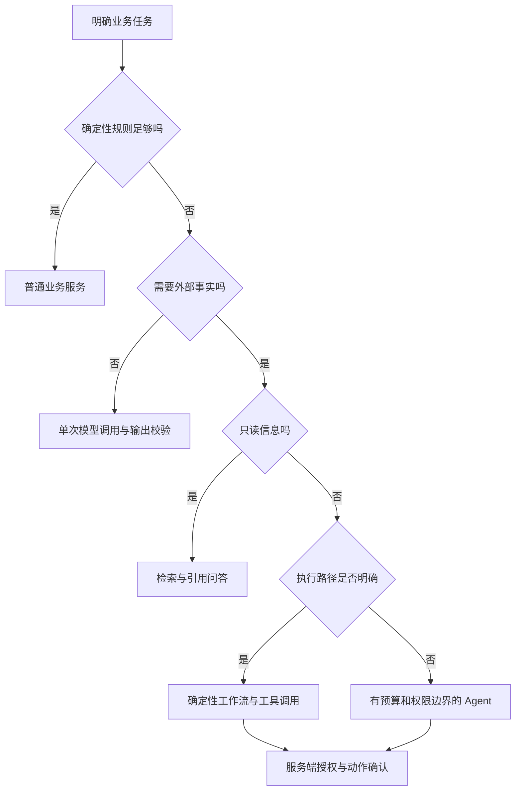
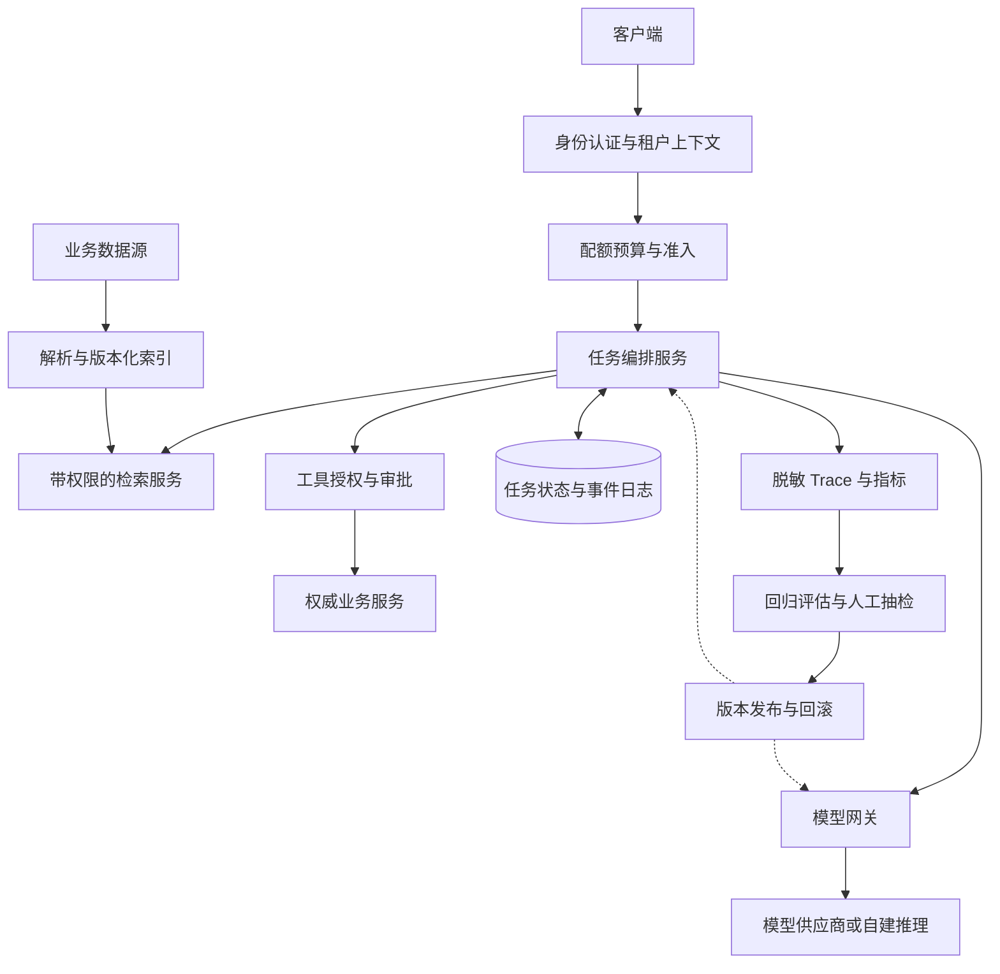

# AI 系统设计方法论

> **适用岗位：** AI 应用后端、全栈工程师、Agent 平台、模型服务平台、资深工程师与架构师  
> **资料核验日期：** 2026-10-17；本文的题目、规模和验收阈值均为教学假设，不代表某家公司真题或统一行业指标。

::: tip 核心要点
AI 系统设计不是在传统架构图中加一个 LLM。需要把**业务成功标准、数据与权限、模型调用、执行状态、评估与成本**组成完整闭环。回答是否可信，最终取决于能否解释：数据过期怎么办、模型答错怎么办、动作执行一半怎么办、费用超预算怎么办。
:::

## 概念

传统系统设计的可用性、一致性、容量和故障隔离仍然重要。新增的难点是：**服务成功返回，不等于任务正确完成**。HTTP 200 的回答可能没有证据；符合 JSON Schema 的退款参数可能越权；延迟降低也可能只是系统过度拒答。

本节从系统工程视角展开。模型、RAG 和 Agent 基础可先看 [AI 技术概览](../../ai-technology/)；已有的 [AI 系统设计面试题](../../ai-technology/ai-system-design) 提供更多题型速览。

### 当前备考应关注什么

公开工程资料可以支持“哪些能力值得准备”，但不能单独证明“某公司出现频率”。下面按能力归纳，不给未经统计的“必考”标签。

| 能力方向 | 从原型到生产新增的设计问题 | 面试中应展示的证据 |
|------|------|------|
| 有依据的问答 | 数据如何更新、撤权、引用与拒答 | 带权限的检索路径、文档版本、分层评估 |
| 能执行动作的 Agent | 模型提议与业务授权如何分离 | 工具契约、审批、幂等、检查点、恢复状态机 |
| 模型服务治理 | 多模型如何共享配额与预算 | Token 估算、准入控制、能力路由、流式失败策略 |
| 质量工程 | Prompt 或模型升级如何证明没有退化 | 固定回归集、人工校准、灰度、按版本回滚 |
| 平台可靠性 | 上游限流、慢调用和租户竞争如何隔离 | 有界队列、截止时间、公平调度、可观测性 |

这些问题与 Anthropic 的工作流/Agent 区分、Azure AI Search 的查询时权限控制实践相呼应。**供应商最佳实践不是面试频率统计，产品能力也不等于所有实现的默认行为。**

---

## 核心原理

### 1. 先识别面试类型

| 类型 | 核心问题 | 应优先展开 | 不宜占用大量时间 |
|------|------|------|------|
| AI 应用系统设计 | 怎样把模型用于可信赖的业务产品 | API、数据流、权限、体验、评估、成本 | 从头推导 Transformer |
| ML 系统设计 | 怎样用数据训练并持续改进预测系统 | 标签、特征、训练/推理一致性、漂移、在线实验 | 只描述 Prompt |
| 推理基础设施设计 | 怎样稳定提供高吞吐模型服务 | GPU 容量、KV Cache、调度、并行、压测 | 只讨论聊天页面 |
| Agent 平台设计 | 怎样管理长任务和有副作用的工具 | 持久执行、隔离、审批、恢复、审计 | 默认需要多个 Agent |

先问面试官：“这道题重点是应用落地、模型训练，还是自建推理平台？”同一个“设计助手”可能对应完全不同的边界。

### 2. 45 分钟答题框架

| 阶段 | 建议时间 | 要交付的内容 |
|------|------|------|
| 需求与风险 | 0-5 分钟 | 用户、任务、不能做什么、错误后果、是否允许人工接管 |
| 指标与容量 | 5-10 分钟 | 业务成功口径、延迟分位数、QPS、Token、在途数和成本 |
| 高层设计 | 10-18 分钟 | 在线链路、离线数据链路、权限与状态边界 |
| 核心深挖 | 18-33 分钟 | 挑两个最重要矛盾，例如撤权一致性与重试幂等 |
| 评估与故障 | 33-41 分钟 | 回归集、故障表、灰度、降级、回滚 |
| 总结取舍 | 41-45 分钟 | MVP 选择、扩展条件、尚未验证的假设 |

时间分配是练习建议，不是所有面试的固定流程。需求复杂时应主动协商深挖范围。

### 3. 必须澄清的需求

| 维度 | 推荐提问 | 对架构的影响 |
|------|------|------|
| 任务边界 | 只回答，还是能改订单、发邮件、运行代码？ | 检索应用还是有副作用的执行系统 |
| 数据边界 | 数据是否可出域？不同部门能否互相检索？ | 部署地域、供应商筛选、租户和文档级权限 |
| 质量边界 | 错答、拒答、漏答哪个代价更高？ | 阈值、人工接管、输出验证 |
| 交互边界 | 首字快，还是必须一次给出验证完的结果？ | 流式、缓冲、异步任务和状态通知 |
| 时效边界 | 文档更新、删除、权限撤销何时必须生效？ | 索引版本、失效通知、权威权限校验 |
| 容量边界 | 问题数、对话轮数和模型调用数分别是多少？ | 配额、并发、排队和成本估算 |
| 产品边界 | 高峰时能否降级为搜索或人工服务？ | 可接受的降级路径，不能只写“切备用模型” |

::: warning 不要把低错误率当成唯一目标
全部拒答也能获得很低的错答率，却没有业务价值。必须同时衡量正确率、覆盖率、拒答合理性和人工处理负担，并按风险分层设置门槛。
:::

### 4. 架构模式选择



| 方案 | 适合解决 | 不能自动解决 |
|------|------|------|
| Prompt 与示例 | 格式、角色、任务说明、轻量分类 | 实时知识、越权和确定性业务规则 |
| RAG | 可更新知识、可定位的证据 | 证据质量、权限一致性、答案必然正确 |
| 微调 | 有稳定样本的行为、格式或领域任务适配 | 用训练替代频繁更新的事实库 |
| Workflow | 已知步骤、有明确规则的多阶段任务 | 任意开放式目标的自主规划 |
| Agent | 步骤不固定、需要环境反馈的任务 | 无限制重试、安全授权、跨系统事务 |
| 多 Agent | 任务可拆分且评估证明有收益 | 自动降低复杂度或成本 |

建议从最小可评估基线开始，只有看到可量化瓶颈时再引入查询改写、重排、多步检索或多 Agent。

---

## 关键指标估算

### 从业务请求推导模型负载

假设一天有 20,000 名活跃用户，每人提问 10 次，流量集中在 10 小时，峰值系数取 4。一次提问平均触发 1.5 次模型调用；每次调用平均输入 3,000 Token、输出 500 Token。

```text
每日问题数 = 20,000 × 10 = 200,000
活跃时段平均问题 QPS = 200,000 / (10 × 3,600) ≈ 5.56
峰值问题 QPS ≈ 5.56 × 4 = 22.22
峰值模型调用 QPS ≈ 22.22 × 1.5 = 33.33
输入需求 ≈ 33.33 × 3,000 = 100,000 Token/s
输出需求 ≈ 33.33 × 500 = 16,667 Token/s
输入 TPM ≈ 6,000,000；输出 TPM ≈ 1,000,000
```

TPM 是每分钟 Token 数；供应商可能将输入、输出或最大输出预留计入同一限额，必须核对实际接口口径。上面的均值用于初算，工具重试、长上下文和复杂任务需要单独建分布。

### 并发不是 DAU 的固定百分比

用 Little's Law 做稳定区间的平均在途估算：

$$
L = \lambda W
$$

其中 $\lambda$ 是每秒到达量，$W$ 是平均停留时间。若模型调用平均占用 6 秒，则峰值稳定区间约有 $33.33 \times 6 \approx 200$ 个在途调用。它**不是 P99 并发或 GPU 卡数**；突发流量、排队和容量余量仍需压测。

自建推理时，应根据模型、量化方式、硬件、上下文长度分布和延迟目标测出**单副本的可持续吞吐**，再计算副本数量，不能用某个固定“单卡 Token/s”覆盖所有请求。

### 延迟要拆成用户可理解的指标

| 指标 | 起止位置 | 常见误区 |
|------|------|------|
| 接入延迟 | 请求到达至被系统接收 | 返回一个任务 ID 不等于回答已开始 |
| 端到端 TTFT | 客户端发问至收到首个答案 Token | 心跳、加载文案不算答案 Token |
| Provider TTFT | 调用供应商至收到首个模型 Token | 不包含本地检索、排队和校验 |
| TPOT | 生成阶段相邻输出 Token 的平均间隔 | 吞吐量高不代表单请求生成快 |
| 完成延迟 | 用户发问至完整答案或任务结果 | 流式不能缩短实际计算所需时间 |

普通自回归文本生成可粗略估算：

$$
T_{complete} \approx T_{first} + (N_{out} - 1) T_{per\ token}
$$

例如首 Token 1.5 秒，随后每秒 50 Token，输出 500 Token，总耗时约 11.48 秒，不能描述成“1.5 秒完成”。各阶段 P95 相加也不等于端到端 P95，需要通过 Trace 和负载测试测量。

### 成本要按成功任务归因

$$
C_{day} = \frac{N_{in} P_{in} + N_{out} P_{out}}{10^6} + C_{retrieval} + C_{tools} + C_{infra}
$$

这里 $N$ 为当天 Token 总量，$P$ 为每百万 Token 的单价；如有缓存输入、推理 Token、工具计费或阶梯定价，应拆项。不要把单轮费用误当成整个会话费用。

前例每日调用数为 300,000，输入 9 亿 Token、输出 1.5 亿 Token。若**教学假设**输入 1 元/百万、输出 4 元/百万，则纯模型费用为每天 1,500 元，不包含检索、工具和人工。

业务最终应比较“每个正确完成且满足约束的任务成本”。更便宜的模型如果显著增加重试或人工接管，整体可能更贵。

---

## 高层架构



此图是职责清单，不要求每个方框都成为独立微服务。小规模 MVP 可以是一个应用进程、关系数据库和托管模型；先保证边界清楚，再按吞吐、隔离和团队职责拆分。

### 必须能复现的版本

| 对象 | 建议记录 | 用途 |
|------|------|------|
| 模型调用 | 模型标识、可固定的版本、生成参数、供应商请求 ID | 追查升级和服务差异 |
| Prompt 与工具 | Prompt 版本、工具 Schema 版本、策略版本 | 解释行为变化 |
| 检索上下文 | 索引版本、文档版本、授权决策版本 | 定位旧答案和权限问题 |
| 执行过程 | task_id、step_id、action_id、检查点版本 | 恢复与副作用对账 |
| 实验 | 数据集版本、评估器版本、灰度分组 | 对齐比较口径 |

不要为“完整可观测性”而默认记录原始私人对话、密钥或完整工具结果。采用脱敏、采样、分权访问和保留期限；审计证据与训练数据另行授权。

---

## 评估、发布与故障设计

### 分层评估，而不是只看回答像不像

| 层次 | 测量内容 | 建议测试样本 |
|------|------|------|
| 检索 | Recall@K、排序质量、权限过滤、更新可见性 | 精确编号、同义改写、已删除文档、跨部门访问 |
| 生成 | 事实正确、引用支持、拒答与覆盖率 | 无答案、证据冲突、过期政策、文档注入 |
| 工具 | 参数合法、授权正确、最终业务状态正确 | 重复提交、审批过期、超时但已执行 |
| 系统 | TTFT、完成延迟、取消传播、预算与隔离 | 突发流量、慢供应商、长上下文、单租户占满 |

建设初期可用 200 条人工标注样本建立基线，再依据流量与风险扩展。按语言、租户、任务难度和高风险操作分层，避免总平均分掩盖少数严重错误。

1. 使用开发集调 Prompt，用独立测试集决定发布；避免根据测试集反复调参。
2. 确定性规则先检查权限、Schema、引用 ID 与业务状态；模型评分补充语义质量判断。
3. LLM-as-a-Judge 需与人工标签校准，检查位置偏差和风格偏好，不作为安全授权裁判。
4. 候选版本先离线评估，再进行脱敏影子流量和小比例灰度；写操作不能在影子链路重复执行。
5. 同时设置质量、风险、延迟与成本门槛，支持按模型、Prompt、索引或工作流版本分别回滚。

### 失败时什么仍然必须成立

| 故障 | 可以降级 | 不可突破的约束 |
|------|------|------|
| 模型不可用 | 返回搜索结果、排队或人工接管 | 不编造答案，不随意跨地域发送数据 |
| 权限服务不可用 | 拒绝访问受保护内容 | 不以“提升可用性”为由关闭鉴权 |
| 工具执行超时 | 标记待确认并查询权威状态 | 不直接创建一个新动作重试 |
| 检索结果不足 | 澄清问题或说明无法回答 | 不把没有证据当成证据充分 |
| 配额不足 | 限制输出、延后低优任务、拒绝新请求 | 不让无限排队和重试放大故障 |

---

## 面试追问

### “为什么不直接使用最强模型？”

因为目标是满足质量门槛下的延迟、成本和合规约束。先用固定评估集比较可用模型，再按任务分层路由；复杂模型可以作为升级路径，但不能绕过权限、预算与工具审批。

### “RAG、长上下文和微调怎么选？”

少量且稳定的材料可以直接放入上下文；大量、不断更新或有精细权限的数据优先采用检索。微调适合稳定行为适配，不是动态知识库的替代品。最终通过正确率、更新成本和 Token 消耗验证选择。

### “只改 Prompt，需要发版吗？”

需要。Prompt 会改变引用、工具选择和拒答行为，应与代码一样版本化、评估、灰度和回滚。更换检索器、工具描述或模型参数也应纳入相同发布链路。

### “怎么证明 Agent 完成了任务？”

以权威系统中的最终状态或可验证产物为准，例如退款单状态、已通过测试的补丁或已提交的工单，而不是模型生成的“操作成功”。同时检查动作是否经过授权、是否发生了额外副作用。

---

## 相关章节

| 已有内容 | 适合继续深挖 |
|------|------|
| [系统设计方法论](../system-design-methodology) | 传统容量、存储、接口与扩展方法 |
| [向量数据库与 RAG](../interview-cases/vector-db-rag) | 分块、混合检索、向量索引基础 |
| [大模型推理服务](../interview-cases/llm-inference-service) | 自建推理、批处理与 KV Cache |
| [实时特征平台](../interview-cases/feature-store) | ML 数据链路与在线/离线一致性 |
| [AI 评估体系](../../ai-technology/ai-evaluation) | 评估方法和指标基础 |

## 参考资料

- [Anthropic: Building effective agents](https://www.anthropic.com/engineering/building-effective-agents)，发表于 2024-12-19。本文参考其工作流与 Agent 的区分、从简单方案开始和基于环境反馈执行的原则，不以其历史模型举例作为当前默认选型。
- [Microsoft Learn: Query-time ACL and RBAC enforcement](https://learn.microsoft.com/en-us/azure/search/search-query-access-control-rbac-enforcement)。用于理解文档级权限、查询身份和权限元数据更新；文中标注为 preview 的能力应按供应商限制评估，不能视作通用生产承诺。