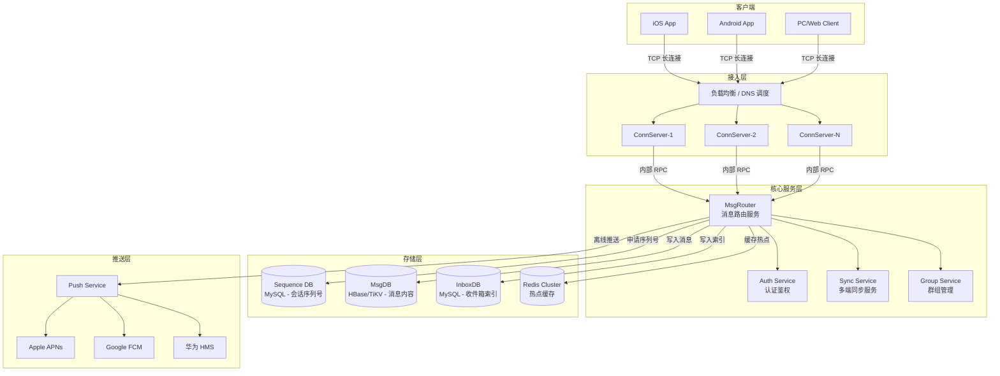
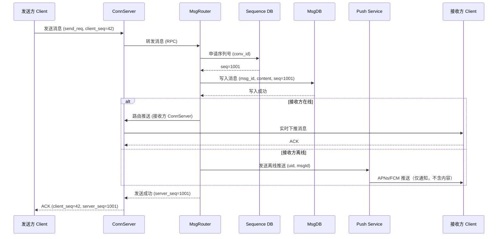
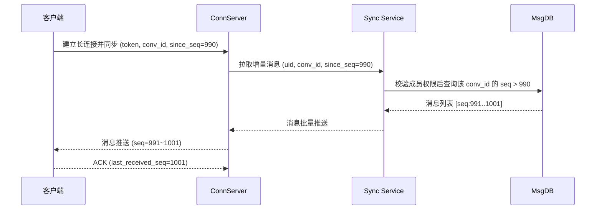
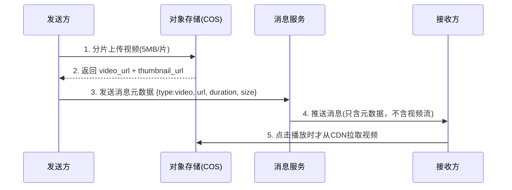
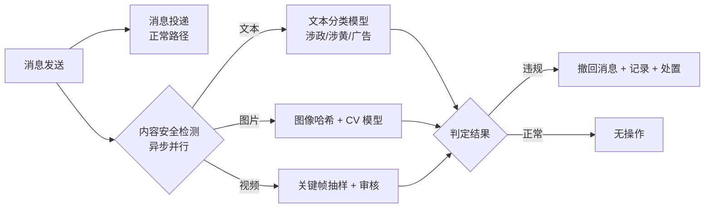

# 微信消息系统设计

> **练习场景：** 大规模即时通讯系统设计，适合高级后端方向。

## 题目背景

**模拟题目：**

> "请设计一个类似微信的即时通讯系统，支持单聊和群聊，要求消息实时送达、不丢失、有序。请从架构层面讲解你的设计思路，并重点讨论消息存储和顺序保证方案。"

**业务背景：**

本例以类似微信的单聊、群聊、消息推送和多端同步需求展开设计，考察网络连接管理、消息可靠传输、存储与在线状态处理。下文规模、容量、阈值和技术选型均为教学假设，不是微信公开运营数据、内部架构披露或特定公司的真实面试记录。

**统一估算口径：**

- 日活跃用户（DAU）：假设 9 亿，每人每天发送 11 条，99 亿条向上取整为 100 亿条/天
- 消息量按发送请求计数，不含接收端投递、群聊写扩散、重试和历史读取
- 峰值系数：4；平均发送 QPS 约 11.6 万，峰值约 46.3 万
- 消息记录平均 1 KB，按十进制容量单位估算，不含媒体原文件、索引、日志和额外元数据
- 峰值同时在线连接数：另行假设 1 亿，不从 DAU 直接推导在线率
- 在线投递延迟目标：P99 < 500ms，不是平均延迟，也不适用于离线用户
- 可靠性目标：在约定故障模型内恢复已持久化确认的消息，至少一次投递配合幂等去重；会话内按已提交序列号排序

---

## 关键指标估算

| 指标 | 估算过程 | 结果 |
|------|----------|------|
| 日活用户 | 题设假设 | 9 亿 DAU |
| 每日消息量 | 9 亿 × 11 条 = 99 亿，向上取整 | 100 亿条/天 |
| 发送 QPS（均值） | 100 亿 ÷ 86,400 | 约 115,741 次/s |
| 发送 QPS（峰值） | 100 亿 ÷ 86,400 × 4 | 约 462,963 次/s |
| 消息存储（单日新增） | 100 亿 × 1 KB | 10 TB/天 |
| 长连接数量（峰值） | 独立的同时在线连接数假设 | 1 亿个 TCP 连接 |
| ConnServer 最少数量 | 假设压测容量为 50 万连接/实例，1 亿 ÷ 50 万 | 200 台，不含冗余 |
| ConnServer 规划数量 | 最少数量 × 2 倍容量余量 | 400 台，仍需校验带宽、CPU 与故障切换 |
| 在线消息 P99 延迟目标 | 包含网络 + 存储 + 路由 | < 500ms |

发送吞吐不能直接当成系统总 QPS。收件箱更新、群成员投递、ACK、重试与拉取需要按各自的放大系数单独估算；50 万连接/实例也只是规划输入，必须用目标 TLS、心跳、消息负载与内存配置压测验证。

**存储容量规划：**

```
单日新增：100亿条 × 1KB = 10TB/天
假设保留3年：10TB × 365 × 3 = 10.95PB
3副本：10.95PB × 3 = 32.85PB
假设压缩后为原体积0.5：32.85PB × 0.5 = 16.425PB
```

密文和已经压缩的媒体通常难以再压缩，0.5 只能作为对比假设，不能直接用于生产承诺。实际规划还需计入索引、媒体、备份、迁移余量和数据保留政策。

---

## 高层架构



**架构层次说明：**

1. **接入层（ConnServer）**：维护客户端的 TCP 长连接，只负责连接管理和消息收发，不做业务逻辑。
2. **路由层（MsgRouter）**：负责消息的路由、序列号分配、存储写入和推送分发，是核心业务模块。
3. **存储层**：按职责拆分为 Sequence DB（序列号）、MsgDB（消息内容）、InboxDB（收件箱索引）三类。
4. **推送层**：处理离线用户的第三方通道推送（APNs / FCM / HMS）。

---

## 核心设计决策

### 决策一：连接协议选型

**方案对比：**

| 方案 | 优点 | 缺点 |
|------|------|------|
| WebSocket | 标准协议，浏览器原生支持，研发成本低 | 需设计应用心跳、重连与代理兼容；帧头开销随长度和掩码变化 |
| XMPP | 开源协议，生态成熟 | XML 格式冗余，在移动端带宽消耗高，扩展性差 |
| HTTP 长轮询 | 部署兼容性较好，服务端可在消息到达时返回 | 反复建立请求增加开销，时延取决于超时、重试和调度 |
| **私有二进制协议** | 可定制帧格式、压缩、连接复用与心跳 | 需维护协议兼容、安全实现与浏览器接入，研发成本高 |

**本例方案：原生客户端使用 TLS 上的应用二进制协议，浏览器入口使用 WebSocket。**

取舍依据：
- 两种接入都需要根据网络条件测量 NAT 空闲超时，并设计带抖动的重连退避
- 二进制编码是否节省流量取决于消息分布，不能预设固定压缩收益
- 单连接可承载多会话消息，安全传输优先使用成熟的 TLS 实现，不自行设计加密协议
- 私有协议不是天然比 WebSocket 更容易穿透 NAT；未证明收益时可以优先采用标准协议

**心跳机制：**

```
心跳周期：按网络类型和测得的空闲超时选择，低于连接失效阈值
离线判定：结合连续心跳丢失、传输错误和业务活动，不依赖单次超时
后台状态：遵守操作系统后台限制，无法维持连接时使用推送通知后拉取
```

### 决策二：消息时序保证

**核心问题**：分布式系统中如何保证同一会话内消息严格有序？

**方案对比：**

| 方案 | 优点 | 缺点 |
|------|------|------|
| 全局唯一时间戳（机器时钟） | 实现简单 | 时钟漂移导致乱序，不可靠 |
| Snowflake ID | 在节点配置与时钟条件满足时提供唯一 ID，整体趋势递增 | 不能保证跨节点生成的同一会话消息按提交顺序严格递增 |
| 全局递增 Sequence ID | 全局严格有序 | 单点瓶颈，写入性能受限 |
| **会话级递增 Sequence ID** | 每个会话独立计数，避免全局热点；满足会话内有序 | 多会话之间无法比较顺序（业务上无需） |

**本例方案：每个会话独立递增的 Sequence ID，不追求全系统全局顺序。**

具体实现：
- 为每个会话（单聊 conversation_id = min(uid_a, uid_b) + ":" + max(uid_a, uid_b)）在 MySQL 中维护一个 `max_seq` 计数器
- 在同一数据库连接、同一个事务中更新并读取计数器，利用行锁防止其他请求在两步之间改变结果；会话创建时先初始化计数器行，并检查 UPDATE 确实命中一行
- 群聊同理，每个群维护独立序列号

```sql
START TRANSACTION;

UPDATE conversation_seq 
SET max_seq = max_seq + 1 
WHERE conversation_id = 'conv:uid1:uid2';

SELECT max_seq FROM conversation_seq 
WHERE conversation_id = 'conv:uid1:uid2';

COMMIT;
```

**为什么不用 Redis INCR？**

Redis INCR 可以提供单实例原子递增，但还需讨论持久化、故障转移和热点。MySQL 方案同样需要明确提交持久性与故障切换策略，异步复制不自动保证已确认写入零丢失。

本例的 Sequence DB 与 MsgDB 是不同存储，不能放进一个 MySQL 本地事务。即使分片键相同，也不能消除跨存储边界。序列号分配后消息写入失败可能留下空洞；同步协议应处理已提交消息和失效序列号，不能永久等待每一个整数。如果要求分配与消息写入原子提交，应选择同一事务存储或按会话串行提交的持久日志，并重新评估吞吐。

### 决策三：消息存储模型（收件箱模型 vs 发件箱模型）

**发件箱模型（Write-on-Read）：**
- 消息写入发送方 outbox
- 接收方读取时，聚合所有联系人的 outbox
- 缺点：读放大严重（N个联系人 = N次读）

**写扩散（Fanout-on-Write）：**
- 消息写入时，同时写入所有接收方的 inbox
- 读取时直接读自己的 inbox
- 缺点：群聊写放大（1000人群 = 1000次写）

**本例方案：收件箱模型（单聊） + 有限写扩散（群聊）。**

单聊消息存储结构：
```
MsgDB（消息内容，按 conversation_id 分片）：
  msg_id        BIGINT PRIMARY KEY    -- 全局唯一，Snowflake 生成
  conversation_id VARCHAR             -- 会话 ID
  sender_uid    BIGINT
  content       BLOB                  -- 加密内容
  msg_type      TINYINT               -- 1=文本 2=图片 3=语音
  created_at    BIGINT                -- 发送时间戳（毫秒）
  seq           BIGINT                -- 会话内序列号

InboxDB（收件箱索引，按 uid 分片）：
  uid           BIGINT
  conversation_id VARCHAR
  last_msg_id   BIGINT
  unread_count  INT
  updated_at    BIGINT
```

消息只存一份（MsgDB），InboxDB 只存指向关系。接收方通过 InboxDB 找到 conversation_id，再到 MsgDB 拉取具体消息内容。

### 决策四：离线消息推送

**在线用户：** ConnServer 直接将消息下推到 TCP 连接，无需经过第三方推送。

**离线用户推送策略：**

```
1. MsgRouter 检查用户是否在线（查路由表）
2. 若离线，向 Push Service 发送推送任务
3. Push Service 发送"信封式"通知：只推送 msgId（不含内容）
4. 用户点击通知 → App 启动 → 建立长连接 → 主动拉取未读消息
```

**为什么不直接推消息内容？**

- 隐私考虑：推送服务不需要收到消息正文。本例基础方案采用传输加密与受控的服务端存储；端对端加密作为后文的独立扩展讨论，不据此声称微信默认使用端对端加密
- 可靠性：用户在离线期间可能收到 N 条消息，只需推一次"你有新消息"即可，避免 APNs 推送超限（iOS APNs 限制连续推送会被合并）
- 幂等：App 启动后统一拉取，不依赖推送数量

### 决策五：已读回执

**方案：** 服务端维护 `ack_seq`，客户端定时上报

```
客户端维护：last_read_seq（本地记录已读到哪一条）
服务端维护：ack_seq_table(uid, conversation_id, ack_seq)

上报时机：
    - 用户打开会话后，上报本地实际已展示或确认读过的最高连续 seq
  - 每 3 秒批量上报一次，而非每条消息都 ack
```

**已读人数（群聊）：**

对于群聊已读人数，服务端维护 `msg_read_count(msg_id, read_uid_list)`，发送方可查询，但不会实时推送给所有成员（避免推送风暴）。

---

## 详细设计

### 消息发送时序



### 消息接收拉取时序



### 数据模型

以下 DDL 使用 MySQL 语法表达逻辑字段与索引，不可直接在 HBase 或原生 TiKV 上执行；采用它们时需映射成对应的行键或 KV 布局。消息与收件箱位于不同存储时，需通过可靠事件与重试更新索引。

```sql
CREATE TABLE messages (
    msg_id          BIGINT NOT NULL,          -- Snowflake ID
    conversation_id VARCHAR(64) NOT NULL,      -- 会话 ID
    sender_uid      BIGINT NOT NULL,
    receiver_uid    BIGINT,                    -- 单聊时有值，群聊为 NULL
    group_id        BIGINT,                    -- 群聊时有值
    content         BLOB,                     -- 消息体或媒体元数据
    msg_type        TINYINT NOT NULL,          -- 1=文本 2=图片 3=语音 4=视频 5=文件
    seq             BIGINT NOT NULL,           -- 会话内序列号
    created_at      BIGINT NOT NULL,           -- 发送时间戳（毫秒）
    is_recalled     TINYINT DEFAULT 0,         -- 是否撤回
    PRIMARY KEY (msg_id),
    INDEX idx_conv_seq (conversation_id, seq)
);

-- 会话序列号表（MySQL，专门用于序列号分配）
CREATE TABLE conversation_seq (
    conversation_id VARCHAR(64) PRIMARY KEY,
    max_seq         BIGINT NOT NULL DEFAULT 0,
    updated_at      BIGINT NOT NULL
);

-- 收件箱索引表（按 uid 分片，MySQL/TiDB）
CREATE TABLE user_inbox (
    uid             BIGINT NOT NULL,
    conversation_id VARCHAR(64) NOT NULL,
    last_msg_id     BIGINT NOT NULL,
    last_msg_seq    BIGINT NOT NULL,
    unread_count    INT NOT NULL DEFAULT 0,
    updated_at      BIGINT NOT NULL,
    PRIMARY KEY (uid, conversation_id),
    INDEX idx_uid_updated (uid, updated_at DESC)
);

-- 用户路由表（ConnServer 地址映射，Redis 存储）
-- Key: "conn:uid:{uid}" → Value: "connserver-ip:port"
-- TTL: 随心跳刷新，过期即视为离线
```

**conversation_seq 分片数量推导：**

| 参数 | 计算 | 结果 |
|------|------|------|
| 日消息量 | 与前文一致的发送请求假设 | 100 亿条/天 |
| 峰值 seq 分配 QPS | 100 亿 ÷ 86,400 × 4，每条消息分配一次 | **约 462,963 次/s** |
| 单 MySQL 分片承载能力（含行锁） | 题设假设，需在目标负载下压测 | 2,000 次/s |
| 最少分片数 | ceil(462,963 ÷ 2,000) | **232 个分片** |
| 规划容量（2× 余量） | 232 × 2 | **464 个分片** |

本例可用 `hash(conversation_id) % 464` 表达初始路由，扩缩容时应使用路由表或虚拟分片避免整体重映射。该数量只满足均匀负载下的总吞吐假设，不能解决单个超热点会话的行锁瓶颈，也不代表需要部署 464 台独立物理机器。重试、索引、复制和存储压力还需另算。

### 核心 API 接口

```protobuf
// 发送消息
rpc SendMessage(SendMessageRequest) returns (SendMessageResponse) {}

message SendMessageRequest {
    string  conversation_id = 1;
    int64   sender_uid      = 2;
    bytes   content         = 3;   // 加密内容
    int32   msg_type        = 4;
    int64   client_msg_id   = 5;   // 客户端生成，用于幂等去重
}

message SendMessageResponse {
    int64  server_msg_id   = 1;
    int64  server_seq      = 2;
    int64  server_timestamp = 3;
    int32  status          = 4;   // 0=success
}

// 拉取历史消息
rpc GetMessages(GetMessagesRequest) returns (GetMessagesResponse) {}

message GetMessagesRequest {
    string conversation_id = 1;
    int64  since_seq       = 2;   // 从哪个序列号开始拉取
    int32  limit           = 3;   // 最多拉取条数，默认20
}
```

### 视频消息发送流程

普通文本消息和视频消息走不同路径，视频消息的核心是**解耦媒体传输和消息元数据传输**：



关键设计点：
- **分片上传**：视频按 5MB 分片，支持断点续传（记录已上传分片的 etag），网络中断后续传
- **异步转码**：上传完成后触发异步转码任务（1080p/720p/360p 三路），原视频立即可播，低分辨率版本就绪后替换
- **消息只传 URL**：IM 消息体仅存 `{video_url, thumbnail_url, duration_ms, file_size}`，不传视频内容，避免 IM 消息队列被大文件堵塞
- **CDN 预热**：热门视频（群发、转发量大）触发 CDN 预热，避免首播回源

---

## 失败场景与工程权衡 {#踩过的坑-生产经验}

### 坑一：消息重复投递（客户端 ACK 超时触发重传）

**问题描述：**

客户端发送消息后，等待服务端 ACK，若 ACK 超时（网络抖动），客户端会重传该消息。此时服务端可能已成功写入了第一次请求，重传导致消息出现两条完全相同的内容。

**解决方案：**

基于 `(sender_uid, client_msg_id)` 的持久幂等约束保证重复请求返回同一结果，Redis 仅作为查询缓存。下面是流程伪代码，存储接口必须原子处理幂等键和消息提交，不能把“先查缓存、再写消息”当作并发去重保证：

```python
# 服务端处理逻辑
def handle_send_message(req):
    # 1. 先查 Redis 幂等缓存（TTL 10分钟）
    cache_key = f"msg_idem:{req.sender_uid}:{req.client_msg_id}"
    cached = redis.get(cache_key)
    if cached:
        # 已处理过，直接返回之前的结果
        return parse_response(cached)
    
    response = message_store.commit_once(
        sender_uid=req.sender_uid,
        client_msg_id=req.client_msg_id,
        request=req,
    )
    
    # 3. 写入幂等缓存
    redis.setex(cache_key, 600, serialize(response))
    
    return response
```

**client_msg_id 生成规则：** 客户端可生成 UUID 并在同一发送请求的所有重试中复用；服务端对幂等键实施持久唯一约束，并校验重复键的请求内容一致。随机 ID 的低碰撞概率不等于绝对唯一，缓存 TTL 也不应限定整个去重保证。

### 坑二：网络闪断导致消息乱序

**问题描述：**

用户网络出现 1 秒抖动，客户端断线重连后，ConnServer 可能将这 1 秒内积压的消息和新消息混合推送，导致客户端显示消息乱序。

**解决方案：**

客户端维护本地消息 `seq` 顺序队列，所有收到的消息先放入 pending buffer，等待按 seq 排序后再渲染：

```javascript
class MessageBuffer {
    constructor() {
        this.buffer = new Map(); // seq -> message
        this.nextExpectedSeq = null;
    }

    onMessageReceived(msg) {
        if (!this.nextExpectedSeq) {
            this.nextExpectedSeq = msg.seq;
        }
        this.buffer.set(msg.seq, msg);
        this.flushOrdered();
    }

    flushOrdered() {
        while (this.buffer.has(this.nextExpectedSeq)) {
            const msg = this.buffer.get(this.nextExpectedSeq);
            this.buffer.delete(this.nextExpectedSeq);
            this.renderMessage(msg); // 按序渲染
            this.nextExpectedSeq++;
        }
    }
}
```

若 5 秒内 pending buffer 中出现 seq 空洞（某条消息迟迟未到），则主动向服务端拉取该 seq 的消息（防止永久卡住）。

### 坑三：群聊消息写扩散的数据库热点

**问题描述：**

一个 500 人的群发送一条消息，InboxDB 需要写入 500 条索引记录，若瞬时有 1000 个群同时活跃，每秒写入压力 = 1000 × 500 = 50 万 IOPS。

**解决方案：**

1. 群聊改用 MQ 异步写扩散（Kafka 批量消费，攒批写入，降低 IOPS）
2. 超大群（>500人）改为读扩散：成员读取时主动去拉群消息 timeline，不预写 inbox
3. InboxDB 写入合并（同一 uid 在同一批次内的更新合并为一次 UPSERT）

### 坑四：消息撤回的最终一致性

**问题：** 消息发出后 2 分钟内可撤回，但接收方可能已经在本地缓存了该消息内容。

**方案：**
- 服务端将 `is_recalled` 置为 true，内容字段清空
- 通过长连接向所有在线的接收方推送"撤回事件"（包含 msg_id）
- 接收方客户端收到撤回事件后，将本地该条消息替换为"对方撤回了一条消息"
- 离线接收方上线时，通过 sync 接口拉取时自然看到已撤回状态

**撤回消息对离线用户的处理：**

撤回推送可能无法送达离线用户，需在**消息同步 API** 层处理：

```json
// 用户上线后拉取离线消息，sync API 返回
{
  "messages": [
    {
      "msg_id": "msg_123",
      "is_recalled": true,      // 服务端标记撤回状态
      "recalled_at": 1704067200,
      "content": null           // 已撤回，不返回内容
    }
  ]
}
```

关键：服务端维护 `recalled_msg_ids` Set，`sync` 接口查询消息列表时合并撤回状态——**即使撤回通知未送达，客户端在下次同步时也能正确渲染"消息已撤回"**。

---

## 扩展考点

### 追问方向

**1. 如何实现端对端加密（E2E Encryption）？**

- 使用 Signal Protocol（双棘轮算法），每个会话独立密钥
- 服务端只存储密文，无法解密
- 密钥通过设备公钥在端侧协商，服务端只做密钥分发（不存储私钥）
- 注意：E2E 加密与消息云备份矛盾，需要用户自行导出密钥备份

**2. 如何设计群聊（万人群）？**

- 群聊消息改用读扩散（拉模型）：消息只写入一份群 timeline
- 成员读取时携带 `last_sync_seq`，服务端返回增量消息
- 写扩散上限（<500人）用于小群，保证实时性；超大群用读扩散，允许轻微延迟

**3. 多端同步如何保证一致性？**

- 每个设备维护独立的 `last_sync_seq`（存在 ConnServer Session 中）
- 设备登录时上报本地 `last_sync_seq`，服务端推送所有 seq > last_sync_seq 的消息
- 已读状态通过专门的 `read_ack_seq` 同步，保证多端已读状态一致

**4. 消息全文搜索如何实现？**

- 消息索引走独立的 Elasticsearch 集群
- 因为消息是加密的，E2E 加密消息无法服务端搜索（只能客户端本地搜索）
- 普通消息（服务端加密）写入时异步投递到 ES，按 uid + 关键词检索

### AI 内容安全的设计边界 {#ai-内容安全-2024-年监管要求}

下面讨论服务端能处理明文内容的教学方案，不描述微信内部审核流程，也不推断具体监管要求。同步拦截还是异步检测，取决于风险、时延目标与适用规则，需由法务和安全团队确认；不能把“先投递后撤回”视为普遍合规保证。端对端加密场景下，服务端不能直接沿用这套明文检测和转码流程。

**异步并行检测架构：**



- **同步检查**：适用的确定性规则在入队前执行，明确拒绝、误报申诉与故障降级策略
- **异步检测**：只用于风险策略允许延迟处理的内容；撤回前可能已被读取或转发，不能保证消除已发生的影响
- **人工复核**：根据经校准的模型结果和风险等级分流，响应时限由业务与合规要求决定，不使用未经验证的统一置信度区间或时间承诺

### 边界 Case

| Case | 处理方式 |
|------|----------|
| 消息发送时接收方账号被注销 | 消息写入 MsgDB，InboxDB 写入失败不影响发送方；定期清理已注销用户的 inbox |
| 超大文件消息（>500MB 视频） | 走独立文件上传流程，消息只存文件 URL + 缩略图，实际内容放对象存储 CDN |
| 网络分区期间消息堆积 | ConnServer 恢复后批量推送积压消息，客户端按 seq 排序；服务端设置积压上限（5 万条/用户），超出截断并提示 |
| 消息炸弹（恶意高频发消息） | 服务端限流：单 uid 发送 QPS 限制 10 条/秒，超限返回 429；ConnServer 层令牌桶限流 |
| 时区问题（跨国消息） | 所有时间戳统一用 UTC 毫秒级时间戳存储，客户端根据本地时区转换显示 |

### 演进路径

```
Phase 1（MVP）：
  - 单机 ConnServer + MySQL 存储
  - 简单轮询（无长连接）
  - 适合 10 万 DAU

Phase 2（水平扩展）：
  - ConnServer 集群 + ZooKeeper 路由注册
  - MySQL 主从分离 + 读写分离
  - 适合 1000 万 DAU

Phase 3（大规模）：
  - Kafka 异步写扩散 + HBase 消息存储
  - 多机房部署 + 同城双活
  - 适合 1 亿 DAU

Phase 4（超大规模，教学扩展方向）：
  - 私有协议 + 自研存储引擎
  - 全球多活 + 区域就近接入
  - 适合 10 亿 DAU
```

### 背压控制说明

**背压控制**：当消息队列堆积超过阈值时，ConnServer 停止从 MsgRouter 拉取新消息，并向客户端返回 503，触发客户端指数退避重连。

### 监控与告警指标

| 指标 | 类型 | 告警阈值 | 说明 |
|------|------|---------|------|
| `connserver_active_connections` | Gauge | 本例容量假设下 > 35万/实例评估扩容 | 50万连接压测容量的 70%，需结合带宽、CPU 与故障余量 |
| `message_delivery_success_rate` | Counter | < 99.9% 触发告警 | 消息投递成功率，低于阈值排查 MsgRouter |
| `kafka_consumer_lag{topic="msg-ack"}` | Gauge | > 10万 触发告警 | 消费堆积，说明入库服务跟不上 |
| `sequence_db_lock_wait_time_ms` | Histogram | P99 > 50ms 触发告警 | Seq 服务锁等待，影响消息时序 |
| `message_e2e_latency_ms` | Histogram | P99 > 500ms 触发告警 | 端到端投递延迟（发送方→接收方） |
| `offline_push_failure_rate` | Counter | > 5% 触发告警 | APNs/FCM 推送失败率 |

---

## 面试评分维度

| 维度 | 基础分（60分） | 加分项（80+分） | 满分项（100分） |
|------|----------------|-----------------|-----------------|
| **连接管理** | 能说出长连接的必要性，提到 WebSocket | 对比分析 WebSocket vs 私有协议的优劣，提到心跳机制和 NAT 超时 | 说明心跳测量、重连退避、连接复用与背压的取舍 |
| **消息时序** | 提到用时间戳排序 | 指出时间戳的问题，提出 Sequence ID 方案 | 区分全局序列号 vs 会话级序列号的权衡，说明 MySQL 原子更新实现 |
| **消息存储** | 能设计基本的消息表结构 | 区分 MsgDB（内容） vs InboxDB（索引），提到消息只存一份 | 详细说明收件箱模型、写扩散/读扩散权衡，按 conversation_id 分片策略 |
| **可靠性** | 知道需要 ACK 确认 | 说明重传机制和 client_msg_id 幂等去重 | 完整的消息可靠性闭环：发送确认 + 重传 + 幂等 + 顺序重排 |
| **离线推送** | 知道 APNs / FCM | 说明只推 msgId 不推内容的原因 | 说明通知合并、App 启动后拉取增量消息的完整流程 |
| **扩展性思考** | 能提到水平扩展 ConnServer | 说明 Kafka 异步写扩散降低数据库压力 | 完整讨论群聊写扩散/读扩散阈值、多机房同城双活方案 |
